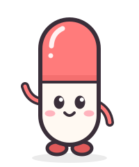
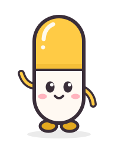
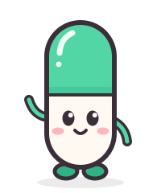
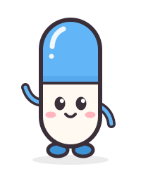

# 💊 Pill Object Detection

## 📑 Project Overview
이 프로젝트는 경구약제 이미지 인식 기능을 이용해 사용자가 알약 사진을 올리면 그 사진 안에 무슨 알약이 있는 지 보여주고, 알약의 효능 및 효과, 용법 및 용량, 그리고 복용 시 주의사항을 알려줍니다. 더 세부적인 정보를 알고싶은 사용자들을 위해 약학정보원으로 바로가는 링크를 제공합니다. 

> 🔗 **서비스 바로가기**
>
> [Hugging Face Space: Pill Detection 바로가기](https://huggingface.co/spaces/relukang/pill-object-detection)

> 🖼️ **서비스 미리보기**
> 
> 

- 복용 정보는 [식의약 데이터 포털 공공API](https://www.data.go.kr/data/15095677/openapi.do)를 통해 제공합니다.

## 📊 DataSet Overview
본 프로젝트는 [Kaggle 대회](https://www.kaggle.com/competitions/ai15-level1-project/data)와 [AI Hub에서 제공하는 공개 데이터셋](https://aihub.or.kr/aihubdata/data/view.do?dataSetSn=576)에서 제공하는 데이터를 혼합해서 활용했습니다. 
- 제공된 데이터에서 EDA를 통해 라벨 오류를 제거하고, 형식을 통일해 데이터 퀄리티를 확보했습니다. 

> **활용한 데이터 규모**
>
> | 구분 | Kaggle 대회 데이터 | AI Hub 데이터 | 총합 | 클래스 수 |
> | --- | ---: | ---: | ---: | ---: |
> | train | 185장 / 612개 | 11,021장 / 42,188개 | 11,206장 / 42,800개 | 118 |
> | val | 47장 / 159개 | 953장 / 3,631개 | 1,000장 / 3,790개 | 96** |
> | test | 842장 / 3,229개* | - | 842장 / 3,229개* | 74* |
> * test 정답은 공개되지 않아, 객체 수는 팀이 자체 파악한 추정치입니다.
> * *\* 채점 대상인 대회 클래스 74개와 채점하지 않는 AI Hub 전용 클래스 22개를 합친 수입니다.

> **클래스 별 객체 수 분포**
> 

> **데이터에서 겪은 어려움**
>
> - **학습 데이터 부족**: 대회가 제공한 학습 사진은 232장이고, 클래스 56종 중 17종은 등장 빈도가 3번뿐이었습니다. 따라서 AI Hub 조합 데이터로 보충했습니다.
> - **test에만 나오는 알약 18종**: 학습 데이터에 없는 알약 18종이 test 사진의 39.8%에 나와, 대회 데이터만으로는 점수 상한이 56/74 ≈ 0.76이었습니다. test 사진을 직접 대조해 18종을 찾고, AI Hub에서 각인을 대조해 모두 보충했습니다.
> - **심한 클래스 불균형**: 대회 데이터에서 한 클래스(K-003351)가 전체의 20.4%를 차지했고, 클래스별 객체 수가 최대 52배 차이 났습니다. AI Hub 조합 데이터로 보충해 이를 보완했지만, 여전히 최대 30배 차이가 남았습니다.
> - **라벨 오류**: 대회 데이터에서 annotation 21개(사진 19장)에 bbox가 누락, bbox 좌표가 이미지 밖으로 나감, 클래스 매칭 오류 같은 오류가 있어서 이를 고치고, AI Hub 조합 데이터에서도 라벨 약 1,100개를 고치고 쓸 수 없는 사진 35장을 뺐습니다. 원본은 그대로 두고 수정 내역을 정제 목록 CSV에 기록했습니다.
> - **같은 조합을 세 각도로 촬영**: 제공받은 데이터는 같은 알약 묶음을 70°·75°·90°에서 찍은 이미지로 구성되어있었습니다. **사진 단위**로 나누면 val 사진의 76%가 train에서 등장한 조합이어서 누수의 위험이 있었습니다. 따라서 **조합 단위**로 나눠 train과 val에 같은 조합이 들어가지 않게 했습니다.

## 🧪 Experiment Pipeline
원본 데이터는 건드리지 않고, 정제 목록을 csv로 만들어 버전관리하고, train/val 분할은 csv로 고정해 버전관리하고, 채점 코드는 하나로 고정했습니다. 

> **실험 파이프라인 다이어그램**
>
> 

## 🧠 Results

<h3 align="center"><i>Public Leader Board</i></h3>

<table align="center">
  <tr>
    <th width="100">순위</th>
    <th width="90">팀이름</th>
    <th width="230">팀멤버</th>
    <th width="170">mAP@[0.75:0.95]</th>
    <th width="90">제출횟수</th>
    <th width="90">최종 제출</th>
  </tr>
  <tr align="center">
    <td><b>1</b></td>
    <td>team2</td>
    <td>
      
      
      
      
    </td>
    <td>0.63390</td>
    <td>55</td>
    <td>2026-11-05</td>
  </tr>
</table>

<h3 align="center"><i>Private Leader Board</i></h3>

<table align="center">
  <tr>
    <th width="100">순위</th>
    <th width="90">팀이름</th>
    <th width="230">팀멤버</th>
    <th width="170">mAP@[0.75:0.95]</th>
    <th width="90">제출횟수</th>
    <th width="90">최종 제출</th>
  </tr>
  <tr align="center">
    <td><b>2</b></td>
    <td>team2</td>
    <td>
      
      
      
      
    </td>
    <td>0.59225</td>
    <td>55</td>
    <td>2026-11-05</td>
  </tr>
</table>

| 계열 | 최종 run | Kaggle public | 추론 시간 (ms/장) | 파라미터 |
| --- | --- | ---: | ---: | ---: |
| YOLO26s | 2차 v3 e20 (`v3_yolo26s_e20_s0`) | **0.6339** | 16.0 ± 0.3 ms/장 (62 FPS)| 948만 |
| RT-DETR-l | 2차 v4 e5 (`v4_rtdetr-l_e5`) | 0.6156 | 76.0 ± 1.5 ms/장 (13 FPS) | 3,223만 |
| Faster R-CNN (R50-FPN) | 3차 v3 rfs e9 (`v3_frcnn_exp3_rfs_e9_s0`) | 0.6141 | 89.5 ± 0.3 ms/장 (11 FPS) | 약 4,176만 |

- 최종 run은 모델마다 Kaggle public 점수가 가장 높은 제출을 기준으로 선정했습니다.
- 추론 시간은 T4, 입력 640, 배치 1, 점수 하한 0.01, 5회 평균으로 측정했습니다.

## 👥 Teams

<table align="center">
  <tr align="center">
    <td></td>
    <td></td>
    <td></td>
    <td></td>
  </tr>
  <tr align="center">
    <td><a href="https://github.com/raewoo0908" target="_blank">강래우</a></td>
    <td><a href="https://github.com/Chaeyoung42" target="_blank">이채영</a></td>
    <td><a href="https://github.com/chaejeong0115" target="_blank">이채정</a></td>
    <td><a href="https://github.com/JaeoneIm" target="_blank">임재원</a></td>
  </tr>
  <tr align="center">
    <td>팀장·데이터 분석·파이프라인 설계·전처리·데모</td>
    <td>데이터 분석·모델 개발(YOLO26s)</td>
    <td>데이터 분석·모델 개발(Faster R-CNN)</td>
    <td>데이터 분석·모델 개발(RT-DETR-l)</td>
  </tr>
</table>

## 📂 Project Structure

```text
pill-object-detection/
├── data/                      # raw·processed·external은 폴더만 git으로 관리하고 내용은 추적하지 않음
│   ├── raw/                   # Kaggle 원본 데이터. 내려받은 그대로 두고 수정하지 않음
│   ├── external/aihub/        # AI Hub 외부 데이터. 내려받은 그대로 두고 수정하지 않음
│   │   ├── raw/               # zip을 풀어 둔 원본. raw/와 같은 구조 (train_annotations, train_images)
│   │   └── sources.csv        # 파일마다 나온 zip 이름
│   ├── processed/             # 가공 결과. 학습 데이터 사본, 2차 실험 방법별 학습 폴더(exp2/)
│   │   ├── train_annotations/ # Kaggle 정제 사본 (이미지는 data/raw/train_images를 씀)
│   │   └── ai_hub/            # AI Hub 정제 사본. train_annotations, train_images(원본 PNG의 하드링크)
│   ├── datasets/              # 2차 실험 목록 CSV(images.csv, classes.csv)와 설명. git으로 관리함
│   └── label_fix/             # 정제 목록(label_fixes.csv)과 변경 기록 CSV. git으로 관리함
├── notebooks/                 # 개인 탐색용 노트북
│   ├── eda/                   # 개인 EDA 노트북
│   └── modeling/              # 각자 맡은 모델링 노트북. 실험별 폴더(exp2/, exp3/)로 나눔
├── src/pill_detection/        # 공용 코드 패키지 (노트북·스크립트·데모 어디서든 import)
│   ├── data.py                # 데이터 읽기, 정제 목록대로 학습 데이터 사본 만들기
│   ├── balance.py             # 3차 실험 클래스 불균형 대응: 오버/언더샘플링 목록, 클래스별 손실 가중치, 불균형 지표
│   ├── datasets.py            # 2차 실험 목록 CSV와 방법별 학습 폴더(YOLO, COCO) 만들기
│   ├── evaluate.py            # 2차 val 채점(mAP@[0.75:0.95])과 Kaggle 제출 CSV 변환
│   └── utils.py               # 공용 보일러 플레이트 코드.(bbox 변환, 시각화 등) 
├── scripts/                   # 터미널에서 실행하는 스크립트 (uv run scripts/<이름>.py)
│   ├── prepare_train_data.py  # 학습 데이터 준비: AI Hub 받기·풀기, 정제, 변경 기록을 한 번에
│   ├── download_aihub.py      # AI Hub에서 filekey로 zip 받기 (대회 금지 파일은 받지 않음)
│   ├── extract_aihub.py       # 받은 AI Hub zip을 풀고 지우기
│   ├── make_fixed_annotations.py  # AI Hub 없이 Kaggle 사본만 다시 만들기
│   ├── make_dataset_lists.py  # 2차 실험 목록 CSV 만들기. 팀원은 --check로 내 데이터가 같은지만 확인
│   └── build_dataset.py       # 목록 CSV대로 방법(v1~v4)별 학습 폴더 만들기
├── demo/                      # 데모 웹페이지(Gradio). 실행·배포 방법은 SETUP.md 데모 절
│   ├── app.py                 # 진입점: uv run demo/app.py
│   ├── predict.py             # 환경 변수로 고른 가중치 로드(YOLO·RT-DETR·Faster R-CNN), 공통 예측 형식
│   ├── drug_info.py           # 클래스 표·허가정보 캐시 읽기, 약학정보원 검색 URL
│   ├── draw.py                # 한글 글꼴로 bbox·라벨 그리기
│   ├── build_drug_info.py     # 허가정보 캐시(drug_info.json) 만들기. 식약처 공공 API를 한 번 호출
│   ├── deploy_space.py        # HF Space에 코드·캐시·가중치 올리기
│   ├── drug_info.json         # 118개 클래스의 효능효과·용법용량·주의사항 캐시. git으로 관리함
│   ├── space/                 # HF Space용 README(설정 YAML), requirements.txt, packages.txt
│   └── fonts/                 # 나눔고딕 Bold(OFL)
├── tests/                     # 공용 코드 테스트 (uv run pytest)
├── runs/                      # 학습 결과
├── submissions/               # 제출 CSV
├── report/                    # 최종 보고서 (final_report.md, 그림은 figures/)
├── hooks/                     # pre-commit hook 스크립트
├── .github/                   # PR 템플릿, 이슈 상태 자동화(workflows/), README 이미지(assets/)
├── SETUP.md                   # 학습 데이터 준비, 스크립트 사용법, 데모 실행·배포
├── EXPERIMENTS.md             # 2차 실험 가이드: 학습 폴더, 학습, val 채점, 제출
└── CONTRIBUTING.md            # git·PR·커밋 협업 규칙
```

## 🧑‍💻 Dependencies
이 프로젝트의 환경은 uv로 관리됩니다. 

1. **uv 설치(최초 1회)**
    - macOS / Linux
        ```bash
        curl -LsSf https://astral.sh/uv/install.sh | sh          # macOS / Linux
        ```
    - Windows PowerShell
        ```powershell
        powershell ExecutionPolicy ByPass -c "irm https://astral.sh/uv/install.ps1 | iex"
        ```

2. **uv 설치 확인**
    ```bash
    uv --version
    ```

3. **레포를 받은 뒤 환경 생성**
    ```bash
    git pull origin main
    rm -rf .venv        # 기존 .venv(예: 3.14)가 있다면 삭제
    uv sync             # Python 3.12가 없으면 uv가 자동으로 받아서 설치함  
    uv run pre-commit install   # 최초 1회: 커밋 전 검사 hook 설치 (uv.lock 검사, nbstripout 설정)
    ```

4. **의존성 추가 시**
    ```bash
    uv add <패키지>
    ```
    | **NOTE**: `pip install`로 설치하지 않습니다. `uv.lock`에 기록되지 않아 다른 팀원 간 환경에 drift 발생함. 

> 환경을 만든 뒤 학습 데이터 준비, 스크립트 사용법, 데모 실행·배포는 [SETUP.md](SETUP.md)를 따릅니다.

## 📎 Deliverables

> 📹 **서비스 소개 유튜브 영상**
> 
> [YouTube 바로가기](https://www.youtube.com/watch?v=dUJKRc9mURE)
>
> <a href="https://www.youtube.com/watch?v=dUJKRc9mURE"></a>

> 📹**발표 유튜브 영상**
>
> [YouTube 바로가기](https://www.youtube.com/watch?v=bNRw7EGT0xk)
>
> <a href="https://www.youtube.com/watch?v=bNRw7EGT0xk"></a>

> 🎤 **발표자료 바로가기**
>
> [Google Drive 바로가기](https://drive.google.com/file/d/1PlH50c45ItooByb0JRnuINE506RuS4J3/view?usp=sharing)

> 👫 **팀 노션 바로가기**
>
> [Notion Team Page](https://app.notion.com/p/Project-1-3ff97c8cd42c804b9e95e74851c347f8?source=copy_link)
