# Faster R-CNN 1차 실험 결과

## 실험 및 평가 기준

| 항목 | 내용 |
| --- | --- |
| 모델 | Faster R-CNN ResNet50 FPN (torchvision) |
| 비교 실험 | 동일 데이터·설정의 seed 0·1·2 |
| 데이터 | 전체 232장: Train 185장 / Validation 47장 |
| 객체·클래스 수 | Train 612객체·56클래스 / Validation 159객체·30클래스 |
| 데이터 분할 seed | 410 |
| 학습 | COCO_V1 가중치에서 전체 미세조정, 정규화 고정 |
| Train batch | 16, 기울기 누적 1회, 마지막 batch 9장 |
| 최대 epoch·조기 종료 | 100 epoch, patience 30, early_stopping=True |
| 분석 checkpoint | 각 seed의 validation mAP가 가장 높은 best checkpoint |

## 1. 학습 과정 평가

### 1.1 Loss 곡선 시각화

*그림 1. 왼쪽부터 train loss, validation loss, validation mAP. 가로축은 metrics.csv에 기록된 epoch이며, 점과 점선은 각 seed의 best epoch다.*

| Seed | 실제 학습 epoch | Best epoch | Best validation mAP | Best 시점 train loss | Best 시점 val loss | 총 실제 optimizer step |
| --- | --- | --- | --- | --- | --- | --- |
| 0 | 100 | 91 | 0.933211 | 0.007371 | 0.087655 | 1198 |
| 1 | 100 | 90 | 0.928546 | 0.009215 | 0.114793 | 1198 |
| 2 | 100 | 81 | 0.917819 | 0.009562 | 0.105133 | 1197 |

Best는 해당 seed의 validation mAP가 가장 높은 checkpoint를 뜻한다. 모든 seed의 학습 로그는 1~100 epoch까지 기록되어 있다.

### 1.2 과적합·과소적합 판단

판단에 사용할 수치만 제시하며, 과적합·과소적합에 대한 해석은 추후 작성한다.

**후반 학습 추세와 수치 안정성**

| Seed | 후반 구간 | Train loss 기울기/epoch | Val loss 기울기/epoch | Val mAP 기울기/epoch | AMP 건너뛴 step | 유효하지 않은 수치 |
| --- | --- | --- | --- | --- | --- | --- |
| 0 | 81~100 | -8.33e-05 | -9.5e-06 | 0.0002511 | 2 | 0 |
| 1 | 81~100 | -6.67e-05 | 9.08e-05 | -0.0001485 | 2 | 0 |
| 2 | 81~100 | -6.85e-05 | -0.0001976 | -0.0005879 | 3 | 0 |

기울기는 마지막 20 epoch(81~100)의 기록에 직선을 맞춰 구한 epoch당 변화량이다. 아래 칸은 해석 작성 전까지 비워 둔다.

| 판단 항목 | 판단 내용 |
| --- | --- |
| 과적합 여부 | |
| 과소적합 여부 | |
| 학습 종료 시점 | |

## 2. 예측 성능 평가

### 2.1 Confusion matrix

- 각 seed의 best validation 예측을 사용한다.
- score ≥ 0.30의 예측을 남기고, **클래스와 무관하게 IoU가 큰 순서로 GT·예측을 일대일 연결**한다. 연결 최소 IoU는 0.75다.
- 행은 정답 클래스, 열은 예측 클래스다. 전체 혼동행렬은 56개 학습 클래스와 미매칭 항목을 포함한다.
- 전체 행렬은 정답 대각선을 포함한다. 오류 중심 행렬은 정답 대각선을 제외하고 오류가 발생한 클래스만 표시한다.
- 각 그림의 왼쪽은 건수, 오른쪽은 해당 클래스의 **전체 GT 객체 수** 대비 비율이다.
- 마지막 열의 미매칭은 연결되지 않은 GT, 마지막 행의 미매칭은 연결되지 않은 예측이다. GT가 없는 행과 미매칭 행의 비율은 비워 둔다.

#### Seed 0

*그림 2. Seed 0, best epoch 91. 정답 대각선을 포함한 전체 혼동행렬. score ≥ 0.30, IoU ≥ 0.75.*

*그림 3. Seed 0. 정답 대각선을 제외한 오류 중심 혼동행렬. 비율의 분모는 해당 클래스 전체 GT 객체 수다.*

#### Seed 1

*그림 4. Seed 1, best epoch 90. 정답 대각선을 포함한 전체 혼동행렬. score ≥ 0.30, IoU ≥ 0.75.*

*그림 5. Seed 1. 정답 대각선을 제외한 오류 중심 혼동행렬. 비율의 분모는 해당 클래스 전체 GT 객체 수다.*

#### Seed 2

*그림 6. Seed 2, best epoch 81. 정답 대각선을 포함한 전체 혼동행렬. score ≥ 0.30, IoU ≥ 0.75.*

*그림 7. Seed 2. 정답 대각선을 제외한 오류 중심 혼동행렬. 비율의 분모는 해당 클래스 전체 GT 객체 수다.*

### 2.2 mAP@[0.75, 0.95]

본문의 mAP@[0.75, 0.95]와 클래스별 AP@[0.75, 0.95]는 IoU 0.75·0.80·0.85·0.90·0.95에서 계산한 AP의 평균을 뜻한다. 저장 추론 score는 0.001이며, 단일 score 0.30의 혼동행렬·Precision·Recall과 구분한다.

| Seed | Best epoch | Best validation mAP | Best 시점 train loss | Best 시점 val loss | Best까지 실제 step |
| --- | --- | --- | --- | --- | --- |
| 0 | 91 | 0.933211 | 0.007371 | 0.087655 | 1090 |
| 1 | 90 | 0.928546 | 0.009215 | 0.114793 | 1078 |
| 2 | 81 | 0.917819 | 0.009562 | 0.105133 | 969 |

| Seed 수 | Best mAP 평균 | Best mAP 표본 표준편차 |
| --- | --- | --- |
| 3 | 0.926525 | 0.007892 |

**단일 score 기준의 Precision·Recall**

아래 표는 score ≥ 0.30, 매칭 IoU ≥ 0.75에서의 micro 집계다. 잘못된 클래스 매칭은 FP와 FN에 각각 포함한다. AP·mAP와 별도의 지표다.

| Seed | score | 매칭 IoU | TP | FP | FN | Precision | Recall |
| --- | --- | --- | --- | --- | --- | --- | --- |
| 0 | 0.3 | 0.75 | 145 | 28 | 14 | 0.83815 | 0.91195 |
| 1 | 0.3 | 0.75 | 142 | 37 | 17 | 0.793296 | 0.893082 |
| 2 | 0.3 | 0.75 | 141 | 42 | 18 | 0.770492 | 0.886792 |

### 2.3 클래스별 AP@[0.75, 0.95]

Validation GT가 있는 **30개 클래스 전체**를 표시한다. 학습 클래스 56개 중 나머지 26개는 validation GT가 없어 AP를 기입하지 않는다.

- 왼쪽 파란 막대: 다섯 IoU 기준의 평균 AP(아래 축).
- 왼쪽 주황 막대: Train GT 객체 수(위 축). 이미지 수나 반복 학습 횟수가 아니다.
- 오른쪽 점: IoU 0.75·0.80·0.85·0.90·0.95별 AP.
- 세 그림의 클래스 순서는 비교를 위해 **seed 0 평균 AP 오름차순**으로 통일했다.

#### Seed 0

*그림 8. Seed 0, best epoch 91. Validation 47장·30개 GT 클래스의 AP와 Train 객체 수.*

#### Seed 1

*그림 9. Seed 1, best epoch 90. Validation 47장·30개 GT 클래스의 AP와 Train 객체 수.*

#### Seed 2

*그림 10. Seed 2, best epoch 81. Validation 47장·30개 GT 클래스의 AP와 Train 객체 수.*

### 2.4 헷갈리는 클래스 분석 및 시각화

score ≥ 0.30, IoU ≥ 0.75로 매칭된 GT·예측 중 클래스가 다른 사례를 모았다. A→B와 B→A는 별개의 방향별 혼동 쌍이다.

| Seed | 방향별 혼동 쌍 수 | 혼동 GT 객체 수 | 혼동이 발생한 이미지 수 |
| --- | --- | --- | --- |
| 0 | 8 | 14 | 13 |
| 1 | 9 | 17 | 14 |
| 2 | 8 | 18 | 15 |

모든 이미지는 **Validation / GT 있음**이다. 초록 박스는 정답, 빨강 박스는 예측이다. 각 이미지의 위쪽에는 해당 validation 이미지의 전체 GT·예측을 표시했다. 아래쪽에는 **왼쪽에 실제 정답 알약(GT·예측 박스 확대), 오른쪽에 모델이 예측한 클래스의 실제 알약 예시**를 나란히 표시했다. 오른쪽 예시는 학습 데이터의 GT 주석에서 가져왔으며 파란 박스·Train 표시·원본 파일명으로 출처를 구분했다.

#### Seed 0

**전체 방향별 혼동 쌍**

| Seed | 정답 코드 | 정답 클래스 | 예측 코드 | 예측 클래스 | 혼동 건수 | 정답 객체 수 | 혼동 비율 |
| --- | --- | --- | --- | --- | --- | --- | --- |
| 0 | K-025469 | 아모잘탄정 5/100mg | K-033009 | 신바로정 | 6 | 9 | 0.666667 |
| 0 | K-030308 | 트라젠타듀오정 2.5/850mg | K-029345 | 비모보정 500/20mg | 2 | 6 | 0.333333 |
| 0 | K-018147 | 리리카캡슐 150mg | K-012081 | 리렉스펜정 300mg/PTP | 1 | 5 | 0.2 |
| 0 | K-018147 | 리리카캡슐 150mg | K-035206 | 아토젯정 10/40mg | 1 | 5 | 0.2 |
| 0 | K-018147 | 리리카캡슐 150mg | K-041768 | 카발린캡슐 25mg | 1 | 5 | 0.2 |
| 0 | K-020238 | 플라빅스정 75mg | K-028763 | 트라젠타정(리나글립틴) | 1 | 7 | 0.142857 |
| 0 | K-028763 | 트라젠타정(리나글립틴) | K-033208 | 에스원엠프정 20mg | 1 | 6 | 0.166667 |
| 0 | K-030308 | 트라젠타듀오정 2.5/850mg | K-012778 | 다보타민큐정 10mg/병 | 1 | 6 | 0.166667 |

Seed 0: 실제 혼동 이미지 13장 전체

**K-003351-016262-018147_0_2_0_2_75_000_200.png**

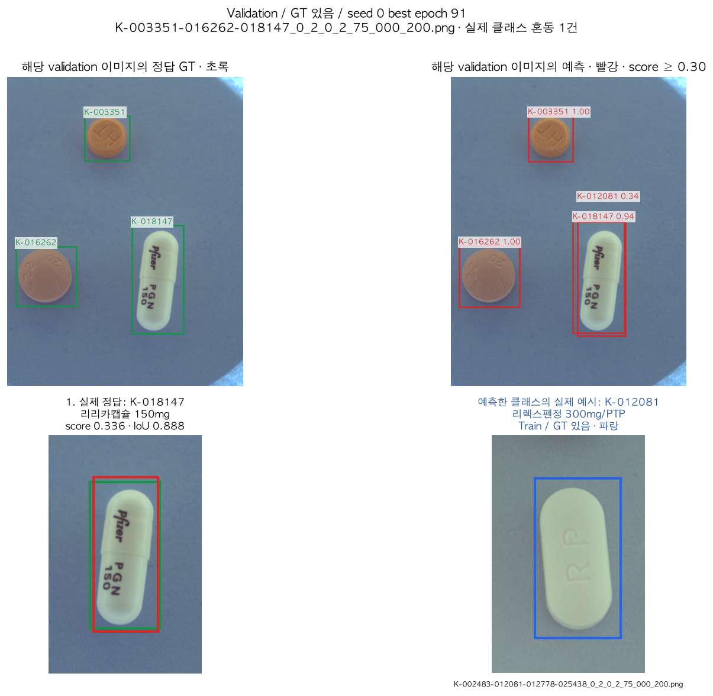

*그림 11. Validation / GT 있음 / seed 0 / best epoch 91. score ≥ 0.30, 매칭 IoU ≥ 0.75.*

1. **K-018147 리리카캡슐 150mg → K-012081 리렉스펜정 300mg/PTP** · score 0.3358 · IoU 0.8880

**K-003351-016688-018147_0_2_0_2_70_000_200.png**

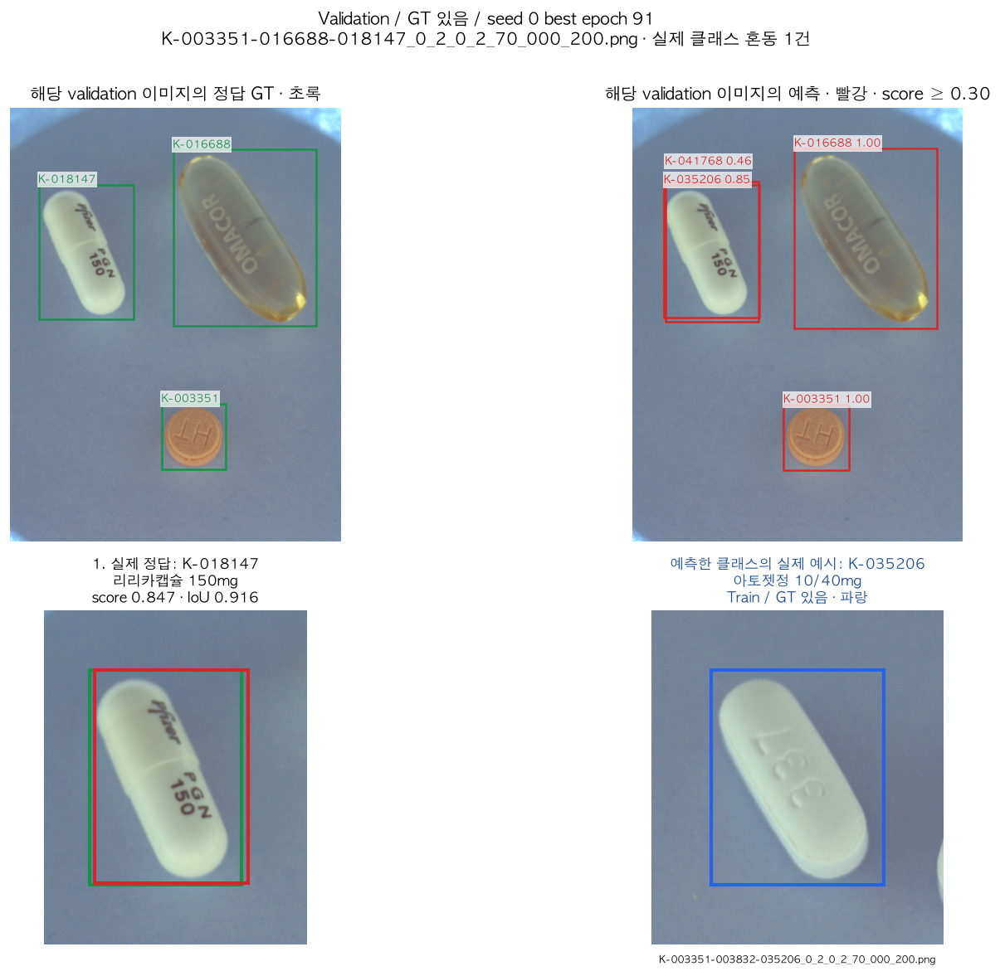

*그림 12. Validation / GT 있음 / seed 0 / best epoch 91. score ≥ 0.30, 매칭 IoU ≥ 0.75.*

1. **K-018147 리리카캡슐 150mg → K-035206 아토젯정 10/40mg** · score 0.8472 · IoU 0.9159

**K-003351-016688-018147_0_2_0_2_75_000_200.png**

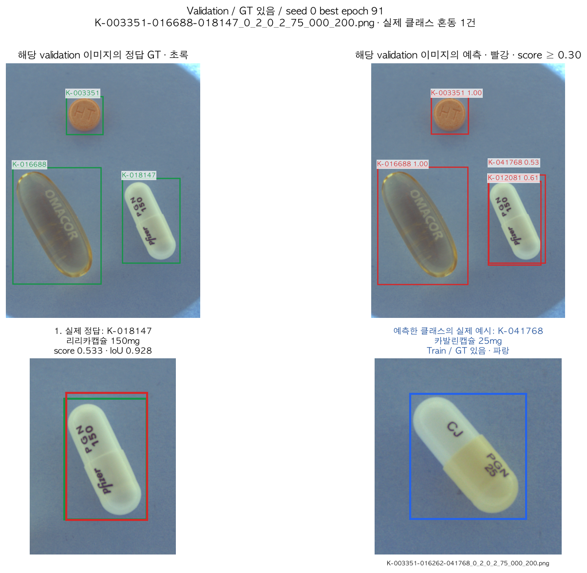

*그림 13. Validation / GT 있음 / seed 0 / best epoch 91. score ≥ 0.30, 매칭 IoU ≥ 0.75.*

1. **K-018147 리리카캡슐 150mg → K-041768 카발린캡슐 25mg** · score 0.5334 · IoU 0.9279

**K-003483-016232-022347-025469_0_2_0_2_70_000_200.png**

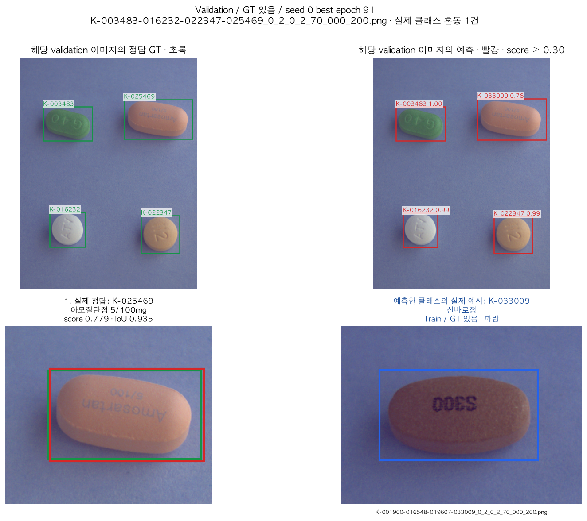

*그림 14. Validation / GT 있음 / seed 0 / best epoch 91. score ≥ 0.30, 매칭 IoU ≥ 0.75.*

1. **K-025469 아모잘탄정 5/100mg → K-033009 신바로정** · score 0.7794 · IoU 0.9353

**K-003483-016232-022347-025469_0_2_0_2_75_000_200.png**

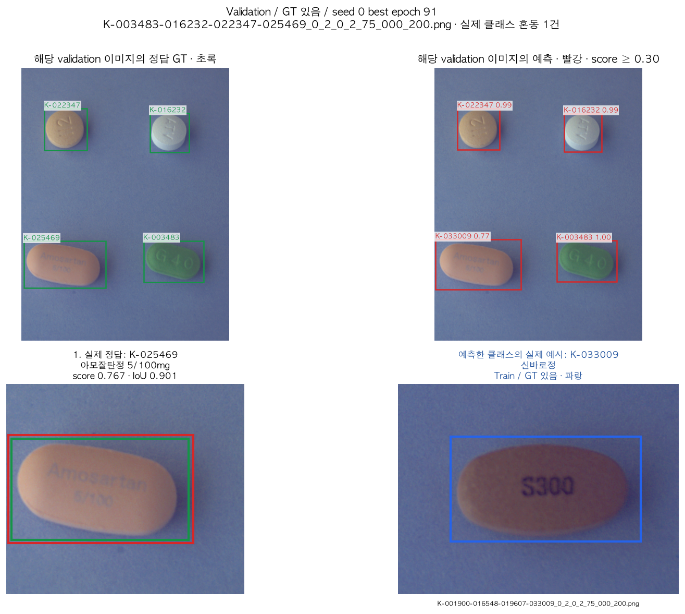

*그림 15. Validation / GT 있음 / seed 0 / best epoch 91. score ≥ 0.30, 매칭 IoU ≥ 0.75.*

1. **K-025469 아모잘탄정 5/100mg → K-033009 신바로정** · score 0.7667 · IoU 0.9006

**K-003483-016232-022347-025469_0_2_0_2_90_000_200.png**

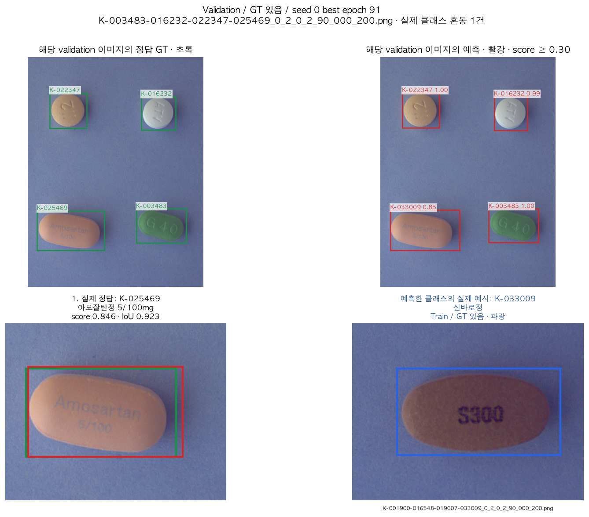

*그림 16. Validation / GT 있음 / seed 0 / best epoch 91. score ≥ 0.30, 매칭 IoU ≥ 0.75.*

1. **K-025469 아모잘탄정 5/100mg → K-033009 신바로정** · score 0.8462 · IoU 0.9234

**K-003483-019861-020238-030308_0_2_0_2_70_000_200.png**

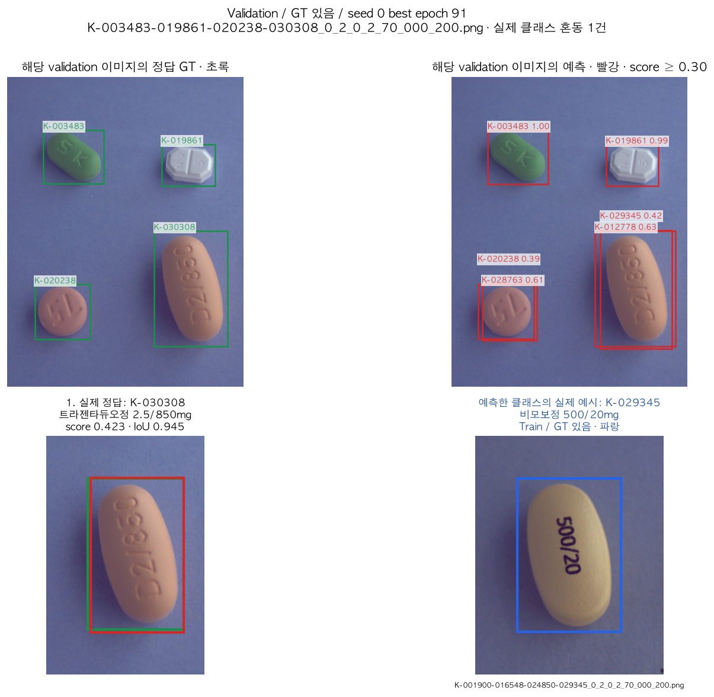

*그림 17. Validation / GT 있음 / seed 0 / best epoch 91. score ≥ 0.30, 매칭 IoU ≥ 0.75.*

1. **K-030308 트라젠타듀오정 2.5/850mg → K-029345 비모보정 500/20mg** · score 0.4230 · IoU 0.9453

**K-003483-019861-020238-030308_0_2_0_2_75_000_200.png**

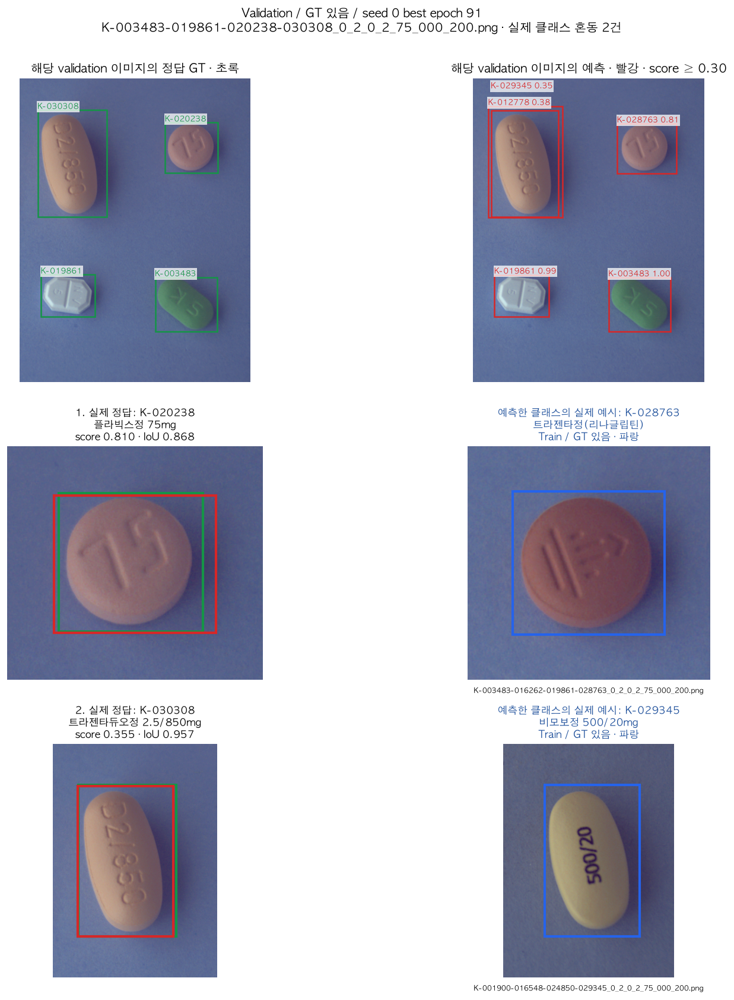

*그림 18. Validation / GT 있음 / seed 0 / best epoch 91. score ≥ 0.30, 매칭 IoU ≥ 0.75.*

1. **K-020238 플라빅스정 75mg → K-028763 트라젠타정(리나글립틴)** · score 0.8097 · IoU 0.8684

2. **K-030308 트라젠타듀오정 2.5/850mg → K-029345 비모보정 500/20mg** · score 0.3548 · IoU 0.9568

**K-003483-019861-020238-030308_0_2_0_2_90_000_200.png**

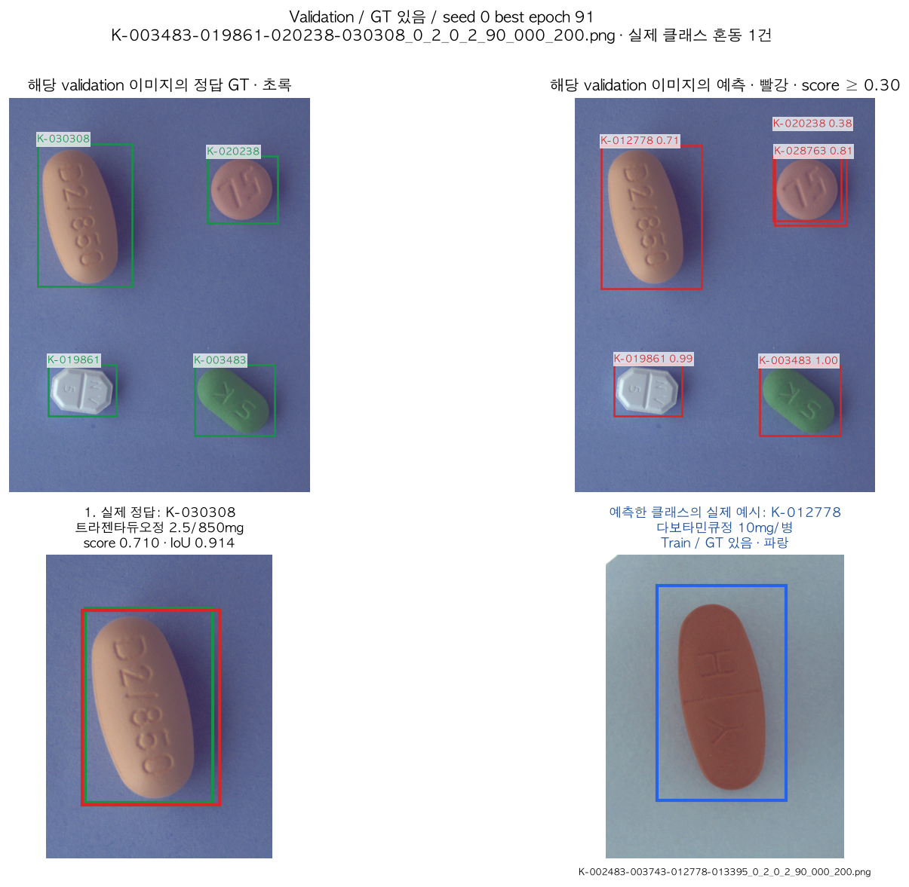

*그림 19. Validation / GT 있음 / seed 0 / best epoch 91. score ≥ 0.30, 매칭 IoU ≥ 0.75.*

1. **K-030308 트라젠타듀오정 2.5/850mg → K-012778 다보타민큐정 10mg/병** · score 0.7096 · IoU 0.9136

**K-003483-020238-027733-028763_0_2_0_2_75_000_200.png**

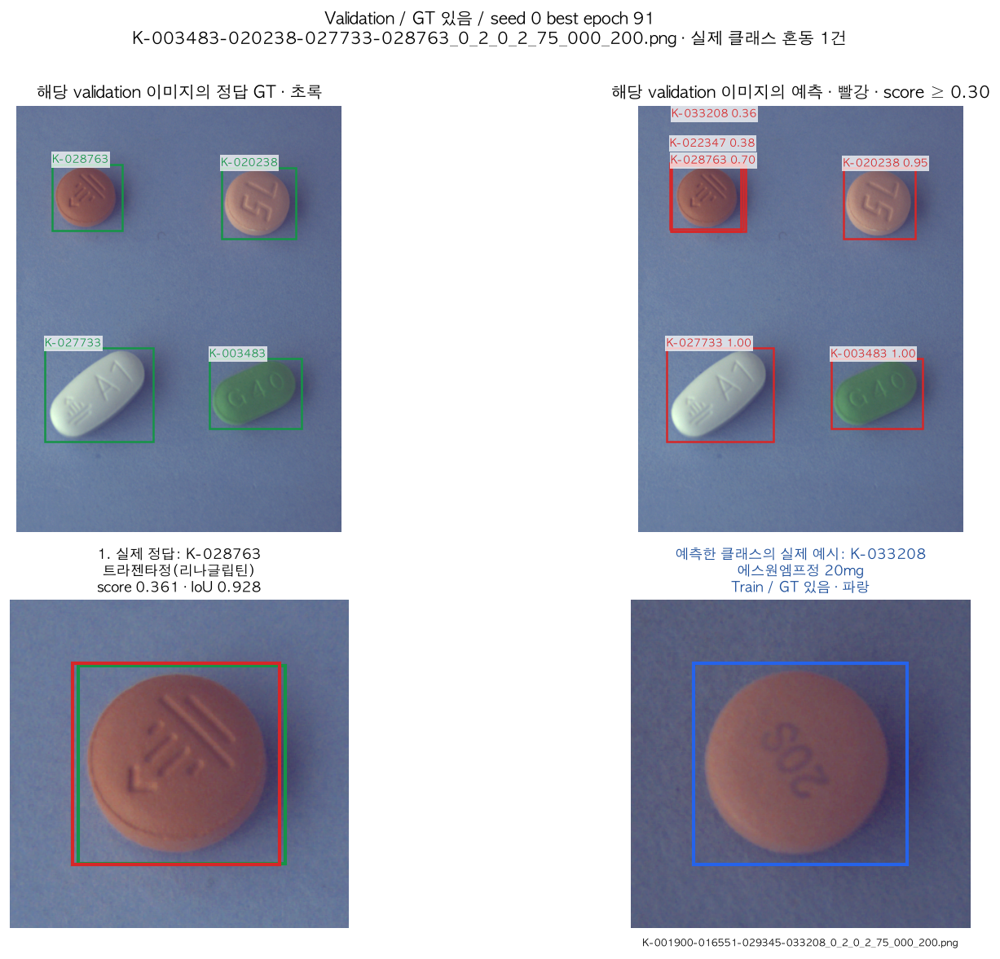

*그림 20. Validation / GT 있음 / seed 0 / best epoch 91. score ≥ 0.30, 매칭 IoU ≥ 0.75.*

1. **K-028763 트라젠타정(리나글립틴) → K-033208 에스원엠프정 20mg** · score 0.3614 · IoU 0.9278

**K-003483-025469-028763-035206_0_2_0_2_70_000_200.png**

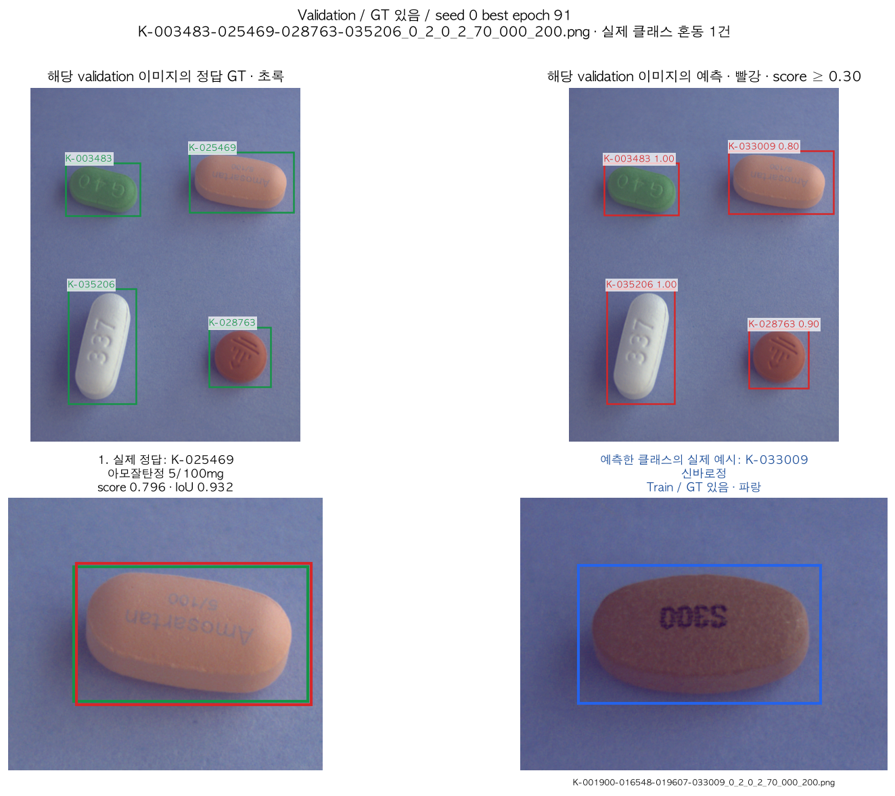

*그림 21. Validation / GT 있음 / seed 0 / best epoch 91. score ≥ 0.30, 매칭 IoU ≥ 0.75.*

1. **K-025469 아모잘탄정 5/100mg → K-033009 신바로정** · score 0.7961 · IoU 0.9324

**K-003483-025469-028763-035206_0_2_0_2_75_000_200.png**

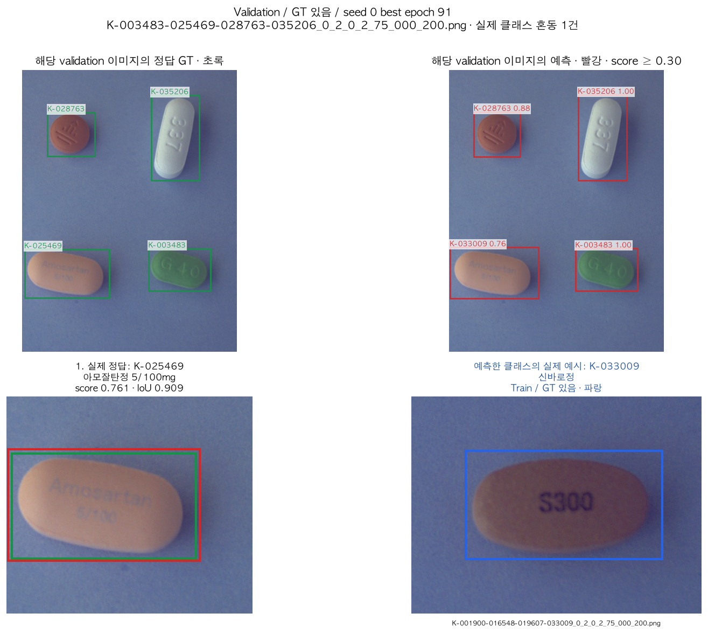

*그림 22. Validation / GT 있음 / seed 0 / best epoch 91. score ≥ 0.30, 매칭 IoU ≥ 0.75.*

1. **K-025469 아모잘탄정 5/100mg → K-033009 신바로정** · score 0.7612 · IoU 0.9090

**K-003483-025469-028763-035206_0_2_0_2_90_000_200.png**

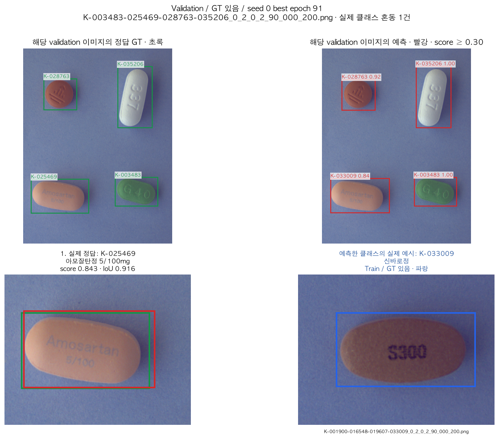

*그림 23. Validation / GT 있음 / seed 0 / best epoch 91. score ≥ 0.30, 매칭 IoU ≥ 0.75.*

1. **K-025469 아모잘탄정 5/100mg → K-033009 신바로정** · score 0.8432 · IoU 0.9159

#### Seed 1

**전체 방향별 혼동 쌍**

| Seed | 정답 코드 | 정답 클래스 | 예측 코드 | 예측 클래스 | 혼동 건수 | 정답 객체 수 | 혼동 비율 |
| --- | --- | --- | --- | --- | --- | --- | --- |
| 1 | K-018147 | 리리카캡슐 150mg | K-002483 | 뮤테란캡슐 100mg | 3 | 5 | 0.6 |
| 1 | K-025469 | 아모잘탄정 5/100mg | K-033009 | 신바로정 | 3 | 9 | 0.333333 |
| 1 | K-013900 | 에빅사정(메만틴염산염)(비매품) | K-036637 | 로수젯정10/5밀리그램 | 2 | 4 | 0.5 |
| 1 | K-020238 | 플라빅스정 75mg | K-028763 | 트라젠타정(리나글립틴) | 2 | 7 | 0.285714 |
| 1 | K-025469 | 아모잘탄정 5/100mg | K-032310 | 글리아타민연질캡슐 | 2 | 9 | 0.222222 |
| 1 | K-030308 | 트라젠타듀오정 2.5/850mg | K-027926 | 울트라셋이알서방정 | 2 | 6 | 0.333333 |
| 1 | K-020238 | 플라빅스정 75mg | K-022347 | 자누비아정 50mg | 1 | 7 | 0.142857 |
| 1 | K-025469 | 아모잘탄정 5/100mg | K-020877 | 엑스포지정 5/160mg | 1 | 9 | 0.111111 |
| 1 | K-030308 | 트라젠타듀오정 2.5/850mg | K-029345 | 비모보정 500/20mg | 1 | 6 | 0.166667 |

Seed 1: 실제 혼동 이미지 14장 전체

**K-003351-013900-022074_0_2_0_2_75_000_200.png**

*그림 24. Validation / GT 있음 / seed 1 / best epoch 90. score ≥ 0.30, 매칭 IoU ≥ 0.75.*

1. **K-013900 에빅사정(메만틴염산염)(비매품) → K-036637 로수젯정10/5밀리그램** · score 0.9088 · IoU 0.9160

**K-003351-013900-022074_0_2_0_2_90_000_200.png**

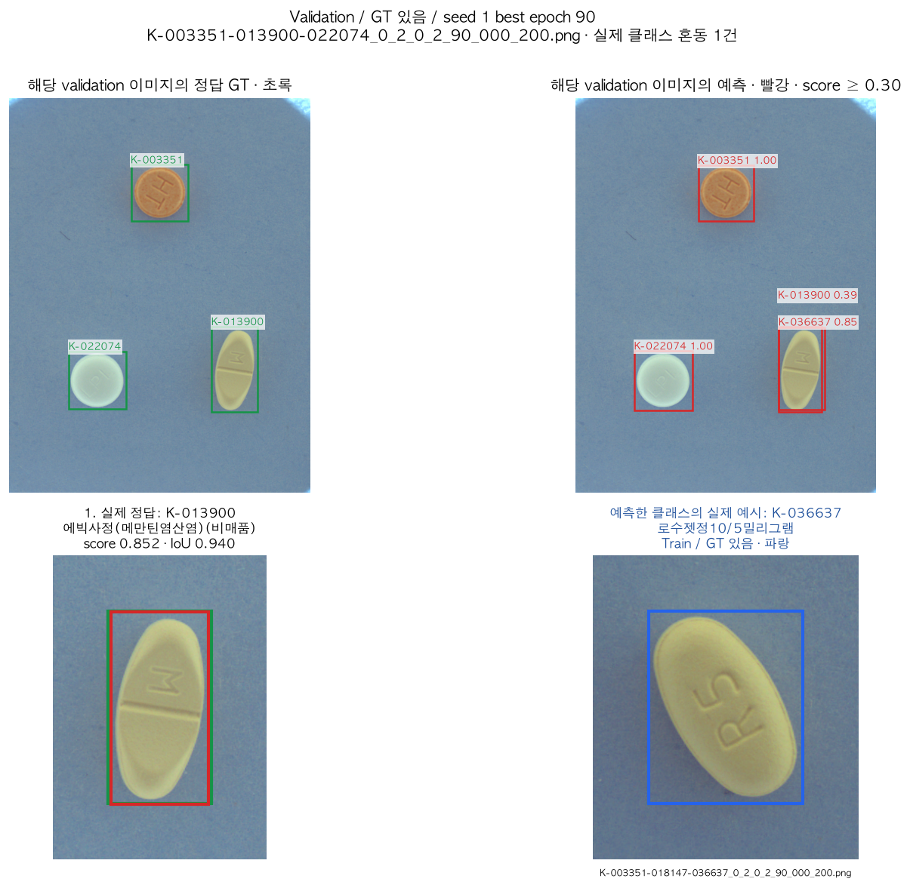

*그림 25. Validation / GT 있음 / seed 1 / best epoch 90. score ≥ 0.30, 매칭 IoU ≥ 0.75.*

1. **K-013900 에빅사정(메만틴염산염)(비매품) → K-036637 로수젯정10/5밀리그램** · score 0.8524 · IoU 0.9397

**K-003351-016262-018147_0_2_0_2_75_000_200.png**

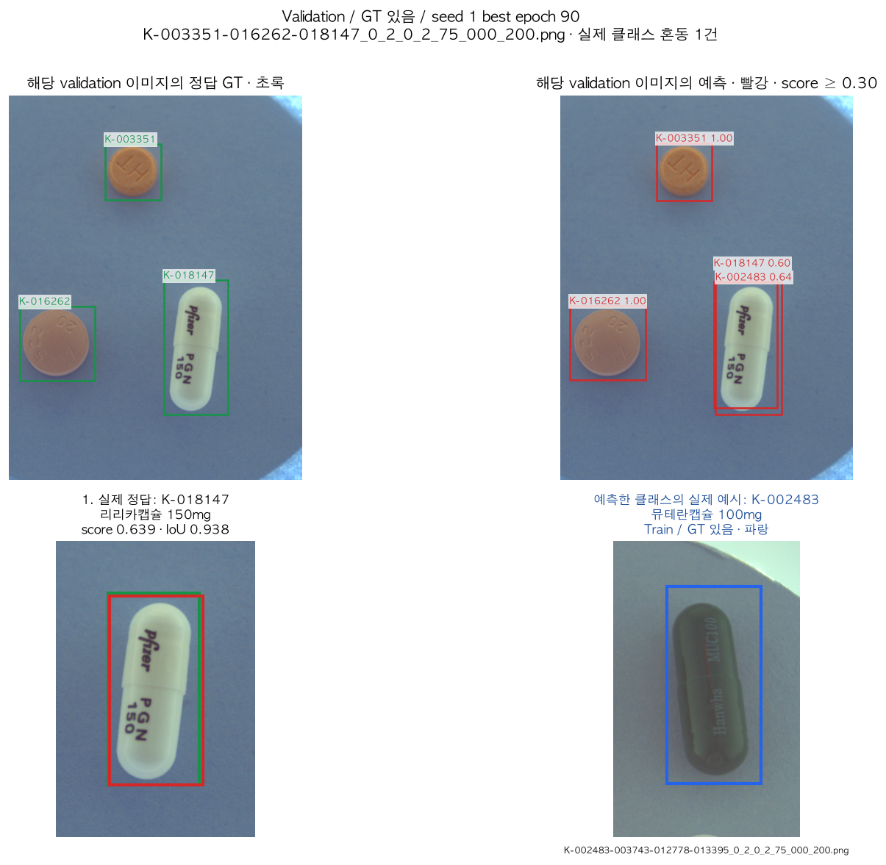

*그림 26. Validation / GT 있음 / seed 1 / best epoch 90. score ≥ 0.30, 매칭 IoU ≥ 0.75.*

1. **K-018147 리리카캡슐 150mg → K-002483 뮤테란캡슐 100mg** · score 0.6393 · IoU 0.9385

**K-003351-016688-018147_0_2_0_2_70_000_200.png**

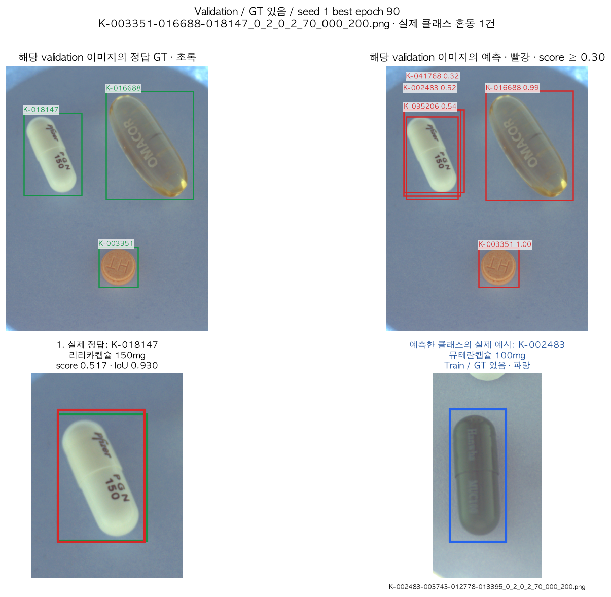

*그림 27. Validation / GT 있음 / seed 1 / best epoch 90. score ≥ 0.30, 매칭 IoU ≥ 0.75.*

1. **K-018147 리리카캡슐 150mg → K-002483 뮤테란캡슐 100mg** · score 0.5165 · IoU 0.9296

**K-003351-016688-018147_0_2_0_2_75_000_200.png**

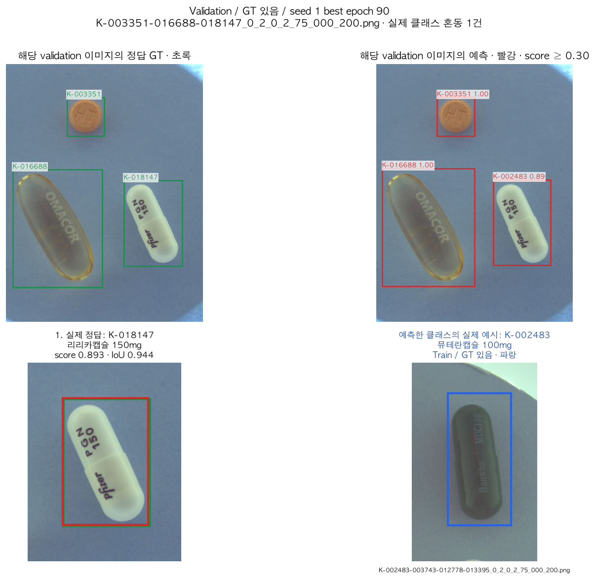

*그림 28. Validation / GT 있음 / seed 1 / best epoch 90. score ≥ 0.30, 매칭 IoU ≥ 0.75.*

1. **K-018147 리리카캡슐 150mg → K-002483 뮤테란캡슐 100mg** · score 0.8930 · IoU 0.9441

**K-003483-016232-022347-025469_0_2_0_2_70_000_200.png**

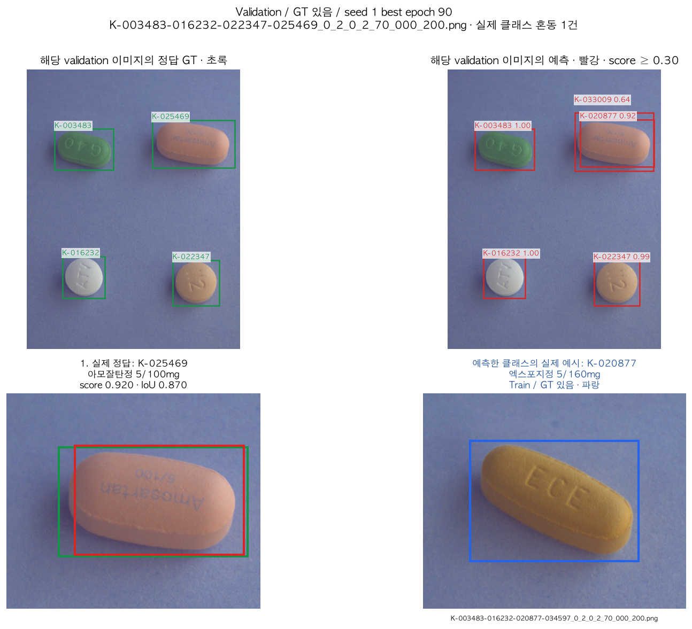

*그림 29. Validation / GT 있음 / seed 1 / best epoch 90. score ≥ 0.30, 매칭 IoU ≥ 0.75.*

1. **K-025469 아모잘탄정 5/100mg → K-020877 엑스포지정 5/160mg** · score 0.9204 · IoU 0.8699

**K-003483-016232-022347-025469_0_2_0_2_75_000_200.png**

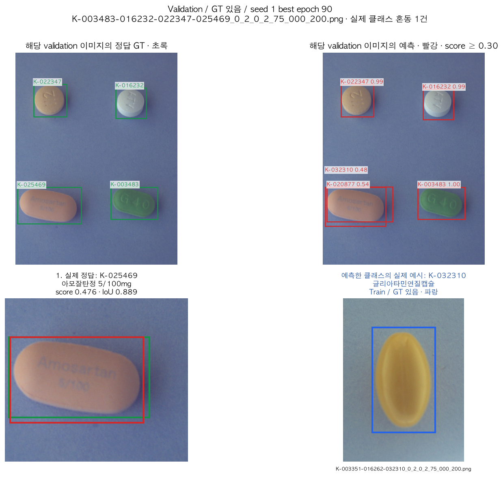

*그림 30. Validation / GT 있음 / seed 1 / best epoch 90. score ≥ 0.30, 매칭 IoU ≥ 0.75.*

1. **K-025469 아모잘탄정 5/100mg → K-032310 글리아타민연질캡슐** · score 0.4760 · IoU 0.8892

**K-003483-016232-022347-025469_0_2_0_2_90_000_200.png**

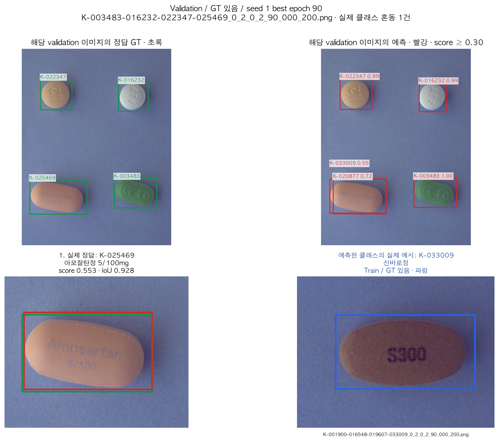

*그림 31. Validation / GT 있음 / seed 1 / best epoch 90. score ≥ 0.30, 매칭 IoU ≥ 0.75.*

1. **K-025469 아모잘탄정 5/100mg → K-033009 신바로정** · score 0.5532 · IoU 0.9282

**K-003483-019861-020238-030308_0_2_0_2_70_000_200.png**

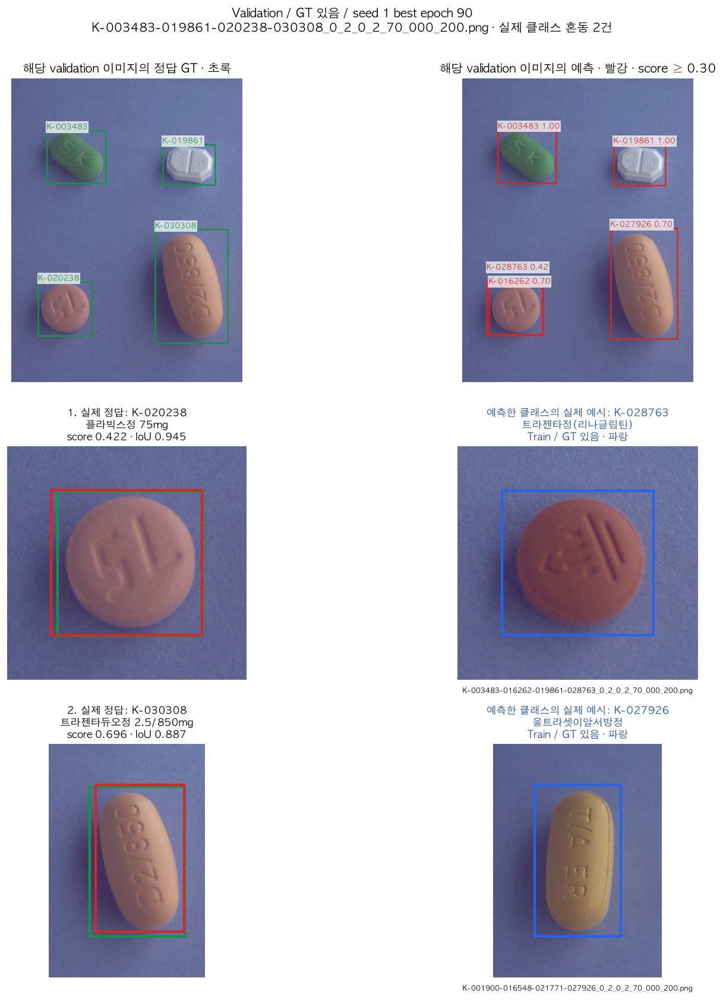

*그림 32. Validation / GT 있음 / seed 1 / best epoch 90. score ≥ 0.30, 매칭 IoU ≥ 0.75.*

1. **K-020238 플라빅스정 75mg → K-028763 트라젠타정(리나글립틴)** · score 0.4224 · IoU 0.9446

2. **K-030308 트라젠타듀오정 2.5/850mg → K-027926 울트라셋이알서방정** · score 0.6964 · IoU 0.8869

**K-003483-019861-020238-030308_0_2_0_2_75_000_200.png**

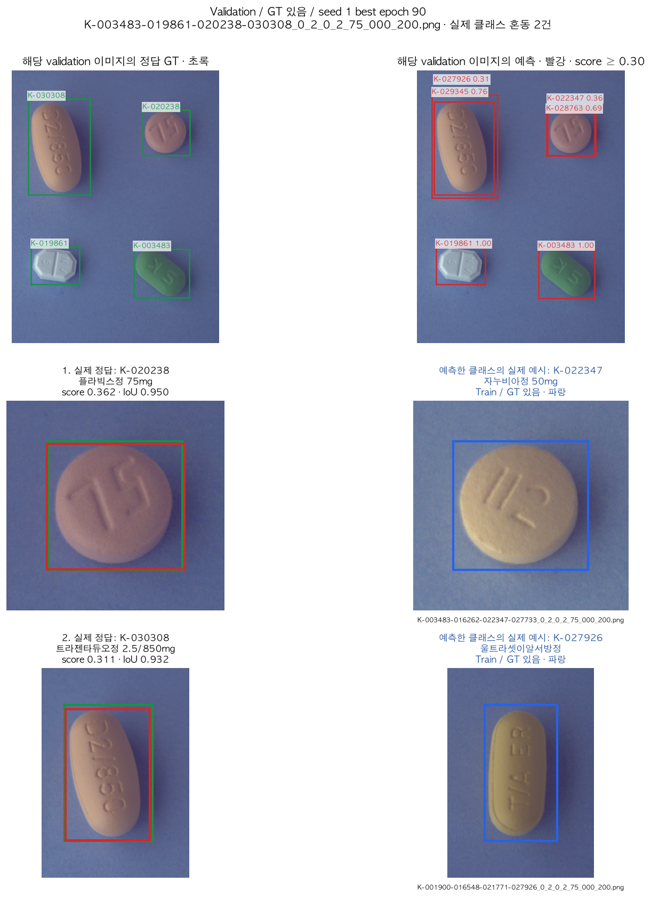

*그림 33. Validation / GT 있음 / seed 1 / best epoch 90. score ≥ 0.30, 매칭 IoU ≥ 0.75.*

1. **K-020238 플라빅스정 75mg → K-022347 자누비아정 50mg** · score 0.3620 · IoU 0.9504

2. **K-030308 트라젠타듀오정 2.5/850mg → K-027926 울트라셋이알서방정** · score 0.3109 · IoU 0.9318

**K-003483-019861-020238-030308_0_2_0_2_90_000_200.png**

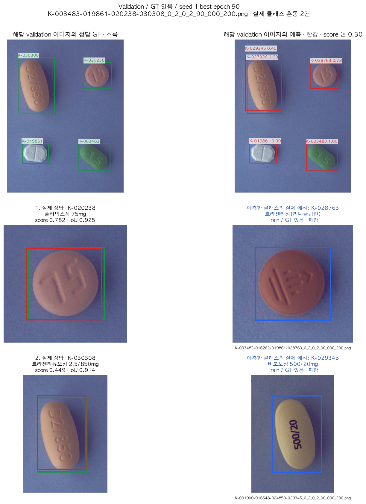

*그림 34. Validation / GT 있음 / seed 1 / best epoch 90. score ≥ 0.30, 매칭 IoU ≥ 0.75.*

1. **K-020238 플라빅스정 75mg → K-028763 트라젠타정(리나글립틴)** · score 0.7816 · IoU 0.9252

2. **K-030308 트라젠타듀오정 2.5/850mg → K-029345 비모보정 500/20mg** · score 0.4490 · IoU 0.9138

**K-003483-025469-028763-035206_0_2_0_2_70_000_200.png**

*그림 35. Validation / GT 있음 / seed 1 / best epoch 90. score ≥ 0.30, 매칭 IoU ≥ 0.75.*

1. **K-025469 아모잘탄정 5/100mg → K-033009 신바로정** · score 0.6424 · IoU 0.8856

**K-003483-025469-028763-035206_0_2_0_2_75_000_200.png**

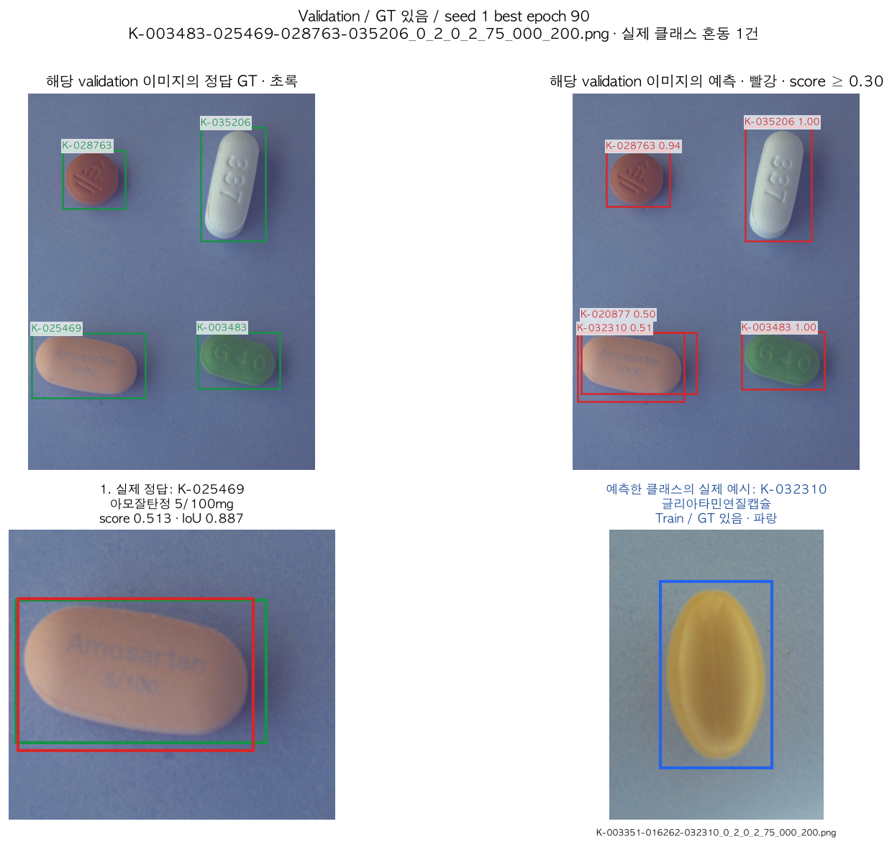

*그림 36. Validation / GT 있음 / seed 1 / best epoch 90. score ≥ 0.30, 매칭 IoU ≥ 0.75.*

1. **K-025469 아모잘탄정 5/100mg → K-032310 글리아타민연질캡슐** · score 0.5131 · IoU 0.8873

**K-003483-025469-028763-035206_0_2_0_2_90_000_200.png**

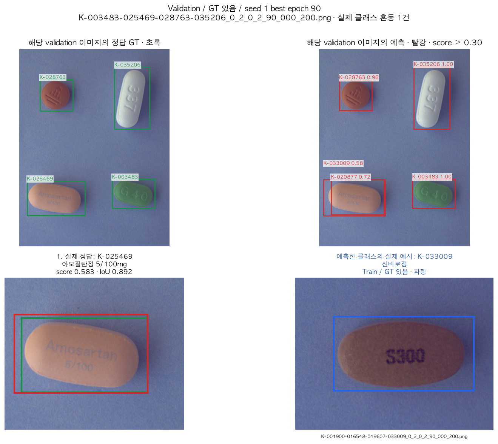

*그림 37. Validation / GT 있음 / seed 1 / best epoch 90. score ≥ 0.30, 매칭 IoU ≥ 0.75.*

1. **K-025469 아모잘탄정 5/100mg → K-033009 신바로정** · score 0.5830 · IoU 0.8919

#### Seed 2

**전체 방향별 혼동 쌍**

| Seed | 정답 코드 | 정답 클래스 | 예측 코드 | 예측 클래스 | 혼동 건수 | 정답 객체 수 | 혼동 비율 |
| --- | --- | --- | --- | --- | --- | --- | --- |
| 2 | K-025469 | 아모잘탄정 5/100mg | K-020877 | 엑스포지정 5/160mg | 6 | 9 | 0.666667 |
| 2 | K-020238 | 플라빅스정 75mg | K-016262 | 크레스토정 20mg | 5 | 7 | 0.714286 |
| 2 | K-030308 | 트라젠타듀오정 2.5/850mg | K-012778 | 다보타민큐정 10mg/병 | 2 | 6 | 0.333333 |
| 2 | K-013900 | 에빅사정(메만틴염산염)(비매품) | K-021325 | 아토르바정 10mg | 1 | 4 | 0.25 |
| 2 | K-013900 | 에빅사정(메만틴염산염)(비매품) | K-036637 | 로수젯정10/5밀리그램 | 1 | 4 | 0.25 |
| 2 | K-018147 | 리리카캡슐 150mg | K-035206 | 아토젯정 10/40mg | 1 | 5 | 0.2 |
| 2 | K-018147 | 리리카캡슐 150mg | K-041768 | 카발린캡슐 25mg | 1 | 5 | 0.2 |
| 2 | K-030308 | 트라젠타듀오정 2.5/850mg | K-027926 | 울트라셋이알서방정 | 1 | 6 | 0.166667 |

Seed 2: 실제 혼동 이미지 15장 전체

**K-003351-013900-022074_0_2_0_2_70_000_200.png**

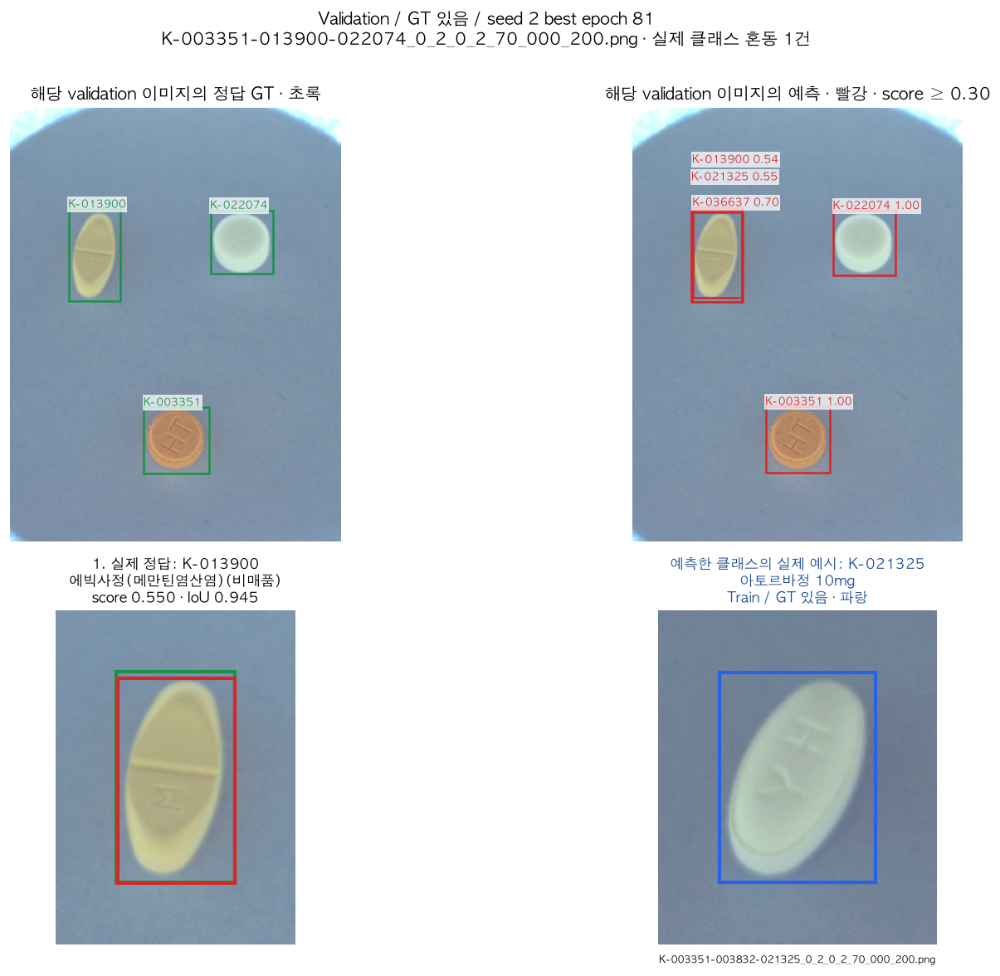

*그림 38. Validation / GT 있음 / seed 2 / best epoch 81. score ≥ 0.30, 매칭 IoU ≥ 0.75.*

1. **K-013900 에빅사정(메만틴염산염)(비매품) → K-021325 아토르바정 10mg** · score 0.5498 · IoU 0.9447

**K-003351-013900-022074_0_2_0_2_75_000_200.png**

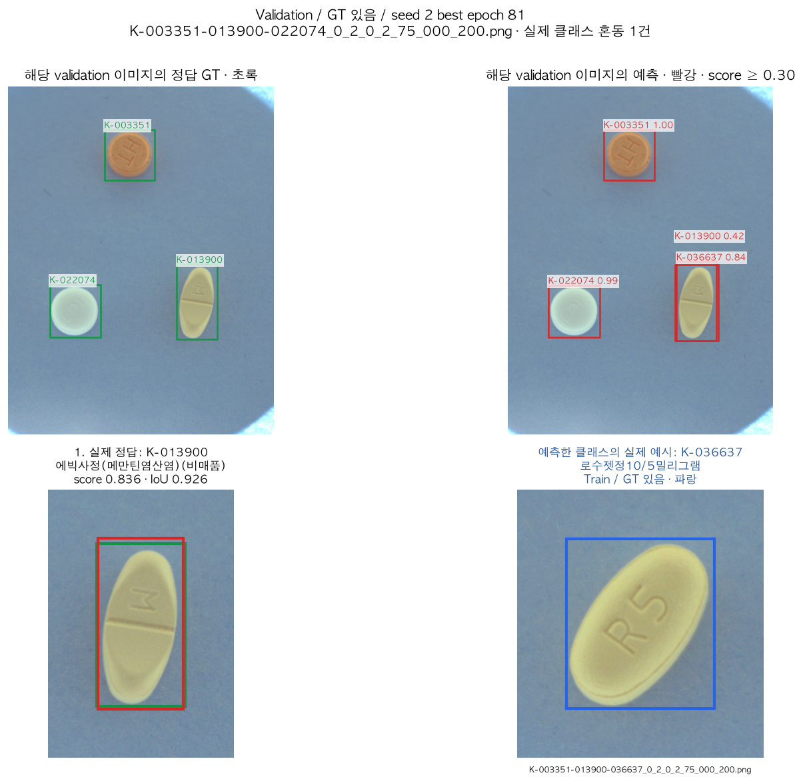

*그림 39. Validation / GT 있음 / seed 2 / best epoch 81. score ≥ 0.30, 매칭 IoU ≥ 0.75.*

1. **K-013900 에빅사정(메만틴염산염)(비매품) → K-036637 로수젯정10/5밀리그램** · score 0.8363 · IoU 0.9262

**K-003351-016688-018147_0_2_0_2_70_000_200.png**

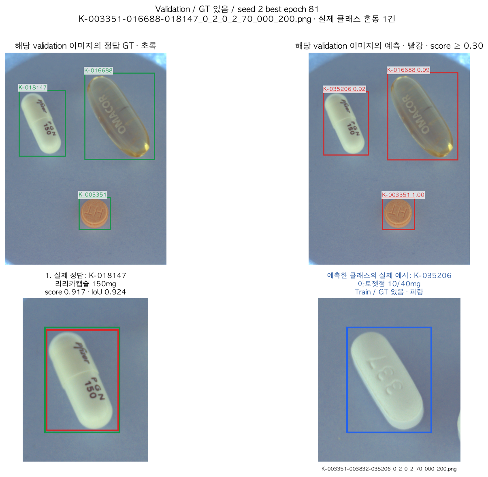

*그림 40. Validation / GT 있음 / seed 2 / best epoch 81. score ≥ 0.30, 매칭 IoU ≥ 0.75.*

1. **K-018147 리리카캡슐 150mg → K-035206 아토젯정 10/40mg** · score 0.9170 · IoU 0.9238

**K-003351-016688-018147_0_2_0_2_75_000_200.png**

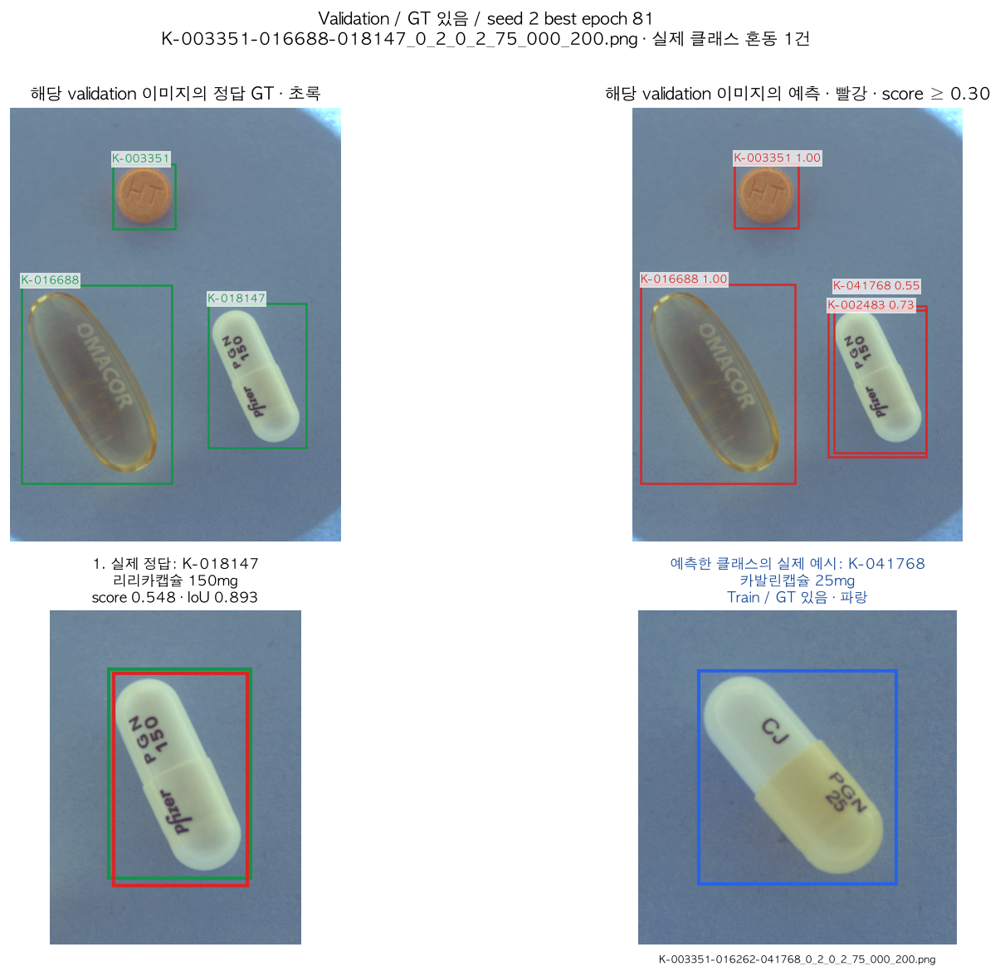

*그림 41. Validation / GT 있음 / seed 2 / best epoch 81. score ≥ 0.30, 매칭 IoU ≥ 0.75.*

1. **K-018147 리리카캡슐 150mg → K-041768 카발린캡슐 25mg** · score 0.5485 · IoU 0.8934

**K-003483-016232-022347-025469_0_2_0_2_70_000_200.png**

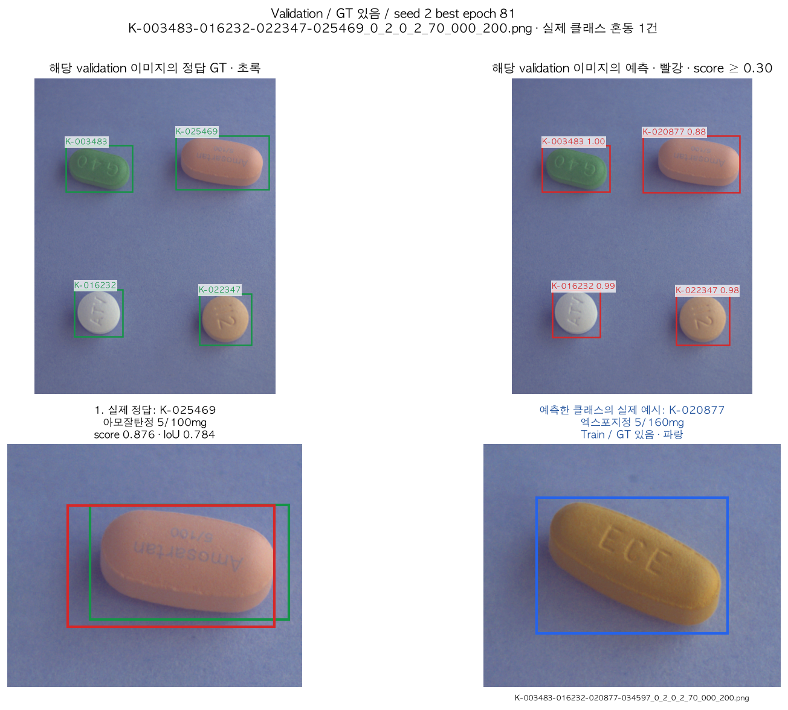

*그림 42. Validation / GT 있음 / seed 2 / best epoch 81. score ≥ 0.30, 매칭 IoU ≥ 0.75.*

1. **K-025469 아모잘탄정 5/100mg → K-020877 엑스포지정 5/160mg** · score 0.8764 · IoU 0.7842

**K-003483-016232-022347-025469_0_2_0_2_75_000_200.png**

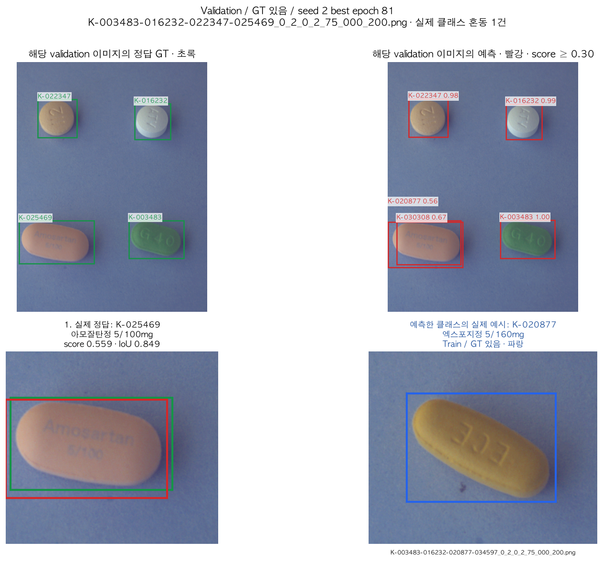

*그림 43. Validation / GT 있음 / seed 2 / best epoch 81. score ≥ 0.30, 매칭 IoU ≥ 0.75.*

1. **K-025469 아모잘탄정 5/100mg → K-020877 엑스포지정 5/160mg** · score 0.5589 · IoU 0.8488

**K-003483-016232-022347-025469_0_2_0_2_90_000_200.png**

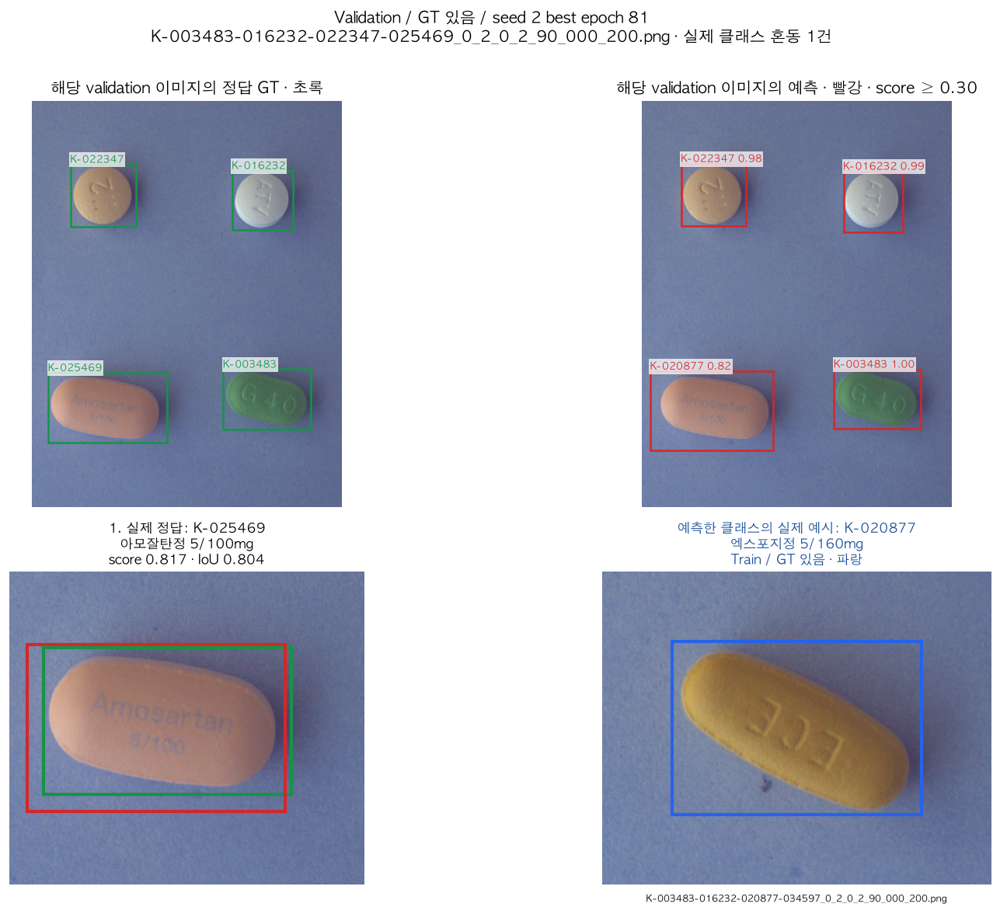

*그림 44. Validation / GT 있음 / seed 2 / best epoch 81. score ≥ 0.30, 매칭 IoU ≥ 0.75.*

1. **K-025469 아모잘탄정 5/100mg → K-020877 엑스포지정 5/160mg** · score 0.8175 · IoU 0.8044

**K-003483-019861-020238-030308_0_2_0_2_70_000_200.png**

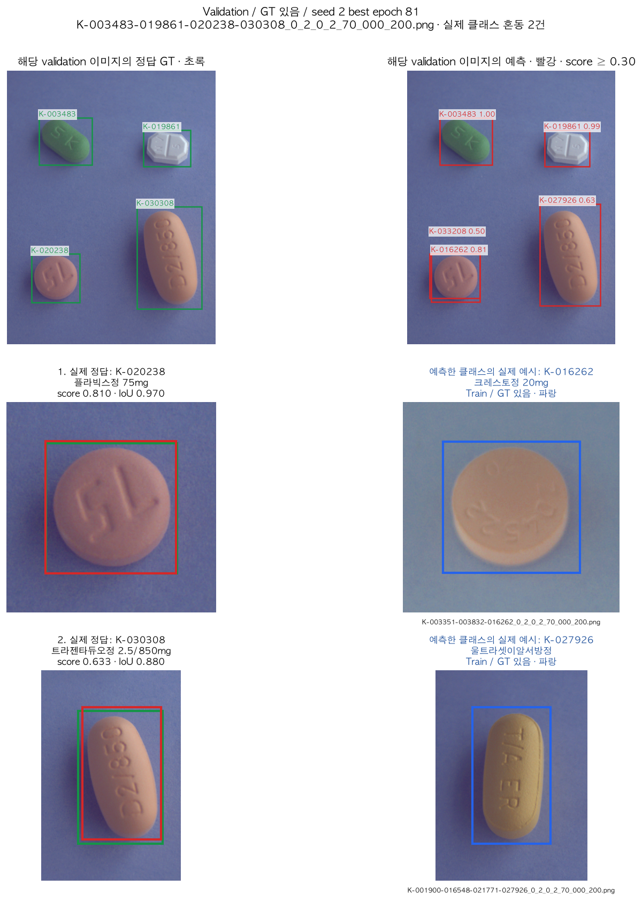

*그림 45. Validation / GT 있음 / seed 2 / best epoch 81. score ≥ 0.30, 매칭 IoU ≥ 0.75.*

1. **K-020238 플라빅스정 75mg → K-016262 크레스토정 20mg** · score 0.8100 · IoU 0.9700

2. **K-030308 트라젠타듀오정 2.5/850mg → K-027926 울트라셋이알서방정** · score 0.6330 · IoU 0.8801

**K-003483-019861-020238-030308_0_2_0_2_75_000_200.png**

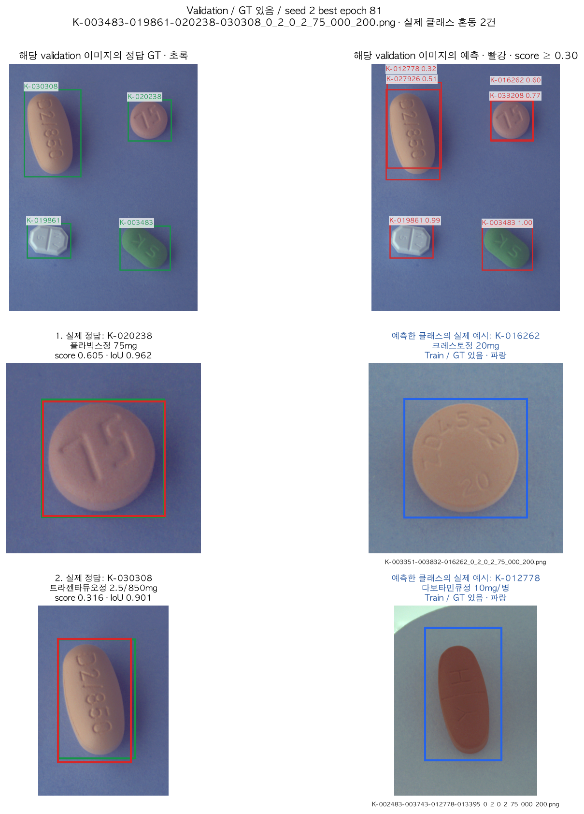

*그림 46. Validation / GT 있음 / seed 2 / best epoch 81. score ≥ 0.30, 매칭 IoU ≥ 0.75.*

1. **K-020238 플라빅스정 75mg → K-016262 크레스토정 20mg** · score 0.6045 · IoU 0.9616

2. **K-030308 트라젠타듀오정 2.5/850mg → K-012778 다보타민큐정 10mg/병** · score 0.3161 · IoU 0.9010

**K-003483-019861-020238-030308_0_2_0_2_90_000_200.png**

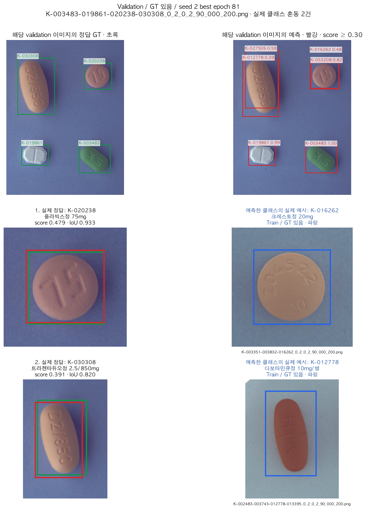

*그림 47. Validation / GT 있음 / seed 2 / best epoch 81. score ≥ 0.30, 매칭 IoU ≥ 0.75.*

1. **K-020238 플라빅스정 75mg → K-016262 크레스토정 20mg** · score 0.4793 · IoU 0.9329

2. **K-030308 트라젠타듀오정 2.5/850mg → K-012778 다보타민큐정 10mg/병** · score 0.3914 · IoU 0.8202

**K-003483-020238-027733-028763_0_2_0_2_75_000_200.png**

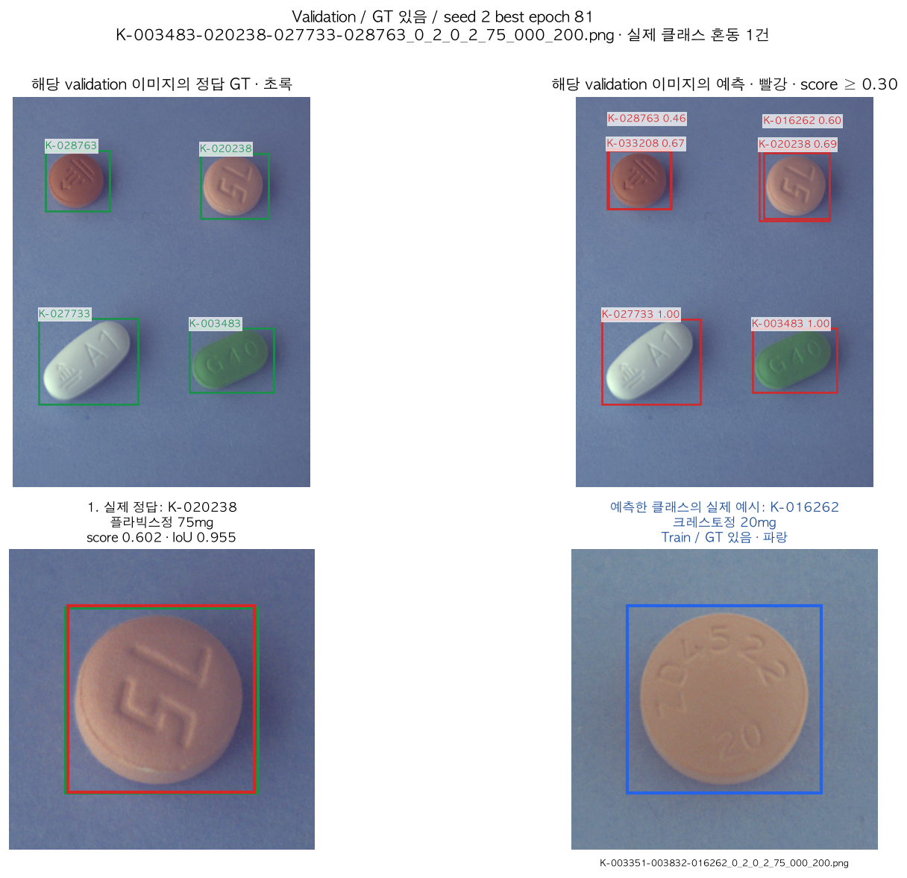

*그림 48. Validation / GT 있음 / seed 2 / best epoch 81. score ≥ 0.30, 매칭 IoU ≥ 0.75.*

1. **K-020238 플라빅스정 75mg → K-016262 크레스토정 20mg** · score 0.6015 · IoU 0.9548

**K-003483-020238-027733-028763_0_2_0_2_90_000_200.png**

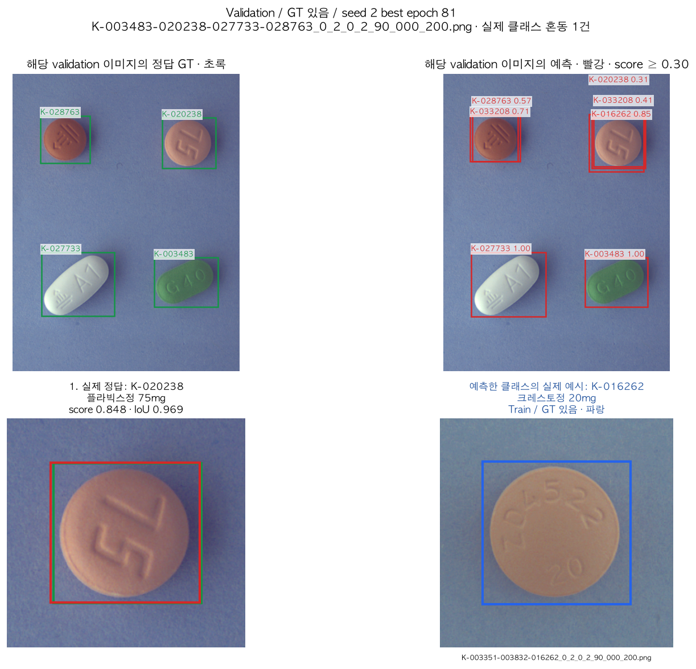

*그림 49. Validation / GT 있음 / seed 2 / best epoch 81. score ≥ 0.30, 매칭 IoU ≥ 0.75.*

1. **K-020238 플라빅스정 75mg → K-016262 크레스토정 20mg** · score 0.8477 · IoU 0.9689

**K-003483-025469-028763-035206_0_2_0_2_70_000_200.png**

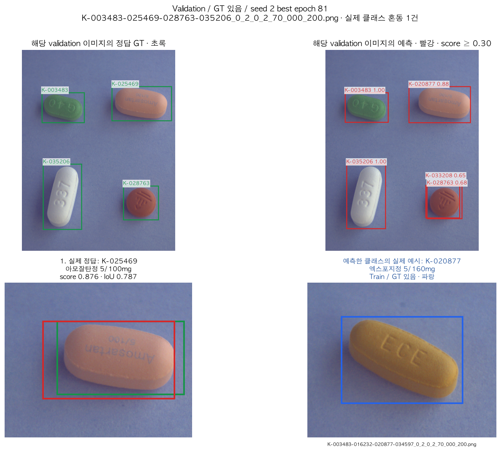

*그림 50. Validation / GT 있음 / seed 2 / best epoch 81. score ≥ 0.30, 매칭 IoU ≥ 0.75.*

1. **K-025469 아모잘탄정 5/100mg → K-020877 엑스포지정 5/160mg** · score 0.8757 · IoU 0.7867

**K-003483-025469-028763-035206_0_2_0_2_75_000_200.png**

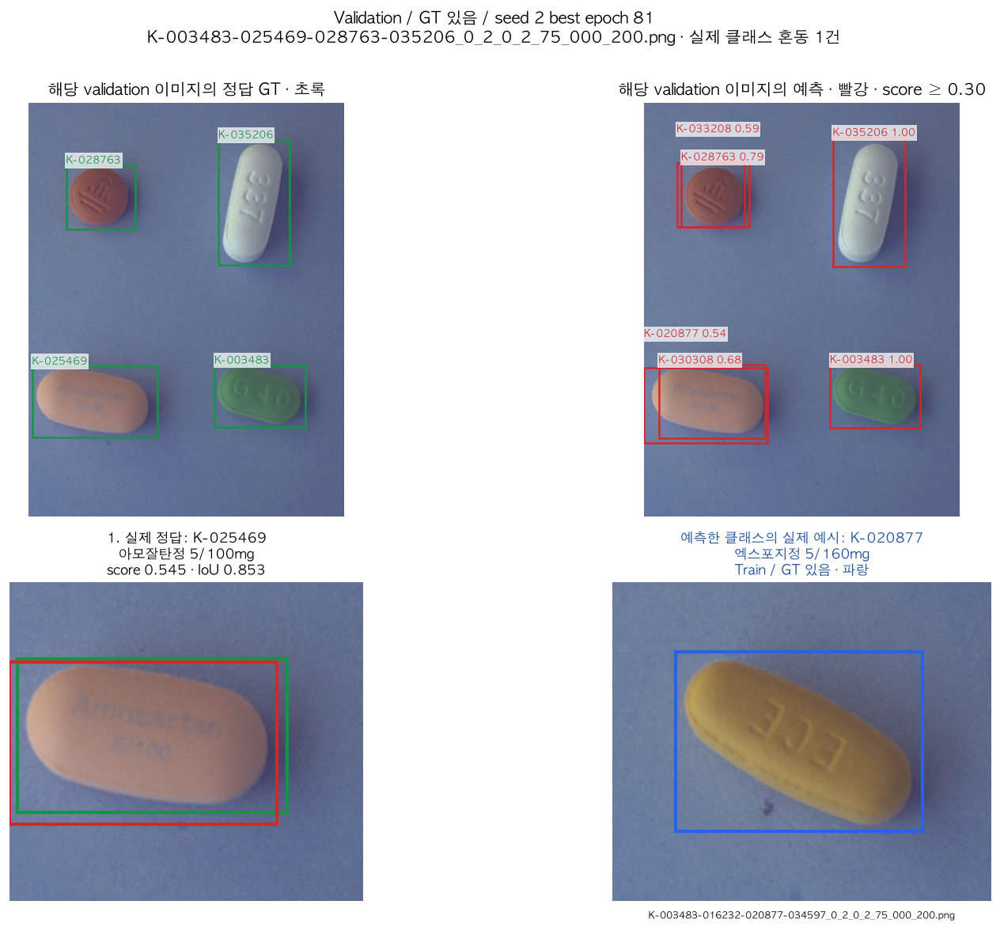

*그림 51. Validation / GT 있음 / seed 2 / best epoch 81. score ≥ 0.30, 매칭 IoU ≥ 0.75.*

1. **K-025469 아모잘탄정 5/100mg → K-020877 엑스포지정 5/160mg** · score 0.5446 · IoU 0.8533

**K-003483-025469-028763-035206_0_2_0_2_90_000_200.png**

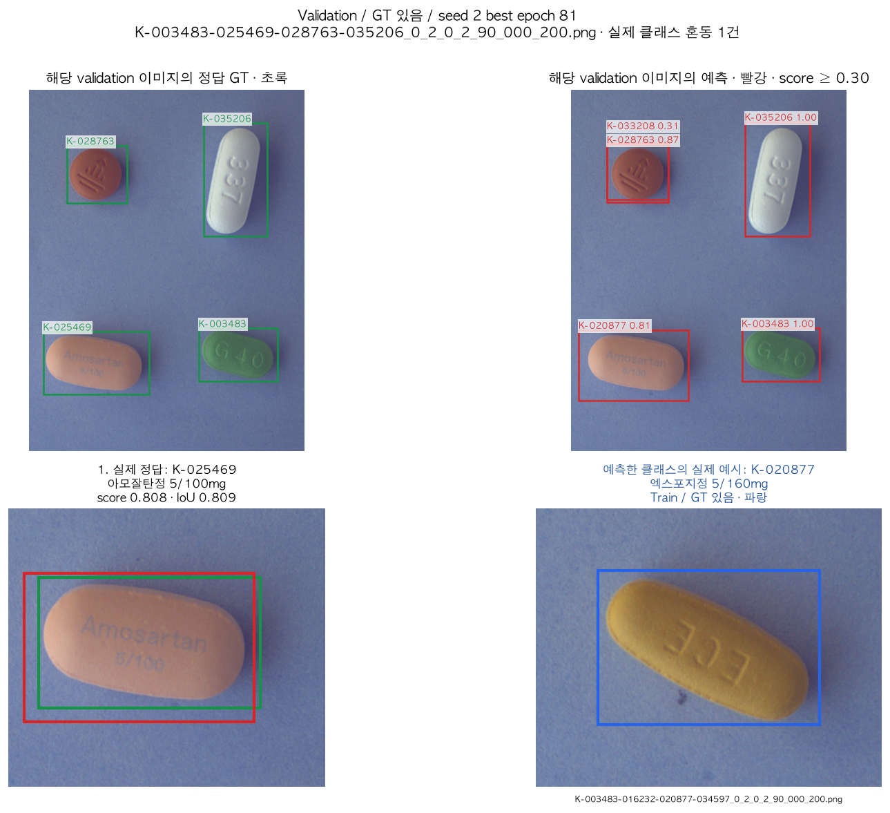

*그림 52. Validation / GT 있음 / seed 2 / best epoch 81. score ≥ 0.30, 매칭 IoU ≥ 0.75.*

1. **K-025469 아모잘탄정 5/100mg → K-020877 엑스포지정 5/160mg** · score 0.8076 · IoU 0.8090

Seed 간 방향별 혼동 쌍 발생 기록

| 정답 코드 | 정답 클래스 | 예측 코드 | 예측 클래스 | 발생_seed수 | 합계_건수 | seed_목록 |
| --- | --- | --- | --- | --- | --- | --- |
| K-025469 | 아모잘탄정 5/100mg | K-033009 | 신바로정 | 2 | 9 | 0, 1 |
| K-025469 | 아모잘탄정 5/100mg | K-020877 | 엑스포지정 5/160mg | 2 | 7 | 1, 2 |
| K-013900 | 에빅사정(메만틴염산염)(비매품) | K-036637 | 로수젯정10/5밀리그램 | 2 | 3 | 1, 2 |
| K-020238 | 플라빅스정 75mg | K-028763 | 트라젠타정(리나글립틴) | 2 | 3 | 0, 1 |
| K-030308 | 트라젠타듀오정 2.5/850mg | K-012778 | 다보타민큐정 10mg/병 | 2 | 3 | 0, 2 |
| K-030308 | 트라젠타듀오정 2.5/850mg | K-027926 | 울트라셋이알서방정 | 2 | 3 | 1, 2 |
| K-030308 | 트라젠타듀오정 2.5/850mg | K-029345 | 비모보정 500/20mg | 2 | 3 | 0, 1 |
| K-018147 | 리리카캡슐 150mg | K-035206 | 아토젯정 10/40mg | 2 | 2 | 0, 2 |
| K-018147 | 리리카캡슐 150mg | K-041768 | 카발린캡슐 25mg | 2 | 2 | 0, 2 |
| K-020238 | 플라빅스정 75mg | K-016262 | 크레스토정 20mg | 1 | 5 | 2 |
| K-018147 | 리리카캡슐 150mg | K-002483 | 뮤테란캡슐 100mg | 1 | 3 | 1 |
| K-025469 | 아모잘탄정 5/100mg | K-032310 | 글리아타민연질캡슐 | 1 | 2 | 1 |
| K-013900 | 에빅사정(메만틴염산염)(비매품) | K-021325 | 아토르바정 10mg | 1 | 1 | 2 |
| K-018147 | 리리카캡슐 150mg | K-012081 | 리렉스펜정 300mg/PTP | 1 | 1 | 0 |
| K-020238 | 플라빅스정 75mg | K-022347 | 자누비아정 50mg | 1 | 1 | 1 |
| K-028763 | 트라젠타정(리나글립틴) | K-033208 | 에스원엠프정 20mg | 1 | 1 | 0 |

같은 validation 객체를 seed마다 평가했으므로, seed를 합산한 건수를 서로 다른 객체 수로 취급하지 않는다.

### 2.5 Bbox를 잘 맞추지 못하는 클래스 분석 및 시각화

**IoU별 위치 매칭**

score ≥ 0.30의 예측과 GT를 클래스와 무관하게 일대일 연결했다. 아래 위치 매칭 비율은 AP가 아니며, 클래스가 틀린 예측도 위치가 맞으면 포함한다.

| Seed | IoU | GT 객체 | 클래스 무관 위치 매칭 | 그중 클래스도 정답 | 위치 매칭 비율 |
| --- | --- | --- | --- | --- | --- |
| 0 | 0.75 | 159 | 159 | 145 | 1.0 |
| 0 | 0.8 | 159 | 159 | 145 | 1.0 |
| 0 | 0.85 | 159 | 159 | 145 | 1.0 |
| 0 | 0.9 | 159 | 157 | 145 | 0.987421 |
| 0 | 0.95 | 159 | 129 | 128 | 0.811321 |
| 1 | 0.75 | 159 | 159 | 142 | 1.0 |
| 1 | 0.8 | 159 | 159 | 142 | 1.0 |
| 1 | 0.85 | 159 | 159 | 142 | 1.0 |
| 1 | 0.9 | 159 | 152 | 141 | 0.955975 |
| 1 | 0.95 | 159 | 129 | 128 | 0.811321 |
| 2 | 0.75 | 159 | 159 | 141 | 1.0 |
| 2 | 0.8 | 159 | 157 | 141 | 0.987421 |
| 2 | 0.85 | 159 | 153 | 141 | 0.962264 |
| 2 | 0.9 | 159 | 148 | 139 | 0.930818 |
| 2 | 0.95 | 159 | 127 | 123 | 0.798742 |

*그림 53. 각 IoU 기준에서 연결된 GT 객체 수를 전체 159개 GT 객체 수로 나눈 값. score ≥ 0.30.*

**클래스별 bbox 위치 매칭 수**

다음 표의 값은 **IoU ≥ 0.75 매칭 수 / IoU ≥ 0.95 매칭 수**다. 어느 seed에서든 매칭 수가 GT 객체 수보다 적은 클래스만 남겼다. 세 seed 모두 두 IoU 기준에서 전체 GT가 매칭된 클래스는 제외했다. 표는 세 seed의 IoU 0.95 미매칭 GT 수 합계 내림차순이며, 합계는 독립 객체 수를 뜻하지 않는다.

| 클래스 코드 | 클래스명 | GT 객체 수 | Seed 0: 0.75 / 0.95 | Seed 1: 0.75 / 0.95 | Seed 2: 0.75 / 0.95 |
| --- | --- | --- | --- | --- | --- |
| K-025469 | 아모잘탄정 5/100mg | 9 | 9 / 3 | 9 / 3 | 9 / 3 |
| K-028763 | 트라젠타정(리나글립틴) | 6 | 6 / 1 | 6 / 3 | 6 / 0 |
| K-030308 | 트라젠타듀오정 2.5/850mg | 6 | 6 / 3 | 6 / 0 | 6 / 2 |
| K-018147 | 리리카캡슐 150mg | 5 | 5 / 1 | 5 / 2 | 5 / 1 |
| K-013900 | 에빅사정(메만틴염산염)(비매품) | 4 | 4 / 1 | 4 / 1 | 4 / 1 |
| K-020238 | 플라빅스정 75mg | 7 | 7 / 3 | 7 / 4 | 7 / 5 |
| K-016232 | 리피토정 20mg | 11 | 11 / 9 | 11 / 9 | 11 / 9 |
| K-016688 | 오마코연질캡슐(오메가-3-산에틸에스테르90) | 4 | 4 / 2 | 4 / 2 | 4 / 2 |
| K-003351 | 일양하이트린정 2mg | 29 | 29 / 29 | 29 / 29 | 29 / 28 |
| K-019232 | 콜리네이트연질캡슐 400mg | 3 | 3 / 3 | 3 / 3 | 3 / 2 |
| K-020014 | 마도파정 | 3 | 3 / 3 | 3 / 3 | 3 / 2 |
| K-021325 | 아토르바정 10mg | 6 | 6 / 6 | 6 / 5 | 6 / 6 |
| K-029667 | 리바로정 4mg | 2 | 2 / 2 | 2 / 1 | 2 / 2 |
| K-031863 | 아질렉트정(라사길린메실산염) | 2 | 2 / 1 | 2 / 2 | 2 / 2 |

Seed 0: 클래스별 AP75·AP95와 차이 (차이 > 0)

| 클래스 코드 | 클래스명 | Validation GT 객체 수 | AP75 | AP95 | AP75 − AP95 |
| --- | --- | --- | --- | --- | --- |
| K-018147 | 리리카캡슐 150mg | 5 | 1.0 | 0.207921 | 0.792079 |
| K-013900 | 에빅사정(메만틴염산염)(비매품) | 4 | 1.0 | 0.257426 | 0.742574 |
| K-028763 | 트라젠타정(리나글립틴) | 6 | 0.876238 | 0.168317 | 0.707921 |
| K-025469 | 아모잘탄정 5/100mg | 9 | 1.0 | 0.336634 | 0.663366 |
| K-020238 | 플라빅스정 75mg | 7 | 0.955446 | 0.429703 | 0.525743 |
| K-031863 | 아질렉트정(라사길린메실산염) | 2 | 1.0 | 0.50495 | 0.49505 |
| K-016688 | 오마코연질캡슐(오메가-3-산에틸에스테르90) | 4 | 1.0 | 0.50495 | 0.49505 |
| K-016232 | 리피토정 20mg | 11 | 1.0 | 0.715372 | 0.284628 |
| K-030308 | 트라젠타듀오정 2.5/850mg | 6 | 0.59571 | 0.336634 | 0.259076 |

Seed 1: 클래스별 AP75·AP95와 차이 (차이 > 0)

| 클래스 코드 | 클래스명 | Validation GT 객체 수 | AP75 | AP95 | AP75 − AP95 |
| --- | --- | --- | --- | --- | --- |
| K-029667 | 리바로정 4mg | 2 | 1.0 | 0.252475 | 0.747525 |
| K-013900 | 에빅사정(메만틴염산염)(비매품) | 4 | 1.0 | 0.257426 | 0.742574 |
| K-016688 | 오마코연질캡슐(오메가-3-산에틸에스테르90) | 4 | 1.0 | 0.336634 | 0.663366 |
| K-025469 | 아모잘탄정 5/100mg | 9 | 1.0 | 0.336634 | 0.663366 |
| K-028763 | 트라젠타정(리나글립틴) | 6 | 1.0 | 0.381518 | 0.618482 |
| K-030308 | 트라젠타듀오정 2.5/850mg | 6 | 0.600449 | 0.0 | 0.600449 |
| K-020238 | 플라빅스정 75mg | 7 | 1.0 | 0.425743 | 0.574257 |
| K-018147 | 리리카캡슐 150mg | 5 | 0.787579 | 0.405941 | 0.381638 |
| K-021325 | 아토르바정 10mg | 6 | 1.0 | 0.693069 | 0.306931 |
| K-016232 | 리피토정 20mg | 11 | 1.0 | 0.779478 | 0.220522 |

Seed 2: 클래스별 AP75·AP95와 차이 (차이 > 0)

| 클래스 코드 | 클래스명 | Validation GT 객체 수 | AP75 | AP95 | AP75 − AP95 |
| --- | --- | --- | --- | --- | --- |
| K-028763 | 트라젠타정(리나글립틴) | 6 | 1.0 | 0.0 | 1.0 |
| K-020238 | 플라빅스정 75mg | 7 | 1.0 | 0.148515 | 0.851485 |
| K-018147 | 리리카캡슐 150mg | 5 | 1.0 | 0.207921 | 0.792079 |
| K-013900 | 에빅사정(메만틴염산염)(비매품) | 4 | 1.0 | 0.257426 | 0.742574 |
| K-025469 | 아모잘탄정 5/100mg | 9 | 1.0 | 0.336634 | 0.663366 |
| K-016688 | 오마코연질캡슐(오메가-3-산에틸에스테르90) | 4 | 1.0 | 0.50495 | 0.49505 |
| K-019232 | 콜리네이트연질캡슐 400mg | 3 | 1.0 | 0.554455 | 0.445545 |
| K-030308 | 트라젠타듀오정 2.5/850mg | 6 | 0.646393 | 0.224422 | 0.421971 |
| K-020014 | 마도파정 | 3 | 1.0 | 0.663366 | 0.336634 |
| K-016232 | 리피토정 20mg | 11 | 1.0 | 0.794059 | 0.205941 |
| K-003351 | 일양하이트린정 2mg | 29 | 1.0 | 0.955616 | 0.044384 |

**실제 GT·예측 bbox 비교**

아래 세 이미지는 클래스가 맞고 IoU ≥ 0.75로 연결된 사례 중 seed별 IoU가 가장 낮은 사례다. 모두 IoU 0.95 미만이다. 왼쪽은 GT(초록), 가운데는 예측(빨강), 오른쪽은 두 박스를 겹친 확대 장면이다.

*그림 54. Validation / GT 있음 / seed 0. score ≥ 0.30. 사례의 score·IoU는 아래 표에 표시했다.*

| Seed | Checkpoint epoch | 데이터 | 파일 | 진단 기준 | 유형 | score | IoU | GT | 예측 |
| --- | --- | --- | --- | --- | --- | --- | --- | --- | --- |
| 0 | 91 | validation / GT 있음 | K-003351-013900-022074_0_2_0_2_70_000_200.png | score 0.30 / IoU 0.75 | 정답 | 0.87759 | 0.900985 | K-013900 에빅사정(메만틴염산염)(비매품) | K-013900 에빅사정(메만틴염산염)(비매품) |

*그림 55. Validation / GT 있음 / seed 1. score ≥ 0.30. 사례의 score·IoU는 아래 표에 표시했다.*

| Seed | Checkpoint epoch | 데이터 | 파일 | 진단 기준 | 유형 | score | IoU | GT | 예측 |
| --- | --- | --- | --- | --- | --- | --- | --- | --- | --- |
| 1 | 90 | validation / GT 있음 | K-003351-016688-020014_0_2_0_2_90_000_200.png | score 0.30 / IoU 0.75 | 정답 | 0.955032 | 0.852143 | K-016688 오마코연질캡슐(오메가-3-산에틸에스테르90) | K-016688 오마코연질캡슐(오메가-3-산에틸에스테르90) |

*그림 56. Validation / GT 있음 / seed 2. score ≥ 0.30. 사례의 score·IoU는 아래 표에 표시했다.*

| Seed | Checkpoint epoch | 데이터 | 파일 | 진단 기준 | 유형 | score | IoU | GT | 예측 |
| --- | --- | --- | --- | --- | --- | --- | --- | --- | --- |
| 2 | 81 | validation / GT 있음 | K-003483-020238-027733-028763_0_2_0_2_70_000_200.png | score 0.30 / IoU 0.75 | 정답 | 0.79017 | 0.896867 | K-028763 트라젠타정(리나글립틴) | K-028763 트라젠타정(리나글립틴) |

### 2.6 Kaggle submission score

실제 제출 점수는 사용자가 제공한 Kaggle 제출 완료 화면에서 확인했다. 로컬 validation 점수와 별도로 표시한다.

| Seed | Best epoch | Validation mAP | 실제 Kaggle 점수 | Validation − Kaggle (p.p.) |
| --- | --- | --- | --- | --- |
| 0 | 91 | 0.933211 | 0.37633 | 55.688085 |
| 1 | 90 | 0.928546 | 0.3775 | 55.104559 |
| 2 | 81 | 0.917819 | 0.39476 | 52.305938 |

*그림 57. 각 seed의 best validation mAP와 실제 Kaggle 제출 점수. 점수 차이의 원인 해석은 포함하지 않았다.*

## 분석 근거

Score 0.001 기준의 seed별 전체 혼동행렬·오류 건수 그래프는 [별도 참고 문서](frcnn-exp1-참고-그래프.md)에 모았다.

- 수치: 각 run의 config.json, result.json, metrics.csv 및 class_support.csv.
- 예측: 각 run의 validation_predictions.pt와 comparison_manifest.json. 모델 학습·추론 없이 저장된 예측을 사용했다.
- 기존 그림: exp1-cj-faster-rcnn-rep.ipynb의 보존된 실행 출력. 원래 노트북 경로에서는 현재 파일이 확인되지 않아 보존본을 사용했다.
- 전체·오류 중심 혼동행렬과 클래스별 위치 매칭 수는 저장된 예측으로 집계했다. 2.4 오른쪽 알약 예시는 실제 학습 이미지와 GT 주석을 사용했다.
- Kaggle 점수: 사용자가 제공한 제출 완료 화면과 제출 CSV 파일명.

| Seed | 결과 폴더(run 이름) |
| --- | --- |
| 0 | cj_faster_e100_s0_exp1_b16_fast_e100_ft_lr3e-4__88800b754961 |
| 1 | cj_faster_e100_s1_exp1_b16_fast_e100_ft_lr3e-4__91b0ad1f9226 |
| 2 | cj_faster_e100_s2_exp1_b16_fast_e100_ft_lr3e-4__b013ae09ae90 |

결과 폴더는 공유 결과의 cj_runs/exp1_b16_e100/84c1a9494dfd 아래에 있다.

이미지는 같은 위치의 **Faster-R-CNN_exp1_assets/** 및 **frcnn-exp1-assets/** 폴더를 상대 경로로 참조한다. GitHub에 올릴 때 문서와 두 이미지 폴더를 함께 포함한다.
