# Faster R-CNN 2차 실험 결과

## 실험 및 평가 기준

| 항목 | 내용 |
| --- | --- |
| 모델 | Faster R-CNN ResNet50 FPN (torchvision) |
| 본실험 | v2·v3·v4 × 5·10·20 epoch, seed 0, 총 9개 독립 run |
| 학습 | COCO_V1에서 각 run 독립 미세조정, 정규화 고정 |
| 공통 validation | 기존 Kaggle 데이터 47장 + AI Hub 953장 = 1,000장 |
| 평가 대상 | 대회 클래스 74종·GT 객체 3,053개; 대회 밖 737개 GT와 관련 예측에는 로컬 평가 제외 처리 적용 |
| Train batch | 16, 기울기 누적 1회 |
| 최대 epoch·조기 종료 | 5·10·20 epoch 예산, patience 30; 9개 run 모두 예산 끝까지 학습 |
| 분석 checkpoint | 각 run에서 validation mAP가 가장 높은 best checkpoint |

| 방법 | 데이터 구성 | Train 이미지 | Train 객체 | 학습 클래스 수 |
| --- | --- | --- | --- | --- |
| v2 | 클래스별 목표 200개를 최대한 채우도록 이미지 선택 | 7,129 | 26,734 | 118 |
| v3 | 기존 train+test 등장 클래스가 하나라도 포함된 이미지 선택 | 8,974 | 33,872 | 96 |
| v4 | 전체 이미지를 사용하고 대회 대상 밖 클래스를 others로 통합 | 11,206 | 42,800 | 75 (대회 74종 + others) |

학습 클래스 수와 평가 클래스 수를 구분한다. 본문은 본실험 9개를 다루며, 2차 v1은 맨 뒤 참고 사항으로 분리한다.

## 1. 학습 과정 평가

### 1.1 Loss 곡선 시각화

방법별로 5·10·20 epoch 독립 run의 train loss·validation loss·validation mAP를 함께 표시한다. 가로축은 metrics.csv의 epoch이며, W&B 로그 step과 구분한다.

#### v2

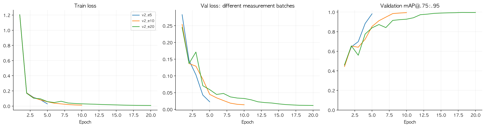

*그림 1. v2의 train loss·validation loss·validation mAP. 표시된 best epoch는 해당 run의 validation mAP 최대 시점이다.*

#### v3

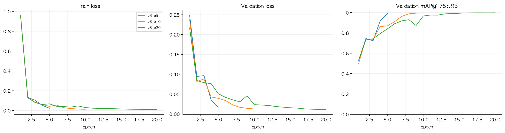

*그림 2. v3의 train loss·validation loss·validation mAP. 표시된 best epoch는 해당 run의 validation mAP 최대 시점이다.*

#### v4

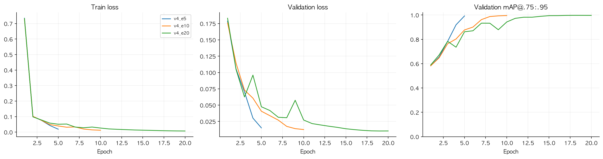

*그림 3. v4의 train loss·validation loss·validation mAP. 표시된 best epoch는 해당 run의 validation mAP 최대 시점이다.*

| Run | 실제 epoch | Best epoch | Best val mAP | Best train loss | Best val loss | 총 실제 update |
| --- | --- | --- | --- | --- | --- | --- |
| v2_e5 | 5 | 5 | 0.982110 | 0.029119 | 0.022538 | 2227 |
| v2_e10 | 10 | 10 | 0.994262 | 0.012181 | 0.013681 | 4457 |
| v2_e20 | 20 | 18 | **0.995970** | 0.009244 | 0.012113 | 8917 |
| v3_e5 | 5 | 5 | 0.989408 | 0.022737 | 0.017038 | 2803 |
| v3_e10 | 10 | 10 | 0.994927 | 0.012013 | 0.012252 | 5608 |
| v3_e20 | 20 | 20 | **0.997082** | 0.008899 | 0.010779 | 11218 |
| v4_e5 | 5 | 5 | 0.992290 | 0.018532 | 0.015148 | 3503 |
| v4_e10 | 10 | 10 | 0.995343 | 0.012009 | 0.012614 | 7008 |
| v4_e20 | 20 | 18 | **0.997244** | 0.008305 | 0.010610 | 14017 |

* 총 실제 update는 metrics.csv의 optimizer_steps 합계다. 
    * 방법마다 데이터 수가 달라 같은 epoch이라도 총 update 수가 다르다.

### 1.2 과적합·과소적합 판단

| 판단 항목 | 그래프에서 확인한 근거 | 판단 |
| --- | --- | --- |
| 학습 수렴 | v2·v3·v4 모두 초반에 train·val loss가 크게 감소하고 validation mAP가 상승했다. 20 epoch run은 후반으로 갈수록 곡선의 변화 폭이 작아졌다. | 현재 validation에서 학습은 대체로 수렴하는 양상이다. 특히 20 epoch run은 후반에 성능이 포화되는 모습을 보인다. |
| 과적합 | 일부 epoch에서 val loss가 일시적으로 상승하고 mAP가 하락했지만 이후 회복했다. 후반에도 val loss가 지속해서 상승하는 패턴은 뚜렷하지 않다. | 그래프에서 뚜렷하고 지속적인 과적합 징후는 약하다. v2_e20·v4_e20의 best 이후 작은 mAP 하락만으로 과적합을 확정하기는 어렵다. |
| 과소적합 | Train loss가 낮아지고 validation mAP도 높은 수준에 도달했다. Train·val loss가 모두 높은 상태로 정체된 모습은 보이지 않는다. | 현재 validation에서 전반적인 과소적합을 의심할 근거는 약하다. 다만 5·10 epoch run은 종료 시점까지 개선되는 모습이므로, 곡선만으로 최적 학습량에 도달했다고 단정하지 않는다. |
| 학습 종료 시점 | 5·10 epoch run은 마지막 epoch가 best다. 20 epoch run은 v2·v4가 epoch 18, v3가 epoch 20에서 best를 기록했다. | 분석에는 각 run의 best checkpoint를 사용한다. 마지막 epoch가 best인 조건은 이후에도 개선될 가능성이 있어, 현재 그래프만으로 최적 종료 시점을 확정할 수 없다. |

## 2. 예측 성능 평가

### 2.1 Confusion matrix

- 각 run의 best checkpoint에 대한 validation 예측을 사용한다.
- 로컬 평가에서는 대회 밖 클래스로 낸 예측과, 대회 밖 GT 박스에 IoU ≥ 0.50으로 겹치는 예측을 클래스와 관계없이 제외한다. 근거는 [evaluate.py의 drop_ignored](../../../src/pill_detection/evaluate.py)다.
- **score는 모델이 각 예측에 부여한 신뢰도 점수**이며, score ≥ 0.30의 예측을 남긴다.
- 클래스와 무관하게 IoU가 큰 순서로 GT·예측을 일대일 연결하고, 최소 매칭 IoU는 0.75로 둔다.
- 행은 정답, 열은 예측이다. 전체 행렬은 평가 클래스 74종과 미매칭을 포함한다.
- 각 그림은 왼쪽 건수, 오른쪽 해당 클래스 전체 GT 객체 수 대비 비율이다. 미매칭 행의 비율은 표시하지 않는다.
- 오류 중심 행렬은 오류와 관련된 클래스만 추리고, **정답 대각선에 실제 맞춘 건수와 비율**을 표시한다. 1차와 같은 빨간색 계열이며 칸 테두리는 없다. 비율의 분모는 축약하기 전 해당 클래스 전체 GT 수다.
- 오류가 없는 클래스는 제외하므로 오류 중심 행렬의 대각선 합은 전체 정답 수와 다를 수 있다.
- 마지막 열은 연결되지 않은 GT, 마지막 행은 연결되지 않은 예측이다. 매칭 IoU는 NMS IoU와 구분한다.

0.30·0.75는 기존 진단과 비교 조건을 맞춘 값이며, 최적 임계값으로 검증한 값이라는 뜻은 아니다. 이 단일 조건의 결과를 AP·mAP나 모든 조건의 분류 성능과 동일하게 해석하지 않는다.

#### v2_e5

*그림 4. v2_e5 best epoch 5. 전체 validation 1,000장·74개 평가 클래스. 왼쪽 건수, 오른쪽 전체 GT 기준 비율.*

v2_e5 오류 중심 혼동행렬

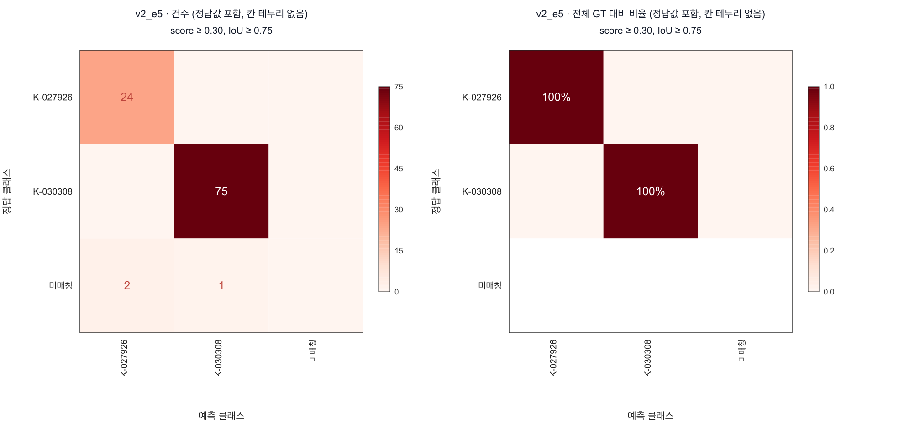

*그림 5. v2_e5. 오류 관련 클래스의 실제 정답 건수·비율을 대각선에 표시했다. 빨간색 계열, 칸 테두리 없음. 오류가 없으면 안내 그림을 표시한다.*

#### v2_e10

*그림 6. v2_e10 best epoch 10. 전체 validation 1,000장·74개 평가 클래스. 왼쪽 건수, 오른쪽 전체 GT 기준 비율.*

v2_e10 오류 중심 혼동행렬

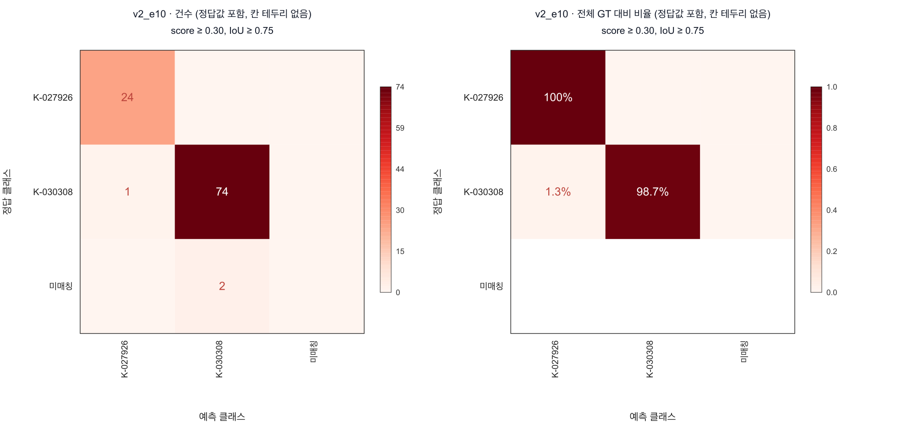

*그림 7. v2_e10. 오류 관련 클래스의 실제 정답 건수·비율을 대각선에 표시했다. 빨간색 계열, 칸 테두리 없음. 오류가 없으면 안내 그림을 표시한다.*

#### v2_e20

*그림 8. v2_e20 best epoch 18. 전체 validation 1,000장·74개 평가 클래스. 왼쪽 건수, 오른쪽 전체 GT 기준 비율.*

v2_e20 오류 중심 혼동행렬

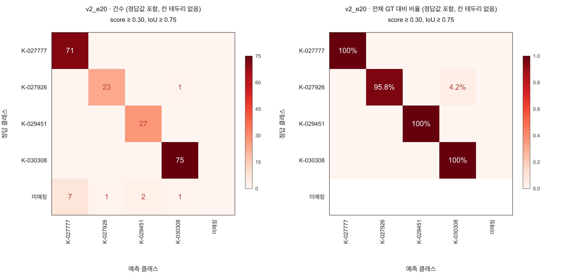

*그림 9. v2_e20. 오류 관련 클래스의 실제 정답 건수·비율을 대각선에 표시했다. 빨간색 계열, 칸 테두리 없음. 오류가 없으면 안내 그림을 표시한다.*

#### v3_e5

*그림 10. v3_e5 best epoch 5. 전체 validation 1,000장·74개 평가 클래스. 왼쪽 건수, 오른쪽 전체 GT 기준 비율.*

v3_e5 오류 중심 혼동행렬

*그림 11. v3_e5. 오류 관련 클래스의 실제 정답 건수·비율을 대각선에 표시했다. 빨간색 계열, 칸 테두리 없음. 오류가 없으면 안내 그림을 표시한다.*

#### v3_e10

*그림 12. v3_e10 best epoch 10. 전체 validation 1,000장·74개 평가 클래스. 왼쪽 건수, 오른쪽 전체 GT 기준 비율.*

v3_e10 오류 중심 혼동행렬

*그림 13. v3_e10. 오류 관련 클래스의 실제 정답 건수·비율을 대각선에 표시했다. 빨간색 계열, 칸 테두리 없음. 오류가 없으면 안내 그림을 표시한다.*

#### v3_e20

*그림 14. v3_e20 best epoch 20. 전체 validation 1,000장·74개 평가 클래스. 왼쪽 건수, 오른쪽 전체 GT 기준 비율.*

v3_e20 오류 중심 혼동행렬

*그림 15. v3_e20. 오류 관련 클래스의 실제 정답 건수·비율을 대각선에 표시했다. 빨간색 계열, 칸 테두리 없음. 오류가 없으면 안내 그림을 표시한다.*

#### v4_e5

*그림 16. v4_e5 best epoch 5. 전체 validation 1,000장·74개 평가 클래스. 왼쪽 건수, 오른쪽 전체 GT 기준 비율.*

v4_e5 오류 중심 혼동행렬

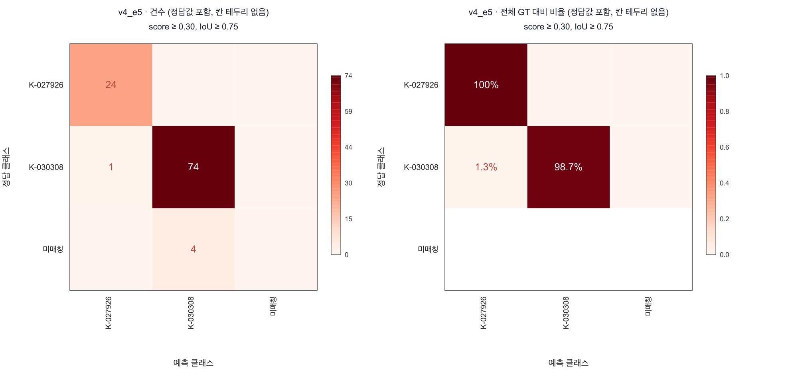

*그림 17. v4_e5. 오류 관련 클래스의 실제 정답 건수·비율을 대각선에 표시했다. 빨간색 계열, 칸 테두리 없음. 오류가 없으면 안내 그림을 표시한다.*

#### v4_e10

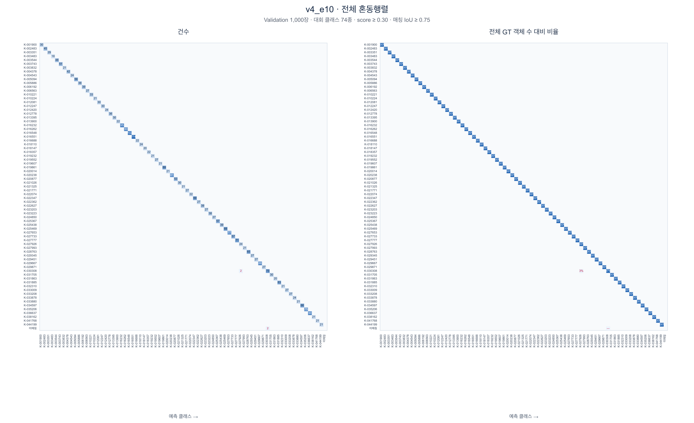

*그림 18. v4_e10 best epoch 10. 전체 validation 1,000장·74개 평가 클래스. 왼쪽 건수, 오른쪽 전체 GT 기준 비율.*

v4_e10 오류 중심 혼동행렬

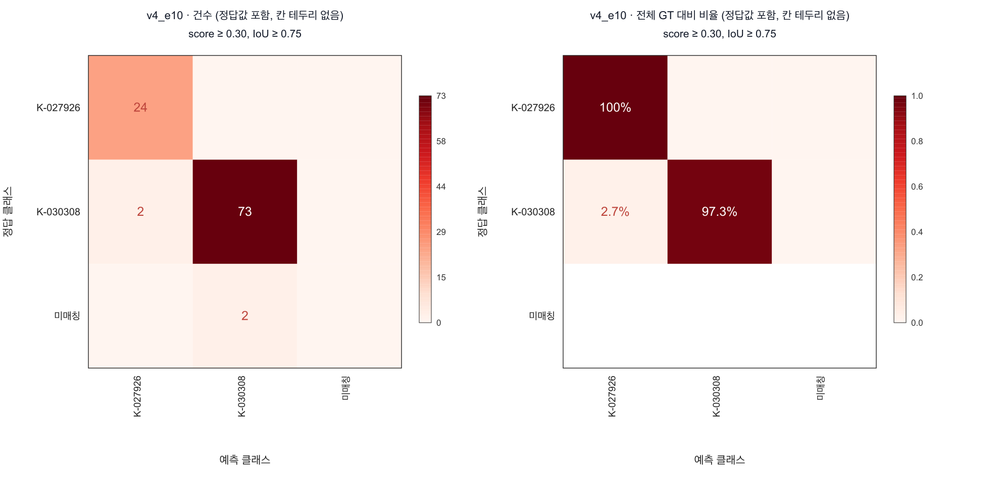

*그림 19. v4_e10. 오류 관련 클래스의 실제 정답 건수·비율을 대각선에 표시했다. 빨간색 계열, 칸 테두리 없음. 오류가 없으면 안내 그림을 표시한다.*

#### v4_e20

*그림 20. v4_e20 best epoch 18. 전체 validation 1,000장·74개 평가 클래스. 왼쪽 건수, 오른쪽 전체 GT 기준 비율.*

v4_e20 오류 중심 혼동행렬

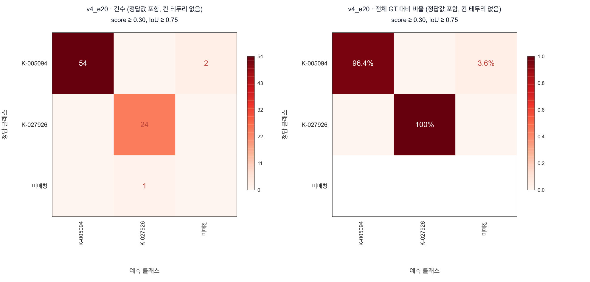

*그림 21. v4_e20. 오류 관련 클래스의 실제 정답 건수·비율을 대각선에 표시했다. 빨간색 계열, 칸 테두리 없음. 오류가 없으면 안내 그림을 표시한다.*

### 2.2 mAP@[0.75, 0.95]

본문의 mAP@[0.75, 0.95]와 클래스별 AP@[0.75, 0.95]는 **IoU 0.75·0.80·0.85·0.90·0.95의 AP 평균**을 뜻한다.

| Run | Best epoch | 전체 val mAP | 기존 val 47장 | Test-only 클래스 val |
| --- | --- | --- | --- | --- |
| v2_e5 | 5 | 0.982110 | 0.984490 | 0.984373 |
| v2_e10 | 10 | 0.994262 | 0.998691 | 0.991048 |
| v2_e20 | 18 | 0.995970 | 1.000000 | 0.994680 |
| v3_e5 | 5 | 0.989408 | 0.991451 | 0.991403 |
| v3_e10 | 10 | 0.994927 | 0.996884 | 0.994973 |
| v3_e20 | 20 | 0.997082 | 1.000000 | 0.995956 |
| v4_e5 | 5 | 0.992290 | 0.992127 | 0.990190 |
| v4_e10 | 10 | 0.995343 | 0.998212 | 0.994460 |
| v4_e20 | 18 | 0.997244 | 0.995960 | 0.996779 |

**세 validation 지표의 평가 범위와 목적**

| 지표 | 평가 사진 범위 | 점수에 포함하는 GT 클래스·객체 | 확인하려는 내용 |
| --- | --- | --- | --- |
| 전체 val mAP | 공통 validation 1,000장 | 대회 클래스 74종·3,053객체 | 2차 모델의 전체 validation 성능 |
| 기존 val 47장 | 1차부터 validation으로 고정한 기존 데이터 47장 | 이 사진에 등장하는 30종·159객체 | 같은 사진에서 기존 클래스 성능이 얼마나 개선됐는지 |
| Test-only 클래스 val | 공통 validation 1,000장에서 해당 클래스만 평가 | 초기 Test-only 18종·617객체 | 1차에서 학습하지 못했던 클래스를 데이터 보충 후 학습했는지 |

**기존 val 47장**

- **1차와 같은 사진으로 비교한다.** 기존 validation 47장·30종·159객체를 2차 모델에도 제시한 점수다.
- **추가 AI Hub validation 953장은 제외한다.** 기존 클래스의 성능 개선을 비교하는 데 사용한다.
- **평가 범위는 30종이다.** 대회 대상 74종 전체를 대표하지 않는다.
- 저장 항목 이름은 ‘kaggle’이지만 **실제 Kaggle 제출 점수는 아니다.**

**Test-only 클래스 val**

- **초기 학습 데이터에 없던 18종의 성능을 본다.** 
    - Test 이미지 검토에서 확인한 클래스로, 타이레놀정500mg(K-004378) 등이 해당한다.
- **2차에서는 학습한 클래스다.** 
    - AI Hub에서 학습 객체를 보충했으므로 현재 모델의 미학습 클래스를 뜻하지 않는다.
- **Validation 18종·617객체의 AP 평균이다.** 
    - 해당 GT는 424장에 등장하지만, 평가는 전체 1,000장에서 클래스 범위만 제한한다. 다른 사진에서 해당 클래스를 잘못 예측한 오탐도 평가될 수 있다.
- **데이터 보충 후의 학습 성과를 확인한다.** 
    - 높은 값이 실제 test 촬영 조건에서의 같은 성능을 보장하지는 않는다.

**단일 score 기준의 Precision·Recall**

score ≥ 0.30·매칭 IoU ≥ 0.75에서 micro 집계했다. 잘못된 클래스 매칭은 FP와 FN에 각각 반영한다.

| Run | TP | FP | FN | Precision | Recall |
| --- | --- | --- | --- | --- | --- |
| v2_e5 | 3053 | 3 | 0 | 0.999018 | 1.000000 |
| v2_e10 | 3052 | 3 | 1 | 0.999018 | 0.999672 |
| v2_e20 | 3052 | 12 | 1 | 0.996084 | 0.999672 |
| v3_e5 | 3053 | 0 | 0 | 1.000000 | 1.000000 |
| v3_e10 | 3053 | 0 | 0 | 1.000000 | 1.000000 |
| v3_e20 | 3053 | 0 | 0 | 1.000000 | 1.000000 |
| v4_e5 | 3052 | 5 | 1 | 0.998364 | 0.999672 |
| v4_e10 | 3051 | 4 | 2 | 0.998691 | 0.999345 |
| v4_e20 | 3051 | 1 | 2 | 0.999672 | 0.999345 |

### 2.3 클래스별 AP@[0.75, 0.95]

Validation GT가 있는 **대회 클래스 74종 전체**를 run별로 표시한다.

- 왼쪽 파랑: 다섯 IoU의 평균 AP, 아래 축.
- 왼쪽 주황: 해당 방법의 Train GT 객체 수, 위 축. 반복 노출 횟수나 이미지 수가 아니다.
- 오른쪽 색깔 점: IoU 0.75·0.80·0.85·0.90·0.95 각각의 AP.
- 1차의 seed 공통 정렬 방식처럼, 9개 run 모두 **v3_e10 평균 AP 오름차순**으로 클래스 행 순서를 통일했다. 다른 run의 AP가 같은 순서로 증가한다는 뜻은 아니다.

#### v2_e5

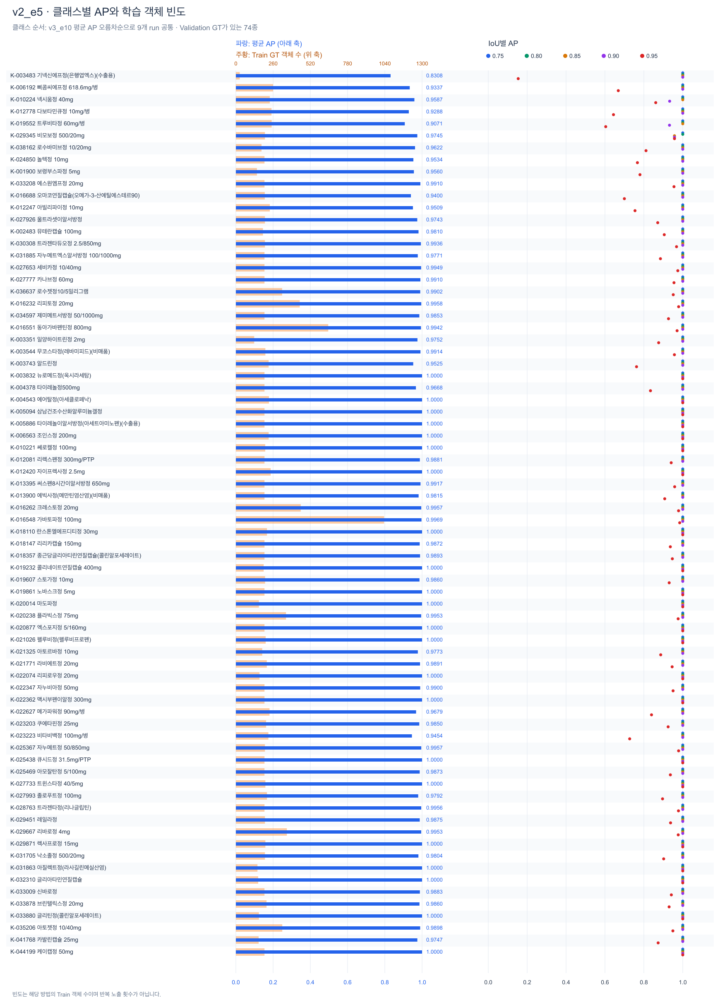

*그림 22. v2_e5 best epoch 5. 전체 validation의 74종, v3_e10 기준 공통 클래스 순서.*

#### v2_e10

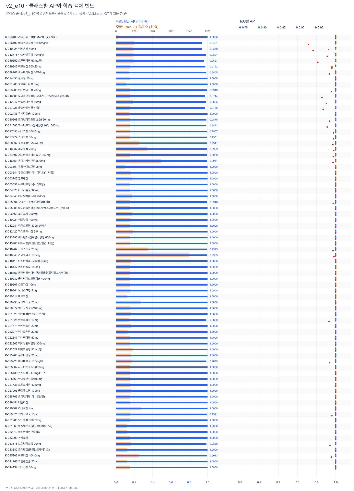

*그림 23. v2_e10 best epoch 10. 전체 validation의 74종, v3_e10 기준 공통 클래스 순서.*

#### v2_e20

*그림 24. v2_e20 best epoch 18. 전체 validation의 74종, v3_e10 기준 공통 클래스 순서.*

#### v3_e5

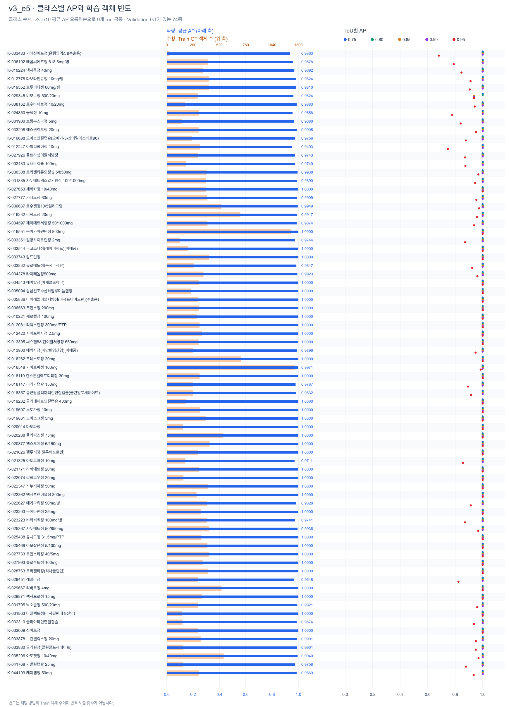

*그림 25. v3_e5 best epoch 5. 전체 validation의 74종, v3_e10 기준 공통 클래스 순서.*

#### v3_e10

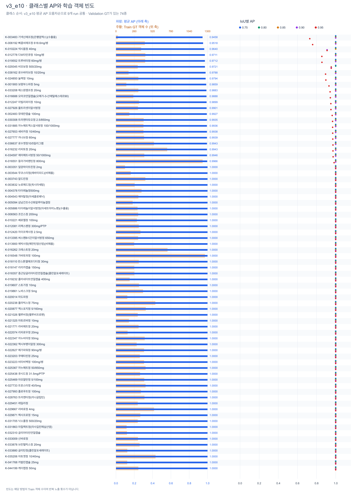

*그림 26. v3_e10 best epoch 10. 전체 validation의 74종, v3_e10 기준 공통 클래스 순서.*

#### v3_e20

*그림 27. v3_e20 best epoch 20. 전체 validation의 74종, v3_e10 기준 공통 클래스 순서.*

#### v4_e5

*그림 28. v4_e5 best epoch 5. 전체 validation의 74종, v3_e10 기준 공통 클래스 순서.*

#### v4_e10

*그림 29. v4_e10 best epoch 10. 전체 validation의 74종, v3_e10 기준 공통 클래스 순서.*

#### v4_e20

*그림 30. v4_e20 best epoch 18. 전체 validation의 74종, v3_e10 기준 공통 클래스 순서.*

**클래스별 성능 해석**

- **희소 클래스가 항상 낮은 AP를 보이지는 않았다.** 9개 조건 중 7개는 희소 집단의 평균 AP가 빈번 집단보다 높았다.
- **불균형이 주원인이라고 입증되지는 않았다.** 개별 클래스의 외형·데이터 다양성·박스 정밀도를 함께 확인해야 한다.

#### 클래스 불균형과 클래스별 AP

**희소/빈번 집단 AP**

| 방법 | 최대 epoch | 희소 평균 AP | 빈번 평균 AP | Gap |
| --- | --- | --- | --- | --- |
| v2 | 5 | 0.98420 | 0.98002 | -0.00419 |
| v2 | 10 | 0.99801 | 0.99052 | -0.00749 |
| v2 | 20 | 0.99798 | 0.99396 | -0.00401 |
| v3 | 5 | 0.98662 | 0.99220 | 0.00558 |
| v3 | 10 | 0.99519 | 0.99467 | -0.00052 |
| v3 | 20 | 0.99799 | 0.99618 | -0.00181 |
| v4 | 5 | 0.99221 | 0.99237 | 0.00015 |
| v4 | 10 | 0.99569 | 0.99500 | -0.00068 |
| v4 | 20 | 0.99803 | 0.99646 | -0.00156 |

클래스별 객체 수는 학습 당시 classes.csv와 같은 SHA-256의 표를 사용했다. Train 객체 수로 74개 평가 클래스를 정렬해 37개씩 나눴다. Gap은 ‘빈번 평균 AP − 희소 평균 AP’이다.

**관찰**

- **v2:** 모든 epoch 조건에서 gap이 음수로, 희소 집단 AP가 더 높았다.
- **v3:** e5의 양의 gap이 e10·e20에서는 음수로 바뀌었다.
- **해석:** ‘희소 클래스 AP가 항상 낮다’는 가설은 현재 validation에서 뒷받침되지 않는다.

| 방법 | 평가 클래스 수 | Train 객체 최소 | Train 객체 최대 | 최대/최소 |
| --- | --- | --- | --- | --- |
| v2 | 74 | 27 | 1035 | 38.33 |
| v3 | 74 | 27 | 1263 | 46.78 |
| v4 | 74 | 27 | 1263 | 46.78 |

- **목표 200개는 정확한 균등 분배가 아니다.** 실제 v2의 Train 객체 수는 클래스별 27~1,035개다.
- 한 이미지에 여러 클래스가 함께 등장하고, 확보 가능한 데이터 양에도 차이가 있다.

**방법별 대표 run에서 상대적으로 AP가 낮은 클래스**

| Run | 클래스 코드·이름 | Train 객체 | Val 정답 객체 | AP75 | AP95 | 평균 AP |
| --- | --- | --- | --- | --- | --- | --- |
| v2 e20 | K-006192 삐콤씨에프정 618.6mg/병 | 260 | 39 | 1.00000 | 0.81797 | 0.95440 |
| v2 e20 | K-019552 트루비타정 60mg/병 | 250 | 27 | 1.00000 | 0.84701 | 0.96940 |
| v2 e20 | K-024850 놀텍정 10mg | 200 | 27 | 1.00000 | 0.85845 | 0.97169 |
| v3 e5 | K-003483 기넥신에프정(은행엽엑스)(수출용) | 27 | 18 | 1.00000 | 0.68160 | 0.93632 |
| v3 e5 | K-012247 아빌리파이정 10mg | 327 | 30 | 1.00000 | 0.74653 | 0.94931 |
| v3 e5 | K-024850 놀텍정 10mg | 318 | 27 | 1.00000 | 0.77909 | 0.95582 |
| v4 e10 | K-006192 삐콤씨에프정 618.6mg/병 | 410 | 39 | 1.00000 | 0.78583 | 0.95717 |
| v4 e10 | K-024850 놀텍정 10mg | 318 | 27 | 1.00000 | 0.79256 | 0.95851 |
| v4 e10 | K-010224 넥시움정 40mg | 357 | 21 | 1.00000 | 0.79798 | 0.95960 |

**v2 — 클래스 빈도와 AP, epoch별 변화**

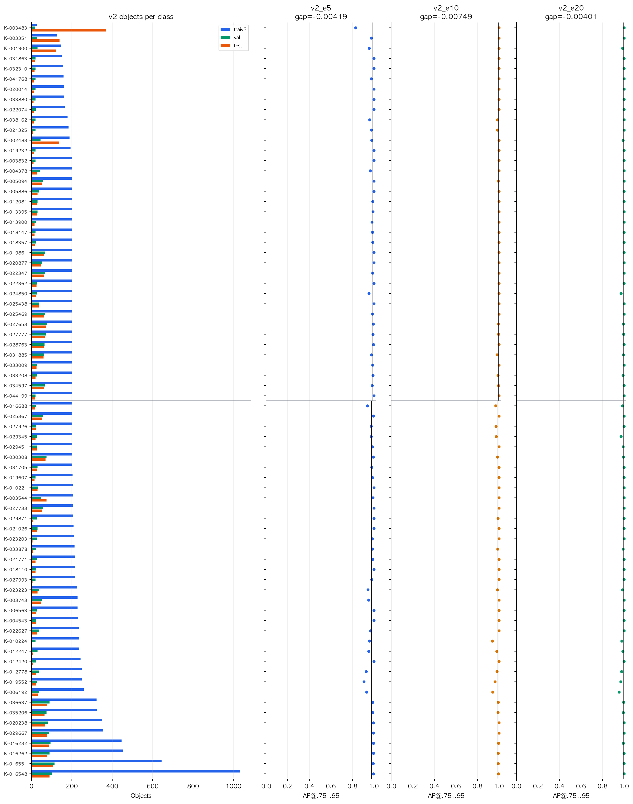

*그림 31. v2 클래스별 train 객체 수와 5·10·20 epoch AP. Train 객체 빈도와 epoch별 클래스 성능을 비교한다.*

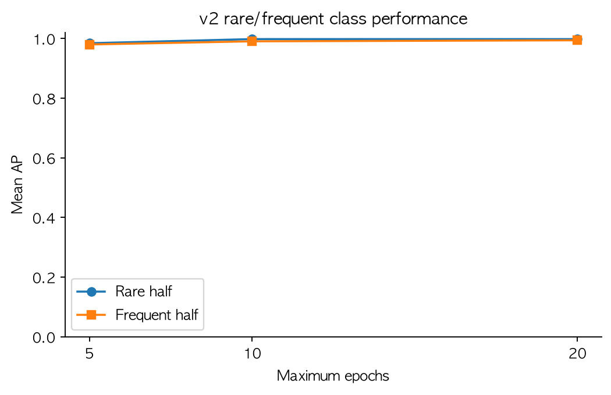

*그림 32. v2 희소·빈번 집단 평균 AP. Train 객체 빈도와 epoch별 클래스 성능을 비교한다.*

**v3 — 클래스 빈도와 AP, epoch별 변화**

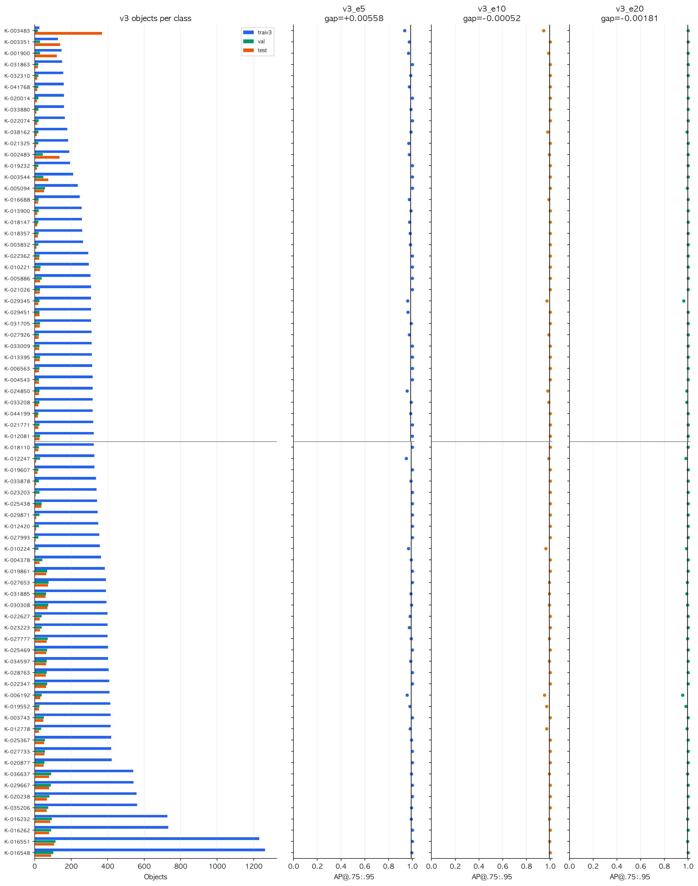

*그림 33. v3 클래스별 train 객체 수와 5·10·20 epoch AP. Train 객체 빈도와 epoch별 클래스 성능을 비교한다.*

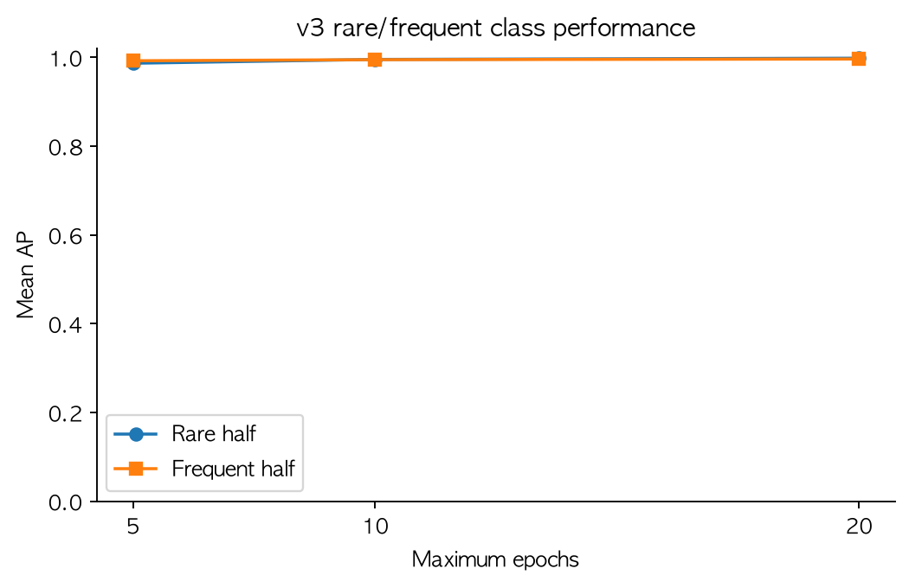

*그림 34. v3 희소·빈번 집단 평균 AP. Train 객체 빈도와 epoch별 클래스 성능을 비교한다.*

**v4 — 클래스 빈도와 AP, epoch별 변화**

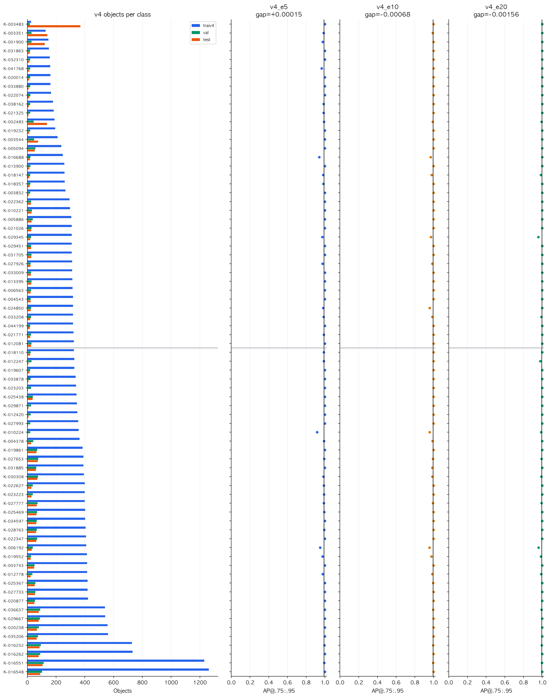

*그림 35. v4 클래스별 train 객체 수와 5·10·20 epoch AP. Train 객체 빈도와 epoch별 클래스 성능을 비교한다.*

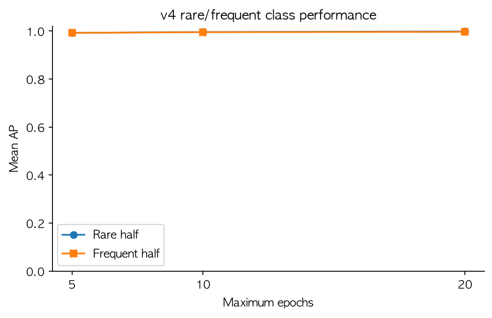

*그림 36. v4 희소·빈번 집단 평균 AP. Train 객체 빈도와 epoch별 클래스 성능을 비교한다.*

### 2.4 헷갈리는 클래스 분석 및 시각화

score ≥ 0.30·IoU ≥ 0.75에서 클래스와 무관하게 연결된 쌍 중 정답과 예측 클래스가 다른 경우다. A→B와 B→A를 구분한다.

| Run | 방향별 혼동 쌍 | 혼동 GT 객체 | 혼동 이미지 |
| --- | --- | --- | --- |
| v2_e5 | 0 | 0 | 0 |
| v2_e10 | 1 | 1 | 1 |
| v2_e20 | 1 | 1 | 1 |
| v3_e5 | 0 | 0 | 0 |
| v3_e10 | 0 | 0 | 0 |
| v3_e20 | 0 | 0 | 0 |
| v4_e5 | 1 | 1 | 1 |
| v4_e10 | 1 | 2 | 2 |
| v4_e20 | 0 | 0 | 0 |

**전체 방향별 혼동 쌍**

| Run | 정답 | 예측 | 건수 | 정답 객체 수 | 혼동 비율 |
| --- | --- | --- | --- | --- | --- |
| v2_e10 | K-030308 트라젠타듀오정 2.5/850mg | K-027926 울트라셋이알서방정 | 1 | 75 | 1.33% |
| v2_e20 | K-027926 울트라셋이알서방정 | K-030308 트라젠타듀오정 2.5/850mg | 1 | 24 | 4.17% |
| v4_e5 | K-030308 트라젠타듀오정 2.5/850mg | K-027926 울트라셋이알서방정 | 1 | 75 | 1.33% |
| v4_e10 | K-030308 트라젠타듀오정 2.5/850mg | K-027926 울트라셋이알서방정 | 2 | 75 | 2.67% |

같은 이미지를 여러 run이 평가했으므로 혼동 5건을 서로 다른 사진 5장 또는 독립 객체 5개로 해석하지 않는다. 1,000장 전체를 평가한 결과지만 score·IoU와 매칭 방식에 따라 혼동 건수가 달라질 수 있다.

**실제 혼동 사례: 전체 5건**

위쪽에는 해당 validation 이미지의 GT(초록)와 score ≥ 0.30 예측(빨강)을 표시했다. 아래 왼쪽은 혼동한 객체의 GT·예측 확대, 오른쪽은 **예측한 클래스의 실제 Train GT 알약 예시**다. 오른쪽 참조는 해당 validation 이미지의 정답이나 모델 출력이 아니다.

#### v2_e10 · K-030308 → K-027926

*그림 37. Validation / GT 있음. score 0.5103, IoU 0.9582. 오른쪽 참조: Train / K-001900-016548-021771-027926_0_2_0_2_70_000_200.png.*

원본 validation 파일: `K-003483-019861-020238-030308_0_2_0_2_75_000_200.png`

#### v2_e20 · K-027926 → K-030308

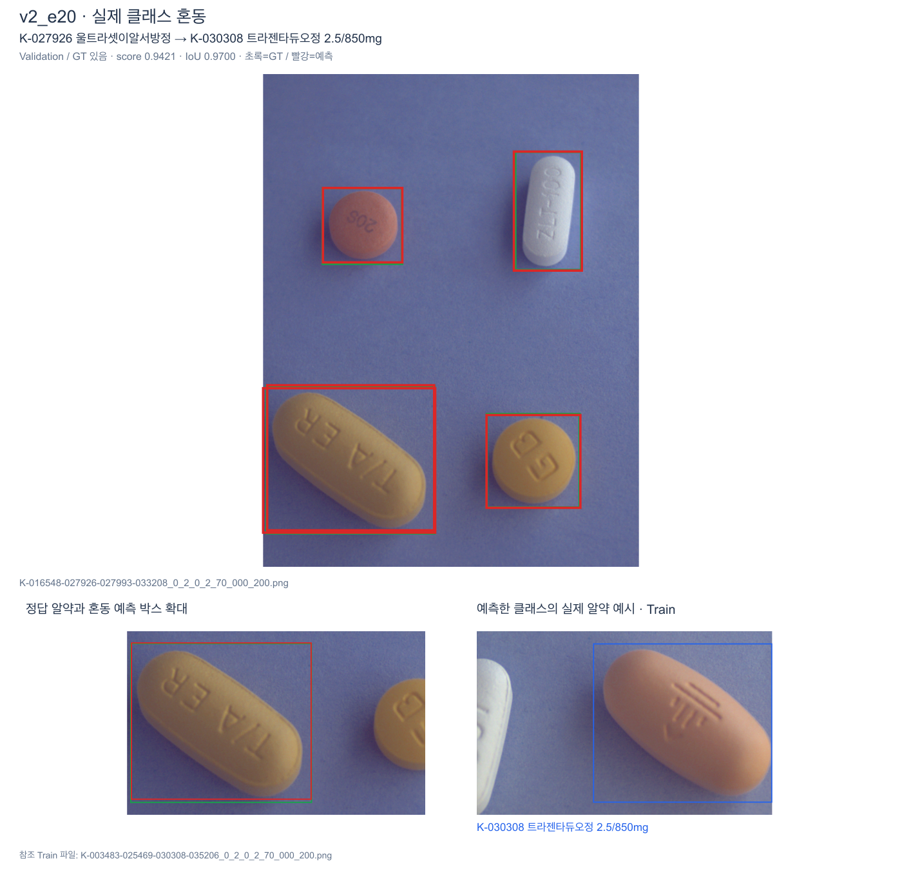

*그림 38. Validation / GT 있음. score 0.9421, IoU 0.9700. 오른쪽 참조: Train / K-003483-025469-030308-035206_0_2_0_2_70_000_200.png.*

원본 validation 파일: `K-016548-027926-027993-033208_0_2_0_2_70_000_200.png`

#### v4_e5 · K-030308 → K-027926

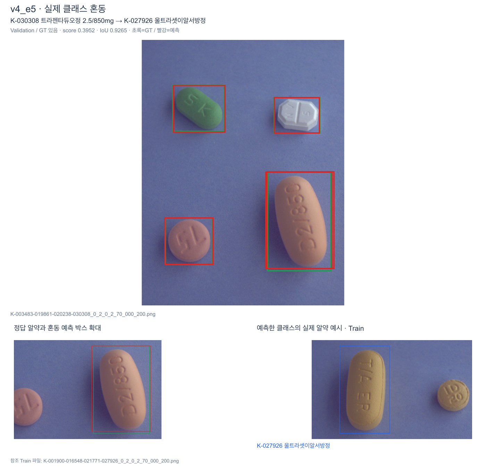

*그림 39. Validation / GT 있음. score 0.3952, IoU 0.9265. 오른쪽 참조: Train / K-001900-016548-021771-027926_0_2_0_2_70_000_200.png.*

원본 validation 파일: `K-003483-019861-020238-030308_0_2_0_2_70_000_200.png`

#### v4_e10 · K-030308 → K-027926 · 사례 1

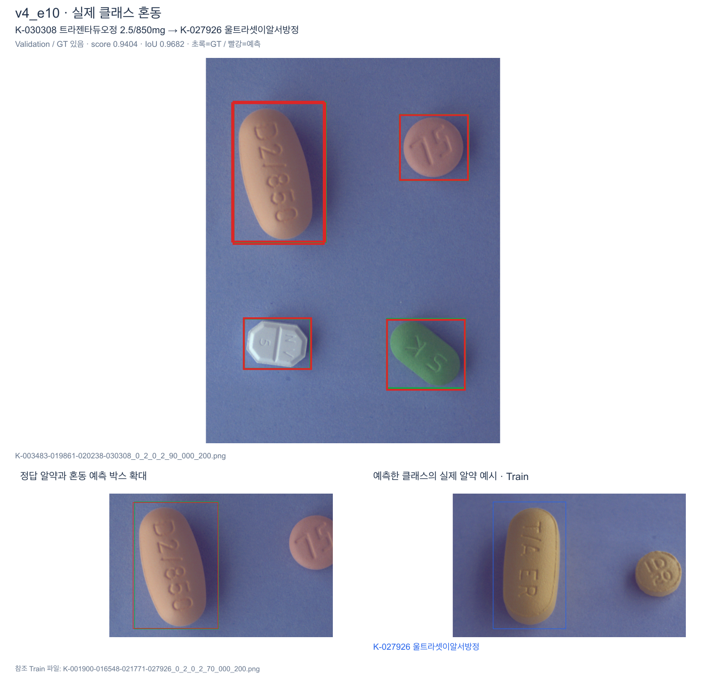

*그림 40. Validation / GT 있음. score 0.9404, IoU 0.9682. 오른쪽 참조: Train / K-001900-016548-021771-027926_0_2_0_2_70_000_200.png.*

원본 validation 파일: `K-003483-019861-020238-030308_0_2_0_2_90_000_200.png`

#### v4_e10 · K-030308 → K-027926 · 사례 2

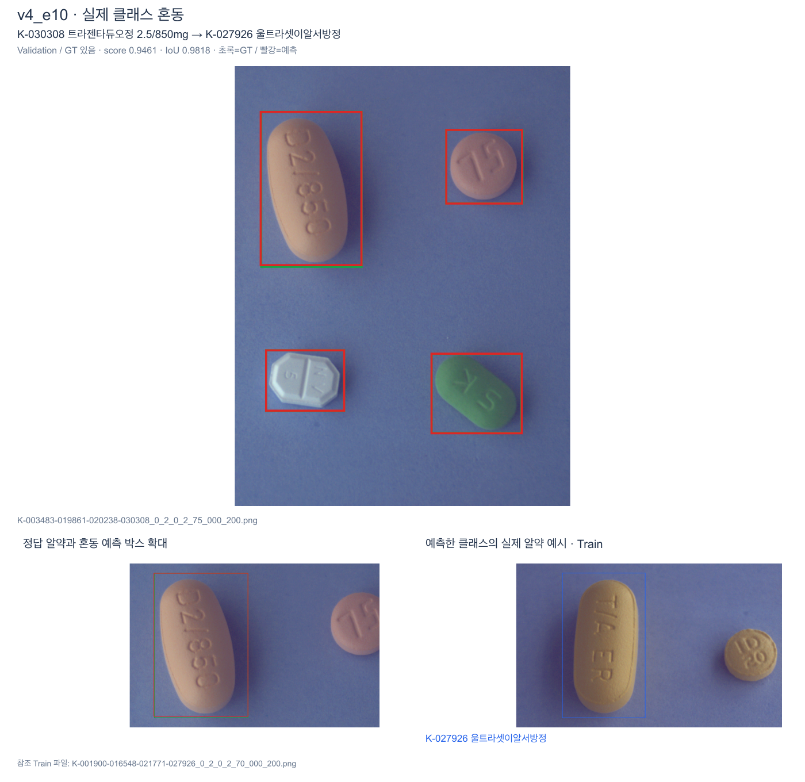

*그림 41. Validation / GT 있음. score 0.9461, IoU 0.9818. 오른쪽 참조: Train / K-001900-016548-021771-027926_0_2_0_2_70_000_200.png.*

원본 validation 파일: `K-003483-019861-020238-030308_0_2_0_2_75_000_200.png`

**원인 해석**

- **혼동은 두 클래스에 집중됐다.** 
    - K-030308(트라젠타듀오정) ↔ K-027926(울트라셋이알서방정)이며, 혼동 예측의 IoU는 0.9265~0.9818이다.
- **5건 중 4건에는 올바른 클래스 예측도 있었다.** 
    - 같은 GT에 대해 score ≥ 0.30·IoU ≥ 0.75인 정답 클래스 박스가 함께 존재했다.
- **IoU 우선 매칭이 결과에 영향을 줬다.** 
    - v2_e10의 정답 예측은 score 0.7972·IoU 0.9547, 오답은 score 0.5103·IoU 0.9582다. IoU가 더 큰 오답이 먼저 연결돼 혼동으로 집계됐다.
- **실제 분류 취약성도 남았다.** 
    - v2_e20은 오답 score 0.9421이 정답 0.3497보다 높았고, v4_e10의 다른 한 사례에는 기준을 충족하는 정답 클래스 예측이 없었다.
- **외형 유사성은 가설이다.** 
    - 장방형 외형은 원인 후보지만 색·각인·방향 중 무엇이 결정적이었는지는 확정하지 못했다.
- **해석할 때 구분한다.** 
    - 모든 혼동을 ‘정답 클래스를 전혀 예측하지 못한 오류’로 보지 않고, 중복 예측과 매칭 방식의 영향도 함께 본다.

### 2.5 Bbox를 잘 맞추지 못하는 클래스 분석 및 시각화

**IoU별 위치 매칭**

score ≥ 0.30의 예측을 클래스와 무관하게 IoU 내림차순으로 일대일 연결했다. 위치 매칭 비율은 연결된 GT 수 ÷ 3,053이며 AP가 아니다. 클래스가 틀려도 위치가 맞으면 포함한다. 0.75에서의 재집계 TP·FP·FN은 9개 run 모두 저장된 진단 결과와 일치했다.

| Run | IoU 0.75 매칭 | IoU 0.95 매칭 | 0.95 미매칭 GT | 0.95 위치 매칭 비율 |
| --- | --- | --- | --- | --- |
| v2_e5 | 3053 | 2908 | 145 | 95.25% |
| v2_e10 | 3053 | 3005 | 48 | 98.43% |
| v2_e20 | 3053 | 3023 | 30 | 99.02% |
| v3_e5 | 3053 | 2978 | 75 | 97.54% |
| v3_e10 | 3053 | 3016 | 37 | 98.79% |
| v3_e20 | 3053 | 3029 | 24 | 99.21% |
| v4_e5 | 3053 | 2997 | 56 | 98.17% |
| v4_e10 | 3053 | 3016 | 37 | 98.79% |
| v4_e20 | 3051 | 3029 | 24 | 99.21% |

**클래스별 bbox 위치 매칭 수**

아래는 방법별 Kaggle 최고 run(v2_e20·v3_e5·v4_e10)에서 IoU 0.95 미매칭 합계가 큰 상위 10개 클래스다. 값은 0.75 매칭 수 / 0.95 매칭 수다. 정답 객체가 모두 매칭된 클래스는 제외했다. 나머지 클래스와 전체 9개 run의 집계는 분석 근거 JSON에 보존했다.

| 클래스 | GT 객체 | v2_e20: .75 / .95 | v3_e5: .75 / .95 | v4_e10: .75 / .95 |
| --- | --- | --- | --- | --- |
| K-006192 삐콤씨에프정 618.6mg/병 | 39 | 39 / 35 | 39 / 34 | 39 / 34 |
| K-024850 놀텍정 10mg | 27 | 27 / 25 | 27 / 23 | 27 / 23 |
| K-019552 트루비타정 60mg/병 | 27 | 27 / 24 | 27 / 25 | 27 / 25 |
| K-030308 트라젠타듀오정 2.5/850mg | 75 | 75 / 74 | 75 / 73 | 75 / 71 |
| K-010224 넥시움정 40mg | 21 | 21 / 20 | 21 / 19 | 21 / 18 |
| K-012778 다보타민큐정 10mg/병 | 36 | 36 / 34 | 36 / 34 | 36 / 34 |
| K-002483 뮤테란캡슐 100mg | 45 | 45 / 44 | 45 / 42 | 45 / 44 |
| K-012247 아빌리파이정 10mg | 30 | 30 / 29 | 30 / 26 | 30 / 30 |
| K-016232 리피토정 20mg | 95 | 95 / 93 | 95 / 93 | 95 / 94 |
| K-016688 오마코연질캡슐(오메가-3-산에틸에스테르90) | 22 | 22 / 21 | 22 / 20 | 22 / 20 |

**클래스별 AP75−AP95 차이**

각 run에서 AP75−AP95가 양수인 클래스 중 차이가 큰 상위 5개를 표시한다. 이 차이만으로 순수한 bbox 오류라고 확정하지 않고, 위 위치 매칭과 실제 박스를 함께 본다.

- **빈도가 충분해도 AP95가 낮을 수 있다.** v4_e10의 K-006192·K-024850은 Train 410·318객체지만 AP95는 0.78583·0.79256이다.
- **적은 데이터와 엄격한 bbox 기준을 함께 본다.** v3_e5의 K-003483은 Train 27객체로 AP75=1.00000, AP95=0.68160이다.

v2_e5: AP75−AP95 상위 5개

| 클래스 | Val GT | AP75 | AP95 | 차이 |
| --- | --- | --- | --- | --- |
| K-003483 기넥신에프정(은행엽엑스)(수출용) | 18 | 1.000000 | 0.153905 | 0.846095 |
| K-019552 트루비타정 60mg/병 | 27 | 1.000000 | 0.603888 | 0.396112 |
| K-012778 다보타민큐정 10mg/병 | 36 | 1.000000 | 0.643812 | 0.356188 |
| K-006192 삐콤씨에프정 618.6mg/병 | 39 | 1.000000 | 0.668518 | 0.331482 |
| K-016688 오마코연질캡슐(오메가-3-산에틸에스테르90) | 22 | 1.000000 | 0.699801 | 0.300199 |

v2_e10: AP75−AP95 상위 5개

| 클래스 | Val GT | AP75 | AP95 | 차이 |
| --- | --- | --- | --- | --- |
| K-006192 삐콤씨에프정 618.6mg/병 | 39 | 1.000000 | 0.715700 | 0.284300 |
| K-010224 넥시움정 40mg | 21 | 1.000000 | 0.763791 | 0.236209 |
| K-019552 트루비타정 60mg/병 | 27 | 1.000000 | 0.813404 | 0.186596 |
| K-016688 오마코연질캡슐(오메가-3-산에틸에스테르90) | 22 | 1.000000 | 0.856796 | 0.143204 |
| K-027926 울트라셋이알서방정 | 24 | 1.000000 | 0.868930 | 0.131070 |

v2_e20: AP75−AP95 상위 5개

| 클래스 | Val GT | AP75 | AP95 | 차이 |
| --- | --- | --- | --- | --- |
| K-006192 삐콤씨에프정 618.6mg/병 | 39 | 1.000000 | 0.817974 | 0.182026 |
| K-019552 트루비타정 60mg/병 | 27 | 1.000000 | 0.847015 | 0.152985 |
| K-024850 놀텍정 10mg | 27 | 1.000000 | 0.858453 | 0.141547 |
| K-012778 다보타민큐정 10mg/병 | 36 | 1.000000 | 0.889989 | 0.110011 |
| K-023223 비타비백정 100mg/병 | 38 | 1.000000 | 0.929797 | 0.070203 |

v3_e5: AP75−AP95 상위 5개

| 클래스 | Val GT | AP75 | AP95 | 차이 |
| --- | --- | --- | --- | --- |
| K-003483 기넥신에프정(은행엽엑스)(수출용) | 18 | 1.000000 | 0.681601 | 0.318399 |
| K-012247 아빌리파이정 10mg | 30 | 1.000000 | 0.746535 | 0.253465 |
| K-024850 놀텍정 10mg | 27 | 1.000000 | 0.779091 | 0.220909 |
| K-006192 삐콤씨에프정 618.6mg/병 | 39 | 1.000000 | 0.789238 | 0.210762 |
| K-029451 레일라정 | 27 | 1.000000 | 0.823847 | 0.176153 |

v3_e10: AP75−AP95 상위 5개

| 클래스 | Val GT | AP75 | AP95 | 차이 |
| --- | --- | --- | --- | --- |
| K-003483 기넥신에프정(은행엽엑스)(수출용) | 18 | 1.000000 | 0.729034 | 0.270966 |
| K-006192 삐콤씨에프정 618.6mg/병 | 39 | 1.000000 | 0.758962 | 0.241038 |
| K-012778 다보타민큐정 10mg/병 | 36 | 1.000000 | 0.855314 | 0.144686 |
| K-019552 트루비타정 60mg/병 | 27 | 1.000000 | 0.856238 | 0.143762 |
| K-038162 로수바미브정 10/20mg | 21 | 1.000000 | 0.894059 | 0.105941 |

v3_e20: AP75−AP95 상위 5개

| 클래스 | Val GT | AP75 | AP95 | 차이 |
| --- | --- | --- | --- | --- |
| K-006192 삐콤씨에프정 618.6mg/병 | 39 | 1.000000 | 0.765581 | 0.234419 |
| K-012247 아빌리파이정 10mg | 30 | 1.000000 | 0.910174 | 0.089826 |
| K-019552 트루비타정 60mg/병 | 27 | 1.000000 | 0.915080 | 0.084920 |
| K-010224 넥시움정 40mg | 21 | 1.000000 | 0.934465 | 0.065535 |
| K-029345 비모보정 500/20mg | 27 | 1.000000 | 0.937294 | 0.062706 |

v4_e5: AP75−AP95 상위 5개

| 클래스 | Val GT | AP75 | AP95 | 차이 |
| --- | --- | --- | --- | --- |
| K-010224 넥시움정 40mg | 21 | 1.000000 | 0.677452 | 0.322548 |
| K-016688 오마코연질캡슐(오메가-3-산에틸에스테르90) | 22 | 1.000000 | 0.700270 | 0.299730 |
| K-006192 삐콤씨에프정 618.6mg/병 | 39 | 1.000000 | 0.747618 | 0.252382 |
| K-041768 카발린캡슐 25mg | 21 | 1.000000 | 0.833333 | 0.166667 |
| K-019552 트루비타정 60mg/병 | 27 | 1.000000 | 0.874587 | 0.125413 |

v4_e10: AP75−AP95 상위 5개

| 클래스 | Val GT | AP75 | AP95 | 차이 |
| --- | --- | --- | --- | --- |
| K-006192 삐콤씨에프정 618.6mg/병 | 39 | 1.000000 | 0.785826 | 0.214174 |
| K-024850 놀텍정 10mg | 27 | 1.000000 | 0.792564 | 0.207436 |
| K-010224 넥시움정 40mg | 21 | 1.000000 | 0.797982 | 0.202018 |
| K-016688 오마코연질캡슐(오메가-3-산에틸에스테르90) | 22 | 1.000000 | 0.858086 | 0.141914 |
| K-019552 트루비타정 60mg/병 | 27 | 1.000000 | 0.888018 | 0.111982 |

v4_e20: AP75−AP95 상위 5개

| 클래스 | Val GT | AP75 | AP95 | 차이 |
| --- | --- | --- | --- | --- |
| K-006192 삐콤씨에프정 618.6mg/병 | 39 | 1.000000 | 0.803059 | 0.196941 |
| K-012247 아빌리파이정 10mg | 30 | 1.000000 | 0.894841 | 0.105159 |
| K-018147 리리카캡슐 150mg | 20 | 1.000000 | 0.928218 | 0.071782 |
| K-029345 비모보정 500/20mg | 27 | 1.000000 | 0.930326 | 0.069674 |
| K-019552 트루비타정 60mg/병 | 27 | 1.000000 | 0.937294 | 0.062706 |

**실제 GT·예측 bbox 비교**

방법별 Kaggle 최고 run에서 클래스가 맞고 IoU ≥ 0.75로 연결된 사례 중 IoU가 가장 낮은 사례를 선택했다. 선택 결과 세 run 모두 같은 이미지·클래스여서 동일한 객체의 박스 차이도 볼 수 있다. 전체 bbox 오류의 분포를 대표하도록 무작위 추출한 사례는 아니다.

*그림 42. Validation / GT 있음 / v2_e20. 왼쪽 GT(초록), 가운데 예측(빨강), 오른쪽 겹침. score 0.9996 / IoU 0.8134.*

원본 파일: `K-003544-016548-029345-033878_0_2_0_2_90_000_200.png`

*그림 43. Validation / GT 있음 / v3_e5. 왼쪽 GT(초록), 가운데 예측(빨강), 오른쪽 겹침. score 0.9975 / IoU 0.8209.*

원본 파일: `K-003544-016548-029345-033878_0_2_0_2_90_000_200.png`

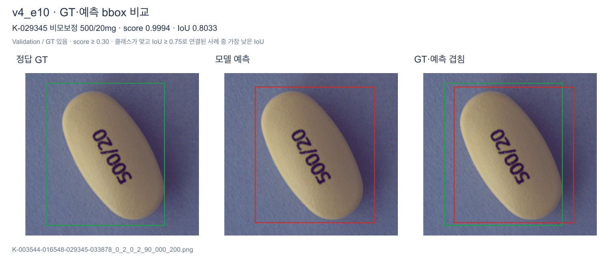

*그림 44. Validation / GT 있음 / v4_e10. 왼쪽 GT(초록), 가운데 예측(빨강), 오른쪽 겹침. score 0.9994 / IoU 0.8033.*

원본 파일: `K-003544-016548-029345-033878_0_2_0_2_90_000_200.png`

**Bbox 성능 해석**

- **엄격한 위치 기준에서도 성능이 개선됐다.** 
    - 독립 run의 e5→e20 비교에서 IoU 0.95 위치 매칭 비율은 v2 95.25%→99.02%, v3 97.54%→99.21%, v4 98.17%→99.21%다.
- **일부 클래스는 IoU 0.95에서 취약하다.** 
    - K-006192·K-024850·K-019552 등은 0.75에서 전부 연결돼도 0.95에서는 일부가 빠진다.
- **높은 score가 정밀한 bbox를 보장하지 않는다.** 
    - 실제 K-029345 예시는 score 0.9975 이상이지만, 박스 중심·폭·경계 차이로 IoU가 0.8033~0.8209다.
- **낮은 AP95에는 박스 정밀도가 관여한다.** 
    - 다만 AP는 오탐·score 순서에도 영향을 받으며, 실제 test 격차에서 bbox 오류의 기여량은 측정하지 않았다.

### 2.6 Kaggle submission score

실제 Kaggle 점수는 사용자가 제공한 제출 완료 화면에서 확인한 값이다. 전체 validation과 별도로 표시한다.

| Run | Best epoch | 전체 val mAP | 실제 Kaggle | Val − Kaggle (p.p.) |
| --- | --- | --- | --- | --- |
| v2_e5 | 5 | 0.982110 | 0.60153 | 38.06 |
| v2_e10 | 10 | 0.994262 | 0.59879 | 39.55 |
| v2_e20 | 18 | 0.995970 | **0.60222** | 39.38 |
| v3_e5 | 5 | 0.989408 | **0.61109** | 37.83 |
| v3_e10 | 10 | 0.994927 | 0.59750 | 39.74 |
| v3_e20 | 20 | 0.997082 | 0.59992 | 39.72 |
| v4_e5 | 5 | 0.992290 | 0.60559 | 38.67 |
| v4_e10 | 10 | 0.995343 | **0.60966** | 38.57 |
| v4_e20 | 18 | 0.997244 | 0.58785 | 40.94 |

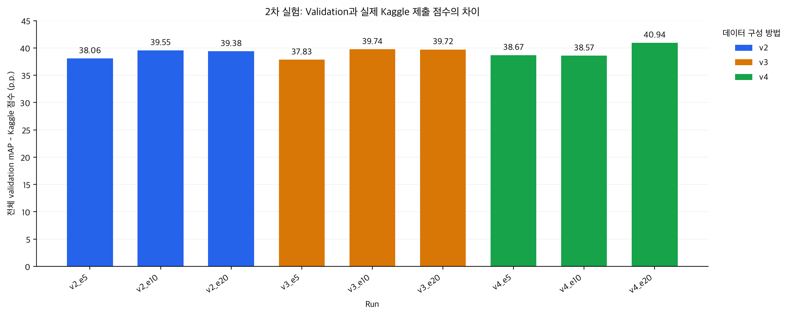

*그림 45. 전체 validation mAP − 실제 Kaggle 제출 점수의 run별 차이. 세로축은 점수 차이이며 정답률이나 틀린 객체 비율이 아니다.*

### 2.7 Validation과 Kaggle 점수는 왜 차이가 날까?

#### 2.7.1 차이가 어디서 발생하는가?

| 방법 | 최대 epoch | 전체 val | 기존 Kaggle val | 실제 Kaggle | 전체 val−실제 Kaggle |
| --- | --- | --- | --- | --- | --- |
| v2 | 5 | 0.98211 | 0.98449 | 0.60153 | 0.38058 |
| v2 | 10 | 0.99426 | 0.99869 | 0.59879 | 0.39547 |
| v2 | 20 | 0.99597 | 1.00000 | **0.60222** | 0.39375 |
| v3 | 5 | 0.98941 | 0.99145 | **0.61109** | 0.37832 |
| v3 | 10 | 0.99493 | 0.99688 | 0.59750 | 0.39743 |
| v3 | 20 | 0.99708 | 1.00000 | 0.59992 | 0.39716 |
| v4 | 5 | 0.99229 | 0.99213 | 0.60559 | 0.38670 |
| v4 | 10 | 0.99534 | 0.99821 | **0.60966** | 0.38568 |
| v4 | 20 | 0.99724 | 0.99596 | 0.58785 | 0.40939 |

위 2.6의 점수 차이 막대그래프와 함께 본다.

- **점수 차이:** v3_e5의 val mAP는 0.98941, 실제 Kaggle은 0.61109다.
- **해석 주의:** mAP는 정답률과 다른 지표다. 이 차이를 ‘알약의 약 38%를 틀렸다’는 뜻으로 읽으면 안 된다.

- **AI Hub가 섞인 전체 val에서만 높은 점수가 나온 것은 아니다.** 기존 Kaggle val 47장 점수도 0.98449~1.00000로 높다.
- **2차의 점수 차이를 ‘학습에 없던 18종’만으로 설명하기 어렵다.** 2차에서는 해당 클래스를 포함한 74종 모두 학습 객체가 있고, test-only 클래스의 val mAP도 0.98437~0.99678다.
- 다만 이 수치만으로 실제 test 촬영 조건·분포 차이, 분할의 유사 이미지 문제, 평가 정책 등의 영향을 분리할 수는 없다.

#### 2.7.2 점수 격차의 원인 해석

- **확인된 현상:** Validation−Kaggle 차이는 37.83~40.94 p.p.이며, val 상승이 Kaggle 상승으로 이어지지 않는다.
- **1차와 구분할 점:** 2차는 초기 미학습 18종도 학습했으므로, 남은 격차를 ‘학습하지 못한 클래스 때문’으로만 설명하기 어렵다.

| 원인 후보 | 현재 확인한 근거 | 해석과 검증 한계 |
| --- | --- | --- |
| Validation의 대표성과 test 촬영 조건 | 전체 val뿐 아니라 기존 47장에서도 0.98449~1.00000로 높지만 Kaggle은 0.58785~0.61109다. | 현재 validation 점수만으로 test 성능을 충분히 예측하기 어렵다. 배경·조명·각도·크기 등 조건 차이의 실제 영향은 확인하지 않았다. |
| 클래스 구성과 빈도 | Train 객체 수의 최대/최소 비율이 v2 38.33, v3·v4 46.78이다. 희소 집단 AP가 일관되게 더 낮지는 않다. | 불균형은 남아 있으나 현재 validation 결과만으로 격차의 주원인이라고 단정할 수 없다. 클래스별 데이터 다양성도 함께 봐야 한다. |
| Train·validation의 유사 사진 | images.csv의 train/val 사이 동일 combo 중복은 0개다. 촬영 조건이나 유사 이미지 자체의 중복은 조사하지 않았다. | 같은 조합을 양쪽에 넣은 단순 누수는 확인되지 않았다. 근접 이미지·촬영 조건의 독립성은 별도 검증 대상이다. |
| 학습 예산과 일반화 | v3 e5→e20에서 val은 상승하지만 Kaggle은 0.61109→0.59992로 낮아진다. | Validation 기준의 개선이 test 개선을 보장하지 않는다. 독립 run·학습률 진행 차이가 있어 과적합의 인과 증거로 확정하지 않는다. |
| 평가 처리와 제출 변환 | 규칙상 지표 범위는 모두 IoU 0.75~0.95다. 로컬 val에는 대회 외 GT와 관련 예측을 무시하는 처리가 있다. | 지표 범위 자체가 다르다는 근거는 없다. 무시 규칙의 영향과 체크포인트·클래스 ID·좌표·이미지 ID 변환 일치는 검증이 더 필요하다. |
| 박스 정밀도와 라벨·박스 기준 | 일부 클래스는 AP75보다 AP95가 낮고 실제 예시에도 박스 경계 차이가 있다. | Validation에서 bbox 취약성은 확인된다. 숨겨진 test GT가 없어 그것이 제출 격차에 기여한 정도나 라벨 오류 여부는 확정할 수 없다. |

- **현재 결론:** 데이터 보충 후 성능은 개선됐다. 남은 격차는 validation의 대표성과 평가·제출 경로를 확인하며 해석해야 한다.
- **결론의 범위:** 각 원인의 기여량을 분리하지 않았으므로, test나 불균형 한 요인만의 문제로 확정하지 않는다.

## 3. 1차 vs 2차 예측 성능 비교

### 3.1 비교 범위와 기준

1차는 validation 47장·30개 GT 클래스를 평가했고, 2차 전체 validation은 1,000장·대회 클래스 74종이다. 이 둘의 전체 mAP 차이를 같은 시험지에서의 향상으로 표시하지 않는다. 직접 비교에는 **같은 기존 validation 47장·159객체·30종**으로 재평가한 결과를 사용한다. 1차는 seed 0·1·2, 2차는 seed 0이므로 seed 반복 범위도 다르다.

1차에는 test 검토에서 발견한 18개 클래스가 train에 없었다. 조합이 하나뿐인 17개 클래스를 train에 고정한 분할 정책으로 학습 56종 중 validation에는 30종만 포함됐다. 이 사실은 1차 평가 범위의 한계이며, 2차 전체 validation에 그대로 적용해 설명하지 않는다.

### 3.2 동일 validation 47장에서의 mAP 비교

| 실험 | Run / Seed | 공통 47장 mAP | 1차 3-seed 평균 대비 (p.p.) |
| --- | --- | --- | --- |
| 1차 | 1차_seed0 | 0.933211 | — |
| 1차 | 1차_seed1 | 0.928546 | — |
| 1차 | 1차_seed2 | 0.917819 | — |
| 2차 | v2_e5 | 0.984424 | 5.79 |
| 2차 | v2_e10 | 0.998691 | 7.22 |
| 2차 | v2_e20 | 1.000000 | 7.35 |
| 2차 | v3_e5 | 0.991398 | 6.49 |
| 2차 | v3_e10 | 0.996884 | 7.04 |
| 2차 | v3_e20 | 1.000000 | 7.35 |
| 2차 | v4_e5 | 0.992127 | 6.56 |
| 2차 | v4_e10 | 0.998212 | 7.17 |
| 2차 | v4_e20 | 0.995894 | 6.94 |

1차 3-seed 평균은 0.926525다. 위 변화량은 기준 평균 대비 관측값의 차이이며, 동일 seed의 통제 실험이나 통계적 유의성 검정 결과가 아니다. 재평가 경로·수치 정밀도 차이로 2.2의 저장된 47장 점수와 일부 소수점 차이가 있다.

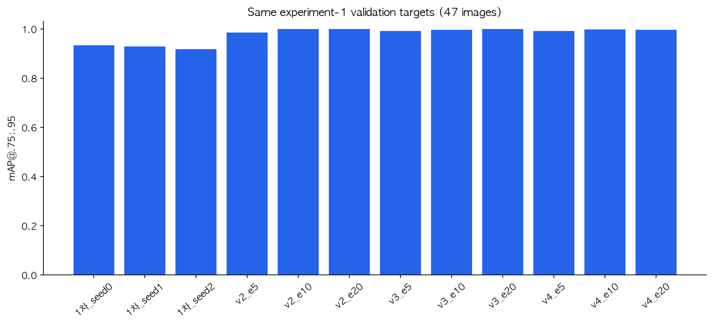

*그림 46. 모든 run을 동일한 기존 validation 47장으로 재평가한 mAP.*

### 3.3 실제 Kaggle 점수 비교

| 단계 | Run / Seed | 실제 Kaggle 점수 |
| --- | --- | --- |
| 1차 | seed 0 | 0.37633 |
| 1차 | seed 1 | 0.37750 |
| 1차 | seed 2 | 0.39476 |
| 2차 · 방법 내 최고 관측값 | v2_e20 | 0.60222 |
| 2차 · 방법 내 최고 관측값 | v3_e5 | 0.61109 |
| 2차 · 방법 내 최고 관측값 | v4_e10 | 0.60966 |

- **Kaggle 최고 관측값 상승:** 1차 0.39476 → 2차 0.61109, **+21.633 p.p.**
- **해석 범위:** 단계별 최고값 비교이며, 데이터 추가·선택·학습 예산의 개별 효과를 분리한 결과는 아니다.

### 3.4 클래스 혼동·bbox 개선 비교

동일한 기존 validation 47장·159개 GT에서 비교했다. 보존된 1차 예측 캐시의 GT를 2차 val_gt.json과 대조한 결과 클래스와 박스가 일치했다. 2차 위치 매칭은 저장된 예측에 score ≥ 0.30·클래스 무관 IoU 내림차순 일대일 연결을 적용해 다시 집계했다. 1차 수치는 1차 보고서의 같은 기준 집계다.

| 단계 | Run / Seed | 클래스 혼동 GT (IoU ≥ 0.75) | IoU ≥ 0.95 위치 매칭 | 위치 매칭 비율 |
| --- | --- | --- | --- | --- |
| 1차 | seed 0 | 14 | 129 / 159 | 81.13% |
| 1차 | seed 1 | 17 | 129 / 159 | 81.13% |
| 1차 | seed 2 | 18 | 127 / 159 | 79.87% |
| 2차 | v2_e5 | 0 | 143 / 159 | 89.94% |
| 2차 | v2_e10 | 1 | 158 / 159 | 99.37% |
| 2차 | v2_e20 | 0 | 159 / 159 | 100.00% |
| 2차 | v3_e5 | 0 | 150 / 159 | 94.34% |
| 2차 | v3_e10 | 0 | 154 / 159 | 96.86% |
| 2차 | v3_e20 | 0 | 159 / 159 | 100.00% |
| 2차 | v4_e5 | 1 | 153 / 159 | 96.23% |
| 2차 | v4_e10 | 2 | 157 / 159 | 98.74% |
| 2차 | v4_e20 | 0 | 156 / 159 | 98.11% |

| 비교 항목 | 관찰된 결과 | 해석 |
| --- | --- | --- |
| 클래스 혼동 | 같은 47장에서 14~18건→0~2건 | 기존 클래스 구분이 전반적으로 개선됐다. 남은 혼동은 K-030308·K-027926에 집중되고 중복 예측의 영향도 있다. |
| Bbox 정확도 | 같은 47장의 IoU 0.95 매칭 비율 상승 | 같은 정답 박스를 더 정밀하게 맞추는 결과가 관찰됐다. 모든 test 사진의 박스가 개선됐다는 증거는 아니다. |
| 클래스별 AP | 공통 47장 전체 mAP는 개선, 2.3의 클래스별 AP는 전체 1,000장 기준 | 평가 범위가 다른 클래스 AP끼리 증감은 계산하지 않는다. 공통 47장의 클래스별 AP 변화량은 이 보고서에서 별도로 재계산하지 않았다. |
| 데이터 보충 효과 | 1차 미학습 클래스에 학습 객체가 추가되고 공통 47장·Kaggle 모두 개선 | 기존 클래스 개선과 평가 대상 확대가 함께 관찰됐다. 데이터 양·구성·학습 예산의 개별 효과는 분리하지 않았다. |

1차는 seed 3개, 2차는 seed 0 하나이므로 위 범위는 관측값의 비교다. 동일한 반복 실험 수에 대한 통계적 유의성 검정 결과는 아니다.

### 3.5 개선점·남은 한계 정리

| 항목 | 확인된 수치·그림 | 해석 |
| --- | --- | --- |
| 동일 validation 성능 | 1차 평균 mAP 0.926525, 2차 0.984424~1.000000 | 같은 47장에서 1차 3-seed 평균보다 5.79~7.35 p.p. 높아졌고, 클래스 혼동과 엄격한 위치 매칭도 개선됐다. |
| 실제 Kaggle 성능 | 1차 최고 0.39476, 2차 최고 v3_e5 0.61109 | 단계별 최고 관측값이 21.633 p.p. 상승했다. 데이터 보충·구성 변경을 포함한 2차 실험 전체의 개선이며 개별 기법의 인과 효과는 아니다. |
| 약한 클래스 | K-030308·K-027926 혼동, 일부 클래스의 낮은 AP95 | 클래스 간 경쟁과 박스 정밀도 문제가 일부 남았다. 빈도가 충분해도 AP95가 낮은 클래스가 있어 빈도만으로 설명되지 않는다. |
| Validation−Kaggle 격차 | 2차에서도 37.83~40.94 p.p. 차이 | Validation이 test 성능을 충분히 대표하는지와 평가·제출 경로가 일치하는지 검증해야 한다. 격차를 과적합 또는 불균형 하나로 확정할 수 없다. |
| 3차 실험 연결 | 불균형은 남아 있지만 희소 집단 AP가 일관되게 낮지는 않음 | 샘플링·손실 가중치는 개선 여부를 확인할 가설이다. 같은 v3 데이터·평가 기준과 비슷한 학습 step에서 전체·취약 클래스·Kaggle 변화를 함께 비교해야 한다. |

- **개선된 점:** 공통 validation과 실제 Kaggle 제출 성능이 모두 높아졌다.
- **남은 한계:** Validation mAP가 가장 높은 조건이 Kaggle에서도 가장 좋지는 않았다.
- **다음 판단 기준:** 전체 mAP·취약 클래스의 혼동·AP95·실제 Kaggle 점수를 함께 비교한다.

## 참고: 2차 v1

v1은 **공통 validation을 제외한 전체 이미지를 학습에 사용하는 2차 데이터 구성 방법**이며, 1차 실험을 뜻하지 않는다.

- **데이터 구성:** 기존 Kaggle train 185장에 AI Hub 11,021장을 더한 총 11,206장·42,800객체·118클래스다. 클래스별 목표 수로 이미지를 줄이지 않고, 대회 대상 밖 알약만 있는 사진도 포함한다.
- **v4와의 차이:** 사용하는 사진은 같지만, v1은 대회 대상 밖 알약도 각각의 클래스로 유지한다. v4는 이들을 `others` 한 클래스로 통합한다.
- **비교 대상에서 제외한 이유:** 모델들의 학습 시간 이슈로 팀의 본실험 비교 대상에서 제외했다. 따라서 본문에서는 v2·v3·v4의 9개 run을 비교하고, 확보된 v1의 5·10·20 epoch 결과는 참고자료로만 제시한다.

데이터 구성은 [데이터 목록 설명](../../../data/datasets/README.md)과 [2차 실험 안내](../../../EXPERIMENTS.md)를 기준으로 확인했다.

| 참고 Run | Best epoch | 전체 val mAP |
| --- | --- | --- |
| v1_e5 | 5 | 0.990181 |
| v1_e10 | 10 | 0.995691 |
| v1_e20 | 20 | 0.996669 |

### 참고 1. Loss 곡선 시각화

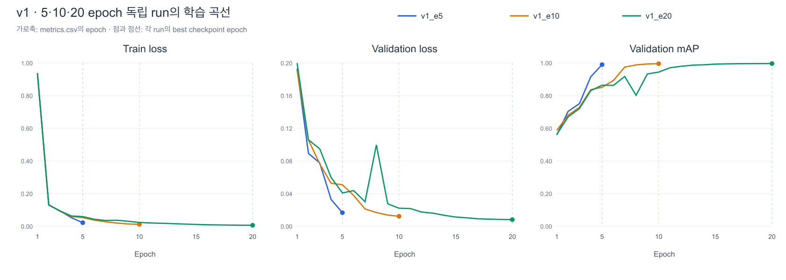

*그림 47. v1의 5·10·20 epoch 독립 run. 가로축은 metrics.csv의 epoch이며 점과 점선은 각 run의 best checkpoint다.*

| 참고 Run | Best epoch | Best train loss | Best val loss | Best val mAP |
| --- | --- | --- | --- | --- |
| v1_e5 | 5 | 0.022376 | 0.016685 | 0.990181 |
| v1_e10 | 10 | 0.012046 | 0.012279 | 0.995691 |
| v1_e20 | 20 | 0.006411 | 0.008199 | 0.996669 |

### 참고 2. Confusion matrix

본문 2.1과 같은 score ≥ 0.30·매칭 IoU ≥ 0.75·클래스 무관 IoU 내림차순 일대일 매칭이다. 학습 클래스 전체가 아니라 공통 평가 클래스 74종과 미매칭을 표시한다. 각 그림은 왼쪽 건수, 오른쪽 전체 GT 객체 수 대비 비율이다.

#### v1_e5

*그림 48. v1_e5, best epoch 5. 전체 validation 1,000장·74종, score ≥ 0.30·IoU ≥ 0.75.*

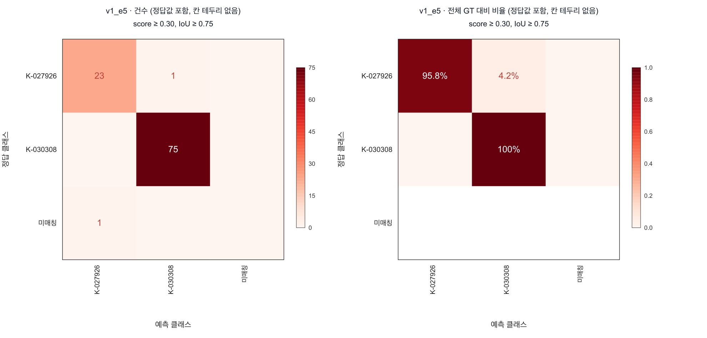

*그림 49. v1_e5. 정답 대각선에 실제 맞춘 건수·비율을 표시한 오류 중심 행렬. 빨간색 계열, 칸 테두리 없음. 비율의 분모는 해당 클래스 전체 GT 객체 수다.*

#### v1_e10

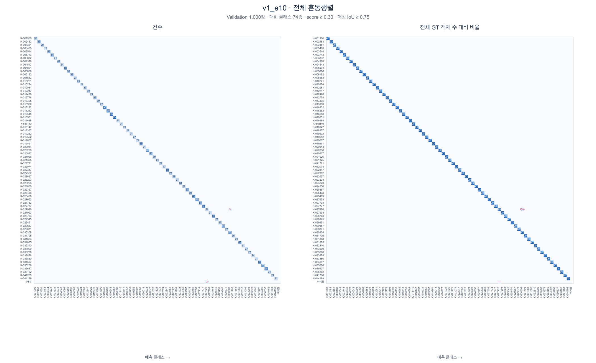

*그림 50. v1_e10, best epoch 10. 전체 validation 1,000장·74종, score ≥ 0.30·IoU ≥ 0.75.*

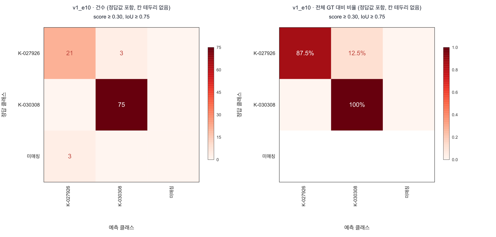

*그림 51. v1_e10. 정답 대각선에 실제 맞춘 건수·비율을 표시한 오류 중심 행렬. 빨간색 계열, 칸 테두리 없음. 비율의 분모는 해당 클래스 전체 GT 객체 수다.*

#### v1_e20

*그림 52. v1_e20, best epoch 20. 전체 validation 1,000장·74종, score ≥ 0.30·IoU ≥ 0.75.*

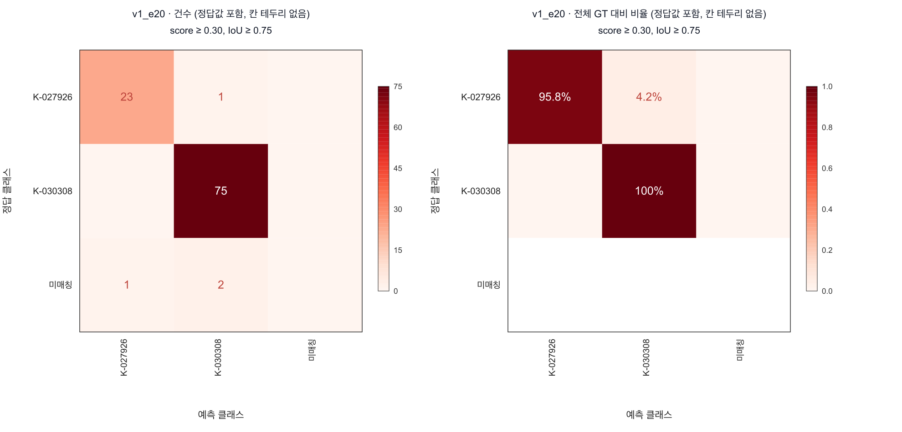

*그림 53. v1_e20. 정답 대각선에 실제 맞춘 건수·비율을 표시한 오류 중심 행렬. 빨간색 계열, 칸 테두리 없음. 비율의 분모는 해당 클래스 전체 GT 객체 수다.*

### 참고 3. 클래스별 AP@[0.75, 0.95]

IoU 0.75·0.80·0.85·0.90·0.95의 평균 AP와 각각의 AP를 표시한다. 왼쪽 파랑은 평균 AP, 주황은 v1의 Train 객체 수이며, 오른쪽 점은 IoU별 AP다. 본문과 같은 v3_e10 기준 클래스 순서를 사용해 74개 평가 클래스를 비교한다.

#### v1_e5

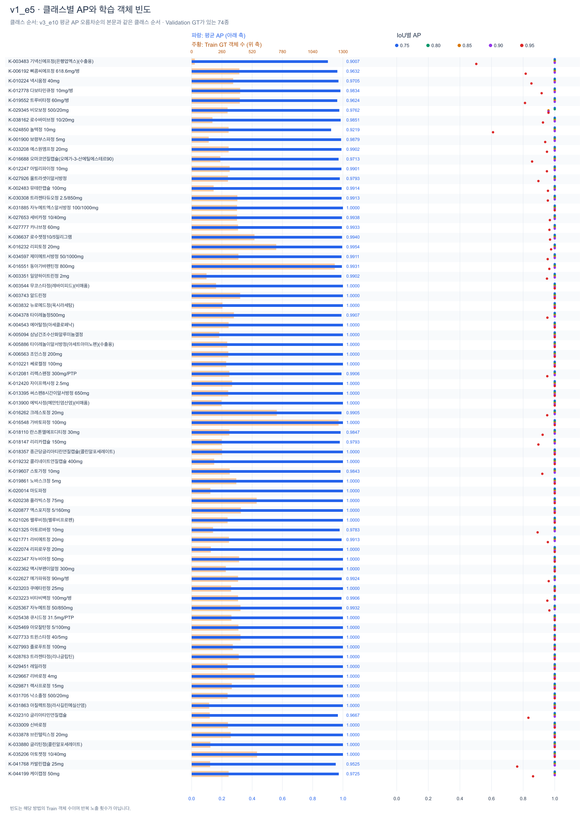

*그림 54. v1_e5, best epoch 5. Validation 74종의 평균 AP·IoU별 AP와 v1의 Train GT 객체 수.*

#### v1_e10

*그림 55. v1_e10, best epoch 10. Validation 74종의 평균 AP·IoU별 AP와 v1의 Train GT 객체 수.*

#### v1_e20

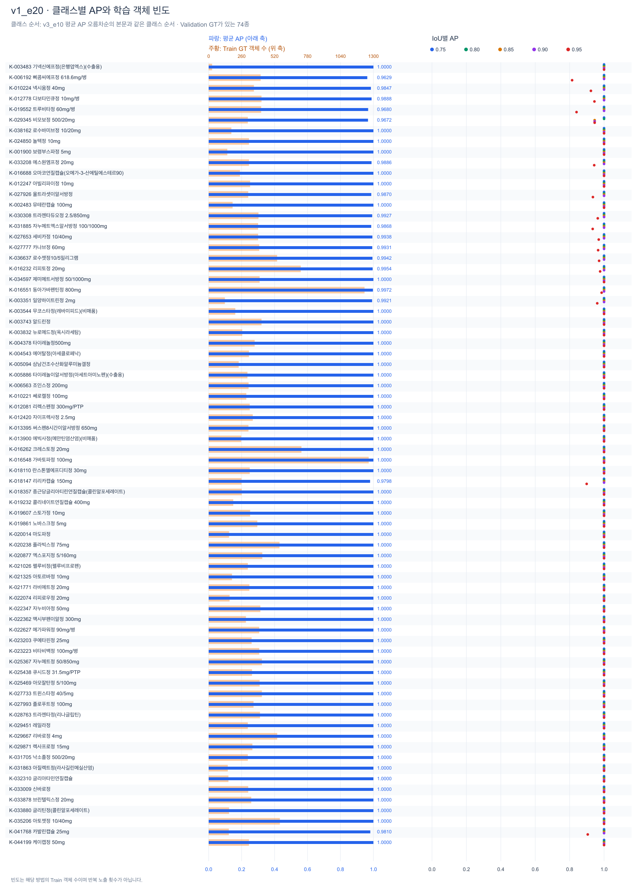

*그림 56. v1_e20, best epoch 20. Validation 74종의 평균 AP·IoU별 AP와 v1의 Train GT 객체 수.*

## 분석 근거

- 기준 보고서: [1차 실험 보고서](../exp1/frcnn-exp1.md).
- 2차 수치: 각 run의 config.json, dataset_info.json, result.json, scores.json, metrics.csv.
- 혼동행렬: 각 run의 analysis/val/score_0.30/confusion_counts.csv·summary.json·errors.csv.
- AP: 저장된 클래스·IoU별 AP CSV. 빈도: 학습 당시 classes.csv 사본.
- 1차·2차 공통 47장 비교: 보존된 1차 캐시 GT와 2차 val_gt.json의 클래스·좌표 일치를 확인했고, 2차 val_predictions.json에서 클래스 혼동과 IoU 0.95 위치 매칭을 재집계했다.
- 실제 이미지·bbox 재집계: val_gt.json과 val_predictions.json, 원본 Kaggle·정제 AI Hub 이미지, Train GT 주석. 모델 학습·추론 없음.
- 실제 Kaggle 점수: 1·2차 제출 완료 화면의 수치와 제출 CSV 파일명.
- [추가 집계·그림 선택·출처 기록](frcnn-exp2-assets/analysis_manifest.json)에는 9개 run × 5개 IoU의 45개 조합에 대한 위치 매칭 집계, 전체 클래스 위치 매칭 수와 실제 이미지 선택 정보를 보존했다.

| Run | 결과 폴더 |
| --- | --- |
| v2_e5 | cj_runs/v2_frcnn_e5_s0_b16_fast |
| v2_e10 | cj_runs/v2_frcnn_e10_s0_b16_fast |
| v2_e20 | rw_runs/v2_frcnn_e20_s0 |
| v3_e5 | rw_runs/v3_frcnn_e5_s0 |
| v3_e10 | rw_runs/v3_frcnn_e10_s0 |
| v3_e20 | rw_runs/v3_frcnn_e20_s0 |
| v4_e5 | cj_runs/v4_frcnn_e5_s0_b16_fast |
| v4_e10 | cj_runs/v4_frcnn_e10_s0_b16_fast |
| v4_e20 | cj_runs/v4_frcnn_e20_s0_b16_fast |

문서와 **frcnn-exp2-assets/** 폴더를 함께 보관하면 상대 경로의 이미지가 유지된다. GitHub에 올릴 때도 둘을 함께 포함한다.
