# Faster R-CNN 3차 실험 결과

## 실험 및 평가 기준

| 항목 | 확인한 내용 |
| --- | --- |
| 모델 | Faster R-CNN ResNet50 FPN (torchvision) |
| 실험 목적 | 고정 v3 데이터에서 RFS·RoI 분류 손실 가중치·두 방법의 결합 비교 |
| Baseline | 2차 v3_frcnn_e10_s0; 기존 결과를 재사용 |
| 본실험 | rfs 9 / weight 10 / both 9 epoch, seed 0; 세 조건 모두 학습 완료 |
| 초기화 | 각 run을 COCO_V1에서 독립 미세조정; Baseline best에서 이어 학습하지 않음 |
| 학습 데이터 | 원래 v3 train 8,974장·33,872객체·96종 |
| 공통 validation | 기존 Kaggle 47장 + AI Hub 953장 = 1,000장; GT·manifest·클래스 표·데이터 지문 해시 일치 |
| Validation 전체 정답 | 3,790객체: 대회 74종의 3,053객체 + 대회 밖 22종의 737객체 |
| 로컬 평가에 사용하는 정답 | 대회 74종의 3,053객체만 채점; 대회 밖 737객체는 채점에서 제외 |
| 학습·평가 배치 | Train 16, 누적 1; validation loss 8, 추론 8 |
| 정밀도 | 학습 AMP FP16; validation loss·추론 FP32 |
| 분석 checkpoint | 전체 validation mAP 최대 best; rfs 9 / weight 10 / both 9 epoch |

**대회 밖 알약은 로컬 평가에서 어떻게 처리했는가?**

- AI Hub를 보충한 v3에는 대회 대상 밖 알약도 포함되어 있어, 학습 클래스는 96종이지만 채점은 대회 74종을 대상으로 한다.
- 공용 [evaluate.py의 drop_ignored](../../../src/pill_detection/evaluate.py)는 대회 밖 클래스로 낸 예측을 제외하고, **대회 밖 GT 박스와 IoU ≥ 0.50으로 겹치는 예측도 클래스와 관계없이 제외**한다.

### 조건별 설계와 실제 학습량

| 조건 | 1 epoch 목록 길이 | RoI 분류 가중치 | 완료 epoch | 계획 update | 실제 update | AMP skip |
| --- | --- | --- | --- | --- | --- | --- |
| Baseline | 8974 | 없음 | 10 | 5610 | 5608 | 2 |
| rfs | 10148 | 없음 | 9 | 5715 | 5713 | 2 |
| weight | 8974 | power 0.5 | 10 | 5610 | 5608 | 2 |
| both | 10148 | power 0.5 | 9 | 5715 | 5713 | 2 |

### 고정 목록의 노출 배수와 클래스 가중치

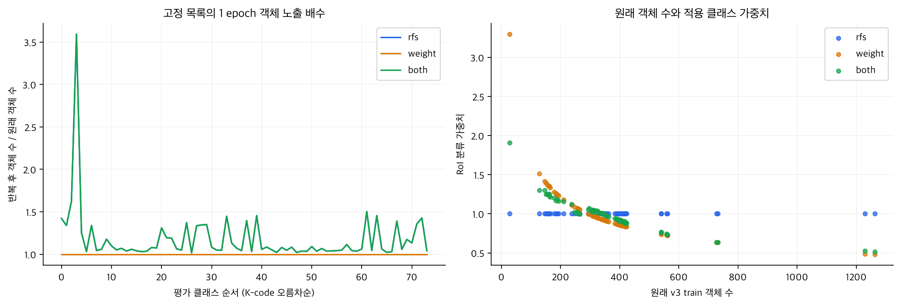

*그림 1. 원래 train 객체 수 대비 고정 반복 목록의 객체 노출 및 실제 적용 가중치. 이미지 내 클래스 동시 등장 때문에 흔한 클래스도 함께 반복될 수 있다.*

- 왼쪽 그래프에서 rfs(파랑)와 both(초록)는 같은 RFS 반복 목록을 사용하므로 클래스별 노출 배수가 같다. 두 선이 겹치며, 나중에 그린 both의 초록 선이 rfs의 파란 선을 가리고 있다.

## 1. 학습 과정 평가

### 1.1 Loss 곡선 시각화

* 조건별로 Baseline과 train loss·validation loss·validation mAP를 표시했다. 
* 점선은 best epoch다. 
* 가로축은 실제 epoch이므로 RFS의 한 epoch과 원래 목록의 한 epoch이 같은 이미지 노출량을 뜻하지 않는다.

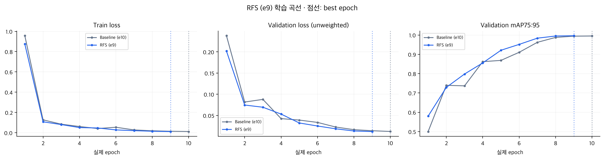

*그림 2. rfs와 Baseline의 학습 곡선. 가중치 조건의 train loss는 손실 정의가 달라 절댓값만으로 우열을 판단하지 않는다.*

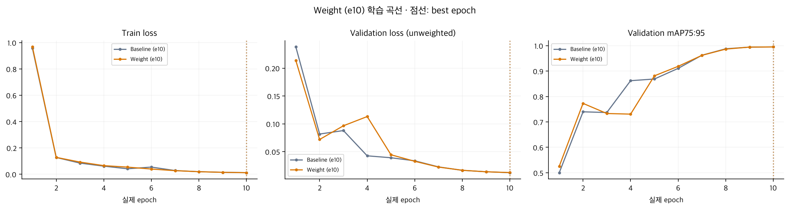

*그림 3. weight와 Baseline의 학습 곡선. 가중치 조건의 train loss는 손실 정의가 달라 절댓값만으로 우열을 판단하지 않는다.*

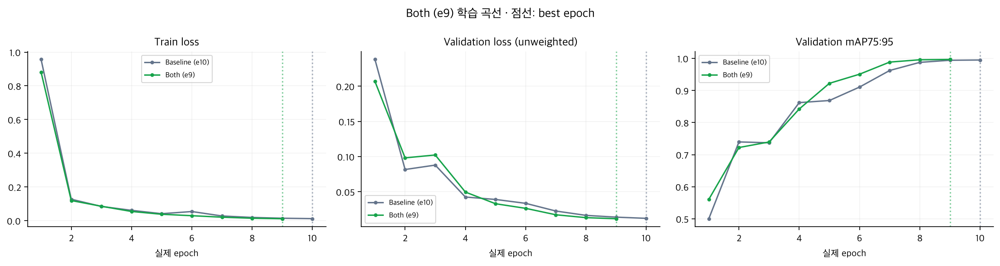

*그림 4. both와 Baseline의 학습 곡선. 가중치 조건의 train loss는 손실 정의가 달라 절댓값만으로 우열을 판단하지 않는다.*

| 조건 | 완료 epoch | Best epoch | Best val mAP | Best train loss | Best val loss | 실제 update |
| --- | --- | --- | --- | --- | --- | --- |
| Baseline | 10 | 10 | 0.994927 | 0.012013 | 0.012252 | 5608 |
| rfs | 9 | 9 | 0.996250 | 0.011525 | 0.011967 | 5713 |
| weight | 10 | 10 | 0.994830 | 0.011593 | 0.012468 | 5608 |
| both | 9 | 9 | **0.996712** | **0.011417** | **0.011681** | 5713 |

### 1.2 과적합·과소적합 판단

| 판단 항목 | 그래프에서 확인한 근거 | 판단 |
| --- | --- | --- |
| 학습 수렴 | rfs·weight·both 모두 초반에 train·val loss가 크게 감소하고 validation mAP가 상승했다. 후반에는 loss와 mAP의 변화 폭이 작아졌다. | 현재 validation에서 세 조건 모두 대체로 수렴하는 양상이다. |
| 과적합: rfs | Train·val loss가 전반적으로 함께 감소하고 mAP는 상승한 뒤 높은 수준에서 완만해졌다. | 현재 곡선에서 지속적인 과적합 징후는 뚜렷하지 않다. |
| 과적합: weight | 초반 epoch 3~4 부근에서 val loss가 상승하고 mAP가 정체·하락했지만, 이후 val loss가 감소하고 mAP도 회복했다. | 초반의 일시적인 변동은 있으나, 후반까지 이어지는 과적합 패턴으로 보기는 어렵다. |
| 과적합: both | 초반에 val loss가 잠시 상승했지만 이후 train·val loss가 함께 감소하고 mAP가 상승했다. | 일시적인 변동 이후 개선됐으며, 지속적인 과적합 징후는 약하다. |
| 과소적합 | 세 조건 모두 train loss가 낮아지고 validation mAP도 높은 수준에 도달했다. Train·val loss가 모두 높은 상태로 정체되는 모습은 보이지 않는다. | 현재 validation에서 전반적인 과소적합을 의심할 근거는 약하다. |
| 학습 종료 시점 | 세 조건 모두 마지막 epoch가 best다. 후반에도 loss가 소폭 감소하고 mAP가 개선되는 흐름이 남아 있다. | 완료 구간에서는 마지막 checkpoint가 가장 좋았다. 다만 곡선만으로 최적 학습량에 도달했거나 추가 학습이 불필요하다고 단정할 수는 없다. |

## 2. 예측 성능 평가

### 2.1 Confusion matrix

Best validation 예측에 위에서 설명한 대회 밖 클래스·영역의 평가 제외 처리를 적용한 뒤 score ≥ 0.30을 남겼다. 클래스와 무관하게 IoU가 큰 순서로 GT·예측을 일대일 연결하고 최소 매칭 IoU는 0.75로 두었다. 행은 정답, 열은 예측이다.

전체 행렬은 74종과 미매칭을 포함한다. 왼쪽은 건수, 오른쪽은 해당 클래스 전체 GT 수 대비 비율이다. 전체 행렬은 파란색 계열이다. 오류 중심 행렬은 빨간색 계열이며 정답 대각선에 실제 정답 수·비율을 남겼고, 미매칭 행에는 비율을 표시하지 않는다. 칸 테두리는 없다.

| 조건 | 정답 매칭 | 잘못된 클래스 매칭 | 미매칭 GT | 미매칭 예측 |
| --- | --- | --- | --- | --- |
| Baseline | 3053 | 0 | 0 | 0 |
| rfs | 3053 | 0 | 0 | 1 |
| weight | 3053 | 0 | 0 | 0 |
| both | 3053 | 0 | 0 | 0 |

- Score 0.30·IoU 0.75 기준에서 네 조건 모두 GT 클래스 혼동·미탐은 0건이었다.
- rfs에만 추가 오탐 1건이 있었고, 해당 GT의 올바른 예측도 존재했다.
- 이 결과를 모든 score·IoU 기준으로 일반화할 수는 없다.

#### Baseline

*그림 5. Baseline best epoch 10. 공통 validation 1,000장·74종. 파란색 계열의 전체 혼동행렬.*

Baseline: 오류 중심 혼동행렬

*그림 6. Baseline. 오류가 없는 조건은 그 사실을 표시한다. 오류 관련 클래스의 분모도 축약 전 전체 GT 수다.*

#### rfs

*그림 7. rfs best epoch 9. 공통 validation 1,000장·74종. 파란색 계열의 전체 혼동행렬.*

rfs: 오류 중심 혼동행렬

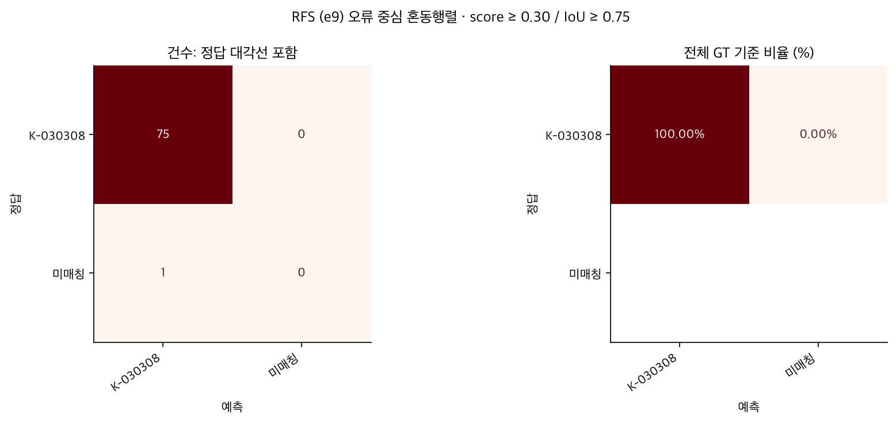

*그림 8. rfs. 오류가 없는 조건은 그 사실을 표시한다. 오류 관련 클래스의 분모도 축약 전 전체 GT 수다.*

#### weight

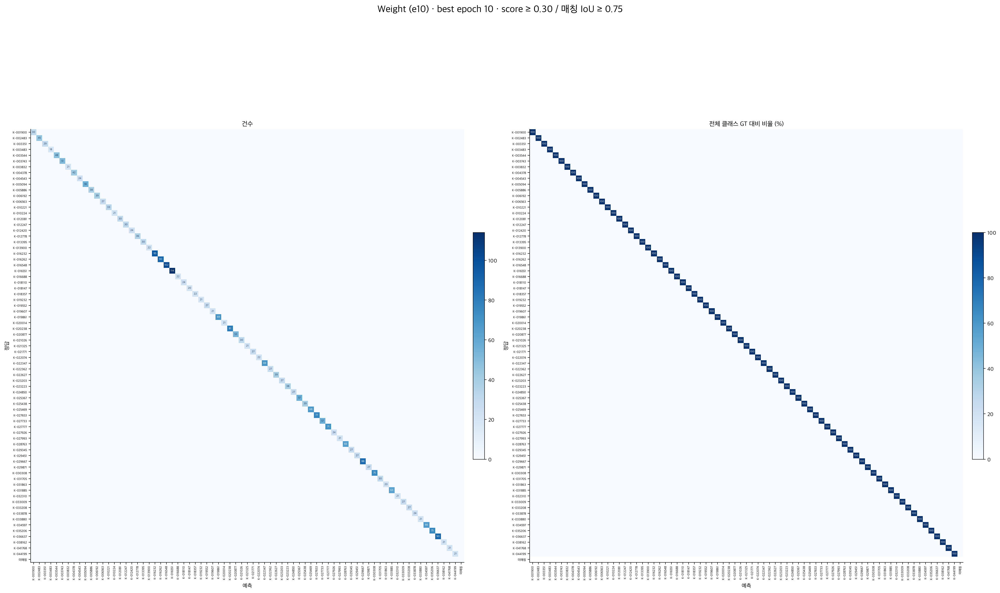

*그림 9. weight best epoch 10. 공통 validation 1,000장·74종. 파란색 계열의 전체 혼동행렬.*

weight: 오류 중심 혼동행렬

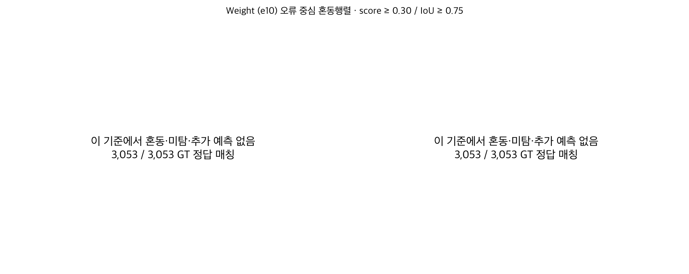

*그림 10. weight. 오류가 없는 조건은 그 사실을 표시한다. 오류 관련 클래스의 분모도 축약 전 전체 GT 수다.*

#### both

*그림 11. both best epoch 9. 공통 validation 1,000장·74종. 파란색 계열의 전체 혼동행렬.*

both: 오류 중심 혼동행렬

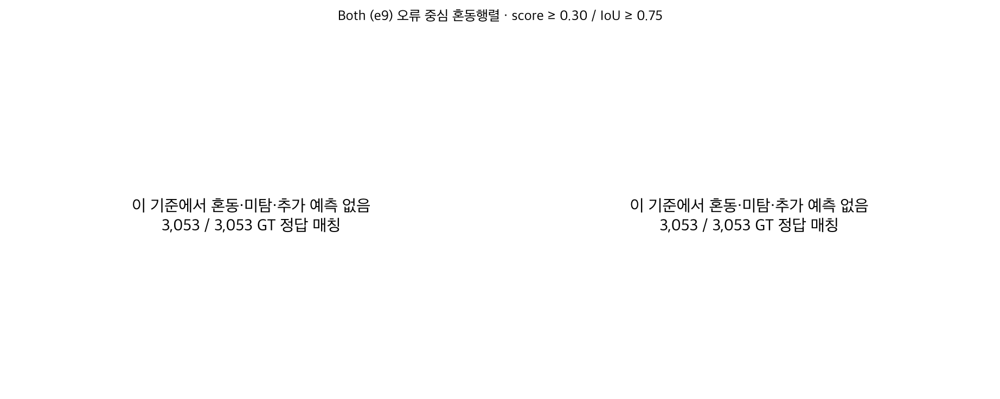

*그림 12. both. 오류가 없는 조건은 그 사실을 표시한다. 오류 관련 클래스의 분모도 축약 전 전체 GT 수다.*

### 2.2 mAP@[0.75, 0.95]

* IoU 0.75·0.80·0.85·0.90·0.95의 AP 평균이다. 
* 저장 추론의 score 하한 0.001을 사용하고, 혼동행렬용 0.30 필터를 AP에 추가하지 않았다. 

| 조건 | Best epoch | 전체 val mAP | 기존 val 47장 | Test-only 클래스 val | Baseline 대비 전체 val (p.p.) |
| --- | --- | --- | --- | --- | --- |
| Baseline | 10 | 0.994927 | 0.996884 | 0.994973 | — |
| rfs | 9 | 0.996250 | 0.998515 | 0.994859 | +0.1323 |
| weight | 10 | 0.994830 | 0.995617 | 0.995693 | -0.0097 |
| both | 9 | 0.996712 | 0.998878 | 0.995564 | +0.1785 |

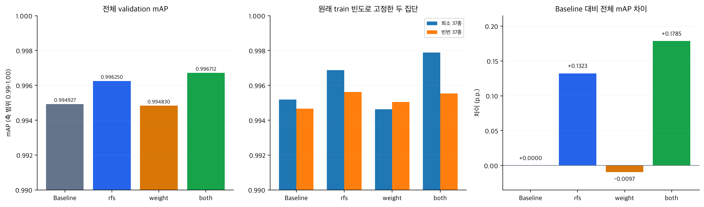

*그림 13. 왼쪽과 가운데 세로축은 0.99~1.00으로 확대했다. 오른쪽은 전체 mAP 차이를 p.p.로 표시했다.*

- **both가 전체 val 최고**이며 Baseline 대비 +0.1785 p.p. 높았다.
- rfs는 +0.1323 p.p. 높았고, weight는 −0.0097 p.p. 낮았다.

| 조건 | TP | FP | FN | Precision | Recall |
| --- | --- | --- | --- | --- | --- |
| Baseline | 3053 | 0 | 0 | 1.000000 | 1.000000 |
| rfs | 3053 | 1 | 0 | 0.999673 | 1.000000 |
| weight | 3053 | 0 | 0 | 1.000000 | 1.000000 |
| both | 3053 | 0 | 0 | 1.000000 | 1.000000 |

* Precision·Recall은 score ≥ 0.30·IoU ≥ 0.75의 micro 집계다. 
* AP는 score 순위를 포함한 여러 recall 수준의 지표라서 RFS의 추가 예측 1건과 AP75=1.0이 동시에 나타날 수 있다.

### 2.3 클래스별 AP@[0.75, 0.95]

74종 모두 Baseline 평균 AP 오름차순으로 공통 정렬했다. 왼쪽 막대는 평균 AP와 **원래 v3 train GT 객체 수**, 오른쪽 점은 IoU별 AP다. 주황 빈도는 반복 목록의 노출량이 아니다. 전체 수치는 [클래스별 AP CSV](frcnn-exp3-assets/both_class_iou_ap.csv) 및 다른 조건의 같은 이름 표에 보존했다.

#### Baseline

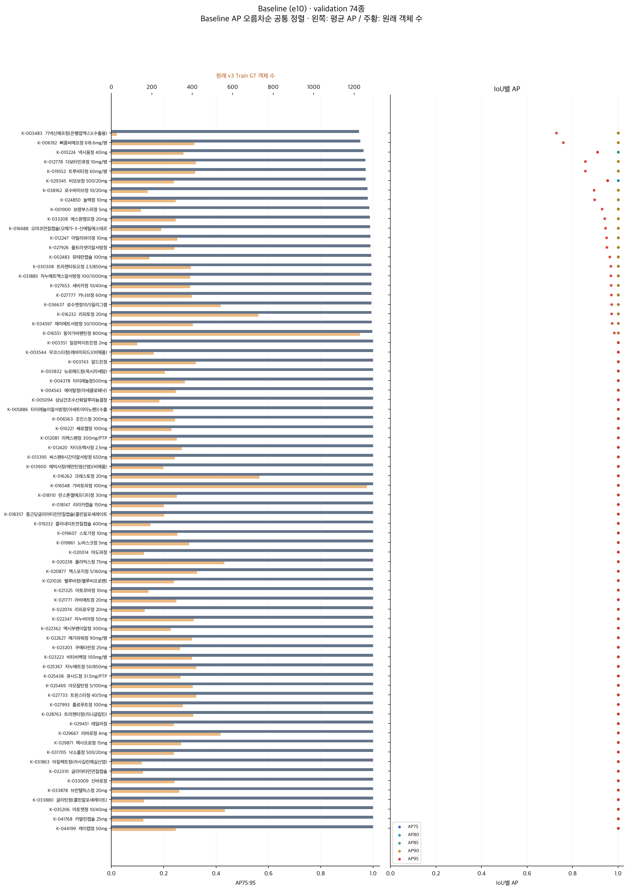

*그림 14. Baseline의 74종 평균 AP·원래 train 객체 수·IoU별 AP. 모든 조건에서 같은 클래스 순서다.*

#### rfs

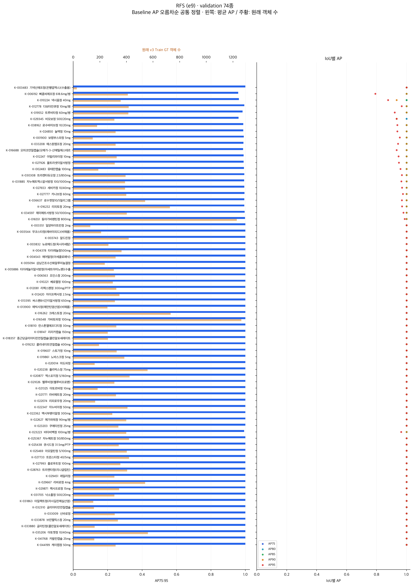

*그림 15. rfs의 74종 평균 AP·원래 train 객체 수·IoU별 AP. 모든 조건에서 같은 클래스 순서다.*

#### weight

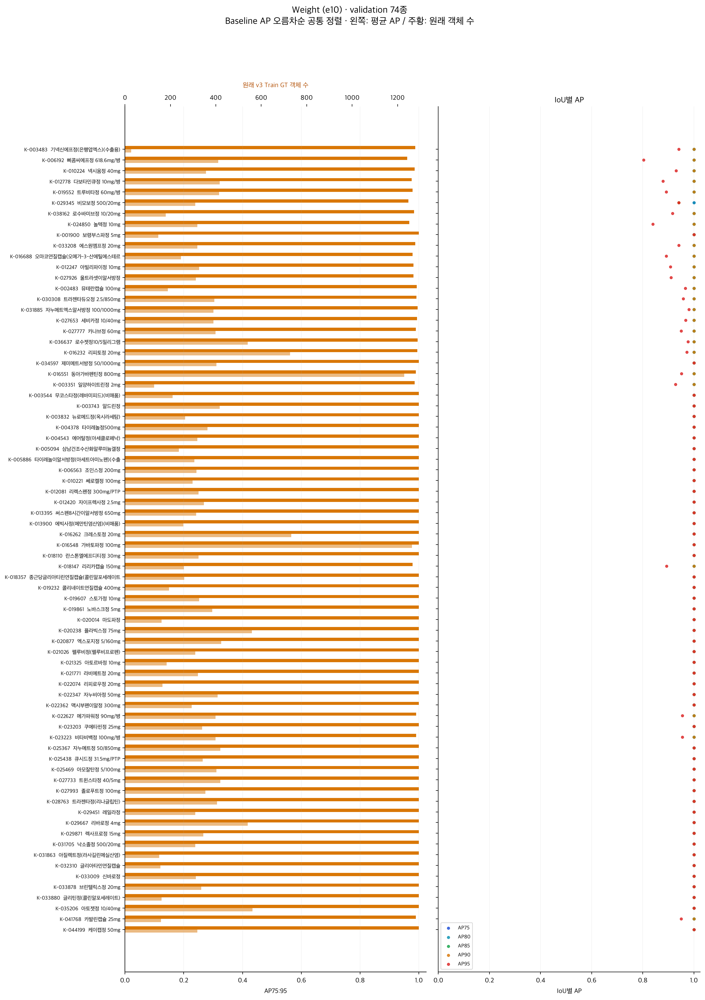

*그림 16. weight의 74종 평균 AP·원래 train 객체 수·IoU별 AP. 모든 조건에서 같은 클래스 순서다.*

#### both

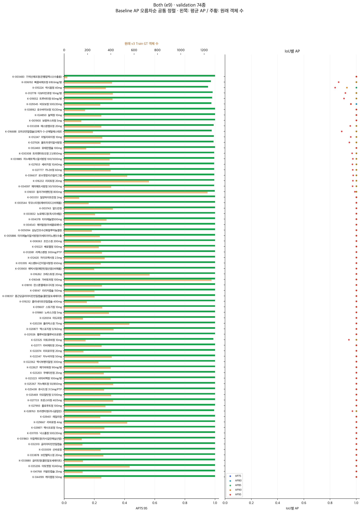

*그림 17. both의 74종 평균 AP·원래 train 객체 수·IoU별 AP. 모든 조건에서 같은 클래스 순서다.*

#### 희소·빈번 집단 비교

원래 v3 train 객체 수와 category_id 순서로 74종을 정렬해 37종씩 나눴다. 모든 조건에서 집단을 고정하며 반복 후 빈도로 다시 나누지 않았다. Gap은 빈번 평균 AP − 희소 평균 AP다.

| 조건 | 희소 평균 AP | 빈번 평균 AP | Gap | 희소 AP 차이 (p.p.) |
| --- | --- | --- | --- | --- |
| Baseline | 0.995188 | 0.994666 | -0.000522 | — |
| rfs | 0.996873 | 0.995626 | -0.001247 | +0.1685 |
| weight | 0.994621 | 0.995039 | 0.000418 | -0.0567 |
| both | 0.997887 | 0.995538 | -0.002349 | +0.2699 |

| 조건 | AP 상승 클래스 | 동일 클래스 | AP 하락 클래스 |
| --- | --- | --- | --- |
| rfs | 13 | 51 | 10 |
| weight | 12 | 48 | 14 |
| both | 18 | 50 | 6 |

- both의 희소 집단 AP는 +0.2699 p.p. 높아졌지만, 6개 클래스는 하락했다.
- weight는 희소 평균이 낮아지고 빈번 평균은 소폭 높아져, 일관된 개선을 보이지 않았다.
- 집단 평균 상승이 모든 클래스의 개선을 뜻하지는 않는다.
- 클래스 증감은 차이 1e-10 기준의 집계이며 유의성 검정 결과는 아니다.

### 2.4 헷갈리는 클래스 분석 및 시각화

- 2차에서 관찰한 K-030308·K-027926 관련 오류를 다시 확인했다.
- 현재 진단 기준의 GT 클래스 혼동은 0건이지만, rfs에서 K-027926 위에 K-030308 추가 예측이 남았다.
- 추가 예측은 score 0.321697·IoU 0.889248이며, 올바른 예측도 있어 **추가 오탐 1건**으로 집계했다.
- 같은 사진에서 나머지 세 조건은 해당 추가 오탐이 없었다.

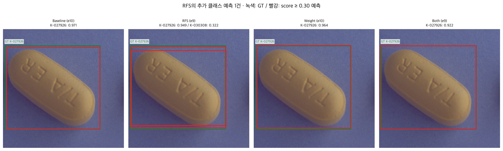

*그림 18. 동일 AI Hub validation 사진의 K-027926 객체. 녹색은 GT, 빨강은 예측이며 각 패널 제목에 클래스·score를 표시했다. 원본 사진의 해시를 저장 지문과 대조했다.*

### 2.5 Bbox를 잘 맞추지 못하는 클래스 분석 및 시각화

| 조건 | 평균 AP75 | 평균 AP95 | IoU ≥ 0.95 위치 매칭 | 위치 매칭 비율 |
| --- | --- | --- | --- | --- |
| Baseline | 1.000000 | 0.977111 | 3016 / 3,053 | 98.79% |
| rfs | 1.000000 | 0.983909 | 3024 / 3,053 | 99.05% |
| weight | 1.000000 | 0.975737 | 3011 / 3,053 | 98.62% |
| both | 1.000000 | 0.985646 | 3026 / 3,053 | 99.12% |

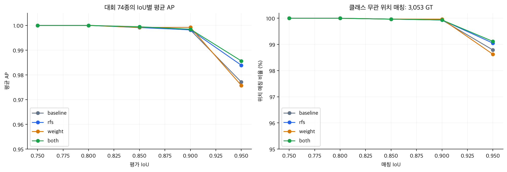

*그림 19. 왼쪽은 클래스·score 순위를 포함한 AP, 오른쪽은 score 0.30에서 클래스 무관 위치 매칭이다. 서로 다른 지표다.*

- AP75는 모두 1.0이지만, 엄격한 박스 기준인 AP95에서는 차이가 나타났다.
- both의 평균 AP95는 0.985646으로 Baseline 0.977111보다 높았고, IoU 0.95 위치 매칭도 3,016→3,026개로 늘었다.
- weight는 평균 AP95 0.975737·위치 매칭 3,011개로 Baseline보다 낮았다.

| 조건 | 낮은 AP 클래스 | 이름 | 원래 train 객체 | AP95 | 평균 AP |
| --- | --- | --- | --- | --- | --- |
| rfs | K-006192 | 삐콤씨에프정 618.6mg/병 | 410 | 0.791882 | 0.958376 |
| rfs | K-029345 | 비모보정 500/20mg | 309 | 0.934360 | 0.960616 |
| rfs | K-010224 | 넥시움정 40mg | 357 | 0.876886 | 0.962270 |
| weight | K-006192 | 삐콤씨에프정 618.6mg/병 | 410 | 0.803375 | 0.960675 |
| weight | K-029345 | 비모보정 500/20mg | 309 | 0.941327 | 0.964796 |
| weight | K-024850 | 놀텍정 10mg | 318 | 0.839821 | 0.967964 |
| both | K-010224 | 넥시움정 40mg | 357 | 0.837812 | 0.953135 |
| both | K-006192 | 삐콤씨에프정 618.6mg/병 | 410 | 0.865178 | 0.973036 |
| both | K-029345 | 비모보정 500/20mg | 309 | 0.958929 | 0.975358 |

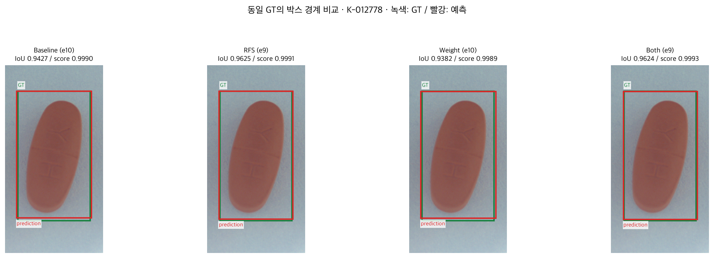

*그림 20. K-012778의 같은 GT 객체를 네 조건에서 비교했다. Baseline IoU 0.9427, rfs 0.9625, weight 0.9382, both 0.9624. 녹색 GT·빨강 예측이며 score는 모두 약 0.999다.*

- 위 사례는 K-012778의 한 객체에서 Baseline IoU<0.95였던 예측이 both에서 IoU≥0.95로 개선된 예시다.
- 높은 score가 정밀한 박스 경계를 보장하지는 않는다.
- 선택한 예시 하나를 전체 성능의 대표 사례로 일반화하지 않는다.

### 2.6 Kaggle submission score

| 조건 | Best epoch | 전체 val mAP | 실제 Kaggle Public | 제출 CSV 예측 행 수 |
| --- | --- | --- | --- | --- |
| Baseline | 10 | 0.994927 | 0.59750 | 기존 제출 |
| rfs | 9 | 0.996250 | 0.61409 | 3258 |
| weight | 10 | 0.994830 | 0.60788 | 3238 |
| both | 9 | 0.996712 | 0.61033 | 3252 |

- 3차 세 조건은 **사용자가 제공한 Kaggle 제출 완료 화면**의 Public 점수를 반영했다(2026-11-05 확인). 제출 파일명으로 rfs·weight·both를 구분했다.
- Baseline 0.59750은 기존 사용자 제출 기록이다. 모든 실제 Public 점수는 [별도 제출 점수 CSV](frcnn-exp3-assets/actual_kaggle_submissions.csv)에 정리했다.
- 로컬 scores.json과 run_summary.csv의 kaggle 항목은 기존 validation 47장 점수다. 위 실제 Kaggle Public 점수와 구분한다.

### 2.7 Validation과 Kaggle 점수 비교

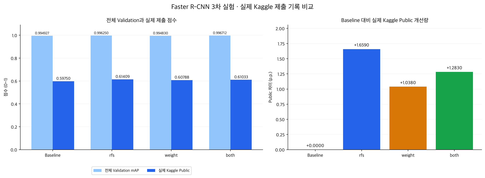

*그림 21. 왼쪽은 전체 validation mAP와 실제 Kaggle Public 점수(세로축 0~1), 오른쪽은 Baseline 대비 실제 Public 차이(p.p.)다. 점수는 사용자 제공 제출 기록을 사용했다.*

| 조건 | Validation − Public (p.p.) | Baseline 대비 Public (p.p.) |
| --- | --- | --- |
| Baseline | 39.7427 | +0.0000 |
| rfs | 38.2160 | +1.6590 |
| weight | 38.6950 | +1.0380 |
| both | 38.6382 | +1.2830 |

- **실제 Public 최고는 rfs(0.61409)**다. Baseline보다 +1.6590 p.p. 높았고, both는 +1.2830 p.p., weight는 +1.0380 p.p. 높았다.
- Validation 최고는 both지만 Public 최고는 rfs로 순위가 달랐다. Validation 개선량만으로 실제 제출 순위를 정할 수는 없다.
- Validation과 Public의 격차는 Baseline 약 39.74 p.p.에서 3차 약 38.22~38.70 p.p.로 줄었지만 여전히 크다.

## 3. 2차 Baseline vs 3차 예측 성능 비교

### 3.1 비교 범위와 기준

비교 Baseline은 `v3_frcnn_e10_s0`다. 네 run의 `val_gt.json`·`val_manifest.csv`·`classes.csv`·`data_fingerprint.json` 해시가 같았다. Best epoch와 완료 상태, 예측 캐시·manifest 해시, 3차 분석 점수 해시를 대조했고 공용 평가 경로로 점수를 재현했다.

### 3.2 동일 validation에서의 mAP 비교

- 전체 val 순서는 **both > rfs > Baseline > weight**다.
- both는 Baseline보다 +0.1785 p.p. 높았고 희소 집단 AP·평균 AP95도 개선됐다.
- 작은 점수 차이와 환경 변경·단일 seed·약 1.87%의 계획 update 차이를 함께 고려해야 한다.

### 3.3 실제 Kaggle 점수 비교

- 실제 Public은 **rfs 0.61409 > both 0.61033 > weight 0.60788 > Baseline 0.59750** 순서다.
- 세 조건 모두 Baseline보다 높았으며, 이번 제출 점수 기준의 우선 검토 대상은 rfs다. Validation 기준의 1위인 both와 일치하지 않는다.
- rfs와 both의 Public 차이는 0.3760 p.p.다. 단일 seed 비교이며 Baseline과 실행 환경도 달라 기법만의 인과 효과로 해석하지 않는다.

### 3.4 클래스 혼동·bbox 개선 비교

- Score 0.30·IoU 0.75에서 네 조건 모두 GT 혼동·미탐이 0건이므로, 오분류 감소로 개선을 설명하기 어렵다.
- rfs에는 추가 오탐 1건이 남았다.
- both·rfs는 IoU 0.95 위치 매칭과 평균 AP95가 높아져, 박스 정밀도 변화가 관찰됐다.
- AP에는 박스 정밀도 외에 score 순위와 추가 예측도 영향을 준다.

### 3.5 개선점·남은 한계 정리

- **전체 성능:** both가 val mAP 0.996712로 가장 높았다(+0.1785 p.p.). 실제 Public 최고는 rfs 0.61409다(+1.6590 p.p.).
- **희소 클래스:** both의 희소 AP는 0.997887로 +0.2699 p.p. 높아졌지만, 모든 클래스가 개선된 것은 아니다.
- **가중치 단독:** 전체 val·AP95·희소 평균은 Baseline보다 낮았지만 실제 Public은 +1.0380 p.p. 높았다. 지표별 개선 방향이 일치하지 않았다.
- **박스 정밀도:** both의 AP95는 0.985646이며 IoU 0.95 위치 매칭이 10개 늘었다.
- **남은 오류:** 현재 진단 기준에서 GT 클래스 혼동은 0건이며 rfs에 추가 오탐 1건이 남았다.
- **해석 한계:** Public 점수 개선은 확인했지만, 환경 차이·단일 seed·학습량 차이 때문에 개선 전체를 기법만의 효과로 확정할 수 없다.

## 분석 근거

- 설정과 실행 코드: [frcnn-exp3.ipynb](frcnn-exp3.ipynb).
- 기준 보고서: [frcnn-exp2.md](../exp2/frcnn-exp2.md).
- 평가와 불균형 정의: [evaluate.py](../../../src/pill_detection/evaluate.py), [balance.py](../../../src/pill_detection/balance.py), [RULE.md](../../../RULE.md).
- 재현 자료: [분석 manifest](frcnn-exp3-assets/analysis_manifest.json), [run 요약](frcnn-exp3-assets/run_summary.csv).
- 그림 폴더에는 조건별 클래스·IoU AP, 혼동행렬 건수, 진단 이벤트, IoU별 위치 매칭 CSV를 함께 보존했다.
- Manifest에 읽은 원본의 경로·SHA-256, 캐시 검증 내용, 원본 이미지 선택 기준·해시를 기록했다. 저장 예측으로 CPU 재채점·그림만 생성했으며 학습·모델 추론·패키지 설치는 실행하지 않았다.
- Baseline 실제 Kaggle 0.59750은 기존 사용자 제출 기록, rfs 0.61409·weight 0.60788·both 0.61033은 사용자가 제공한 Kaggle 제출 완료 화면에 근거한다.
- 평가 대상·제외 규칙은 공통 val_gt.json과 evaluate.py의 drop_ignored로 확인했다.

| 대상 | Drive의 pill data 기준 위치 |
| --- | --- |
| Baseline | rw_runs/v3_frcnn_e10_s0/ |
| rfs | cj_runs/exp3/v3_frcnn_exp3_rfs_e9_s0/ |
| weight | cj_runs/exp3/v3_frcnn_exp3_weight_e10_s0/ |
| both | cj_runs/exp3/v3_frcnn_exp3_both_e9_s0/ |

문서와 `frcnn-exp3-assets/`를 함께 보관하면 그림의 상대 경로가 유지된다. 가중치·원본 데이터·제출 CSV는 보고서 그림 폴더에 복사하지 않았다.
