# 경구약제 이미지 객체 검출: 최종 보고서 (초안)

> **상태**: 초안 v0.1 (2026-11-04). 코드잇 AI 15기 초급 프로젝트 1, 팀 2 (codeit-prj1-team2).
> **읽는 법**
> - `[그림 N-M]`, `[표 N-M]`은 그림·표가 들어갈 자리입니다. 그래프는 FigJam의 장표를 붙여 넣습니다. 괄호 안에 어떤 자료를 쓰면 되는지 적어 두었습니다.
> - `[TODO: …]`는 아직 값이 없거나 확인이 필요한 곳입니다. 전체 목록은 [부록 F](#부록-f-작성-전-채울-빈칸)에 있습니다.
> - 4·6·8·9장의 수치는 W&B 기록(`codeit-prj1-team2/pill-object-detection`)과 Kaggle 제출 기록에서 가져왔고, 그림은 W&B history·`best.pt`·Drive의 val 예측을 로컬에서 다시 채점해 만들었습니다(부록 E). Faster R-CNN 1·2·3차 수치는 main에 머지된 정리 문서(`notebooks/modeling/exp{1,2,3}/frcnn-exp*.md`, PR #53)와 대조해 맞췄습니다.
> - 수치 뒤 괄호의 `00 4-2` 같은 표기는 근거 노트북과 절 번호입니다. 00 = `notebooks/eda/00_kaggle_eda.ipynb`, 01 = `01_aihub_eda.ipynb`, 02 = `02_test_class_freq_eda.ipynb`, 03 = `03_val_test_gap_eda.ipynb`, Y1 = `notebooks/modeling/exp1/yolo26-exp1.md`, Y2 = `notebooks/modeling/exp2/yolo26-exp2.md`.
> - 가설 번호는 발표자료와 같은 체계다: 1차 H1~H4, 2차 H5~H7. 7장(val·Kaggle 점수 차이의 원인)은 별도로 H1~H8을 쓴다. 번호 없이 "추가 확인"으로 적은 것은 가설표에는 없었지만 같이 확인한 항목이다.

---

## 목차

- [0. 요약](#0-요약)
- [1. 문제 정의](#1-문제-정의)
- [2. 접근 방법과 실험 파이프라인](#2-접근-방법과-실험-파이프라인)
- [3. 1차 데이터 EDA: Kaggle 제공 데이터](#3-1차-데이터-eda-kaggle-제공-데이터)
- [4. 1차 실험: Kaggle 데이터 베이스라인](#4-1차-실험-kaggle-데이터-베이스라인)
- [5. 2차 데이터 EDA: AI Hub 외부 데이터 보충](#5-2차-데이터-eda-ai-hub-외부-데이터-보충)
- [6. 2차 실험: Kaggle + AI Hub](#6-2차-실험-kaggle--ai-hub)
- [7. val과 Kaggle 점수 차이의 원인 분석](#7-val과-kaggle-점수-차이의-원인-분석)
- [8. 3차 실험: 클래스 불균형 대응 (최소 실행)](#8-3차-실험-클래스-불균형-대응-최소-실행)
- [9. 결과와 최종 모델](#9-결과와-최종-모델)
- [10. 데모 서비스](#10-데모-서비스)
- [11. 한계와 개선 방향](#11-한계와-개선-방향)
- [12. 재현 방법](#12-재현-방법)
- [13. 팀원 역할과 회고](#13-팀원-역할과-회고)
- [부록](#부록)

---

## 0. 요약

### 0.1 한 줄 요약

알약 사진 한 장에서 알약마다 위치(bbox)와 약 이름(74종)을 찾는 Object Detection 모델을 만들었다. Kaggle 대회 제공 데이터 232장만으로는 Kaggle 점수가 0.38~0.42에 머물렀고, 외부 데이터(AI Hub)로 데이터 양과 test에만 나오는 18종의 클래스를 보충하자 0.59~0.63으로 올랐다. 하지만 validation mAP와 Kaggle 제출 점수에 차이가 남을 확인했다 (validation 0.99 vs Kaggle 0.61). EDA와 자체 제작 test annotaion을 활용한 분석 결과, 이 차이는 데이터 누수 및 모델 문제가 아니라, 대회 측 test 정답이 다른 방식으로 만들어졌거나 box가 덜 정확하기 때문일 가능성이 크다고 판단했다.

### 0.2 대표 그림

> **[그림 0-1] 실험 단계별 val·Kaggle 점수**

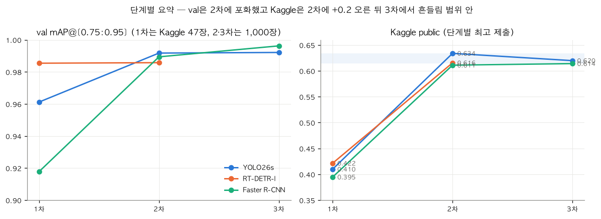

- 1차 대비 2차에서 val 점수는 RT-DETR을 제외하고 모두 상승했으며, 2차에서는 거의 1.0에 가깝게 붙어서 포화됨을 확인했다. 3차는 seed 간 흔들림 범위 안에서 상승 및 하강했기 때문에 효과가 있다고 보기 어렵다. 
- Kaggle 점수는 1차 0.38~0.42에서 2차 0.59~0.63으로 상승했다. 3차에서도 val과 마찬가지로 seed 흔들림 범위 안에서 점수가 변동했기 때문에 효과 없음으로 판단되었다. 

### 0.3 최종 결과 요약

> **[표 0-1] 최종 모델 3계열 성능·추론 시간**

| 계열 | 최종 run | val mAP@[0.75:0.95] | Kaggle public | 추론 시간 (ms/장) | 파라미터 |
| --- | --- | ---: | ---: | ---: | ---: |
| YOLO26s | 2차 v3 e20 (`v3_yolo26s_e20_s0`) | 0.9918 | **0.6339** | 16.0 ± 0.3 ms/장 (62 FPS)| 948만 |
| RT-DETR-l | 2차 v4 e5 (`v4_rtdetr-l_e5`) | 0.9858 | 0.6156 | 76.0 ± 1.5 ms/장 (13 FPS) | 3,223만 |
| Faster R-CNN (R50-FPN) | 3차 v3 rfs e9 (`v3_frcnn_exp3_rfs_e9_s0`) | 0.9962 | 0.6141 | 89.5 ± 0.3 ms/장 (11 FPS) | 약 4,176만 |

- 최종 run은 모델마다 Kaggle public 점수가 가장 높은 제출을 기준으로 선정했다.
- 추론 시간은 T4, 입력 640, 배치 1, 점수 하한 0.01, 5회 평균으로 측정함.

> **[표 0-2] Kaggle 리더보드 (2026-11-05 09:08 KST, public)**

| 순위 | 팀 | public | private | 비고 |
| ---: | --- | ---: | --- | --- |
| 1 | **우리 팀 (team2)** | **0.63390** | | YOLO26s `v3_yolo26s_e20_s0` |
| 2 | 다른 팀 | 0.63060 | | |
| 3 | 다른 팀 | 0.61804 | | | 

- 우리 팀의 v3_yolo26s_e20_s0 public 점수가 0.63390로 1등이기는 하지만, 우리가 실험한 세 계열 모델의 최고 제출 점수(0.6339 / 0.6156 / 0.6141)과 2위 팀의 차이는 매우 근소하다. 1위는 순위일 뿐 모델 간 우열의 근거는 아니라고 판단했다.
- 최종 순위는 private으로 정해진다. `[TODO: 최종 public/private 순위]`

### 0.4 링크

- GitHub: https://github.com/codeit-ai-15th/pill-object-detection
- Notion: [팀 노션 페이지](https://app.notion.com/p/Project-1-3ff97c8cd42c804b9e95e74851c347f8?source=copy_link)
- 데모 (Hugging Face Space): [Pill Detection](https://huggingface.co/spaces/relukang/pill-object-detection)
- W&B: [W&B report](https://forge.coreweave.com/wandb/codeit-prj1-team2/pill-object-detection/reports/Final-Report--VmlldzoxODI1MTM1Nw?accessToken=zy5f6o45cnpxazzavvghqesktjqox3p4tbmtm2thygq58avgroizzw68akw3oxn7) 
- Kaggle 대회: https://www.kaggle.com/competitions/ai15-level1-project

### 0.5 용어

처음 읽는 사람을 위해 이 보고서에서 쓰는 말을 먼저 정리한다.

| 이 보고서의 표현 | 코드·다른 문서에서의 이름 | 뜻 |
| --- | --- | --- |
| Kaggle 데이터, 1차 데이터 | `data/raw` | 대회가 제공한 학습 사진 232장과 test 사진 842장 |
| AI Hub 데이터, 2차 데이터 | `data/external/aihub` | 외부에서 추가로 받은 경구약제 조합 사진 (정제 후 11,974장) |
| 검증 세트 | val | 학습에 쓰지 않고 점수를 재는 사진. 1차는 Kaggle 47장, 2차는 Kaggle 47장 + AI Hub 953장 = 1,000장 |
| 테스트 세트 | test | Kaggle이 정답을 숨겨 둔 사진 842장. 제출하면 이 사진으로 채점된다 |
| 대회 점수 | mAP@[0.75:0.95] | IoU 기준 0.75, 0.80, 0.85, 0.90, 0.95 각각에서 클래스별 AP를 구해 모두 평균한 값 |
| AP | Average Precision | 한 클래스의 예측을 점수 순으로 줄 세웠을 때의 정밀도-재현율 곡선 아래 넓이 |
| IoU | Intersection over Union | 예측 box와 정답 box가 겹친 넓이 ÷ 합친 넓이. 1이면 완전히 같음 |
| Kaggle 클래스 | kaggle (56종) | Kaggle 학습 데이터에 있는 알약 56종 |
| 테스트 전용 클래스 | test_only (18종) | Kaggle 학습 데이터에는 없고 test에만 나오는 알약 18종. AI Hub로만 학습했다 |
| 대회 클래스 | competition (74종) | 56 + 18. 채점 대상 |
| 방법 v1~v4 | v1, v2, v3, v4 | 2차 실험에서 학습 이미지를 고르는 네 가지 방법 ([5.5절](#55-학습-이미지-선택-방법-v1v4-설계)) |
| 조합 | combo | 한 사진에 함께 놓인 알약의 묶음. 같은 조합을 세 각도(70°, 75°, 90°)로 찍는다 |
| K-코드 | `K-003351` 등 | 알약 식별 번호. 숫자 부분이 `category_id` |
| 자체 파악 | `notebooks/eda/02_test_crops.csv` | test 842장의 알약 3,229개를 우리가 직접 정리한 목록. 클래스는 사람이 확인했고 box는 1차 모델 예측이다. 공식 대회 정답이 아니다 |
| 대리 채점 | — | 제출 파일을 Kaggle 대신 자체 파악으로 채점하는 것 |
| 진단 제출 | — | 점수를 올리려는 것이 아니라 원인을 가르기 위해 일부러 바꿔서 낸 제출 |

---

## 1. 문제 정의

### 1.1 배경과 목표

- **시나리오**: 헬스케어 스타트업 "헬스잇(Health Eat)"의 AI 엔지니어링 팀. 사용자가 모바일 앱으로 복용 중인 약 사진을 찍으면, 이미지 인식으로 그 약이 무엇인지 알려 주고, 복악 정보를 제공한다.
- **1차 목표**: 사진 속 알약 객체의 **종류와 위치**를 검출하는 모델. Kaggle 대회 형식으로 평가한다.
- **2차 목표**: 검출 결과를 바탕으로 복약 가이드를 제공하는 서비스 개발. 우리는 Gradio 데모와 식약처 허가정보 API 연동으로 구현했다 ([10장](#10-데모-서비스)).
- **기간·인원**: 2026-10-22 ~ 11-06 (약 2주), 4명.
- **제출물**: 팀 보고서 PDF 1개, 최고 점수 모델을 재현할 수 있는 GitHub 레포, 개인 협업 일지.

### 1.2 데이터와 규칙

| 항목 | 내용 |
| --- | --- |
| 제공 데이터 | 학습 사진 232장(PNG, 976×1280) + COCO 형식 JSON 763개(알약 하나당 JSON 하나), test 사진 842장 |
| 출처 | AI Hub "경구약제 이미지 데이터"(dataset id = 576)를 대회 측이 가공해 제공 |
| 외부 데이터 | 사용 가능. 단 AI Hub의 `TL_2_조합.zip`, `TS_2_조합.zip` 두 파일은 **사용 금지** |
| 대회 측 경고 | "Test Data에는 Train Data엔 없는 클래스가 존재하며, 제공된 데이터에는 크고 작은 오류들이 포함되어 있습니다" |
| 제출 형식 | CSV. 열 구성: `annotation_id, image_id, category_id, bbox_x, bbox_y, bbox_w, bbox_h, score`. 한 줄이 알약 하나 |
| 제출 한도 | 하루 10회 |
| 리더보드 | Public / Private. 최종 순위는 Private |

### 1.3 평가 지표

- **주 지표: mAP@[0.75:0.95]**. 일반적인 COCO 지표(mAP@[0.5:0.95])보다 IoU 기준이 높다. 가장 느슨한 기준이 0.75이므로, 알약을 찾고 이름을 맞혀도 box가 조금만 어긋나면 점수가 깎인다.
  - 예: 높이 182px인 box를 192px로 그리면 IoU가 약 0.948이다. IoU 0.95 기준에서는 FP로 처리된다.
- **Kaggle 채점 방식**: 대회 주체측에 공식적으로 문의해 확인하지는 못했지만, 74종 각각의 AP를 평균하는 것으로 확인됐다. 예측이 하나도 없는 클래스는 0점으로 처리된다. 낮은 score의 예측을 남겨도 불이익은 없다. 이 두 가지는 [7.2절](#72-가설과-검증)의 진단 제출로 확인했고, 우리 채점 코드(`src/pill_detection/evaluate.py`, pycocotools 기반)와 같은 규칙이다.
- **보조 지표**: IoU 기준별 AP(0.75 → 0.95), 클래스별 AP, 추론 시간(서비스 목적), 비슷한 클래스 간 혼동.

---

## 2. 접근 방법과 실험 파이프라인

### 2.1 전체 흐름

> **[그림 2-1] 실험 파이프라인 다이어그램**

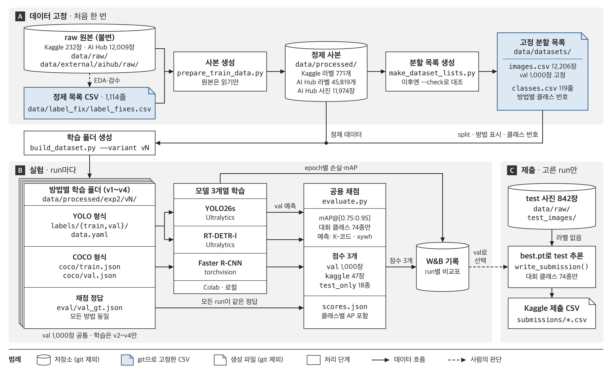

팀 내에서 확정한 원칙은 네 가지다.

1. **원본은 건드리지 않는다.** 라벨을 고칠 때는 "무엇을 왜 고쳤는지"를 CSV에 기록하고, 스크립트가 그 목록대로 사본을 만든다. 이는 데이터 버전을 변경시키는 것이고, 그 기록 또한 CSV로 버전관리한다. 누구든 같은 명령으로 같은 데이터를 다시 만들 수 있도록 하고, 변경 기록을 추적하기 위함이다. 또한, 추후 이전 버전의 데이터로 실험을 진행하고자 할 때 손쉽게 진행할 수 있다.
2. **분할은 파일로 고정한다.** train/val 목록을 CSV로 git에 넣고, 점검 스크립트로 각자의 데이터가 팀과 같은지 확인한다. 각 실험에서 사용한 데이터가 다르면 그 실험끼리 같은 선상에서 비교할 수 없기 때문에 둔 안전장치다. 따라서 1차, 2차 실험에서 세 모델이 같은 train으로 학습하고, 같은 val로 채점되도록 했다.
3. **채점 코드는 하나만 쓴다.** 세 모델의 예측을 같은 형식으로 바꿔 같은 함수로 채점한다. 채점 코드가 다르면 그 결과도 달라지기 때문에 채점 코드를 고정했다.
4. **실험은 가설 → 결과 → 회수** 순서로 기록한다. 실패한 실험도 기록한다.

이 흐름은 `src/pill_detection/` 공용 모듈 5개(`data`, `datasets`, `evaluate`, `balance`, `utils`), 스크립트 7개, 테스트 11개 파일로 구현했다. 

### 2.2 모델 3계열과 선정 이유

> **[표 2-1] 모델 3계열 비교**

| 계열 | 모델 | 구조 | 파라미터 / 연산량 | 구현 | 담당 |
| --- | --- | --- | --- | --- | --- |
| 1-stage | YOLO26s | anchor-free, NMS 없음 | 948만 / 23.0 GFLOPs (학습 기록) | Ultralytics 8.4.183 | 이채영 |
| DETR | RT-DETR-l | 트랜스포머 디코더, 쿼리 300개, NMS 없음 | 3,223만 / 105.9 GFLOPs (학습 기록) | Ultralytics 8.4.183 | 임재원 |
| 2-stage | Faster R-CNN ResNet50-FPN | RPN + RoI head | 약 4,176만 / 134.38 GFLOPs (torchvision 문서값) | torchvision | 이채정, 강래우 |

- **YOLO26s를 사용한 이유**: Selçuk Univ.(2026) 알약 검출 비교에서 YOLOv8s와 YOLO26s의 mAP50-95가 0.954로 같고, YOLO26s는 NMS를 없애 후처리가 0.19ms로 가장 짧다. 우리는 데모 서비스도 프로젝트 목적에 두고 있었기 때문에 추론시간을 고려해 YOLO26s를 실험 후보에 넣었다.
- **Faster R-CNN을 사용한 이유**: "같은 YOLO 세대끼리 비교하기보다는 서로 다른 계열의 모델을 비교해보자"는 논의 끝에, 구조가 전혀 다른 2-stage Detector 대표로 Faster R-CNN을 넣었다. 알약 검출 비교 논문(Tan et al., 2021 프리프린트, [부록 G](#부록-g-참고문헌) 2번)에서 Faster R-CNN이 mAP 87.69%로 가장 높았지만, YOLO v3(mAP 80.17%)가 FPS 기준 8배 이상 빨랐다. 정확도-속도 트레이드오프를 직접 확인하려는 목적이 있었다.
- **RT-DETR을 사용한 이유**: 팀원이 실험을 진행하고 있는 YOLO26(1단계 CNN), Faster R-CNN(2단계 CNN)과 계열이 다른 Transformer 계열 중에서 RT-DETR을 선정했다. RT-DETR은 정확도 중심이던 DETR 계열을 실시간 영역으로 옮긴 모델(CVPR 2024)이고, 후속 실시간 DETR인 RT-DETRv2가 기준으로 삼은 모델이기 때문에 Transformer 계열의 대표로 골랐다. COCO 사전학습 가중치로 적은 데이터를 미세조정할 수 있고, YOLO26과 같은 Ultralytics 파이프라인을 그대로 쓸 수 있다는 점이 결정적이었다.
- **모두 COCO 사전학습 가중치에서 전체 미세조정(full fine-tuning)으로 학습했다**. 

### 2.3 공정 비교를 위해 고정한 것과 모델별로 다르게 둔 것

우리의 1차, 2차 실험 목표는 '모델 성능' 비교가 아니라 **'데이터의 쓸모'** 판단이 목적이었다. 따라서 필수적으로 고정해야 하는 것들만 고정하고, 모델마다 적합한 하이퍼파라미터는 각각 다르게 두는 것을 허용했다. 모델 간 성능 순위를 가리는 것은 목표에서 뺐다.

> **[표 2-2] 고정한 것 / 다르게 둔 것**

| 구분 | 항목 | YOLO26s | RT-DETR-l | Faster R-CNN |
| --- | --- | --- | --- | --- |
| 세 모델 공통 고정 | 데이터 분할 | 1차: 조합 단위, seed 410, train 185 / val 47. 2차: 고정 val 1,000장 (CSV) | 같음 | 같음 |
| | 입력 크기 | 640 | 640 (비율 유지 없이 640×640) | 640 |
| | 배치 | 16 | 16 | 16 (1차 원본 run만 2 × 누적 8) |
| | 옵티마이저 | AdamW | AdamW | AdamW |
| | 사전학습 | COCO, 전체 미세조정 | COCO `rtdetr-l.pt`, 전체 미세조정 | COCO_V1 `fasterrcnn_resnet50_fpn`, 전체 미세조정(BatchNorm 고정) |
| | 시드 | 1차 0·1·2, 2차 0, 3차 0 (+ seed 1·2 흔들림 측정) | 1차 0·1·2, 2차 0 | 1차 0·1·2, 2차 0, 3차 0 |
| | 채점 | `evaluate.py` | 같음 | 같음 |
| 모델별로 다름 | 학습률 | lr0 0.000167 (1차 auto가 고른 값을 2차에 고정) | lr0 0.000167, momentum 0.9 (같은 방식) | 3e-4, weight decay 1e-4 |
| | 스케줄 | 선형 감소 + warmup 3 epoch (2차 e5·e10도 3 epoch) | 선형 감소 + warmup = 전체의 3% (2차) | warmup 3 + cosine |
| | 증강 | Ultralytics 기본(mosaic, hsv, translate, scale, fliplr 0.5). 2차 e5·e10은 close_mosaic 10 때문에 처음부터 mosaic 꺼짐 | Ultralytics 기본, 2차는 close_mosaic = max(1, 0.1 × epochs) | 없음 |
| | 에폭 | 1차 100(patience 30). 2차 5/10/20. 3차 18~20 | 1차 100(patience 30). 2차 5/10 | 1차 100(patience 30). 2차 5/10/20. 3차 9~10 |
| | 환경 | Colab T4(1차, 2차 e5·e10), A100(2차 e20, 3차). AMP 예 | 로컬 Windows RTX 4070 SUPER 12GB, workers 0. AMP 예 | 1차 Kaggle·Colab, 2차 Colab A100, 3차 Colab L4. AMP(FP16) 예 |

- 세부 환경(GPU·프레임워크 버전·workers·1 epoch 시간)은 [부록 D](#부록-d-실험-환경)에 있다.

> **[표 2-3] RT-DETR-l 2차: 고정한 것 / 다르게 둔 것**

| 구분 | 값 | 이유 |
| --- | --- | --- |
| 고정: 학습 설정 | imgsz 640, batch 16, AdamW, lr0 0.000167, momentum 0.9, warmup_bias_lr 0.0, patience 30, 증강 기본값 | 1차에서 optimizer=auto가 고른 값을 2차에서 직접 적었다. auto로 두면 클래스 수에 따라 학습률이 v2 0.000082, v3 0.0001, v4 0.000127로 바뀐다(자동 계산값) |
| 고정: 비율 | warmup = 전체의 3%, 모자이크 끄는 구간 = 마지막 10% (정수라 5, 10 epoch 모두 마지막 1 epoch) | 1차 실험때의 epoch 100을 2차 때 5, 10으로 줄이면서 1차 값(3, 10)을 그대로 두면 warmup이 학습의 30~60%가 되고 모자이크는 처음부터 꺼지기 때문에 1차 때의 비율을 사용하여 값을 조정. ex) 10 에폭에서는 (0.3, 1) |
| 고정: 평가와 제출 | 팀 evaluate_val, 2차 val 1,000장(커밋 4fdae56), 제출 conf 0.01 | 1차 best.pt도 같은 함수로 다시 채점해 kaggle 점수로 비교했다 |
| 다름: 환경 | 로컬 Windows, RTX 4070 SUPER 12GB, workers=0 | Windows 주피터에서 사진 읽기 오류를 피하려고 `workers=0`을 썼다. 팀원이 실험한 YOLO는 Colab T4(e5, e10), A100(e20)에서 학습했다(`yolo26-exp2.md`) |
| 다름: epoch | 5, 10 (20은 돌리지 않음) | 10 epoch run 하나에 2.7~3.7시간. 5 → 10 epoch에서 Ultralytics best mAP50-95가 +0.0017~+0.0054만 올랐다. 20에폭을 돌려도 성능이 별로 오르지 않을 것으로 예상하고 시간이 너무 낭비될 것 같다고 판단. |
| 다름: 모자이크 | 5 epoch run은 1~4 epoch, 10 epoch run은 1~9 epoch 사용 | 팀원 기록(yolo26-exp2.md)으로는 YOLO e5, e10은 기본값(마지막 10 epoch 끔)이라 처음부터 꺼진 채 학습했다. 모델 비교 때 이 차이가 섞인다 |

- **2차 에폭을 100에서 5/10/20으로 줄인 이유**: 1차 실험에서는 훈련 데이터가 232장으로, 1 epoch은 약 15 step(232장÷16)이라 100 epoch이 약 1,500 step밖에 안됐다. 2차는 1 epoch이 446~701 step이므로 같은 100 epoch으로 하면 44,600~70,100 step으로, 이는 1차 실험의 약 46배에 이른다. 이러면 2차 실험의 성과가 '데이터가 보충돼서'인 지, '학습을 더 많이 해서'인 지 구분할 수 없게 된다. step수를 고정하게 된다면 2차 실험에서는 2~3에폭밖에 학습을 하지 않아야 하는데, 이는 과소적합(under fitting) 우려가 있었다. 따라서 우리의 실험 환경(Colab Pro, 로컬 GPU) 위에서 과소적합 및 과적합이 일어나지 않은 run으로 1차와 2차를 비교하기 위해 epoch 5/10/20를 차례로 실험했다.(RT-DETR은 epoch 20은 실험하지 않음)
- **환경이 모델마다 다른 것은 이 프로젝트의 한계다.** 실험 환경은 부록 D에 정리했고, 11장에서 다시 다룬다.

---

## 3. 1차 데이터 EDA: Kaggle 제공 데이터

> 근거: `notebooks/eda/00_kaggle_eda.ipynb` (팀원 4명의 EDA를 통합한 노트북).

### 3.1 데이터 구성과 촬영 조건

> **[표 3-1] Kaggle 데이터 구성과 촬영 조건**

| 항목 | 값 |
| --- | --- |
| train 이미지 / annotation JSON | 232장 / 763개 |
| 이미지당 JSON(=알약) 수 | 2개 7장, 3개 151장, 4개 74장 |
| 클래스(`category_id`) 수 | 56개 |
| `category_id` = `drug_N` 숫자인 annotation | 763/763 |
| 조합 수 | 114개 |
| test 이미지 | 842장 |
| 해상도 (너비×높이) | train 976×1280 232장, test 976×1280 842장 |
| `drug_S` (알약 상태) | 정상알약 763개 |
| `back_color` (배경) | 연회색 배경 763개 |
| `light_color` (조명) | 주백색 763개 |
| `drug_dir` (알약 면) | 앞면 751개, 뒷면 12개 |
| `camera_la` (카메라 위도, 도) | 90: 277개, 75: 249개, 70: 237개 |
| `camera_lo` (카메라 경도, 도) | 0: 763개 |
| `image` 안에서 모든 값이 비어 있는 필드 | 4개 / 전체 50개: `mark_code_back_anal`, `mark_code_back_img`, `mark_code_front`, `mark_code_back` |

- 모든 사진이 976×1280 RGB. 촬영 조건 중 달라지는 것은 **카메라 각도**(90° 85장, 75° 75장, 70° 72장)와 앞·뒷면(앞면 228장)뿐이다. 배경·조명은 같다.

> **[그림 3-1] train과 test 밝기 분포 비교**

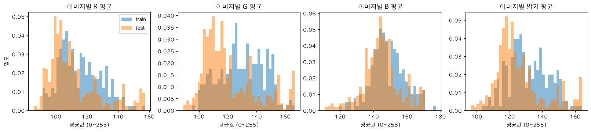
- test 사진은 train보다 평균 밝기가 5.6 낮다(131.4 vs 125.8). 분포는 겹친다.

> **[그림 3-2] 학습 사진·test 사진 예시**

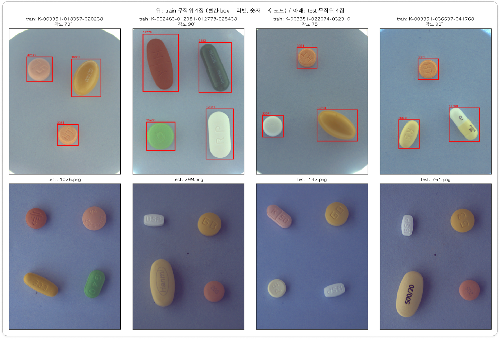

**정한 것**: 전처리(밝기 보정 등)는 하지 않는다. 각도만 다르므로 회전·뒤집기 증강은 신중히 다룬다(각인이 거울상이 되면 다른 약이 될 수 있음).

### 3.2 라벨 품질과 정제

JSON 763개를 전수 검사하고 클래스별로 bbox를 알약에 겹쳐서 crop본을 만들어 직접 눈으로 확인했다.

> **[표 3-2] Kaggle 라벨 오류 종류와 건수**

| 오류 | 건수 | 처리 |
| --- | ---: | --- |
| 라벨 누락 (파일명의 알약 수보다 JSON이 적음) | 8장 8개 | box를 새로 그려 추가 |
| 이미지 밖 bbox (x=6567, 오타) | 1개 | 좌표 수정 |
| 다른 알약 위에 그려진 box | 3개 | 좌표 수정 |
| 빈 바닥에 그려진 box | 1개 | 좌표 수정 |
| 두 알약의 클래스가 서로 바뀜 (27733↔35206) | 2개 | 클래스 수정 |
| bbox 크기 오류 | 2개 | 좌표 수정 |
| area ≠ w×h | 4개 | area 수정 |
| **합계** | **bbox 21개 (추가 8, 수정 13), 사진 19장, 전체의 약 8%** | JSON 763 → 771개 |

- 정제 결과는 `data/label_fix/label_fixes.csv`의 kaggle 행 21개로 기록되어있다. 원본은 그대로 두고 스크립트가 사본을 만들어 `processed/train_annotations/`에 저장한다.
- 이 정제만으로 YOLO26s의 Kaggle public이 0.392 → 0.410(+0.018)으로 올랐다([표 4-3](#432-yolo26s-추가-실험)).

> **[그림 3-3] 라벨 오류 예시 (누락, 이미지 밖, 클래스 바뀜)**
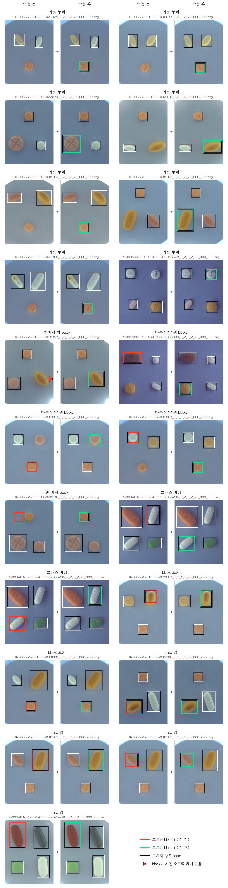

**정한 것**: 1차 실험은 라벨 오류 21개를 고친 사본으로 학습한다. 이후 절의 수치는 모두 정제 후 771개 기준이다.

### 3.3 클래스 분포와 알약 외형

> **[그림 3-4] 클래스별 객체 수와 등장 조합 수**

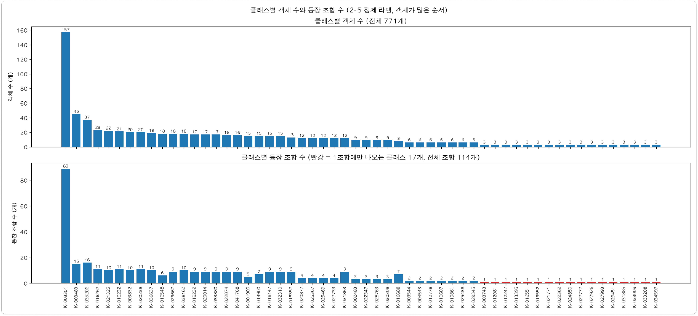

- 클래스 56개. 클래스별 bbox 수는 최소 3, 중앙값 9, 최대 157로 **최대÷최소 52.3배**다.
- K-003351 하나가 전체 bbox의 20.4%이고 사진의 68%, 조합의 78%에 나온다.
- bbox가 5개 이하인 클래스는 17개(30%)이고, 모두 3개뿐이다(조합 하나에만 나오는 약).

> **[그림 3-5] 클래스 살펴보기**
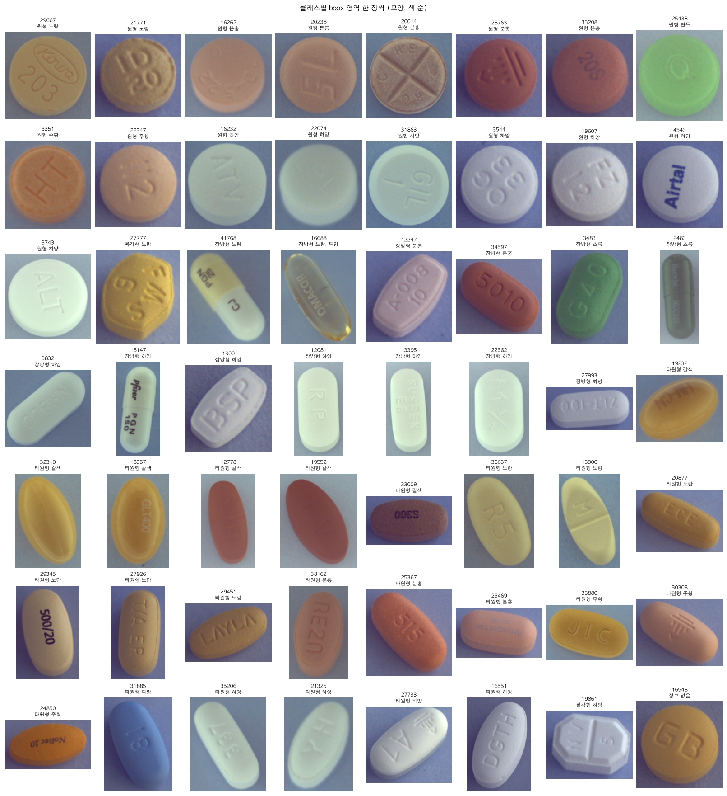

- 모양과 색이 비슷한 알약이 다수 존재한다. 이런 알약이 한 사진에 같이 등장하는 경우, 외형 특징만으로는 구분하지 못할 가능성이 보인다.

**정한 것**: 클래스 불균형이 크다. 희소 클래스의 AP가 낮을 것으로 예상하고, 1차에서는 가중치·샘플링 없이 그대로 학습한 뒤 결과를 본다. 각인이 보여야 하므로 입력 해상도를 줄이는 데 한계가 있다.

### 3.4 bbox 크기와 입력 크기

> **[그림 3-6] bbox 크기 분포**

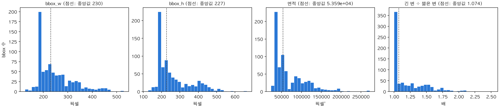

- bbox 771개 모두 COCO 기준 large(가장 작은 면적 약 152²). 너비 125~529px(중앙값 230), 높이 126~664px(중앙값 227). 긴 변÷짧은 변 중앙값 1.074로 거의 정사각이다.

| 입력 크기 | 짧은 변 최소 | 짧은 변 중앙값 | 각인 |
| ---: | ---: | ---: | --- |
| 1280 | 125.0 | 214.0 | 선명 |
| 960 | 93.8 | 160.5 | 선명 |
| **640** | **62.5** | **107.0** | 보임 |
| 416 | 40.6 | 69.6 | 작은 글자 흐림 |

> **[그림 3-7] 입력 크기별 각인 확대 비교** 

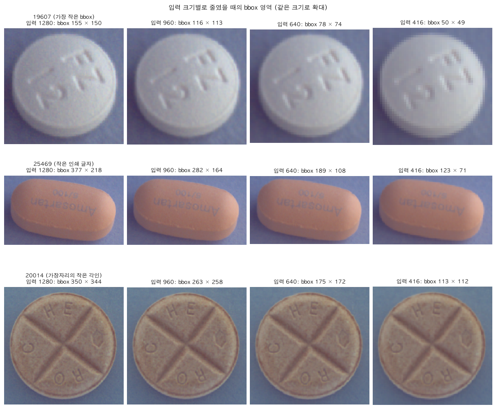

| 알약 | 1280, 960 | 640 | 416 |
|---|---|---|---|
| 19607 (FZ12 각인) | 각인이 또렷하다. | 각인이 흐려지지만 획은 보인다. | 픽셀이 굵게 보이고, 획이 희미해서 글자를 알아보기 어렵다. |
| 25469 (Amosartan 5/100 인쇄) | 두 줄 모두 읽힌다. | Amosartan은 읽히고, 5/100은 흐려진다. | Amosartan은 대략 보이지만, 5/100은 알아보기 어렵다. |
| 20014 (십자 분할선, 가장자리 글자) | 분할선과 글자가 또렷하다. | 분할선과 글자가 보인다. | 분할선은 뚜렷하고, 가장자리 글자는 흐려진다. |

- 640까지는 세 알약 모두 각인이나 인쇄 글자가 보인다. 416에서는 작은 각인과 작은 글자가 흐려진다.
- 모양과 색이 비슷한 알약들은 식별 문자가 주요 구분 단서라서, 입력을 너무 줄이면 구분이 어려워질 수 있다.
- 하지만 입력 크기를 키우면 학습에 드는 메모리와 시간이 늘어난다.

**정한 것**: 입력 416은 각인이 뭉개지므로 사용하지 않는다. 640을 사용한다. 1280은 학습 비용 대비 이득이 불확실하다.

### 3.5 분할 설계: 조합 단위

> **[그림 3-8] 조합 예시** 

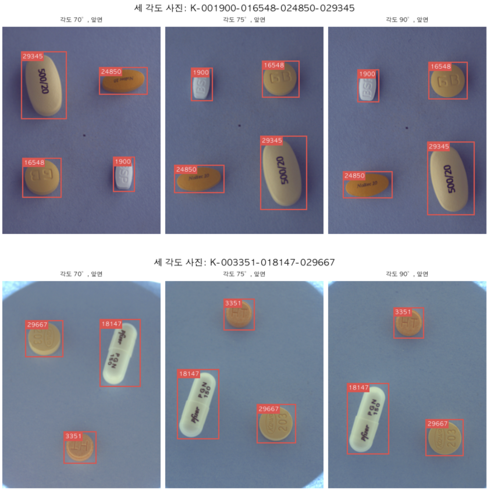
- 하나의 조합은 같은 알약들을 세 각도로 찍은 것이므로, 사진 단위로 나누면 같은 장면이 train과 val에 모두 들어간다.
- **사진 단위 분할**로 시뮬레이션(val 20%, seed 20회)해봤을 때, **val의 76.1%(63~87%)가 train에 같은 조합이 있다.** 같은 조합의 사진은 같은 알약의 각도만 다른 배치였으므로, val 점수가 처음 보는 조합에서의 성능보다 높게 나올 수 있다.

> **[표 3-3] 사진 단위 vs 조합 단위 분할 비교**

| 분할 단위 | val 사진 수 | 같은 조합이 train에 있는 val 사진 비율 | val에만 있는 클래스 수 | train에만 있는 클래스 수 |
|---|---|---|---|---|
| 사진 단위 | 46 | 평균 76.1% (63~87%) | 평균 0.1 (0~2) | 평균 11.5 (6~19) |
| 조합 단위 | 평균 46.7 (46~48) | 0% | 평균 4.1 (1~8) | 평균 24.8 (16~31) |

- 조합 단위로 나누면 누수는 없다. 하지만 두 가지 문제가 있다.
    - 평균 4.1개(최대 8개) 클래스가 val에만 들어가서 학습하지 못한다.
    - 평균 24.8개 클래스가 val에 없어서, 56개 클래스 중 절반 가까이를 val로 평가하지 못한다.
- 232장뿐이라, val 20%로는 어느 방법이든 모든 클래스를 평가하기 어렵다.


> **[그림 3-9] 1차 실험 train/val의 클래스별 bbox 수**

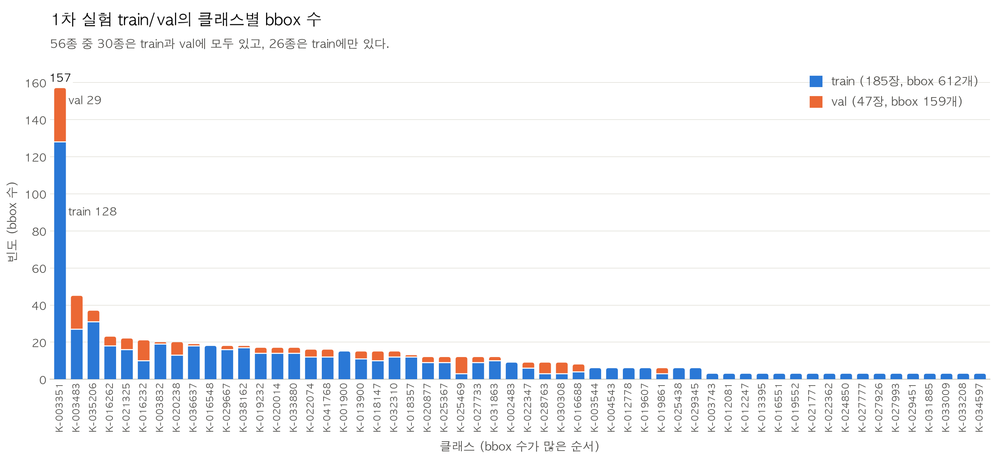

- **최종 분할(seed 410):**, train 185장(79.7%) / val 47장(20.3%). val에 30종이 들어 있고 val에만 있는 약은 0종. K-003351 비율이 전체와 ±0.02 이내이면서 val 약 종류가 가장 많은 seed를 골랐다. 이 기준은 라벨 정제 전 값으로 판정했고, 정제 후 값으로는 val 18.2%, 전체 20.4%로 차이가 0.021이다.
- **분할 결과**: train 185장의 bbox는 612개, val 47장은 159개다. train의 클래스별 bbox 수는 최소 3 / 중앙값 9 / 최대 128로 최대÷최소 42.7배이고, 56종 중 30종은 train과 val에 모두 있지만 26종(46%)은 train에만 있어 val로 평가하지 못한다.

**정한 것**: 조합 단위 분할, seed 410.

### 3.6 test 데이터: 학습에 없는 알약

대회 주최 측에서 "test에는 있고 train에는 없는 클래스가 있다"고 밝혔다. 따라서 train에 등장하는 56종 알약을 줄세워놓고, test 사진을 일일이 대조해가며 train에 한 번도 등장하지 않은 알약을 찾아냈다.

> **[그림 3-10] test에만 나오는 알약 예시**

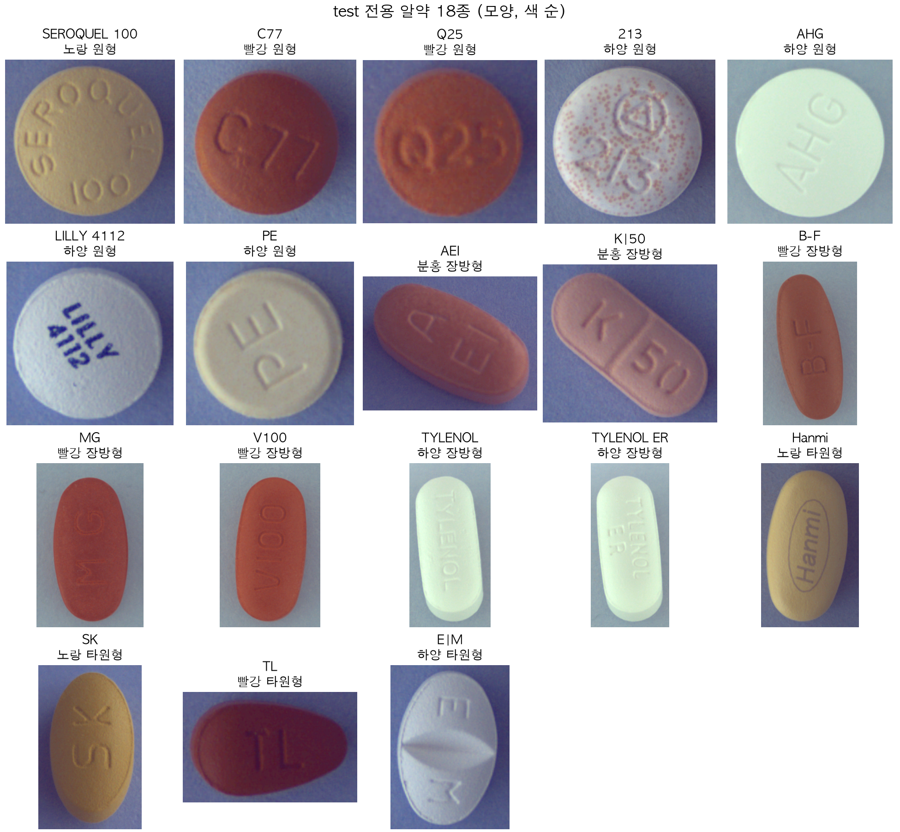

- test 사진을 눈으로 보니 train에 없는 알약이 18종 있었다. **test 전용 알약 18종은 test 842장 중 335장(39.8%)에 나온다**.
- Kaggle train 56종만 배운 모델은 이 18종을 절대 맞힐 수 없다. 대회 점수가 클래스별 AP 평균이므로 18종이 0점이면 **상한은 56/74 ≈ 0.76**이다.

### 3.7 EDA 결론 → 1차 실험 가설

> **[표 3-4] 1차 EDA에서 1차 실험 가설로**

| EDA에서 확인한 것 | 1차 실험 가설 |
| --- | --- |
| test 전용 알약 18종, test 사진의 39.8% | **H1.** Kaggle 점수는 val보다 크게 낮을 것이고, 주된 원인은 train에 없는 18종일 것이다 |
| 사진 232장, 클래스당 3~157개 | **H2.** 100 epoch이면 과적합이 생길 수 있다. 학습 곡선과 20/30/50 epoch을 함께 본다 |
| JSON에 외형 정보가 있는 55종(16548 제외) 중 49종은 비슷하게 생긴(모양·색이 같은) 다른 클래스가 있음 | **H3.** 오류는 "못 찾음"보다 "클래스 틀림"이 많을 것이다 |
| 클래스당 3~157개, K-003351 한 종이 bbox의 20.4% | **H4.** 애매하면 빈도가 많은 클래스로 찍는 경향이 있을 것이다 |
| 입력 640에서 각인 짧은 변 62px 이상 | (추가 확인, 4.3.2) 640이면 충분하고 1280은 이득이 없을 것이다 |
| 각도만 다르고 각인으로 구분 | (추가 확인, 4.3.2) 상하 뒤집기 증강은 도움이 되지 않을 것이다 |

**정한 것**: 라벨 21개 수정 · 입력 크기 640 · 조합 단위 분할(train 185 / val 47장) · 밝기 보정 없음.

---

## 4. 1차 실험: Kaggle 데이터 베이스라인

### 4.1 목적과 가설

Kaggle 제공 데이터만으로 어디까지 되는지 기준 성능을 잡고, 부족하면 원인을 찾는다. 가설은 [표 3-4](#37-eda-결론--1차-실험-가설)의 H1~H4. 입력 640과 상하 뒤집기는 가설 번호 없이 추가 실험(4.3.2)으로 확인한다.

### 4.2 실험 설정

> **[표 4-1] 1차 실험 설정 (모델 × 환경 × 시드)**

| 항목 | YOLO26s | RT-DETR-l | Faster R-CNN (`notebooks/modeling/exp1/frcnn-exp1.md`) |
| --- | --- | --- | --- |
| 데이터 | 232장(train 185 / val 47), 56종, bbox 771 (라벨 수정 반영). train 객체 612개·56종, val 객체 159개·30종 | 같음 | 같음 |
| 사전학습 | COCO, 전체 미세조정 | COCO `rtdetr-l.pt`, 전체 미세조정. 가중치 941개 중 926개를 가져오고 클래스 층 15개는 새로 초기화 | COCO_V1 `fasterrcnn_resnet50_fpn`, 전체 미세조정, BatchNorm 고정 |
| 입력·배치 | 640, 16 | 640(비율 유지 없이 640×640), 16 | 640, 16 (재실험 run. 처음 Kaggle 환경에서 돌린 2×누적 8 run의 수치는 남아 있지 않다) |
| 옵티마이저 | auto → AdamW lr 0.000167 | auto → AdamW lr 0.000167, momentum 0.9 | AdamW lr 3e-4, wd 1e-4, warmup 3 + cosine |
| 에폭 | 100, patience 30 (seed 2 기록은 81 epoch까지) | 100, patience 30 (3 seed 모두 100 완주, best epoch 92 / 75 / 99) | 100, patience 30 (best epoch 91 / 90 / 81) |
| 증강 | Ultralytics 기본 | Ultralytics 기본 (mosaic 1.0, close_mosaic 10, fliplr 0.5) | 없음 |
| AMP | 예 | 예 | 예 (FP16, 추론·val loss는 FP32) |
| 환경 | Colab T4, run당 약 12.6분 | 로컬 RTX 4070 SUPER 12GB, run당 1.07 / 1.55 / 2.76h | Colab, run당 약 35분 |
| 시드 | 0, 1, 2 | 0, 1, 2 | 0, 1, 2 |
| 추가 실험 | flipud 0.5, imgsz 1280, e20/30/50, 라벨 수정 전 | 제출 conf 0.01·max_det 300·박스 경계 자르기 | 사전학습 없이 처음부터 학습(scratch) seed 0·1·2 |
| W&B run | `cy_yolo26s_e100_s{0,1,2}_fix` | `jw_rtdetr-l_e100_s{0,1,2}_fix` | `cj_faster_e100_s{0,1,2}_exp1_b16_fast_e100_ft_lr3e-4`, `scratch_s{0,1,2}_1028_*` |

### 4.3 결과

#### 4.3.1 점수 요약

> **[표 4-2] 1차 결과: val 47장 mAP@[0.75:0.95]와 Kaggle public (시드 3개)**

| 모델 | val 47장 (seed 0 / 1 / 2) | Kaggle public (seed 0 / 1 / 2) | Kaggle 시드 범위 | val − Kaggle |
| --- | --- | --- | ---: | ---: |
| YOLO26s | 0.961 / 0.958 / 0.927 ※ | 0.410 / 0.410 / 0.390 | 0.020 | 약 0.54~0.55 |
| RT-DETR-l | 0.985 / 0.982 / 0.978 ※ | 0.4215 / 0.4176 / 0.4201 | 0.004 | 약 0.56 |
| Faster R-CNN | 0.933 / 0.929 / 0.918 (best epoch 91 / 90 / 81) | 0.3763 / 0.3775 / 0.3948 | 0.018 | 약 0.52~0.56 |
| Faster R-CNN scratch (seed 0) | 0.750 | 0.2857 | — | 약 0.46 |

- ※ YOLO26s와 RT-DETR-l은 W&B에 남은 `best.pt`를 내려받아 2차 채점 함수(`evaluate_val`)로 같은 47장을 다시 잰 값이다. Ultralytics가 학습 중 기록한 값은 mAP50-95라서 대회 지표보다 높다(YOLO 0.976 / 0.963 / 0.956, RT-DETR 0.987 / 0.985 / 0.976). RT-DETR의 Ultralytics mAP75-95는 0.982 / 0.980 / 0.973이다. Faster R-CNN은 체크포인트가 남아 있지 않아 학습 중 기록한 대회 지표 값을 쓴다.
- **시드 편차**: YOLO는 Kaggle이 0.390~0.410으로 움직였다. 그래서 1차에서는 **0.02보다 작은 차이는 차이로 보지 않는다**. RT-DETR은 0.004, Faster R-CNN은 0.018.
- 세 모델 모두 val은 0.92~0.99인데 Kaggle은 0.38~0.42다. 모델이 달라도 차이의 크기가 같다. 사전학습 없이 학습한 scratch run도 val 0.75 → Kaggle 0.29로 차이가 비슷하다.

> **[그림 4-2] 1차 val 47장 점수와 Kaggle public 점수 (모델 × 시드)**

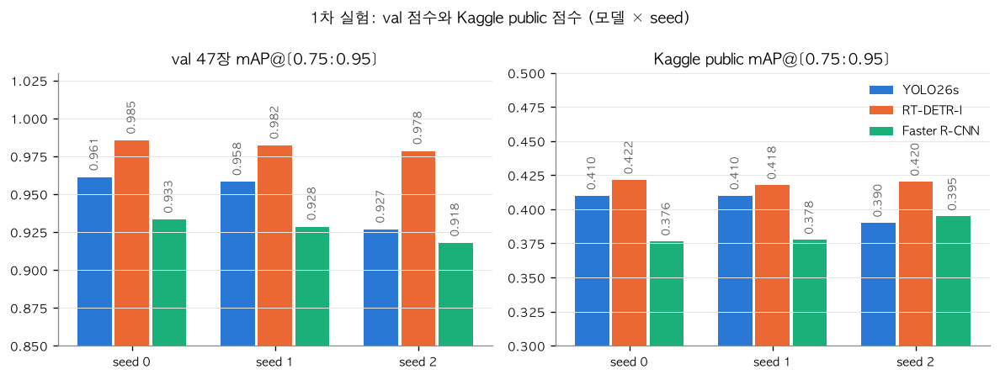

#### 4.3.2 YOLO26s 추가 실험

> **[표 4-3] YOLO26s 1차 추가 실험** (Y1)

| 실험 | val mAP50-95 | Kaggle public | 판정 (기준 0.410, 흔들림 0.02) |
| --- | ---: | ---: | --- |
| 기준 (100 epoch, seed 0) | 0.976 | 0.410 | — |
| 상하 뒤집기 0.5 | 0.968 | 0.403 | 차이 없음 (추가 확인: 뒤집기) |
| 해상도 1280 (batch 8) | 0.966 | 0.403 | 차이 없음 (추가 확인: 해상도) |
| 20 epoch | 0.858 | 0.325 | 부족 |
| 30 epoch | 0.949 | 0.380 | 부족 |
| 50 epoch | 0.974 | 0.404 | 차이 없음 (H2) |
| 라벨 수정 전 | 0.974 | 0.392 | 라벨 정제 효과 +0.018 |

- 과적합 아님: train/val loss가 끝까지 같이 내려갔고, 100 epoch이 50 epoch보다 낮지 않다.

#### 4.3.3 학습 곡선

> **[그림 4-1] 1차 학습 곡선 (train loss, val loss, val mAP) 3계열, seed 0·1·2** (W&B history에서 다시 그림)

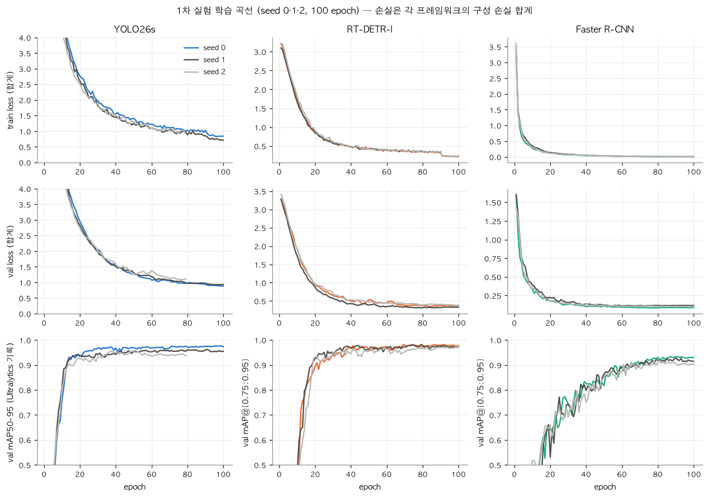

- 세 모델 모두 train loss와 val loss가 끝까지 같이 내려갔고 벌어지지 않았다. 과적합 신호는 없다.
- **YOLO26s**: val mAP가 20 epoch 근처에서 0.93에 닿고 그 뒤 천천히 오른다. seed 0만 0.97 선에 도달했고 seed 1·2는 0.95~0.96에서 멈췄다. 이것이 표 4-2의 seed 2 val이 낮은 이유다.
- **RT-DETR-l**: 약 40 epoch부터 평평하다. best epoch은 92 / 75 / 99지만 40 epoch 이후의 차이는 0.01 안이다. 손실 눈금이 YOLO와 다른 것은 손실 구성(giou·cls·l1)이 다르기 때문이다.
- **Faster R-CNN**: 손실은 20 epoch 안에 거의 바닥에 닿지만 val mAP는 60 epoch까지 계속 오른다(best 91 / 90 / 81). 세 모델 중 가장 늦게 수렴했고, 그래도 val은 0.93에 머물렀다.
- val과 Kaggle의 큰 차이는 과적합을 의심할 징조였다. 하지만 train 클래스가 test보다 적고(56종 vs 74종) train의 불균형이 심한 점을 감안하면, 손실 곡선이 벌어지지 않은 이상 과적합이라고 확정할 근거가 없었다.

#### 4.3.4 오류 분석: confusion matrix

세 모델의 오류를 같은 기준으로 셌다. score 0.30 이상 예측을 남기고, score가 높은 예측부터 아직 연결되지 않은 정답 중 IoU가 가장 큰 것에 클래스와 상관없이 일대일로 연결한다(COCO 방식, 연결 최소 IoU 0.75). 세 모델의 예측을 같은 코드로 다시 채점했다. 연결됐고 클래스가 같으면 "맞음", 클래스가 다르면 "클래스 틀림", 연결이 안 된 정답은 "못 찾음", 연결이 안 된 예측은 "배경 오답"이다. "IoU<0.95"는 맞혔지만 박스가 IoU 0.95에 못 미친 것으로, 대회 지표에서 감점되는 부분이다.

> **[표 4-4] 1차 오류 분류 (val 47장, 정답 159개, score ≥ 0.30, 매칭 IoU ≥ 0.75)**

| 모델 | seed | 맞음 | 클래스 틀림 | 못 찾음 | 배경 오답 | IoU<0.95 |
| --- | ---: | ---: | ---: | ---: | ---: | ---: |
| YOLO26s | 0 | 148 | 5 | 6 | 1 | 11 |
| | 1 | 144 | 11 | 4 | 6 | 8 |
| | 2 | 145 | 4 | 10 | 5 | 16 |
| RT-DETR-l | 0 | 150 | 9 | 0 | 45 | 9 |
| | 1 | 155 | 4 | 0 | 38 | 10 |
| | 2 | 153 | 6 | 0 | 62 | 5 |
| Faster R-CNN | 0 | 145 | 14 | 0 | 14 | 32 |
| | 1 | 141 | 18 | 0 | 20 | 31 |
| | 2 | 139 | 20 | 0 | 24 | 34 |

- RT-DETR는 같은 알약에 박스가 여러 개 겹쳐 남기 때문에 매칭 규칙에 따라 "클래스 틀림" 수가 달라진다. IoU가 큰 순서로 연결하면 seed 0의 클래스 틀림이 19개가 되는데, 그중 10개는 정답 클래스의 박스가 바로 옆에 더 높은 score로 있는 중복 박스다. 위 표와 그림은 score 우선 규칙을 쓴다.

> **[그림 4-3a] 1차 전체 클래스 confusion matrix (seed 0, val 47장, 30종 전부)** — 위에서 아래로 train 객체 수가 많은 순. 파랑 = 맞음, 빨강 = 오류, 마지막 열 = 못 찾음, 마지막 행 = 배경 오답

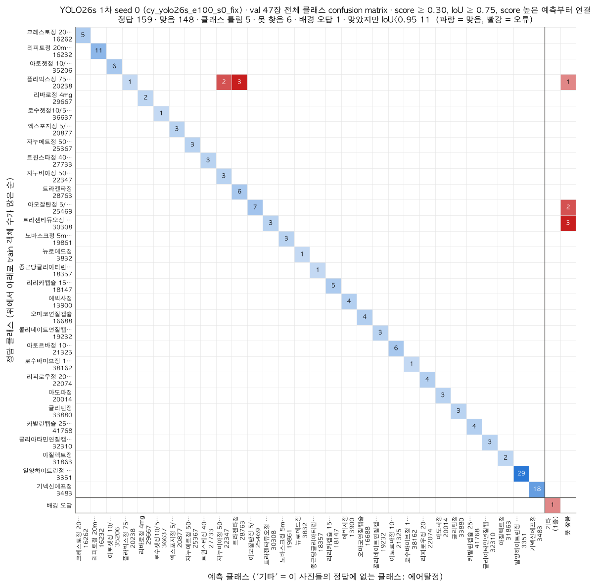
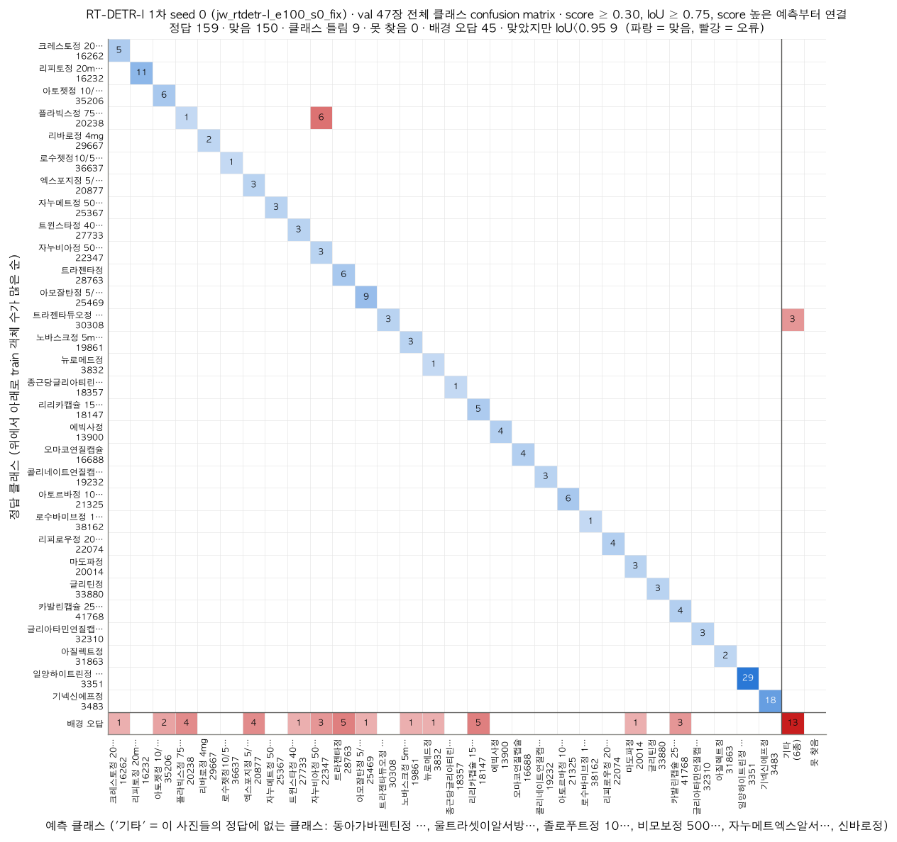
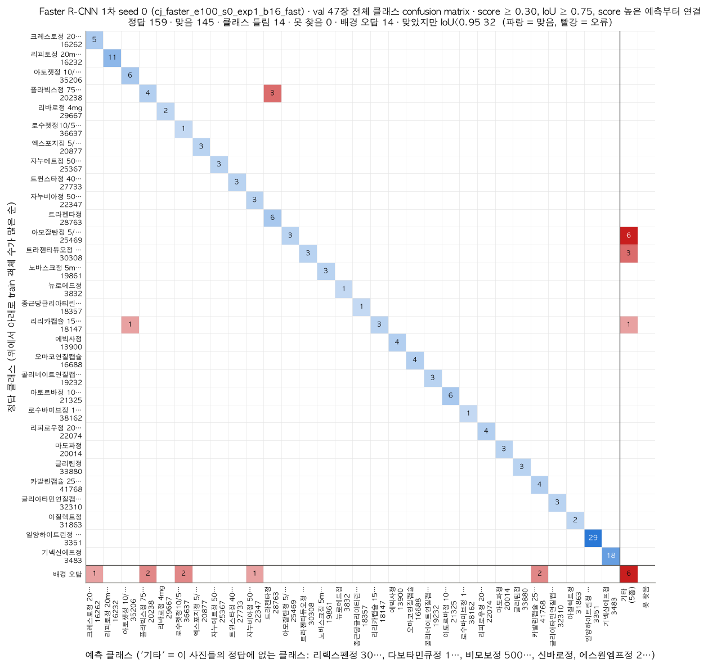

> **[그림 4-3b] 1차 오류 중심 confusion matrix (seed 0, 오류에 관여한 클래스만 축에 둠)** — 그림 4-3a에서 오류가 있는 행·열만 남긴 것

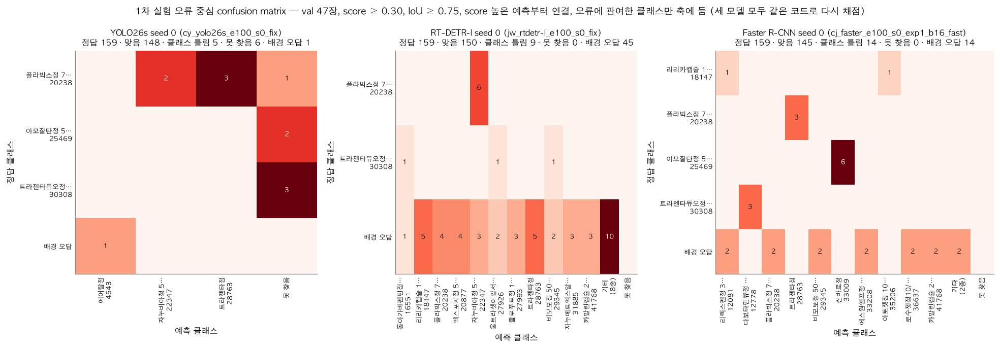

> **[그림 4-3c] 1차 혼동 쌍과 train 빈도** — 왼쪽: 두 모델 이상이 틀린 알약 3종(플라빅스정·트라젠타듀오정은 세 모델 공통), 오른쪽: 한 모델에서만 틀린 알약 4종. 막대는 모델이 대신 고른 알약의 1차 train 객체 수(색 = 모델), 막대 끝 숫자는 seed 3개 합 건수, 점선은 val 30종 train 중앙값

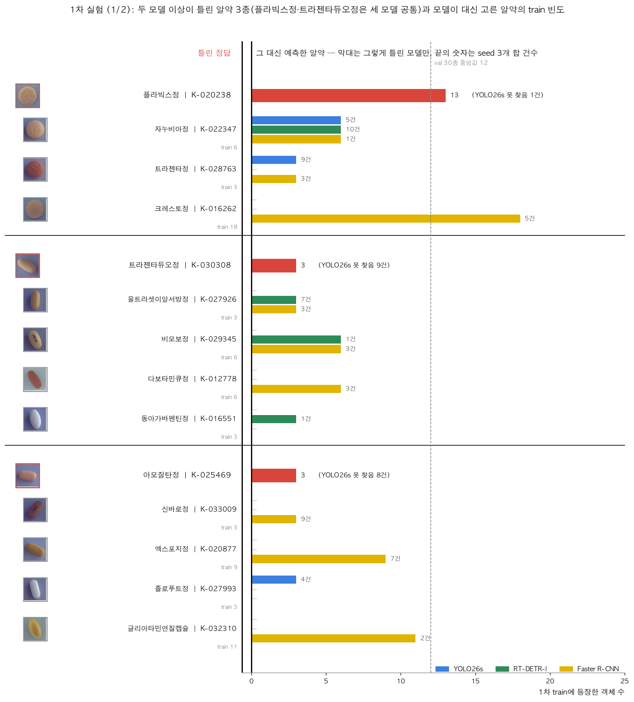
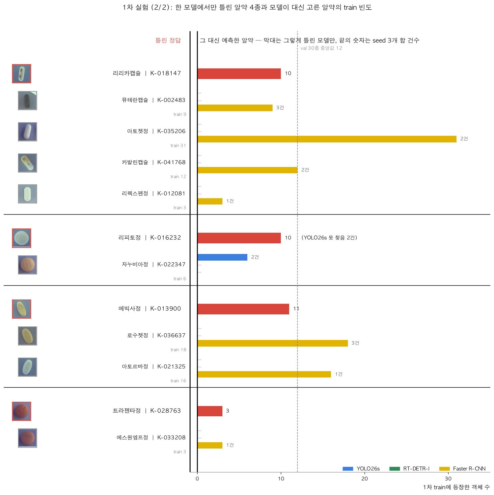

- **YOLO26s**: 클래스 틀림 5개는 모두 플라빅스정(20238)을 자누비아정(22347)·트라젠타정(28763)으로 본 것이고, 못 찾음 6개는 트라젠타듀오정(30308) 3개·아모잘탄정(25469) 2개·플라빅스정 1개다. 세 클래스 모두 train 객체가 3~13개뿐이다.
- **RT-DETR-l**: 못 찾음은 0이지만 배경 오답이 45개로 많다. RT-DETR는 NMS가 없어 같은 알약에 낮은 score의 박스가 겹쳐 남기 때문이다(score 0.5로 올리면 5개로 준다). 클래스 틀림 9개는 플라빅스정(20238)→자누비아정(22347) 6, 트라젠타듀오정(30308)→비모보정(29345)·동아가바펜틴정(16551)·울트라셋이알서방정(27926) 각 1로 YOLO와 같은 짝에 몰려 있다. seed 1·2도 플라빅스정→자누비아정, 트라젠타듀오정→울트라셋이알서방정 두 짝뿐이다.
- **Faster R-CNN**: seed 0은 아모잘탄정(25469)→신바로정(33009) 6건이 가장 크고, 트라젠타듀오정→다보타민큐정(12778) 3, 플라빅스정→트라젠타정(28763) 3, 리리카캡슐(18147)→아토젯정(35206)·리렉스펜정(12081)이 뒤따른다. seed 1·2는 아모잘탄정→엑스포지정(20877) 5·4건, 에빅사정(13900)→로수젯정(36637) 3·2건으로 짝이 바뀐다. 세 seed에 모두 나온 쌍은 리리카캡슐→아토젯정(각 1건)뿐이고 두 seed에 나온 쌍이 8개다.
- **공통점**: 혼동은 색·모양이 닮은 짝(플라빅스정↔자누비아정·트라젠타정, 아모잘탄정↔신바로정·엑스포지정, 트라젠타듀오정↔울트라셋이알서방정·비모보정처럼 흰색 원형끼리, 주황 타원끼리)에 몰린다. 틀린 세 클래스(아모잘탄정, 트라젠타정, 트라젠타듀오정)는 train 3~13개로 희소하지만, 모델이 대신 고른 알약의 train 빈도는 틀린 알약보다 많기도 적기도 하다(그림 4-3c). 즉 **빈도가 많은 쪽으로 찍는 편향은 없고**(H4 기각) 모양이 비슷하면 빈도와 무관하게 헷갈린다. 박스 자체는 거의 맞고(못 찾음 0~10개), 틀리는 것은 이름이다(H3).

#### 4.3.5 클래스별 AP와 흔들리는 클래스

> **[그림 4-4a] 1차 모델별 클래스 AP (seed 3개 평균, val 47장 30종, 위에서 아래로 train 객체 수가 많은 순)** — 왼쪽: 클래스별 평균 AP 막대와 1차 train 객체 수(위 축), 검은 선 = seed 최소~최대. 오른쪽: IoU 기준별 AP. AP와 클래스 빈도는 관계가 없고, 감점은 bbox(IoU 0.90·0.95)에서 난다

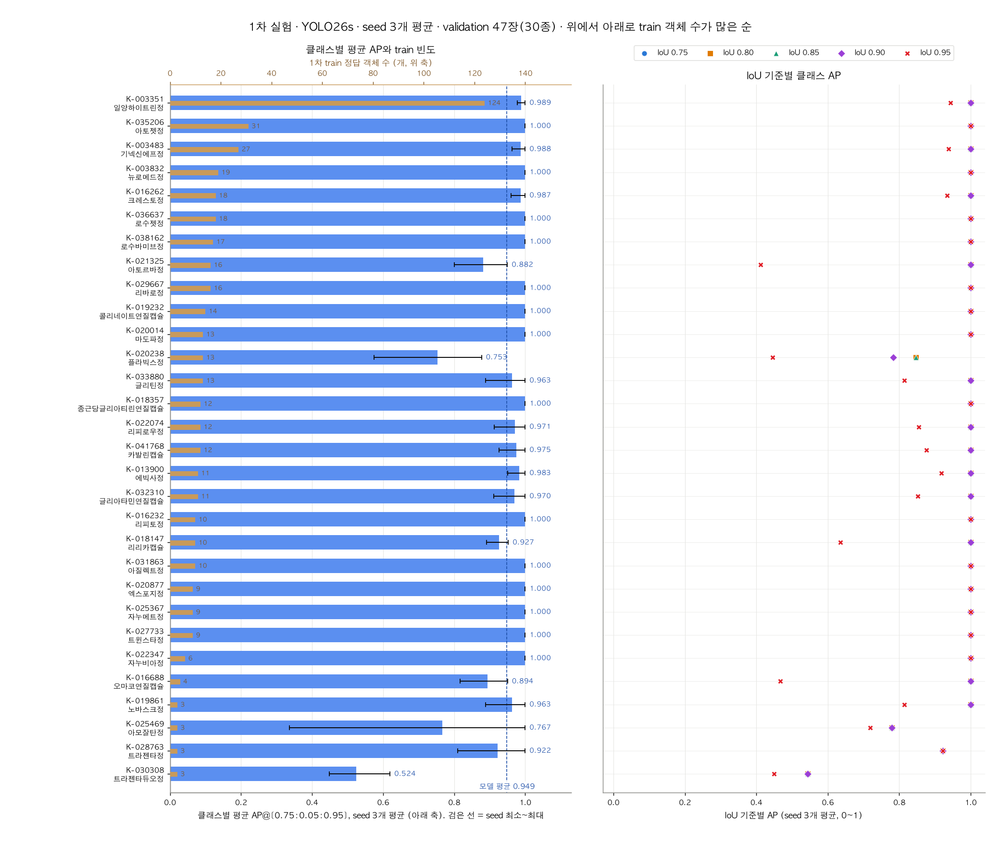
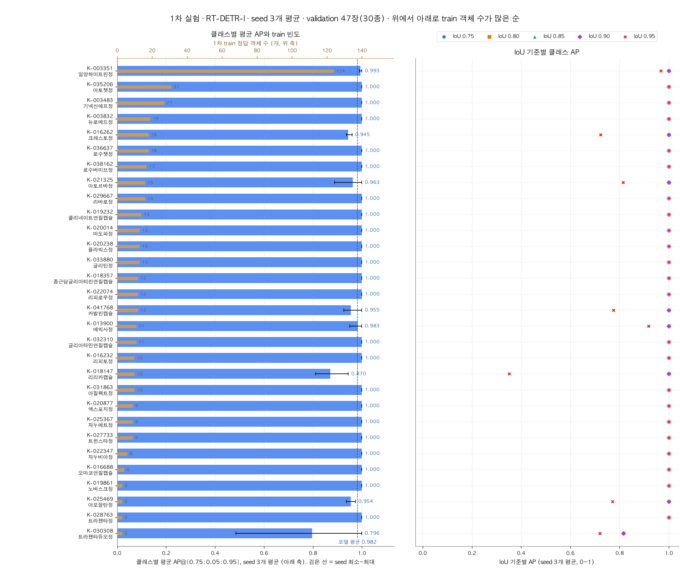
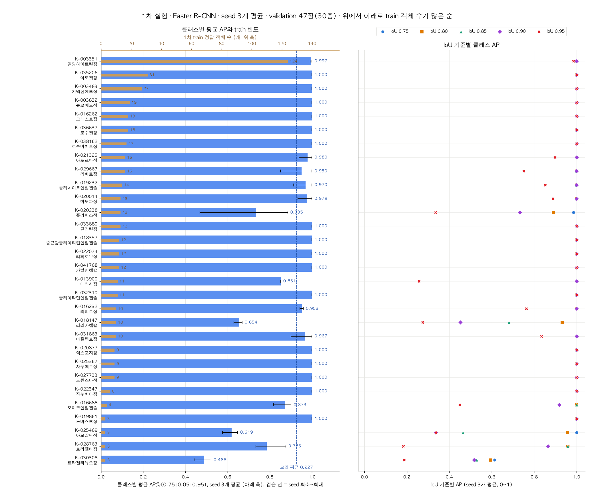

> **[그림 4-4b] 1차 클래스별 AP 세 모델 한눈에 (val 30종, train 객체 수가 적은 순서, 점 = seed)**

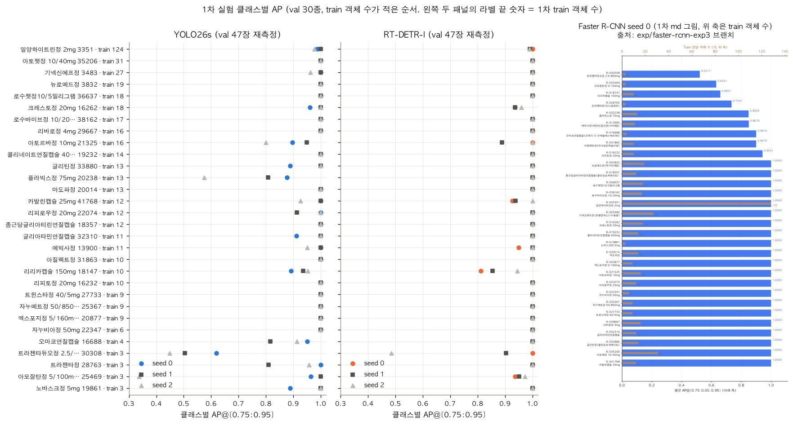

> **[그림 4-5] 1차 흔들리는 클래스: seed 간 AP 범위가 큰 클래스와 그 알약의 val crop**

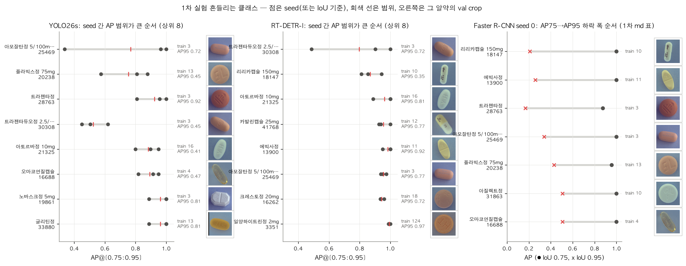

- **YOLO26s**: seed 0 기준 30종 중 19종이 1.0이다. 가장 낮은 것은 트라젠타듀오정(30308) 0.62와 플라빅스정(20238) 0.88. seed를 바꾸면 아모잘탄정(25469)이 0.34~1.00, 플라빅스정이 0.57~0.88, 트라젠타정(28763)이 0.81~1.00으로 움직였다. 세 클래스 모두 train 3~13개다.
- **RT-DETR-l**: 30종 중 22종 만점. 트라젠타듀오정이 0.49~1.00으로 가장 크게 흔들렸고(train에 앞면만 있어 뒷면을 울트라셋이알서방정 27926으로 봄), 리리카캡슐(18147)은 세 seed 모두 0.81~0.95로 낮았다. 리리카캡슐은 IoU 0.95에서 AP가 0.35로, 클래스는 맞혔지만 박스가 캡슐 끝을 덜 감싸 깎였다.
- **Faster R-CNN**: 클래스별 AP가 낮은 8종(0.52~0.94)은 모두 IoU 0.75와 0.95의 AP 차이가 컸다. 리리카캡슐 1.00→0.21, 에빅사정(13900) 1.00→0.26, 트라젠타정 0.88→0.17, 아모잘탄정 1.00→0.34. 클래스와 상관없이 IoU 0.95로 위치가 맞은 정답은 81.1 / 81.1 / 79.9%였다.
- **공통점**: 크게 흔들린 클래스는 train이 3~13개인 희소 약이거나 같은 색·모양의 짝이 있는 약이다. 하지만 30종 전체로 보면 평균 AP와 train 객체 수의 관계는 없다(그림 4-4a 왼쪽: train 128개인 K-003351도, 3개인 클래스도 대부분 1.0). AP를 깎는 것은 클래스 혼동보다 박스가 IoU 0.90·0.95를 못 넘는 것이고(그림 4-4a 오른쪽의 빨간 ×), 이 두 번째 원인은 2차에서도 남는다(6.3.4).

#### 4.3.6 test 예측의 이상 징후

- train에 3개뿐인 희소 약이 test에서 기대보다 최대 8.9배 많이 예측됐다(과잉 예측 상위 10개 중 7개). 같은 알약에 다른 약 box가 겹친 사진이 38장 (Y1). RT-DETR도 test 사진의 14~20%에서 score 0.5 이상 box가 5개 이상 나왔고, 겹침 쌍은 seed별 111 / 102 / 193건(가장 많은 짝은 다보타민큐정 12778–트루비타정 19552, 98회)이었다. 눈으로 확인한 알약 20개 중 8개가 train에 없는 약이었고, 모델은 이것을 배운 약으로 0.54~0.91의 score로 예측했다.

> **[그림 4-6] 1차 test 예측의 이상 징후** — 왼쪽·가운데: YOLO26s·RT-DETR-l seed 0의 test 842장 예측(score ≥ 0.5)에서 약별 예측 수가 기대 수(전체 예측 × 그 약의 1차 라벨 비율)의 몇 배인지, 상위 10종. 오른쪽: YOLO26s가 상위 3종으로 찍은 test 알약 crop과, 자체 파악(5.6절)으로 확인한 실제 약

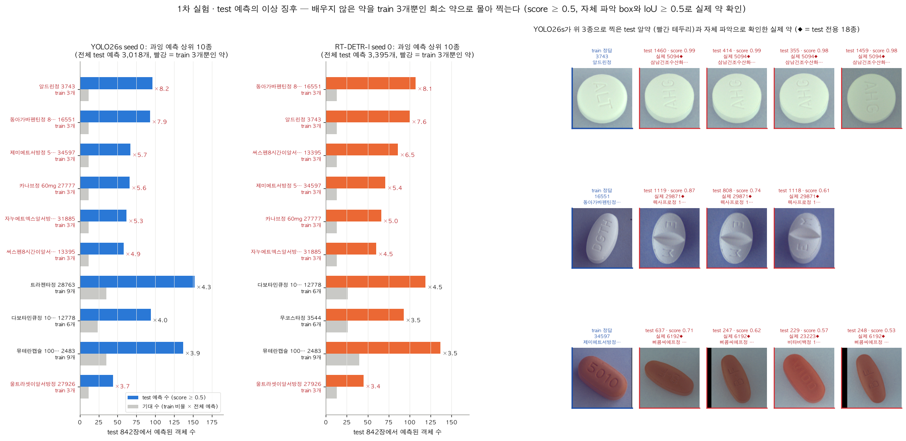

- 1차 best.pt로 test를 다시 추론해(conf 0.25, 입력 640) 그렸다. 과잉 예측 상위 10종 중 7종이 train 3개뿐인 약이고(두 모델 공통), 가장 심한 알드린정(3743)은 기대 11.7개에 96개(×8.2, RT-DETR ×7.6), 동아가바펜틴정(16551)은 ×7.9(RT-DETR ×8.1)다. Y1이 잰 8.9배와 같은 현상이다.
- 자체 파악 box와 IoU 0.5 이상으로 짝지어 보면, score ≥ 0.5 예측 중 클래스가 실제와 다른 것이 YOLO 403개(13.4%), RT-DETR 595개(18.0%)이고 그중 각각 317개·477개(79~80%)가 **test 전용 18종**이다. 알드린정으로 찍힌 알약은 실제로 삼남건조수산화알루미늄겔정(5094, 흰 원형), 동아가바펜틴정으로 찍힌 것은 렉사프로정(29871, 흰 타원), 제미메트서방정으로 찍힌 것은 삐콤씨에프정(6192)·비타비백정(23223, 주황 장방형)이었다. 모두 배우지 않은 약을 모양·색이 닮은 희소 약으로 찍은 것이다.

### 4.4 가설 회수와 다음 단계로 넘어간 이유

> **[표 4-5] 1차 가설 회수**

| 가설 | 판정 | 근거 |
| --- | --- | --- |
| H1 배우지 않은 18종이 Kaggle 점수를 깎는다 | **채택(1차 시점)** | 세 모델 모두 val − Kaggle ≈ 0.55 (scratch run도 0.46). train 3개뿐인 희소 약을 test에서 최대 8.9배 과잉 예측(4.3.6) |
| H2 100 epoch 과적합 | 기각 | 세 모델 loss 곡선이 벌어지지 않음(그림 4-1), 50 vs 100 epoch 차이 없음 |
| H3 오류는 "못 찾음"보다 "클래스 틀림"이 많다 | 채택 | 못 찾음은 0~10개, 클래스 틀림은 닮은 짝에 몰림(표 4-4, 그림 4-3b). 단, 맞힌 박스의 3~24%는 IoU 0.95에 못 미쳐 이것도 감점 요인 |
| H4 애매하면 빈도가 많은 클래스로 찍는다 | 기각 | 대신 고른 알약의 train 빈도는 틀린 알약보다 많기도 적기도 함(그림 4-3c). 모양이 비슷하면 빈도와 무관하게 헷갈림. 클래스별 AP도 train 빈도와 무관(그림 4-4a) |
| (추가 확인) 640이면 충분 | 채택 | 1280이 이득 없음(표 4-3) |
| (추가 확인) 상하 뒤집기 불리 | 채택(이득 없음) | 0.403 vs 0.410, 흔들림 안(표 4-3) |

**다음 단계로 넘어간 이유**: 증강·해상도·에폭은 모두 시드 흔들림(0.02) 안이었다. 모델을 바꿔도 같은 벽에 부딪혔다. 남는 원인은 "test에만 있고 train에는 없는 약"과 "절대적인 학습 데이터 부족"(232장, 클래스당 3~157개)이고 이것은 데이터로만 풀 수 있다. 그래서 외부 데이터(AI Hub)로 18종과 부족한 약을 보충하기로 했다.

---

## 5. 2차 데이터 EDA: AI Hub 외부 데이터 보충

> 근거: `notebooks/eda/01_aihub_eda.ipynb`(AI Hub 검토·정제·선택 방법), `02_test_class_freq_eda.ipynb`(test 알약 전수 파악), 정제 과정은 `notebooks/eda/label_fix/01_aihub_label_fix.ipynb`.

### 5.1 받은 데이터와 변환

- AI Hub 576 "경구약제 이미지 데이터" **조합** 데이터 중, 금지된 2개의 zip(TL_2·TS_2)을 제외한 8쌍(TL_1, TL_3~8, VL_1 + 짝이 되는 원천 이미지 zip, 약 24GB)만 받았다. 단일 알약 데이터는 약 3.7TB라 쓰지 않았다.

| 구분 | 파일 | 개수 | 용량 | filekey | 사용 |
| --- | --- | --- | --- | --- | --- |
| Training 조합 라벨 | TL_1, TL_3~8_조합.zip | 7 | 7~8MB | 66065, 66067~66072 | 사용 가능 |
| Training 조합 라벨 | TL_2_조합.zip | 1 | 7MB | 66066 | **금지** |
| Training 조합 이미지 | TS_1, TS_3~8_조합.zip | 7 | 3GB | 66154, 66156~66161 | 사용 가능 |
| Training 조합 이미지 | TS_2_조합.zip | 1 | 3GB | 66155 | **금지** |
| Validation 조합 라벨 | VL_1_조합.zip | 1 | 7MB | 66243 | 사용 가능 |
| Validation 조합 이미지 | VS_1_조합.zip | 1 | 3GB | 66254 | 사용 가능 |
| Training 단일 라벨 | TL_1~81_단일.zip | 81 | 11~73MB (합계 2.6GB) | 66073~66153 | 사용 가능 |
| Training 단일 이미지 | TS_1~81_단일.zip | 81 | 13~95GB (합계 3,473GB) | 66162~66242 | 사용 가능 (로컬 디스크 부족) |
| Validation 단일 라벨 | VL_1~10_단일.zip | 10 | 15~24MB | 66244~66253 | 사용 가능 |
| Validation 단일 이미지 | VS_1~10_단일.zip | 10 | 19~31GB (합계 228GB) | 66255~66264 | 사용 가능 (로컬 디스크 부족) |

### 5.2 1차 정제 및 라벨 형식 통일

**1차 정제**
AI Hub 원본 데이터에는 크고 작은 문제가 있었다. 

| 문제 | 처리 | 이유 |
|---|---|---|
| JSON만 있고 PNG는 없는 이미지 파일명이 있다 | 뺀다 | 그 이름의 촬영 PNG가 없어서 학습에 쓸 수 없다 |
| `_index.png`는 세 각도 사진과 중복된다 | 뺀다 | 정답이 그려진 참고 사진이다 |
| PNG만 있고 JSON은 없는 이미지가 있다 | 남긴다 | 사진의 알약을 찾아 box를 그려 넣을 수 있다 |
| 읽지 못하는 JSON, `-오류`가 붙어있는 폴더, copy.json, copy 2.json, bbox 오류 | 남긴다 | 촬영 PNG가 있어서, 사진으로 고칠 수 있는지 살펴본다 |

> **[그림 5-1] `_index.png` 예시**

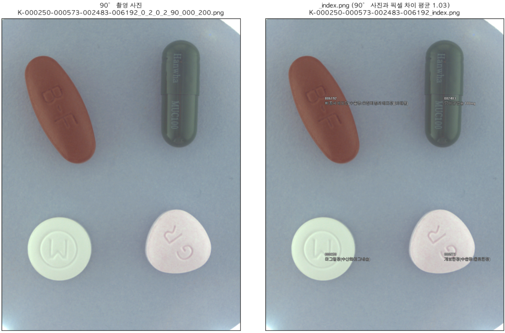

어떤 경우에도 복구할 수 없는 데이터 결함은 과감히 삭제하기로 결정했다. 
- 이미지 파일이 없이 정답만 있는 JSON은 학습은 물론이고 정답에도 사용할 수 없다. 이런 경우도 살려서 쓰려면 이미지를 만드는 방법밖에 없는데, 그것은 비효율적이라고 판단했다. 
- _index.png는 90도 촬영 사진에 정답이 글자로 적힌 참고용 사진이다. 이런 경우는 제외해도 문제가 없다.

| 항목 | AI Hub 원본 | 1차 정제 후 | 변화량 |
| --- | ---: | ---: | ---: |
| JSON 파일 수 | 45,934 | 45,910 | −24 |
| PNG 파일 수 | 16,012 | 12,009 | −4,003 |
| 같은 이름의 PNG가 없는 JSON 수 | 24 | 0 | −24 |


**라벨 형식**
이 뿐만 아니라, Kaggle 대회에서 제공해준 라벨 형식과 AI Hub 데이터의 라벨 형식이 다르다는 점을 파악했다.

| 항목 | Kaggle train | AI Hub 1차 정제 후 | 비고 |
| --- | --- | --- | --- |
| 읽을 수 없는 JSON | 0 | 1 | `K-012247-016551-033009-044199_json/K-016551-오류/K-012247-016551-033009-044199_0_2_0_2_90_000_200.json`의 59번째 줄 `"area": ,`에 값이 없어 JSON으로 읽을 수 없다. JSON 내용으로 세는 아래 행(폴더 이름 = drug_N, 키 구성, id, name, dl_idx)은 이 1개를 뺀 45909개로 센다 |
| 폴더 구조 | `<조합>_json/K-<코드>/<이미지명>.json` | 같음 | 예외 2가지: K-코드 뒤에 `-오류`가 붙은 폴더 3개 (`-오류` 폴더 JSON 행), 파일 이름에 ` copy`가 붙은 JSON 24개 (copy 중복 파일 행). `-오류` 폴더 외의 JSON은 K-코드 폴더 이름 = drug_N이다 (45901/45901) |
| JSON 키 구성 | images 50개, annotations 8개, categories 3개 | 같음. 단, 1개 예외 | 다른 1개: `K-006835-020004-038972-053384_json/K-020004/K-006835-020004-038972-053384_0_2_0_2_90_000_200.json`의 annotations에 iscrowd 키가 없다 |
| **image id** | 이미지마다 다름 (232종) | 1 (45909) |  |
| **category_id** | K-코드 숫자 (56종) | 1 (45909) |  |
| **annotation id** | annotation마다 다름 (763종) | 1 (45909) |  |
| **categories의 name** | 제품명 (dl_name) | Drug (45909) |  |
| **dl_idx = K-코드** | 763/763 | 0/45909 |  |
| **dl_idx = K-코드 - 1** | 0 | 45459/45909 | 나머지 450개는 K-053384(디카테오엘씨정 10mg/병)의 JSON 450개이다. dl_idx가 모두 130376이고, dl_mapping_code는 K-053384이다 |

- AI Hub 원본 JSON은 `id`, `category_id`가 모두 1이고, 알약 번호 `dl_idx`는 K-코드보다 1 작다. 그대로 쓰면 모든 클래스가 하나씩 어긋나는데 에러는 나지 않고 점수만 0이 되는 참사가 일어난다. 그래서 `drug_N` 필드에서 K-코드를 읽어 `category_id`를 만들었다. 변환 결과 45,909/45,909개가 Kaggle 대회 형식과 일치했다. is_crowd 키가 없는 json은 0으로 추가했다.

**촬영 조건**
| 필드 | 대회 train (232장) | AI Hub (11,997장) |
|---|---|---|
| back_color | 연회색 배경 100% | 연회색 배경 11,996장, 검은색 배경 1장 |
| light_color, camera_lo, drug_S, size, 해상도 | 주백색, 0, 정상알약, 200, 976×1280 (모두 100%) | 같음 (모두 100%) |
| camera_la | 90° 36.6%, 75° 32.3%, 70° 31.0% | 세 각도 3,999장씩 (33.3%) |
| drug_dir 뒷면 | 4장 (1.7%) | 6장 (0.1%) |

- 촬영 조건은 Kaggle 대회 제공 데이터와 AI Hub 제공 데이터가 같다. 
- "검은색 배경" 1장(`K-012247-016551-024850-029451_0_0_0_2_90_000_200.png`)은 메타데이터만 틀렸다.
    - 사진은 같은 조합의 75° 사진과 같은 연회색 배경이다.
    - 파일명의 배경 자리도 다른 사진(`_0_2_`)과 달리 `_0_0_`이다.
- 이 1장도, 메타데이터만 연회색 배경으로 고쳐서 쓰기로 결정했다.

**중복 점검**

| 확인 항목 | 결과 |
| --- | --- |
| Kaggle train 이미지와 같은 이름의 PNG가 있는 지 | 0/232 |
| Kaggle train과 겹치는 조합이 있는 지 | 0/114 |
| 파일 내용(MD5)이 같은 사진: AI Hub vs Kaggle train | 0 |
| 파일 내용(MD5)이 같은 사진: AI Hub vs test | 0 |
| 파일 내용(MD5)이 같은 사진: AI Hub vs AI Hub | 0 |
| 축소 그림: 대회 train에서 가장 가까운 AI Hub 사진의 RMS 차이 | 최소 2.0, 중앙값 6.2, 2 미만 3장 |
| test에서 가장 가까운 AI Hub 사진의 RMS 차이 | 최소 1.9, 중앙값 8.3, 2 미만 2장 |
| AI Hub 다른 조합 사진에서 가장 가까운 AI Hub 사진의 RMS 차이 | 최소 0.4, 중앙값 6.2, 2 미만 54장 |

> **[그림 5-2] RMS 거리가 가까운 사진 예시**

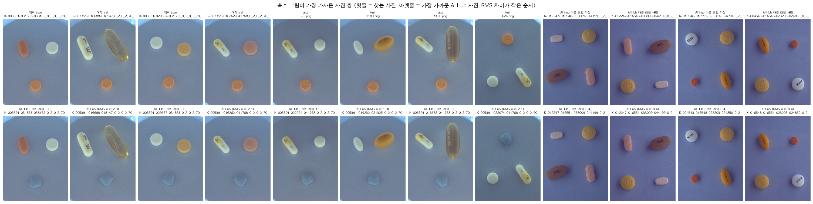

- 대회 train 사진과 AI Hub 사진이 같은 파일인 경우는 0건이다. 즉, 누수는 없다.
- RMS가 가까운 쌍을 보면, 거의 같은 알약 조합인데, 하나의 조합만 다른 경우에 RMS가 낮았다.
- RMS 0.4인 AI Hub 쌍은 같은 장면을 두 번 찍은 사진이 다른 조합 이름으로 들어간 것이다. (위 그림의 AI Hub끼리 4쌍) 이런 사진은 사실상 중복되는 사진이니 하나만 남기고 제거했다.

### 5.3 라벨 품질과 정제

AI Hub에서 받아온 데이터 라벨에도 오류가 많았다. 1차 Kaggle 데이터와 같은 기준으로 전수 검사했다.

- 라벨이 누락된 경우, 좌표에 오류가 있는 경우, 파일 이름에 오류가 있는 경우, 읽을 수 없는 JSON인 경우, 
한 이미지에 같은 K-코드의 box가 파일 명보다 많은 경우 등 문제가 있었다.

> **[그림 5-3] AI Hub 데이터의 오류 유형 20가지**

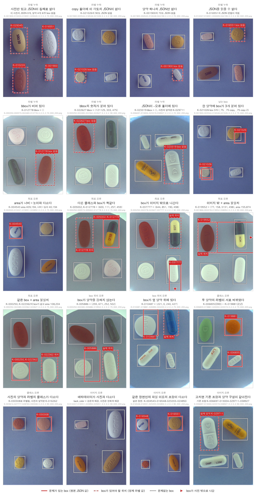

**문제별 처리 결과** (정제 노트북 2-4-2)

| 문제 | 찾은 방법 | 문제 후보 | 고칠 필요 없음 | 자동으로 고침 | 눈으로 확인하고 고침 | 이미지 제외 | 해결 (고침 + 이미지 제외) | 고치지 못함 |
| --- | --- | ---: | ---: | ---: | ---: | ---: | ---: | ---: |
| 메타데이터가 사진과 다르다 | JSON의 메타데이터 값을 집계한 뒤 튀는 값을 사진과 비교 | 4개 | - | - | 4개 | - | 4개 | - |
| 사진에서는 같은 조합인데, 파일 이름이 다른 조합으로 잘못 기재되어있다 | RMS 거리 측정 | 6장 | - | - | - | 6장 | 6장 | - |
| copy.json이 있는 폴더의 JSON 촬영 각도가 파일 이름과 다르다 | copy.json, copy 2.json을 직접 사진에 그려 확인 | 63개 | 18개 | - | 45개 | - | 45개 | - |
| 라벨 누락: 파일 이름에 있는 알약에 쓸 수 있는 box가 없다 | 파일 이름의 K-코드와 JSON을 대조해 box가 없거나 값이 깨진 알약을 찾음 | 211개 | - | 201개 | 1개 | - | 202개 | 9개 |
| 좌표 오류: bbox 값이 틀렸다 (이미지 밖으로 나감, area와 너비×높이가 다름, 다른 클래스와 box가 똑같음) | JSON의 bbox와 area 값을 규칙으로 검사 | 627개 | 69개 | 532개 | 14개 | - | 546개 | 12개 |
| 좌표 값은 정상인데 box가 알약을 제대로 감싸지 않는다 | OpenCV로 bbox 다시 제작 후 라벨과 비교 | 313개 | 75개 | 203개 | 35개 | - | 238개 | - |
| 문제 후보들 중에서 직접 찾은 오류 | 직접 찾음 | 2개 | - | - | 2개 | - | 2개 | - |
| 사진의 알약이 다른 클래스로 라벨되어있지는 않은가? | OpenCV로 클래스 별 크기와 색 통계를 추출, 그 통계와 차이가 나는 box를 찾음 | 140개 | 108개 | - | 32개 | - | 32개 | - |
| 클래스 별 crop 사진들에서 찾은 오류 | 직접 찾음 | 31개 | - | - | 31개 | - | 31개 | - |
| 라벨을 고치고 보니 알약 4개의 구성이 이미 있는 다른 조합과 똑같아진 조합 | 고친 라벨의 클래스로 조합 이름을 다시 만들어 기존 조합과 대조 | 9장 | - | - | - | 9장 | 9장 | - |
| **합계** | | **1,391개 + 15장** | **270개** | **936개** | **164개** | **15장** | **1,100개 + 15장** | **21개** |

- `개`는 라벨(annotation) 수, `장`은 이미지 수다.
- 고치지 못한 21개는 사진에서 알약을 찾지 못한 경우다. 대부분 바닥과 색이 비슷한 파란 알약이고, 이 알약이 있는 20장은 학습에서 뺐다.
- 고침, 이미지 제외, 고치지 못함을 더하면 정제 목록은 1,136줄이다. 제외한 이미지에 붙어 있던 다른 줄 22개를 빼고, 같은 알약을 두 번 고친 줄 21개를 한 줄로 합쳐 `label_fixes.csv`에는 1,093줄로 남았다.

> **[그림 5-4] 문제 유형별 수정 전후 예시**

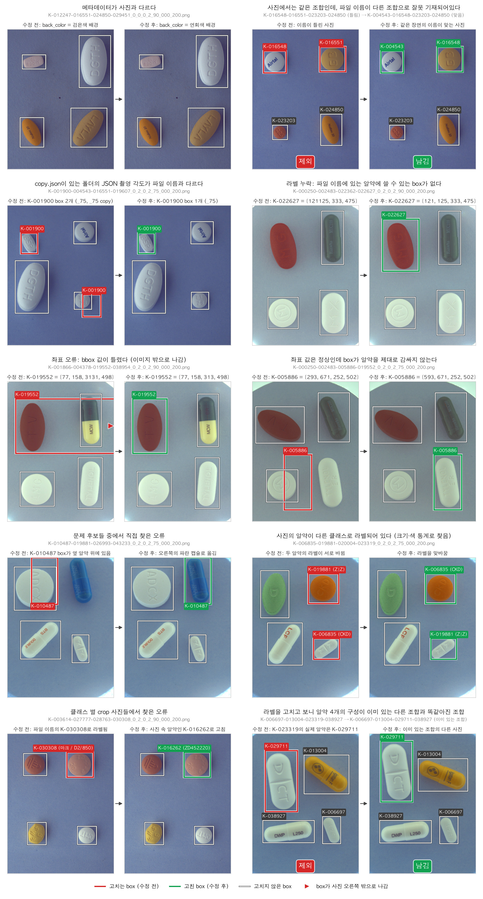


**정제 결과**

| 단계 | PNG | 객체 | 내용 |
| --- | ---: | ---: | --- |
| 1차 정제 후 | 12,009장 | 45,910개 | 객체 수는 JSON 파일 수 (읽지 못하는 JSON 1개 포함) |
| 이미지 제외 | −35장 | −138개 | 사진에서 알약을 찾지 못함 20장(78개), 라벨을 고치니 기존 조합과 구성이 같아짐 9장(36개), 파일 이름이 다른 조합으로 잘못 기재됨 6장(24개) |
| 없던 box 추가 | - | +70개 | PNG만 있던 12장의 42개, copy.json이 있는 폴더에서 비어 있던 자리 23개, JSON이 없던 자리 5개 |
| 남는 box 제거 | - | −23개 | copy.json이 있는 폴더에서 한 알약에 2~3개 붙어 있던 box |
| **최종** | **11,974장** | **45,819개** | 클래스 116개, 쓸 수 없는 bbox 0개 |


- 정제는 OpenCV를 통해 오류 후보를 검출하고 자동 수정한 후, 모든 오류 후보를 사람이 직접 검수하며 바로잡았으며, 45910개의 알약 crop 사진을 일일이 눈으로 보며 클래스 오류를 잡아냈다. 자세한 과정은 `label_fix/01_aihub_label_fix.ipynb`에 있다.

### 5.4 합친 분포와 test 커버리지

> **[그림 5-5] 합친 클래스 분포 (118종, 출처별 색)**

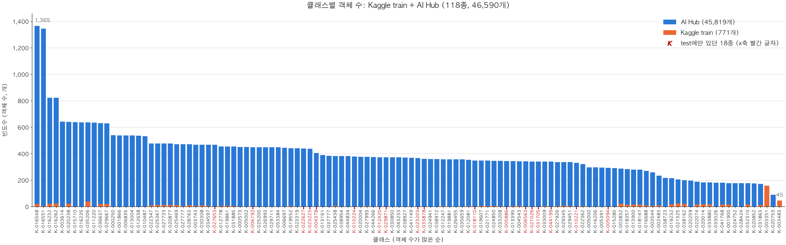

> **[표 5-1] 대회 train만 vs 대회 train + AI Hub 전부** 

| 항목 | 대회 train만 | + AI Hub 전부 |
| --- | ---: | ---: |
| 이미지 | 232 | 12,206 |
| 객체 | 771 | 46,590 |
| 클래스 | 56 | 118 |
| 클래스별 최소 / 중앙값 / 최대 | 3 / 9 / 157 | 45 / 369.5 / 1,365 |
| 최대 ÷ 최소 | 52.3배 | 30.3배 |
| 변동계수(CV) | 1.53 | 0.47 |
| 최다 클래스 비중 | K-003351 20.4% | K-016548 2.9% |
| 객체 100개 미만 클래스 | 55개 | 2개 |

- AI Hub에는 대회 train 56종 중 54종이 있고 K-003351, K-003483 두 종은 없다. 새 클래스 62종이 더해져 전체 118종이다.
- **test 전용 18종은 모두 AI Hub에서 찾았다**(각인 대조, 01 5-2). 그 결과 "모든 알약이 학습 클래스에 있는 test 사진"이 507장(60.2%)에서 **842장(100%)** 으로 늘었다.
- 불균형은 52배 → 30배로 줄었지만 남아 있다. CV(평균 대비 흩어진 정도) 기준으로는 1.53 → 0.47로 크게 줄었다.

다음 사진을 보면, test에만 있던 18종이 AI Hub에서 어떻게 채워졌는 지를 확인할 수 있다.
> **[그림 5-6] test 전용 18종: test crop vs AI Hub crop 대조**

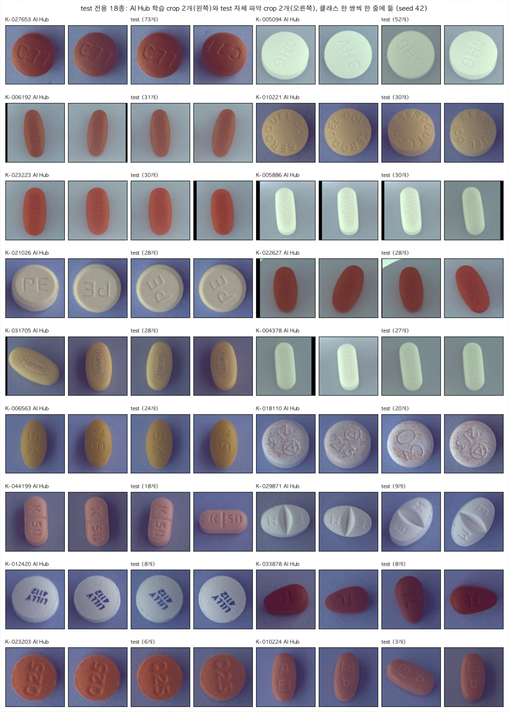

| test에서 읽은 각인 | test 색, 모양 | test 파일 번호 | AI Hub K-코드 | 제품명 | AI Hub 색, 모양 | train에 있음 | AI Hub 객체 수 |
| --- | --- | --- | --- | --- | --- | --- | --- |
| C77 | 빨강 원형 | 8, 9, 23, 24, 134, 135 … | K-027653 | 세비카정 10/40mg | 갈색 원형 | 없음 | 467 |
| AHG | 하양 원형 | 127, 128, 129, 154, 155, 156 … | K-005094 | 삼남건조수산화알루미늄겔정 | 하양 원형 | 없음 | 293 |
| B-F | 빨강 장방형 | 53, 54, 127, 128, 129, 170 … | K-006192 | 삐콤씨에프정 618.6mg/병 | 갈색 타원형 | 없음 | 449 |
| SEROQUEL 100 | 노랑 원형 | 112, 113, 114, 183, 191, 316 … | K-010221 | 쎄로켈정 100mg | 노랑 원형 | 없음 | 330 |
| TYLENOL ER | 하양 장방형 | 53, 54, 154, 155, 156, 229 … | K-005886 | 타이레놀이알서방정(아세트아미노펜)(수출용) | 하양 장방형 | 없음 | 344 |
| V100 | 빨강 장방형 | 27, 46, 47, 154, 155, 156 … | K-023223 | 비타비백정 100mg/병 | 빨강 타원형 | 없음 | 437 |
| Hanmi | 노랑 타원형 | 88, 89, 90, 298, 299, 652 … | K-031705 | 낙소졸정 500/20mg | 노랑 타원형 | 없음 | 339 |
| Hanmi | 노랑 타원형 | 88, 89, 90, 298, 299, 652 … | K-025469 | 아모잘탄정 5/100mg | 분홍 타원형 | 있음 | 458 |
| MG | 빨강 장방형 | 304, 443, 444, 481, 482, 574 … | K-022627 | 메가파워정 90mg/병 | 빨강 타원형 | 없음 | 438 |
| PE | 하양 원형 | 124, 125, 126, 142, 143, 212 … | K-021026 | 펠루비정(펠루비프로펜) | 노랑 원형 | 없음 | 339 |
| TYLENOL | 하양 장방형 | 304, 443, 444, 679, 680, 681 … | K-004378 | 타이레놀정500mg | 하양 장방형 | 없음 | 405 |
| SK | 노랑 타원형 | 31, 32, 73, 75, 183, 205 … | K-006563 | 조인스정 200mg | 노랑 타원형 | 없음 | 342 |
| K\|50 | 분홍 장방형 | 136, 142, 143, 452, 674, 675 … | K-044199 | 케이캡정 50mg | 분홍 장방형 | 없음 | 339 |
| 213 | 하양 원형 | 88, 89, 90, 212, 213, 658 … | K-018110 | 란스톤엘에프디티정 30mg | 분홍 원형  | 없음 | 348 |
| E\|M | 하양 타원형 | 731, 732, 808, 810, 1075, 1076 … | K-029871 | 렉사프로정 15mg | 하양 타원형 | 없음 | 372 |
| LILLY 4112 | 하양 원형 | 31, 32, 332, 1297, 1298, 1357 … | K-012420 | 자이프렉사정 2.5mg | 하양 원형 | 없음 | 372 |
| TL | 빨강 타원형 | 430, 431, 432, 472, 474, 635 … | K-033878 | 브린텔릭스정 20mg | 빨강 기타 | 없음 | 360 |
| Q25 | 빨강 원형 | 160, 162, 185, 186, 205, 244 | K-023203 | 쿠에타핀정 25mg | 분홍 원형 | 없음 | 366 |
| 30 | 하양 원형 | 100, 102, 1135, 1136 | K-018110 | 란스톤엘에프디티정 30mg | 분홍 원형 | 없음 | 348 |
| AEI | 분홍 장방형 | 409, 411, 1418 | K-010224 | 넥시움정 40mg | 분홍 장방형 | 없음 | 378 |

### 5.5 학습 이미지 선택 방법 v1~v4 설계

AI Hub에서 데이터를 보충해도, 여전히 최대와 최소가 30배 차이남을 확인했다. 특히, K-003483은 AI Hub 데이터에 없어서 전혀 보충되지않아 45개로 여전히 남아있다. 따라서 여전히 남아있는 이 클래스 불균형으로 인해 1차 실험에서의 한계를 2차 데이터가 완전히 극복하지 못할 것으로 예상했다. 따라서 이미지를 선택적으로 취해 훈련에 사용하는 방식을 도입하기로 했다. 우리는 네 가지를 설계했다 (`src/pill_detection/datasets.py`).

> **[표 5-2] 방법 v1~v4** (val 1,000장을 뗀 뒤 train 기준)

| 방법 | 고르는 방식 | 모델 클래스 | train 사진 | train 객체 | 최대 ÷ 최소 | CV(표준편차 ÷ 평균) | 의도 |
| --- | --- | ---: | ---: | ---: | ---: | ---: | --- |
| v1 | AI hub + Kaggle 모든 데이터 위에서 val을 뺀 사진 전부 | 118 | 11,206 | 42,800 | 46.8배 | 0.47 | 기준(실험에서는 제외) |
| v2 | 객체가 적은 클래스부터 클래스별 200개를 채우도록 고른 사진 | 118 | 7,129 | 26,734 | 38.3배 | 0.44 | 불균형을 줄이고 학습량도 줄임 |
| v3 | 대회 클래스(74종)가 하나라도 든 사진 | 96 | 8,974 | 33,872 | 46.8배 | 0.52 | 대회와 무관한 알약만 든 사진 제외 |
| v4 | v1과 같은 사진. 대회 클래스 밖 알약은 `others` 한 클래스로 묶음 | 75 | 11,206 | 42,800 | 613.0배 (`others` 제외 46.8배) | 3.27 (`others` 제외 0.54) | 채점 대상 74 클래스만 세밀하게 배우도록 유도 |

- "대회 클래스만 든 사진만 고르기"(2,688장)은 test 전용 7종이 0개가 되어 후보에서 뺐다. 
- v4의 `others`는 16,552개로 가장 큰 클래스가 된다.
- v1은 v4와 사진이 같고 클래스만 더 많아, 시간을 아끼려고 실험에서 뺐다.
- 클래스 수가 방법마다 달라서(118/118/96/75) Ultralytics의 `optimizer=auto`를 쓰면 학습률이 달라진다. 그래서 2차에서는 lr을 직접 지정했다.

> **[그림 5-7] 방법별 train, val 클래스 분포 비교 (v1~v4)**

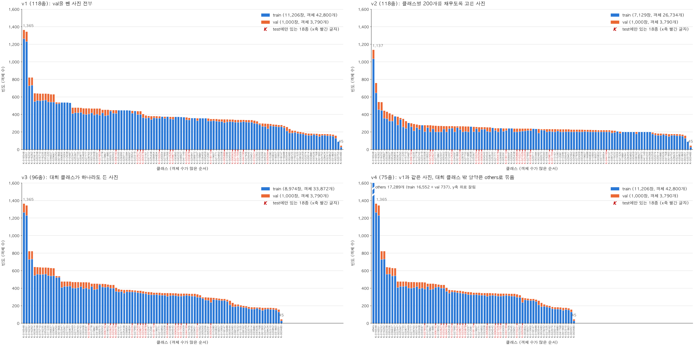

### 5.6 2차 val 설계: test를 닮은 고정 val

1차 실험의 val(Kaggle 47장)은 30종뿐이고 test 전용 알약이 없어서, val 이 test를 전혀 대표하지 못했다. 2차 val은 test를 충분히 대표할 수 있도록 다시 만들 필요가 있었다.

1. **test 알약 전수 파악** (02 노트북): 1차 RT-DETR 예측으로 test 842장의 알약 crop 3,229개를 만들고, 육안으로 하나씩 클래스가 맞게 매칭되었는 지를 확인했다. 
    - 결과: **74종이 모두 test에 나오고, 클래스당 3~369개(중앙값 27개)**. 가장 많은 K-003483이 369개(11.4%)인데 Kaggle train에는 27개뿐이다. test 전용 18종은 453개(14.0%).
    
    > **[그림 5-8] test 클래스 빈도 (자체 파악 3,229개)**
    
    
2. **val 구성 규칙** (`datasets.py select_val`): 
    1. 1차 val 47장은 모두 넣고, 
    2. AI Hub 몫: AI Hub의 대회 클래스 객체 28,530개의 10%인 2,853개를 val 몫으로 잡는다.
    3. test 비율로 나누기: 특정 클래스의 val 객체 수 목표 = 2,853 × (그 클래스의 test 객체 수 ÷ 2,721)로 계산해 반올림.
        - 2,853: AI Hub 데이터에서 val로 뽑을 객체의 총량(AI Hub의 대회 클래스 객체 28,530개의 10%).
        - 2,721은 test 3,229개에서 AI Hub에 없는 K-003351(139개)과 K-003483(369개)을 뺀 수. 이 둘은 AI Hub에서 뽑을 수 없어 나눗셈에서 제외한다.
    3. 최솟값 적용: 목푯값이 20보다 작으면 20으로 올린다. test에 드문 클래스도 val에서 AP를 잴 수 있게 하기 위해서이다.
    4. 상한 적용: 그 클래스 AI Hub 객체의 20%를 넘으면 상한까지 줄인다. val에 너무 많이 빼앗겨 train이 모자라지 않게 하기 위해서이다.
    - val 구성은 조합 단위로 넣는다. 
3. **결과**: val 1,000장(Kaggle 47 + AI Hub 953), 객체 3,790개(대회 클래스 3,053 + 대회 밖 737). 74종 모두 포함, 클래스당 18~114개(중앙값 30). train과 겹치는 조합 0개.

    > **[그림 5-9] val 비율 vs test 비율 막대그래프**

    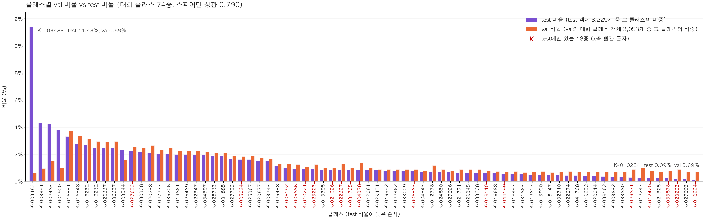

    - val 에는 대회 클래스 74종 외의 22종도 있지만, 그래프에서는 제외했다. test에도 없고 채점에서도 무시되기 때문이다.
    - test와 비율이 많이 차이나는 클래스는 [그림5-8]에서 확인한다.
4. **고정**: `data/datasets/images.csv`로 어떤 이미지가 train이고 val인 지 고정하고 git에서 관리해서 변경내역을 추적하도록 했다. 훈련 전에 검증 스크립트로 같은지만 확인하면 네 팀원이 같은 데이터 구성으로 훈련함을 보장할 수 있다. v1, v2, v3 ,v4 네 방법 모두 같은 val을 사용한다. 

> **[그림 5-10] val 비율 vs test 비율 산점도**


- val 비율: 이 클래스의 val 객체 수 ÷ val의 대회 클래스 객체 3,053개
- test 비율: 이 클래스의 test 객체 수 ÷ test 자체 파악 객체 3,229개
- val 비율과 test 비율의 상관계수는 0.790이다. 대체로 비슷하지만 양 끝이 어긋난다.
- 세 클래스에서 val이 모자라다: K-003483(val 18 / test 369), K-003351(val 29 / test 139), K-001900(val 30 / test 122).
  - K-003483·K-003351은 AI Hub에 없어 늘릴 수 없고, 
  - K-001900은 AI Hub 객체 개수의 20% 상한에 걸렸다(AI Hub 객체 개수: 162개, 상한: 32개).
- val이 넘치는 쪽 7종(K-010224, K-023203, K-012247, K-027993, K-033878, K-029871, K-012420)은 test에 3~9개뿐인 희소 클래스다. 최소 목표 20개 때문에 val 비율이 3~7배 높다.


### 5.7 EDA 결론 → 2차 실험 가설

> **[표 5-3] 2차 EDA에서 2차 실험 가설로**

| EDA에서 확인한 것 | 2차 실험 가설 |
| --- | --- |
| test 전용 18종을 AI Hub가 100% 커버한다 | **H5.** Kaggle 점수가 크게 오른다 (상한 0.76의 벽이 사라지기 때문이다) |
| 불균형이 30~47배 남음 | **H6.** 희소 클래스의 AP가 빈번 클래스보다 낮을 것이다 |
| val을 test 빈도로 설계 | **H7.** 2차 val 점수가 Kaggle 점수와 비슷하게 이동할 것이다 |
| v2/v3/v4의 CV 0.43~0.51로 비슷 | (추가 확인) 세 방법 사이에 뚜렷한 우열은 없을 것이다 |
| 1 epoch이 446~701 step | (추가 확인) 5/10/20 epoch 중 10 전후면 수렴할 것이다 |

- 비교 대상은 모델이 아니라 데이터 구성 방법(v2/v3/v4)이다. 100 epoch을 그대로 쓰면 step이 1차의 약 46배라 데이터 효과와 학습량 효과를 구분할 수 없어, epoch은 5/10/20으로 줄였다([2.3절](#23-공정-비교를-위해-고정한-것과-모델별로-다르게-둔-것)).

---

## 6. 2차 실험: Kaggle + AI Hub

### 6.1 목적과 가설

AI Hub로 test 전용 18종을 학습에 넣고 불균형도 줄인다. 가설은 [표 5-3](#57-eda-결론--2차-실험-가설)의 H5~H7과 추가 확인 2개. 멘토 조언대로 비교 대상은 "모델"이 아니라 "데이터 구성 방법(v2/v3/v4)"이다.

### 6.2 실험 설정

> **[표 6-1] 2차 설정: 1차와 같게 둔 것 / 바꾼 것**

| 구분 | 항목 | YOLO26s | RT-DETR-l | Faster R-CNN (`notebooks/modeling/exp2/frcnn-exp2.md`) |
| --- | --- | --- | --- | --- |
| 같게 둔 것 | 모델·입력·배치·시드 | yolo26s, 640, 16, seed 0 | rtdetr-l, 640, 16, seed 0 | R50-FPN COCO_V1, 640, 16×1, seed 0 |
| | 옵티마이저 | AdamW lr0 0.000167, momentum 0.9 (1차 auto 값을 고정) | 같음 | AdamW 3e-4, wd 1e-4, warmup 3 + cosine |
| 바꾼 것 | 데이터 | v2 / v3 / v4 | v2 / v3 / v4 | v1 / v2 / v3 / v4 |
| | 에폭 | 5 / 10 / 20 | 5 / 10 (20은 시간상 못 함) | 5 / 10 / 20 |
| | epoch 비례 설정 | close_mosaic 기본 10 → e5·e10은 처음부터 mosaic 꺼짐, e20만 앞 10 epoch 켜짐 | warmup 0.03×epochs, close_mosaic max(1, 0.1×epochs) | — |
| 환경 | GPU | e5·e10 Colab T4(workers 2), e20 Colab A100(workers 8) | 로컬 RTX 4070 SUPER | Colab A100 (torch 2.11, torchvision 0.26), e10 약 35분 |
| 공통 | val | 고정 1,000장, `evaluate.py` 점수 3개(val / kaggle 47장 / test_only) | 같음 | 같음 |
| W&B run | | `v{2,3,4}_yolo26s_e{5,10,20}_s0` | `v{2,3,4}_rtdetr-l_e{5,10}` | `v{1,2,4}_frcnn_e{5,10,20}_s0_b16_fast`, `v3_frcnn_e{5,10,20}_s0`, `v2_frcnn_e20_s0` |

- 점수 3개의 뜻: `val`은 1,000장 전체, `kaggle`은 1차 val 47장만(1차와 비교용), `test_only`는 test 전용 18종만.
- 1차 모델도 같은 함수로 다시 쟀다: 같은 47장에서 YOLO26s 1차 0.961 / 0.958 / 0.927, RT-DETR-l 1차 0.985 / 0.982 / 0.978. test_only는 두 모델 모두 0이다(배우지 않았으므로).

### 6.3 결과

#### 6.3.1 YOLO26s

> **[표 6-2] YOLO26s 2차 run 표** (점수는 모두 mAP@[0.75:0.95])

| run | val | kaggle 47장 | test_only | Kaggle public | 학습 시간 | 환경 |
| --- | ---: | ---: | ---: | ---: | ---: | --- |
| v2_yolo26s_e5_s0 | 0.9830 | 0.9933 | 0.9826 | 0.5912 | 28분 | T4 |
| v2_yolo26s_e10_s0 | 0.9878 | 0.9957 | 0.9836 | 0.6019 | 63분 | T4 |
| v2_yolo26s_e20_s0 | 0.9897 | 0.9936 | 0.9880 | 제출 안 함 | 22분 | A100 |
| v3_yolo26s_e5_s0 | 0.9846 | 0.9944 | 0.9801 | 0.6133 | 38분 | T4 |
| v3_yolo26s_e10_s0 | 0.9901 | 0.9920 | 0.9888 | 0.6035 | 77분 | T4 |
| **v3_yolo26s_e20_s0** | 0.9918 | 0.9905 | 0.9909 | **0.6339** | 29분 | A100 |
| v4_yolo26s_e5_s0 | 0.9838 | 0.9906 | 0.9817 | 제출 안 함 | 46분 | T4 |
| v4_yolo26s_e10_s0 | 0.9889 | 0.9922 | 0.9895 | 0.6007 | 91분 | T4 |
| v4_yolo26s_e20_s0 | 0.9938 | 0.9983 | 0.9928 | 제출 안 함 | 33분 | A100 |
| (1차 기준 e100) | — | 0.9612 | 0 | 0.410 | 13분 | T4 |

- 1차 대비: 같은 47장에서 +0.03~0.04, Kaggle public은 **+0.18~0.22**.
- 방법·에폭 간: e10끼리 방법 차이는 최대 0.003. e5와 e10의 차이는 v2·v3에서 방향이 반대. 모두 흔들림 안. v3 e20만 e10보다 +0.030이지만 mosaic·GPU·workers가 같이 달라져 에폭만의 효과로 볼 수 없다.
- **val 순서와 Kaggle 순서가 맞지 않는다.** val 1위(v4 e20)는 제출하지 않았고, 제출한 6개 중 val 2위(v3 e20)가 Kaggle 1위, val 최하(v2 e5)가 Kaggle 최하였지만 가운데 순서는 섞인다. val로 run을 고를 수 없다.

#### 6.3.2 RT-DETR-l

> **[표 6-3] RT-DETR-l 2차 run 표**

| run | val | kaggle 47장 | test_only | Kaggle public | 학습 시간 |
| --- | ---: | ---: | ---: | ---: | ---: |
| v2_rtdetr-l_e5 | 0.9800 | 0.9839 | 0.9783 | 0.6073 | 1.66h |
| v3_rtdetr-l_e5 | 0.9785 | 0.9810 | 0.9722 | 0.6030 | 9.58h* |
| v4_rtdetr-l_e5 | 0.9858 | 0.9866 | 0.9812 | **0.6156** | 5.53h* |
| v2_rtdetr-l_e10 | 0.9809 | 0.9844 | 0.9783 | 0.6152 | 2.72h |
| v3_rtdetr-l_e10 | 0.9882 | 0.9971 | 0.9861 | 0.6066 | 2.67h |
| v4_rtdetr-l_e10 | 0.9902 | 0.9908 | 0.9875 | 0.6114 | 3.65h |
| (1차 기준 e100 seed 0) | — | 0.9854 | 0 | 0.4215 | 1.07h |

- *표시 run은 중단 후 커널을 재시작하지 않아 GPU 메모리가 넘쳐 느려진 것으로, 점수에는 영향이 없다고 판단. 총 25.81h. 모델은 파라미터 32,226,230개, 105.9 GFLOPs, best.pt 66.7MB.
- val은 v4가 e5·e10 모두 1위. 10 epoch이 5 epoch보다 높았다(v3 +0.0097, v4 +0.0044, v2 +0.0009). e5 run은 마지막 epoch까지 오르는 중이었고 v2, v3는 e10이 best epoch이었고, v4는 10 epoch 끝에서는 더 이상 오르지 않았다(그림 6-2).
- Kaggle public은 0.603~0.616으로 제출 6개의 차이가 0.013 안. 1차 대비 약 +0.19. **val 순위와 public 순위가 어긋난다**: val 1위 v4_e10이 public 3위, val 2위 v3_e10이 public 5위다.
- **IoU 기준별 AP**: 6개 run 모두 IoU 0.75~0.90의 AP는 0.99 이상이고 0.95에서만 0.90~0.95로 떨어진다. 점수를 깎는 것은 클래스가 아니라 박스의 마지막 몇 픽셀이다.
- **후처리 실험(제출 안 함)**: val에서 겹친 박스를 정리하는 후처리 A(클래스 무관 NMS)는 −0.007~−0.009, B(같은 클래스만)는 −0.0002~−0.0048로 모두 val을 떨어뜨려 쓰지 않았다. RT-DETR는 겹친 박스를 그대로 두는 쪽이 mAP에 유리하다.

#### 6.3.3 Faster R-CNN (`notebooks/modeling/exp2/frcnn-exp2.md`. val 수치는 best checkpoint 기준, Kaggle public은 제출 기록)

> **[표 6-4] Faster R-CNN 2차 run 표**

| run | val | kaggle 47장 | test_only | Kaggle public | 학습 시간 |
| --- | ---: | ---: | ---: | ---: | ---: |
| v1_frcnn_e5_s0_b16_fast | 0.9902 | 0.9919 | 0.9921 | 제출 안 함 | 28분 |
| v1_frcnn_e10_s0_b16_fast | 0.9957 | 0.9995 | 0.9958 | 제출 안 함 | 56분 |
| v1_frcnn_e20_s0_b16_fast | 0.9967 | 0.9962 | 0.9967 | 제출 안 함 | 113분 |
| v2_frcnn_e5_s0_b16_fast | 0.9821 | 0.9845 | 0.9844 | 0.6015 | 21분 |
| v2_frcnn_e10_s0_b16_fast | 0.9943 | 0.9987 | 0.9910 | 0.5988 | 41분 |
| v2_frcnn_e20_s0 | 0.9960 | 1.0000 | 0.9947 | 0.6022 | 58분 |
| v3_frcnn_e5_s0 | 0.9894 | 0.9915 | 0.9914 | **0.6111** | 36분 |
| v3_frcnn_e10_s0 | 0.9949 | 0.9969 | 0.9950 | 0.5975 | 35분 |
| v3_frcnn_e20_s0 | 0.9971 | 1.0000 | 0.9960 | 0.5999 | 70분 |
| v4_frcnn_e5_s0_b16_fast | 0.9923 | 0.9921 | 0.9902 | 0.6056 | 28분 |
| v4_frcnn_e10_s0_b16_fast | 0.9953 | 0.9982 | 0.9945 | 0.6097 | 57분 |
| v4_frcnn_e20_s0_b16_fast | 0.9972 | 0.9960 | 0.9968 | 0.5878 | 113분 |
| (1차 기준 e100 seed 2) | — | 0.918 | 0 | 0.3948 | 35분 |

- 1차 대비 Kaggle public **+0.19~0.22**. 제출 9개의 public은 0.588~0.611로 범위 0.023이며, 1차의 시드 편차(0.018)와 비슷하다.
- **val 1위(v3_e20 / v4_e20, 0.997)가 Kaggle에서는 중하위·최하(0.600 / 0.588)이고, val 최하권(v3_e5 0.989)이 Kaggle 1위(0.611)다.** val 순위와 Kaggle 순위가 무관하다.
- v1(AI Hub 전체, 118종)을 넣은 것은 Faster R-CNN뿐이다. val은 v3·v4와 같은 0.99 선이고 Kaggle에는 내지 않았다.
- v2·v4의 e20 run은 best가 18 epoch이라 그 checkpoint의 값을 썼다(W&B summary에 남은 마지막 20 epoch 값은 val 0.9955 / 0.9967). 나머지 run은 마지막 epoch가 best다.
- 빈번 클래스 절반 − 희소 클래스 절반의 AP 차이(gap)는 12개 run에서 −0.0075~+0.0060으로 작고, 희소 쪽이 오히려 높은 run이 많다. v3 e20에서 클래스 혼동 0(표 6-5).

#### 6.3.4 세 모델 공통으로 본 것

**(1) val 점수와 Kaggle 점수**

> **[그림 6-0] 1차 → 2차: val 47장과 Kaggle public의 변화 (3계열)** — 점선 = val 47장(Kaggle 출처 사진, 1·2차 같은 사진), 실선 = Kaggle public. 1차는 seed 0 run, 2차는 모델별 Kaggle 최고 run

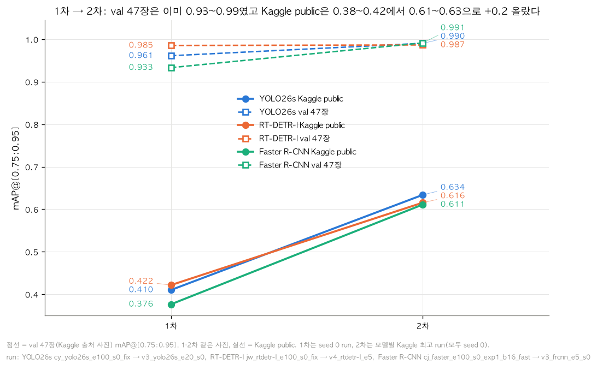

- 세 모델 모두 Kaggle public이 0.38~0.42 → 0.59~0.63(+0.19~0.22)으로 올랐다. 같은 47장의 val은 이미 0.93~0.99였고 2차에서 0.99로 붙었다.

> **[그림 6-1] 2차 run별 val·Kaggle public (모델 × 방법 × 에폭). 점선은 1차 최고 Kaggle, 파란 띠는 YOLO v3 e20의 seed 0·1·2 Kaggle 범위(0.6145~0.6339)**

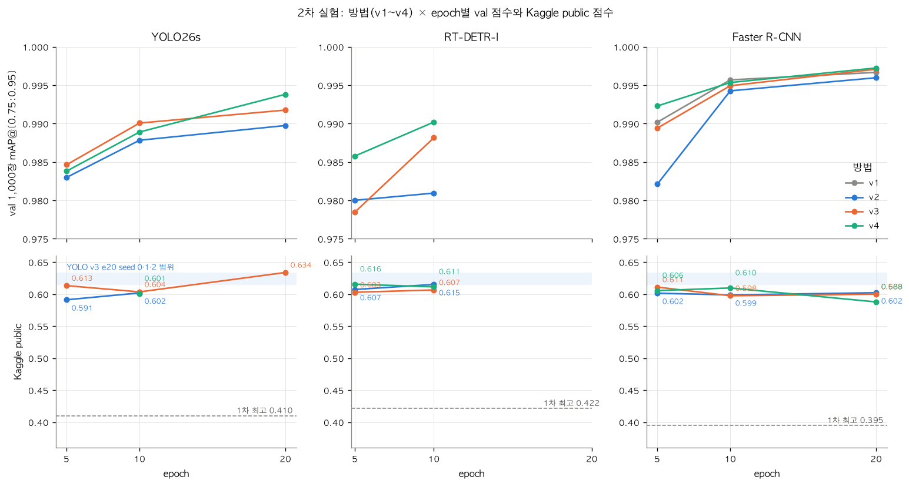

- 세 모델 모두 val은 0.978~0.997, Kaggle은 0.588~0.634다. 방법(v2/v3/v4)·에폭을 바꿔도 Kaggle은 0.59~0.62 띠 안에서 움직였고, 이 띠는 같은 설정의 seed만 바꾼 YOLO 3개(3차, 0.6145~0.6339)의 범위와 겹친다.
- val은 에폭을 늘리면 꾸준히 오르지만(e5 → e20 +0.005~+0.015) Kaggle은 그만큼 오르지 않는다.

**(2) 학습 곡선**

> **[그림 6-2] 2차 학습 곡선 (v3, epoch 5/10/20) 3계열** (W&B history)

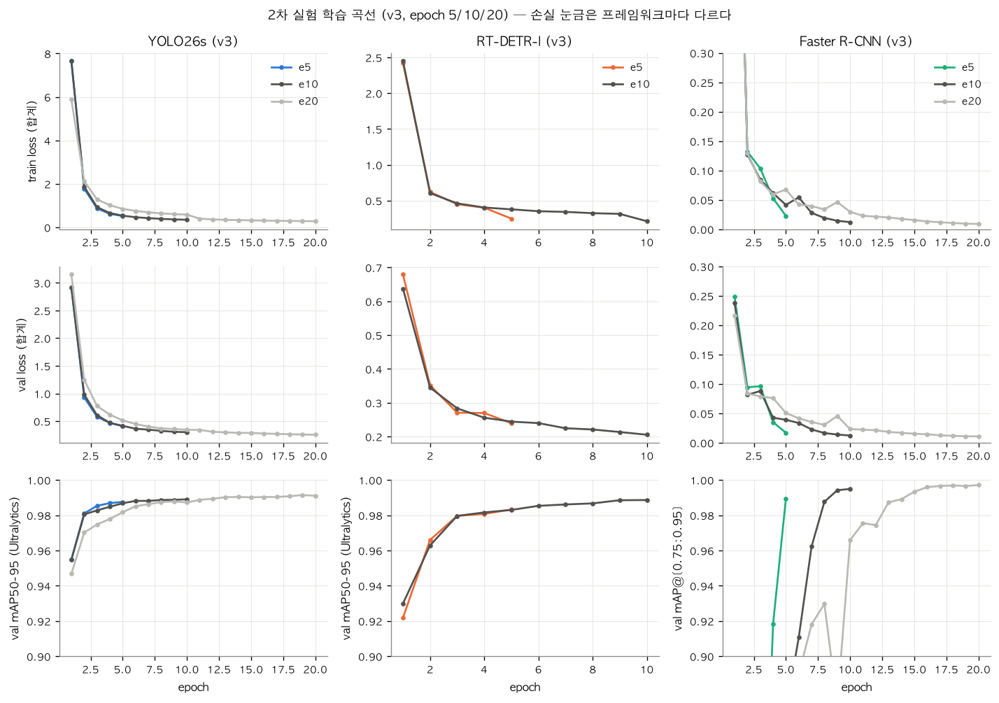

- YOLO26s·RT-DETR-l은 train·val 손실이 3 epoch 안에 1차의 100 epoch 수준까지 내려간다. 데이터가 1차의 39배(v3 8,974장)라 epoch당 step이 그만큼 많기 때문이다. val mAP(Ultralytics 기록)는 e5 끝에서 0.98, e10 끝에서 0.99, e20은 12 epoch 이후 평평하다.
- Faster R-CNN은 val 대회 지표가 e5 run은 5 epoch에 0.989, e10 run은 10 epoch에 0.995, e20 run은 14 epoch 이후 0.997에서 평평하다. e20 run의 7~9 epoch에서 val이 한 번 출렁였지만(0.90~0.93) 곧 회복했다.
- 세 모델 모두 과적합 신호(train 손실은 내려가는데 val 손실이 오르는 구간)는 없다. "10 epoch 전후 수렴"(5.7절 추가 확인)은 val 기준으로 대체로 맞다.

**(3) 오류 분석: confusion matrix**

1차와 같은 기준(score ≥ 0.30, score 우선 일대일 매칭 IoU ≥ 0.75)으로 셌다. 먼저 1차와 같은 47장, 다음에 val 1,000장(대회 클래스 정답 3,053개)이다.

> **[그림 6-3a] 2차 v3 e10의 1차 val 47장 confusion matrix (30종 전부, 3계열)** — 그림 4-3a와 같은 사진·같은 축

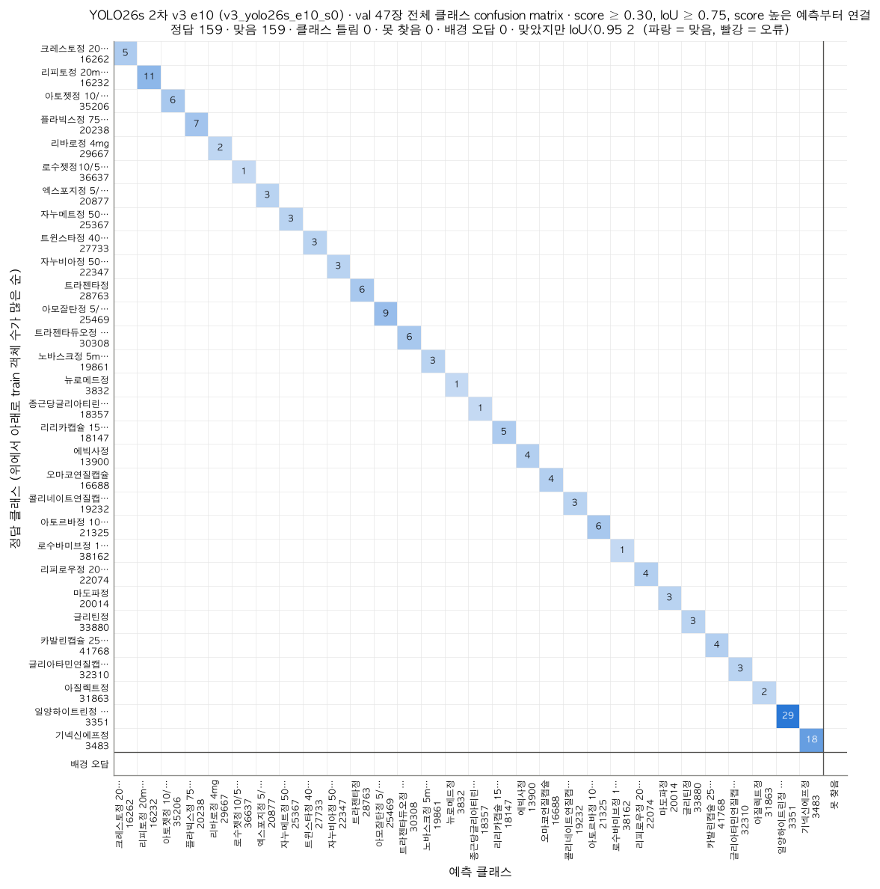
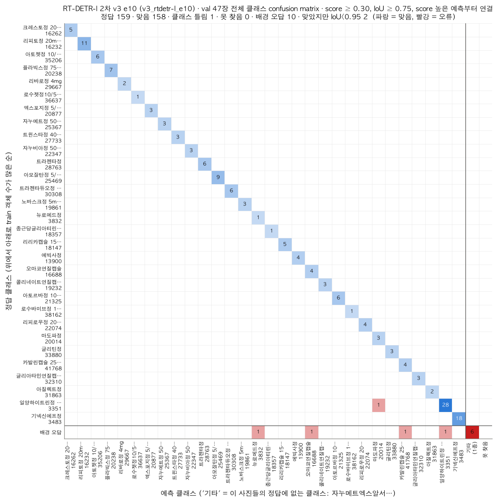
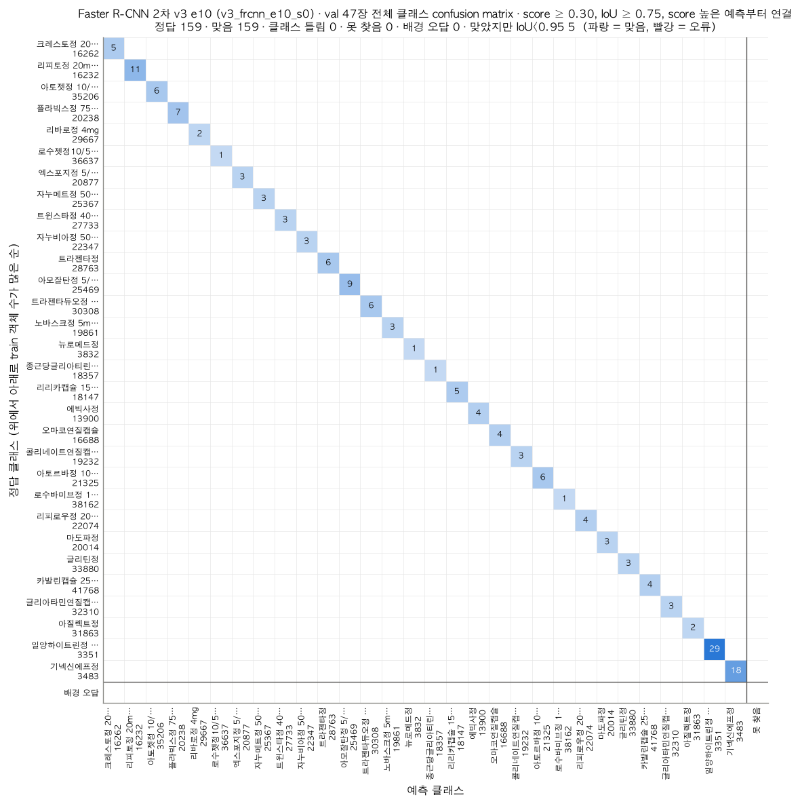

- 1차에서 헷갈리던 47장에서 YOLO·F-RCNN은 정답 159개를 모두 맞혔고(오류 0), RT-DETR는 클래스 틀림 1(일양하이트린정 3351 → 마도파정 20014)과 배경 오답 10뿐이다. 1차 그림 4-3a와 나란히 보면 플라빅스정·아모잘탄정·트라젠타듀오정의 빨간 칸이 모두 사라졌다.

> **[그림 6-3b] 2차 v3 e10의 val 1,000장 confusion matrix (74종 전부, 3계열)**

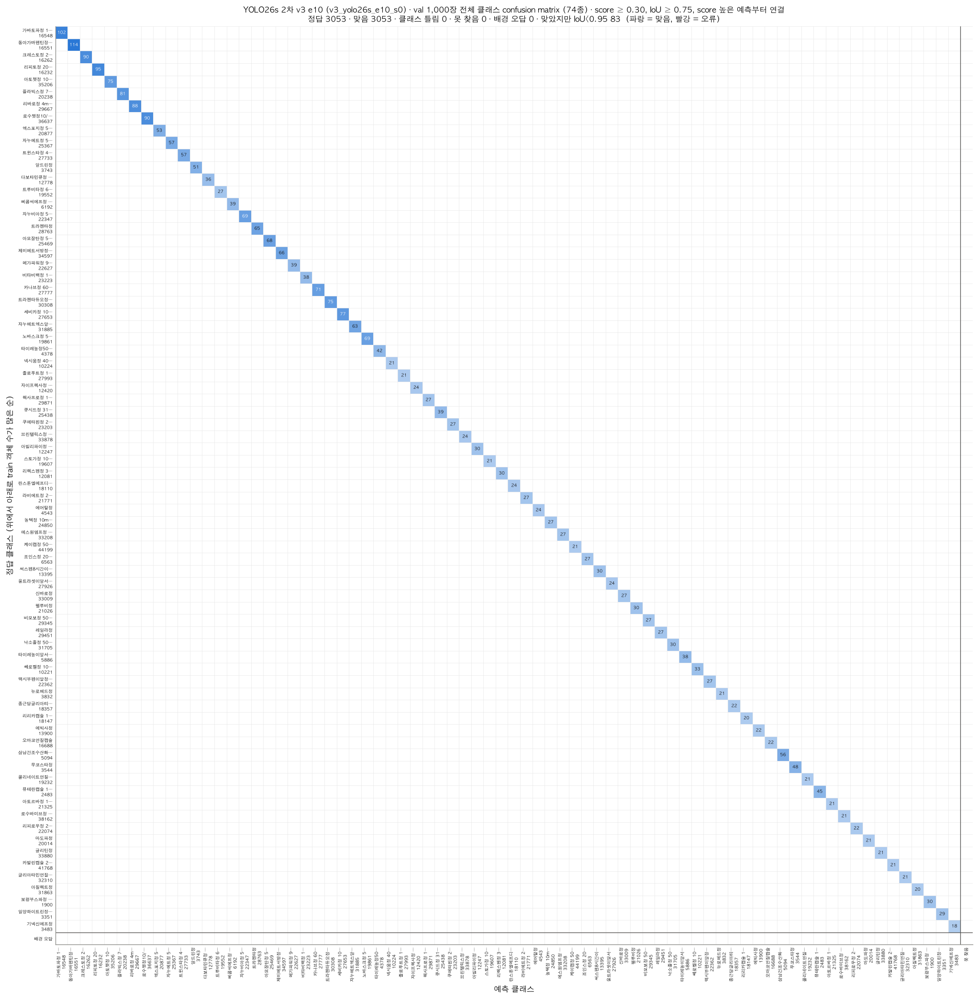
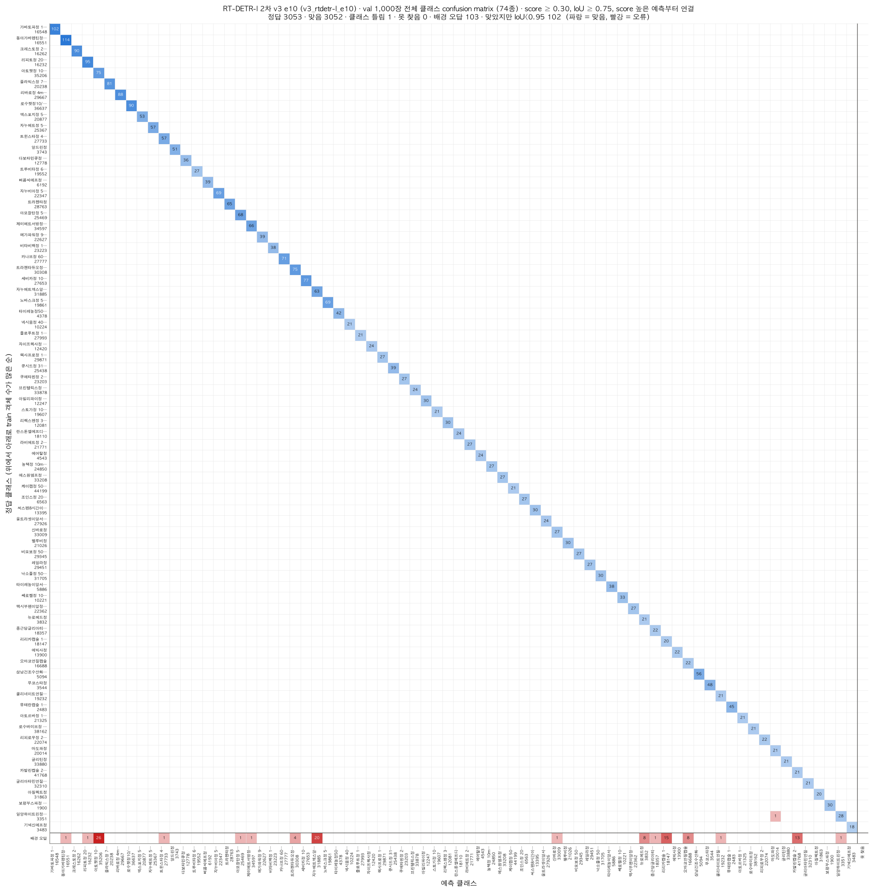


- 1,000장에서도 대각선 밖의 칸은 RT-DETR의 배경 오답 행뿐이다. 사실상 2차에 남은 클래스 오류는 RT-DETR의 중복 박스다.

> **[표 6-5] 2차 오류 분류 (val 1,000장, 정답 3,053개)**

| run | 맞음 | 클래스 틀림 | 못 찾음 | 배경 오답 | IoU<0.95 |
| --- | ---: | ---: | ---: | ---: | ---: |
| v3_yolo26s_e10_s0 | 3,053 | 0 | 0 | 0 | 83 |
| v3_yolo26s_e20_s0 | 3,052 | 0 | 1 | 0 | 58 |
| v3_rtdetr-l_e10 | 3,052 | 1 | 0 | 103 | 102 |
| v3_frcnn_e10_s0 | 3,053 | 0 | 0 | 0 | 37 |
| v3_frcnn_e20_s0 | 3,053 | 0 | 0 | 0 | 24 |

> **[그림 6-3c] 2차 오류 분석: run별 오류 건수, RT-DETR-l의 오류 중심 confusion, 박스가 IoU 0.95에 못 미친 정답 비율이 큰 12종**

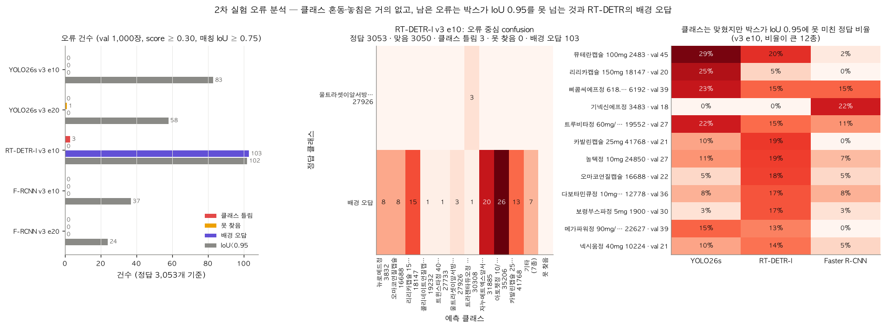

- **클래스 혼동은 사라졌다.** 1차에서 4~20개였던 클래스 틀림이 YOLO·F-RCNN은 0, RT-DETR는 1(일양하이트린정 3351 → 마도파정 20014)이다. 1차에서 가장 많이 틀리던 플라빅스정·아모잘탄정·트라젠타듀오정은 train이 3개에서 393~559개가 되면서 혼동이 없어졌다.
- **RT-DETR의 배경 오답 103개**는 1차와 같은 이유(NMS가 없어 같은 알약에 낮은 score 박스가 남음)이고, 대부분 아토젯정(35206)·자누메트엑스알서방정(31885)·카발린캡슐(41768)에 몰린다. score가 낮아 mAP에는 거의 영향이 없다.
- **남은 오류는 박스 정밀도다.** 맞힌 정답 중 IoU 0.95에 못 미친 것이 YOLO 58~83개(1.9~2.7%), RT-DETR 102개(3.3%), F-RCNN 24~37개(0.8~1.2%)다. 모델이 달라도 같은 클래스에 몰린다: 뮤테란캡슐(2483), 리리카캡슐(18147), 삐콤씨에프정(6192), 트루비타정(19552), 넥시움정(10224). 캡슐과 긴 타원 정제가 많다.

**(4) 클래스별 AP와 흔들리는 클래스**

> **[그림 6-4a] 2차 v3 e10 모델별 클래스 AP (val 1,000장 74종, 위에서 아래로 평균 AP가 낮은 순)** — 왼쪽: 클래스별 평균 AP 막대와 v3 train 객체 수(위 축), 오른쪽: IoU 기준별 AP. bbox 오류(IoU 0.95 감점)는 남아 있고 train 빈도와 무관하다

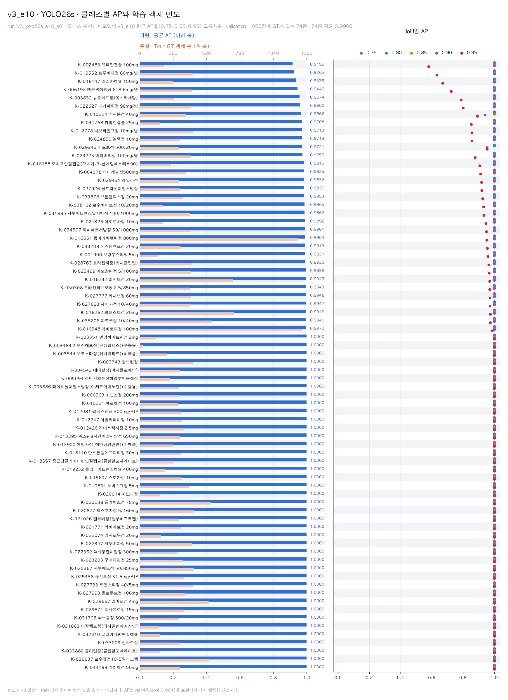

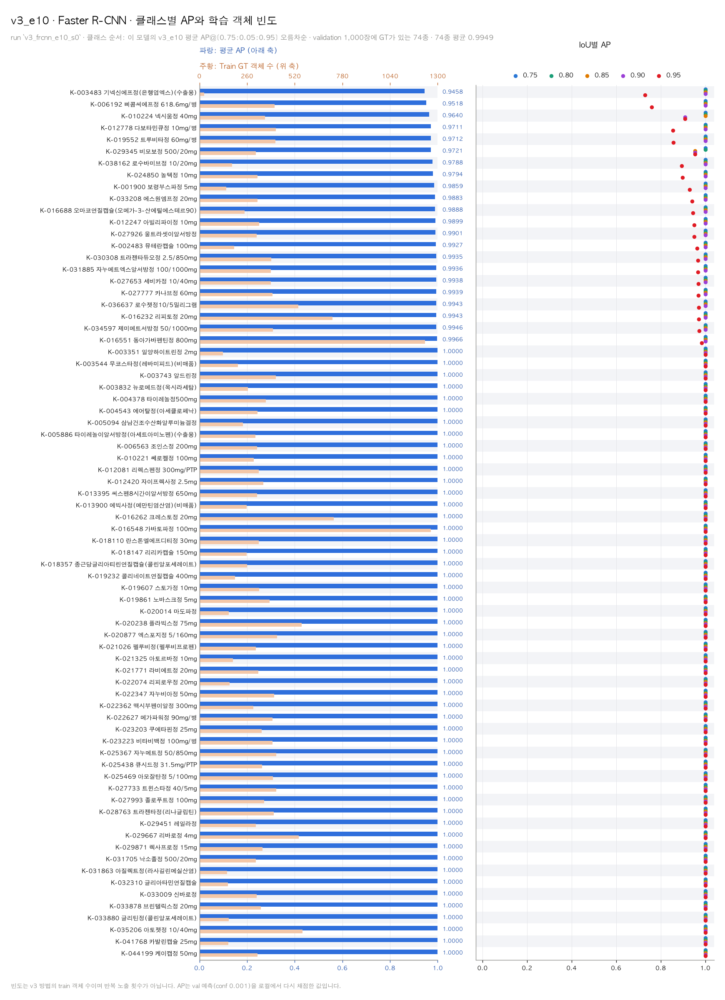

> **[그림 6-4b] 2차 클래스별 AP 전체 run — 74종을 v3 train 객체 수가 적은 순서로, 점 하나가 run 하나 (색 = 방법, 모양 = epoch), 점선 = 0.95**

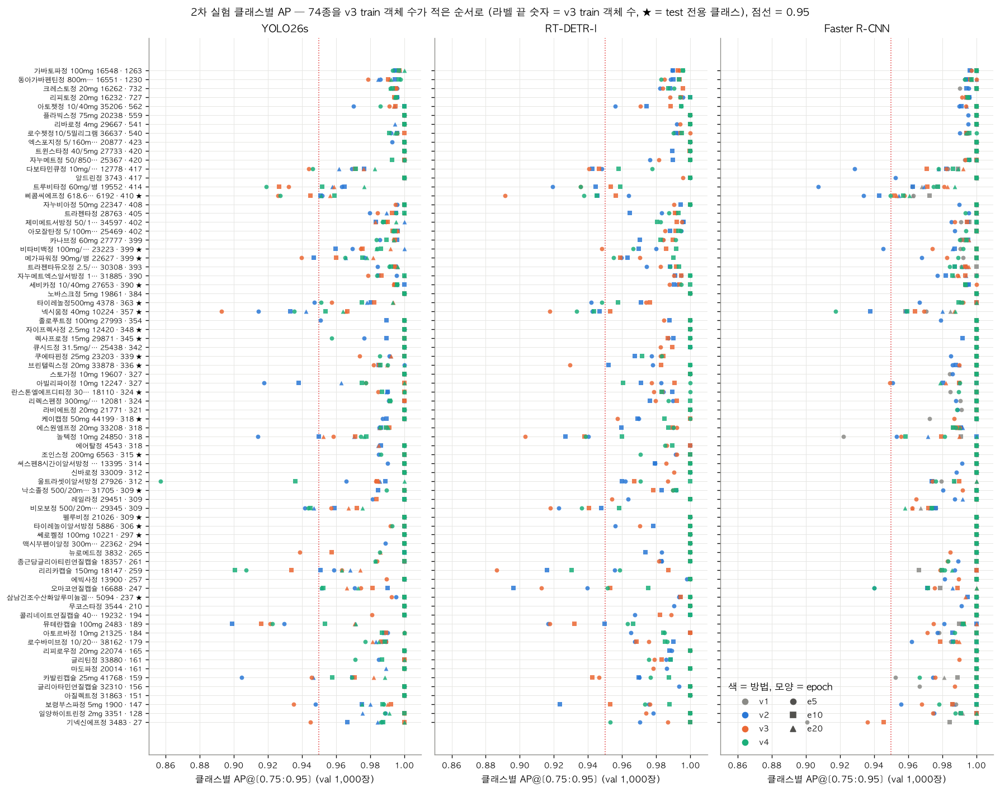

> **[그림 6-5] 2차 흔들리는 클래스: run 평균 AP가 낮은 8종과 그 알약의 val crop (train 객체 수, AP@0.95 평균 함께)**

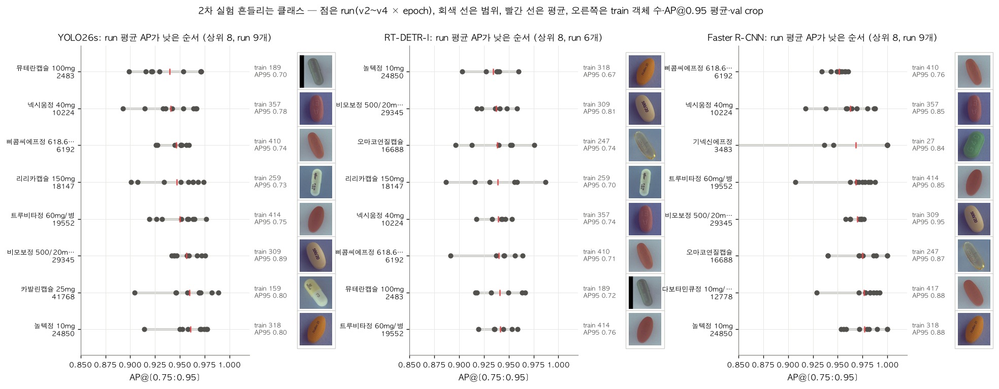

- **클래스별 AP와 train 객체 수의 관계는 없다.** 그림 6-4b에서 AP 0.95 미만인 점은 YOLO 41개(9 run), RT-DETR 43개(6 run), F-RCNN 16개(12 run)인데, train이 가장 적은 기넥신에프정(3483, 27개)은 F-RCNN에서만 낮고(4 run) YOLO·RT-DETR에서는 1.0이다. train 357~417개인 넥시움정·삐콤씨에프정·트루비타정이 오히려 자주 낮다. Y2가 잰 AP–train 수 상관은 0.08이다.
- **세 모델이 같은 클래스에서 흔들린다.** run 평균 AP가 낮은 8종이 세 모델에서 거의 같다: 뮤테란캡슐(2483), 넥시움정(10224), 삐콤씨에프정(6192), 리리카캡슐(18147), 트루비타정(19552), 비모보정(29345), 놀텍정(24850), 오마코연질캡슐(16688). 이 중 리리카캡슐·뮤테란캡슐·오마코연질캡슐은 캡슐, 나머지는 긴 타원형 정제다. 이 클래스들의 AP@0.95는 0.66~0.89로, 박스 끝을 어디까지 잡느냐에 따라 깎인다.
- run 간 범위가 가장 큰 것은 F-RCNN의 기넥신에프정(3483, train 27개)으로 run에 따라 0.85~1.00을 오간다. 이 클래스는 val 객체가 18개뿐이라 한두 개의 박스 차이로 AP가 크게 움직인다.
- 모델별 run 평균으로 보면 AP 0.95 미만 클래스는 YOLO 9 run 평균 4종, RT-DETR 6 run 평균 7종, F-RCNN 12 run 평균 1종이다. F-RCNN이 val 박스 정밀도에서는 가장 좋지만, Kaggle 점수는 세 모델이 같다(그림 6-1).

**(5) IoU 기준별 AP**

> **[그림 6-6] IoU 기준별 AP 곡선 (0.75→0.95), v3 e10 3계열, Kaggle 47장과 AI Hub 953장을 나눠서** (03 5-2)

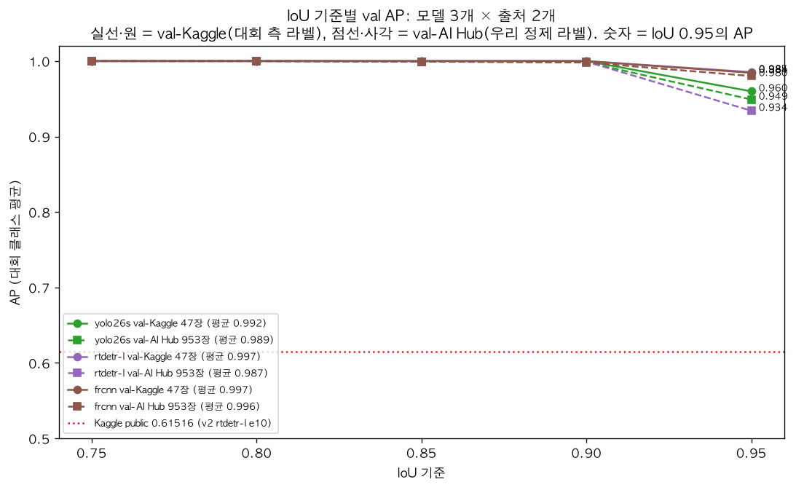

> **[표 6-6] 2차 run별 AP@0.95와 희소−빈번 gap** (val 1,000장, 로컬에서 다시 계산)

| 모델 | run | AP@[0.75:0.95] | AP@0.95 | AP<0.95 클래스 수 | gap (빈번 − 희소) |
| --- | --- | ---: | ---: | ---: | ---: |
| YOLO26s | v3_e5 / v3_e10 / v3_e20 | 0.984 / 0.990 / 0.993 | 0.922 / 0.952 / 0.965 | 10 / 4 / 0 | −0.002 / 0.000 / +0.001 |
| | v4_e5 / v4_e10 / v4_e20 | 0.984 / 0.989 / 0.994 | 0.928 / 0.950 / 0.971 | 8 / 3 / 0 | +0.002 / +0.003 / 0.000 |
| RT-DETR-l | v3_e10 | 0.987 | 0.938 | 5 | +0.001 |
| Faster R-CNN | v3_e5 / v3_e10 / v3_e20 | 0.989 / 0.995 / 0.997 | 0.949 / 0.977 / 0.987 | 2 / 1 / 0 | +0.006 / −0.001 / −0.002 |
| | v4_e5 / v4_e10 / v4_e20 | 0.992 / 0.995 / 0.997 | 0.964 / 0.978 / 0.988 | 3 / 0 / 0 | 0.000 / −0.001 / −0.002 |

- 세 모델 모두 IoU 0.75~0.90의 AP는 0.99~1.00이고 손실은 0.95에서만 난다. 에폭을 늘리면 AP@0.95가 오른다(YOLO v3 0.92 → 0.97, F-RCNN v3 0.95 → 0.99). 이것이 val이 e5 → e20에서 오르는 이유의 전부다.
- gap은 모든 run에서 ±0.008 안이다. 희소 클래스가 특별히 낮지 않다(H6 기각).
- **클래스 불균형과 AP** (Y2): train 최소/최대가 v2 27/1,035(38.3배), v3·v4 27/1,263(46.8배)로 1차(42.7배)와 비율이 비슷한데도 그렇다.

**(6) test 예측의 변화** (Y2): 842장 전부 box 3·4개. 약별 개수가 자체 파악과 3,229개 중 3~6개 차이. **1차의 희소 약 과잉 예측이 사라졌다.**

### 6.4 가설 회수와 남은 의문

> **[표 6-7] 2차 가설 회수**

| 가설 | 판정 | 근거 |
| --- | --- | --- |
| H5 Kaggle 점수 크게 상승 | **채택** | 세 모델 모두 0.38~0.42 → 0.59~0.63 (+0.19~0.22) |
| H6 희소 클래스 AP가 낮다 | **기각** | AP와 train 수 상관 0.08. 희소·빈번 절반 AP 차이 −0.008~+0.006(세 모델 27 run). 낮은 클래스는 캡슐·긴 타원 정제 |
| H7 2차 val이 Kaggle을 따라간다 | **기각** | val 0.98~0.997로 포화, 세 모델 모두 val 순위와 Kaggle 순위가 어긋남 |
| (추가 확인) v2/v3/v4 우열 없음 | 채택 | e10끼리 차이 ≤ 0.003(YOLO), RT-DETR 0.002~0.009, F-RCNN e10끼리 0.599~0.610. 모두 시드 편차(0.020) 안(시드가 1회라는 한계 존재) |
| (추가 확인) 10 epoch 전후 수렴 | 대체로 채택 | e5 → e10 상승, e10은 평평(그림 6-2). e20은 AP@0.95만 더 오름. YOLO v3 e20의 Kaggle +0.03은 환경이 같이 바뀌어 보류 |

**남은 의문**: val은 0.99인데 Kaggle은 0.61이다. 구조가 다른 세 모델이 데이터 구성을 바꿔도 모두 같은 점수에 멈췄다. 리더보드 상위권도 모두 0.6대다. 모델 성능 문제라면 모델끼리 몇 점은 차이가 나야 한다. 그래서 **모든 run이 공유하는 것**(학습 라벨, 클래스 번호, 제출 변환 코드, 대회 test 정답)에서 원인을 찾기로 했다. → [7장](#7-val과-kaggle-점수-차이의-원인-분석)

---

## 7. val과 Kaggle 점수 차이의 원인 분석

> 근거: `notebooks/eda/03_val_test_gap_eda.ipynb`

### 7.1 문제 상황

- 2차 실험 3모델 × 3방법 × epoch 5/10/20이 모두 val 0.98~0.997인데 Kaggle public은 0.59~0.63이다.
- 우리 팀의 리더보드 최고 점수도 0.63390(v3_yolo26s_e20_s0)이며, 다른 팀들도 0.636060, 0.60981, 0.60852으로, **모든 팀이 비슷한 상한에 걸려 있다.**
- 이는 우리 val이 보지 못하는 어딘가에서 문제가 있다는 뜻이다. 그래서 아래 가설을 세웠고, 하나씩 검증했다.

### 7.2 가설과 검증

> **[표 7-1] 가설 8개와 판정**

| # | 가설 | 확인 방법 | 결과 | 판정 |
| --- | --- | --- | --- | --- |
| 1 | val과 test의 클래스 분포가 달라 val이 test를 대표하지 못한다 | val 비율 vs test 비율을 비교, 비율이 비슷하지 않은 클래스의 IoU별 AP를 분석 | val과 test의 클래스 별 비율은 스피어만 상관 0.790. 3배 넘게 벗어난 10개 클래스도 AP@0.75~0.85는 1.000. 밝기·알약 수 분포는 val-AI Hub가 test와 가장 가까움 | 분포 차이는 존재하지만 **원인이 아님**. |
| 2 | AI Hub 데이터 전처리 시category_id = K-코드 번호 매핑 오류 | 원본 dl_idx·drug_N 규칙, 정제 사본 전수 확인, test에만 있고 train에는 없던 클래스 18종 외형 대조 | 전처리 후 AI Hub 데이터의 대회 클래스 72종 모두 dl_idx = drug_N = K-코드. 외형 일치 | **기각** |
| 3 | Kaggle, AI Hub 출처별 box 크기·여백이 다르다 | 클래스별로 짧은 변 중앙값, 출처 간 여백 크기 비교 | 74종 중 59종 차이 10% 미만. Kaggle 라벨과 AI Hub 라벨의 box 크기 중앙값 비(AI Hub ÷ Kaggle)는 너비 0.991, 높이 0.998, 짧은 변 0.994로 1에 붙어 있다 | **기각** |
| 4 | train·val 누수 | 중복된 조합이 있는 지 전수 조사 | train과 val에 동시에 포함되어있는 조합 0 | **기각** |
| 5 | test 전용 18종 번호가 대회 정답과 달라서 Kaggle 제출 시 점수가 깎인다 | 진단 제출 (test 전용 18종만 제출) | 0.16171 ≠ 0 → 18종 평균 AP 0.665 | **기각** |
| 6 | Kaggle 채점 방식이 pycocotools와 다르다 (클래스 평균 방식, 저신뢰 벌점) | test 전용 18종에 대한 예측만 남긴 제출 점수 + train에 있던 56종에 대한 예측만 남긴 제출 점수를 더해서 전체 예측 점수와 같은 지 확인, score≥0.5인 예측만 남겨서 제출했을 때 점수 변화 확인 | 56종 + 18종 = 0.61515 ≈ 원본 0.61516 → 74종 전체 평균과 같다. conf≥0.5만 내도 −0.0001 차이. | **기각** (Kaggle은 우리 채점 코드와 같은 규칙을 사용한다) |
| 7 | 대회 정답 box가 전체적으로 크거나 작다 | 예측 box 크기를 ±2%로 조작한 csv를 제출 | +2%: −0.010, -2%: −0.066. 둘 다 하락 | **기각** |
| 8 | 대회 test 정답에 라벨 오류가 많다 | 대리 채점으로 모델 쪽을 먼저 확인 | 대리 채점 AP@0.5 1.000, 놓친 알약 0. 대회 정답은 공개되지 않아 직접 확인할 수 없음 | **기각하지 못함**. 가설 1~7이 모두 기각되어 가장 유력한 후보로 남음 (7.3절) |

1. **H1: val과 test의 클래스 분포가 달라 val이 test를 대표하지 못한다**

> **[그림 7-1] val vs test 비율 산점도**

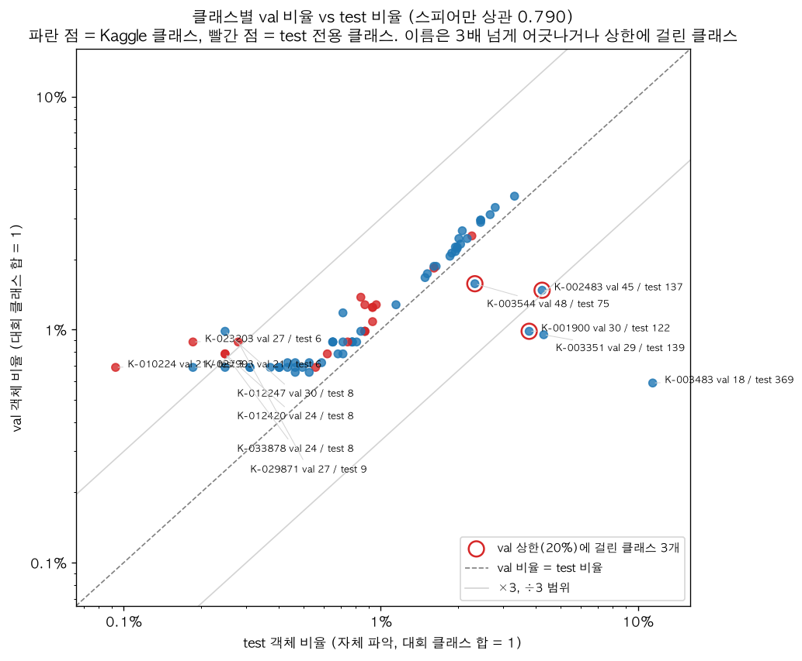

- val의 클래스 비율은 test와 거의 비슷하지만 다른 것들도 있다. 하지만 이는 "희소 클래스도 val에 20개 이상 넣는다"는 val 구성 설계의 결과다.

가설 1의 "분포가 다르다"는 사실이다. 그렇다면, 이 다른 분포를 갖고있는 10개 클래스들은 val AP가 정말 낮게 나왔을까?

> **[그림 7-2] val·test 비율이 3배 넘게 어긋난 10종의 IoU 기준별 val AP**

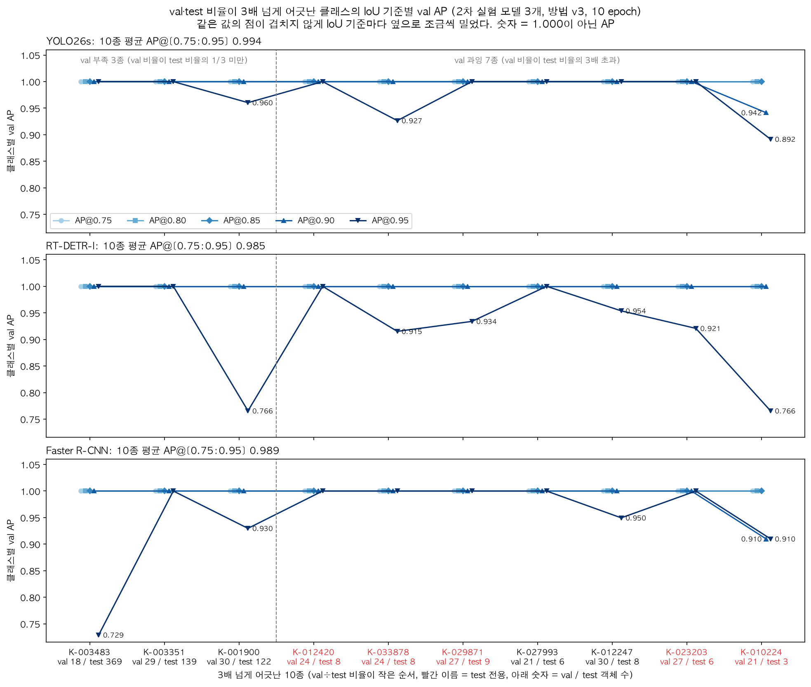

- 10종 모두 IoU 0.75, 0.80, 0.85에서 세 모델의 AP가 1.000이다. 비율이 어긋난 클래스도 val에서 놓침이나 클래스 오류가 없다.
- AP@0.90이 1.000 아래인 경우는 K-010224뿐이다. (YOLO26s 0.942, F-RCNN 0.910)
- 나머지 감점은 모두 AP@0.95에서 나온다.
    - YOLO26s는 3종(K-001900 0.960, K-033878 0.927, K-010224 0.892)이 1.000 아래다.
    - RT-DETR-l은 6종이 0.766~0.954다.
    - F-RCNN은 4종(K-003483 0.729, K-001900 0.930, K-012247 0.950, K-010224 0.910)이 1.000 아래다.
- val이 부족한 3종 중 K-003351은 세 모델 모두 다섯 IoU 기준에서 1.000이다. K-003483은 F-RCNN의 AP@0.95(0.729)만 떨어진다.
- 따라서, val·test 비율이 어긋난 클래스도 val에서는 검출과 분류가 완벽하고, 점수가 깎인 곳은 box가 조금 어긋나는 IoU 0.90·0.95 기준뿐이다. 비율 불균형이 val AP를 떨어뜨리지 않는다.

2. **H2: AI Hub 데이터 전처리 시category_id = K-코드 번호 매핑 오류**

> **[표 7-2] AI Hub 정제 사본의 클래스 번호 전수 확인**

| 확인 항목 | 세는 단위 | Kaggle 클래스 54종 | test 전용 18종 | 대회 밖 44종 | 전체 | 어긋난 수 | 어긋난 예 |
| --- | --- | --- | --- | --- | --- | --- | --- |
| 대상 | JSON | 21,812 | 6,718 | 17,289 | 45,819 |  |  |
| `images.drug_N` = K-코드 | JSON | 21,812 | 6,718 | 17,289 | 45,819 | 0 |  |
| `images.dl_idx` = K-코드 | JSON | 21,812 | 6,718 | 17,289 | 45,819 | 0 |  |
| `images.dl_mapping_code` = K-코드 | JSON | 21,812 | 6,718 | 17,289 | 45,819 | 0 |  |
| `annotations.category_id` = K-코드 | JSON | 21,812 | 6,718 | 17,289 | 45,819 | 0 |  |
| `categories.id` = K-코드 | JSON | 21,812 | 6,718 | 17,289 | 45,819 | 0 |  |
| 파일명 조합에 K-코드가 있음 | JSON | 21,812 | 6,718 | 17,289 | 45,819 | 0 |  |
| 대상 | 클래스 | 54 | 18 | 44 | 116 |  |  |
| K-코드마다 (약 이름, 품목기준코드)가 한 가지 | 클래스 | 54 | 18 | 44 | 116 | 0 |  |
| (약 이름, 품목기준코드) = Kaggle 정제 사본의 같은 K-코드 | 클래스 | 54 | 해당 없음 | 해당 없음 | 54 | 0 |  |

- 정제 사본 JSON 45,819개(116종) 모두에서 `drug_N`, `dl_idx`, `dl_mapping_code`, `annotations.category_id`, `categories.id`가 약 폴더의 K-코드와 같다. 어긋난 JSON은 0개다.
- AI Hub 정제 사본의 클래스 번호는 모두 K-코드다. 변환 결과는 Kaggle에서 제공받은 데이터의 정답 형식과 일치한다.

3. **H3: Kaggle, AI Hub 출처별 box 크기·여백이 다르다**

> **[그림 7-3] 대회 클래스 74종의 출처별 box 짧은 변**


- 74종 중 59종은 출처별 box 짧은 변 중앙값의 최대 ÷ 최소가 1.10 미만이다. 74종의 중앙값은 1.031이고, 대부분의 클래스는 세 출처의 상자가 겹친다.
- 1.15 이상인 클래스는 8종(K-001900, K-025469, K-029451, K-033009, K-003832, K-029871, K-012247, K-027993)이다.
    - 이 중 K-029451, K-033009, K-012247, K-027993은 Kaggle box가 3개뿐이다.
    - Kaggle 56종 중 17종이 box 3개다. 이 17종의 Kaggle 중앙값은 box 하나의 값이다.
    - K-003832, K-029871, K-012247, K-027993은 test box도 6~10개뿐이다. 

이상하다고 보인 노란 배경 16종(1.15 이상인 8종 + 눈으로 고른 8종)의 박스 모양은 실제로 어떻게 생겼을까?

> **[그림 7-4] 그림 7-3의 노란 배경 16종의 출처별 box 사진**


- 그림에서 확인할 수 있듯, 출처별 중앙값 차이는 알약이 놓인 방향의 차이이고, 라벨 여백이나 클래스 매핑 문제가 아니다.


4. **H4: train·val 누수**

> **[표 7-3] 조합 수로 본 train·val·test 겹침**

| 구분 | 조합 수 | 내역 | 사진 수 (장) |
| --- | ---: | --- | ---: |
| train | 3,766 | Kaggle 89 + AI Hub 3,677 | 11,206 |
| val | 345 | Kaggle 25 + AI Hub 320 | 1,000 |
| **train+val 전체** | **4,111** | train 3,766 + val 345 (train·val에 함께 있는 조합 0개) | 12,206 |
| test (자체 파악) | 458 | train과 겹침 57 + val과 겹침 17 + test에만 384 | 842 |
| └ train과 겹치는 test 조합 | 57 | 모두 Kaggle 조합 | 82 |
| └ val과 겹치는 test 조합 | 17 | 모두 Kaggle 조합 | 28 |
| └ test에만 있는 조합 | 384 | train·val 사진 0장 | 732 |

- 같은 조합이 train과 val에 나뉘어 들어가면 val 점수가 부푼다. ([3.5절](#35-분할-설계-조합-단위)) 그런데 train과 val에 함께 있는 조합은 Kaggle 안에서 0개, AI Hub 안에서 0개, 두 출처 사이에서도 0개다.
- 그렇다면 test에 처음 보는 조합이 많아서 점수가 낮은 걸까? test 조합 458개 중 train에 없는 조합은 401개(88%, test에만 있는 384개 + val과 겹치는 17개)다. val은 345개 전부(100%)가 train에 없다.
- 따라서 val 0.99는 누수로 부푼 점수가 아니고, 처음 보는 조합의 비율은 val이 오히려 더 높으므로 val 0.99와 Kaggle 0.61의 차이를 설명하지 못한다.

5. **H5, H6, H7: 진단 제출 5건으로 한 번에 확인**

진단제출은 점수를 올리려는 제출이 아니라 원인을 가르려는 제출이다. 재학습 없이 제출 CSV만 변형해서 가설을 검증했다.

> **[표 7-4] 진단 제출 결과** (2026-11-03)

| 가설 | 제출 | 내용 | public | 원본 대비 | 해석 |
| --- | --- | --- | ---: | ---: | --- |
| | 원본 | v2 RT-DETR-l e10 | 0.61516 | — | 기준 |
| H5 | test_only | 18종 예측만 | 0.16171 | | 18종 평균 AP = 0.16171 × 74 ÷ 18 = **0.665**. 번호 가설 기각 |
| H6 | kaggle_only | 56종 예측만 | 0.45344 | | 56종 평균 AP = 0.45344 × 74 ÷ 56 = **0.599** |
| H6 | 합 | kaggle_only + test_only | 0.61515 | −0.00001 | Kaggle은 74종 전체 평균, 예측 없는 클래스 0점 |
| H6 | conf≥0.5만 (팀원, v4 e5) | 저신뢰 예측 제거 (173,409개 → 3,236개) | 0.61558 → 0.61545 | −0.0001 | 저신뢰 예측 벌점 없음 |
| H7 | scale1.02 | box 너비·높이 2% 키움 (중심 고정) | 0.60500 | −0.010 | 키워도 점수가 떨어짐 |
| H7 | scale0.98 | 너비·높이 2% 줄임 (중심 고정) | 0.54908 | −0.066 | 줄여도 점수가 떨어짐 |

- **H5: test 전용 18종의 번호는 어긋나지 않았다.** 번호가 대회 정답과 다르면 test_only는 0점이어야 하는데 0.16171이 나왔다. 18종 평균 AP 0.665는 Kaggle 56종의 0.599보다 낮지 않아서, 18종만 따로 깎인 흔적도 없다.
- **H6: Kaggle 채점은 확인한 두 규칙에서 우리 채점 코드와 같다.**
    - 클래스 평균 방식: kaggle_only + test_only = 0.61515로 원본 0.61516과 같다. 즉 74종 전체 평균이고, 예측이 없는 클래스는 0점이다. 예측이 있는 클래스끼리만 평균을 냈다면 kaggle_only는 0.599가 나왔어야 한다.
    - 저신뢰 벌점: score≥0.5인 예측만 남겨 예측의 98%를 지워도 점수는 0.0001만 변한다. 낮은 score의 예측에 벌점이 없다.
    - 우리 채점 코드 자체도 확인했다. val 정답을 예측으로 넣으면 1.0000이고, RT-DETR-l의 val 예측은 제출 CSV로 썼다가 다시 읽어도, pycocotools 없이 직접 구현한 AP로 채점해도, 대회 밖 알약과 겹친 예측을 버리는 val 전용 규칙을 꺼도 모두 0.9872로 같다. 로컬 가중치 3개로 val을 다시 추론해 채점한 점수도 기록과 0.001 안에서 같다.
- **H7: 우리 예측 box는 전체적으로 크거나 작지 않다.** scale1.02와 scale0.98 모두 점수가 떨어졌다. 키우거나 줄여서 점수가 오르는 쪽이 없으므로, 우리 예측 box가 전체적으로 크거나 작다는 가설은 기각한다.

8. **H8: 대회 test 정답에 라벨 오류가 많다**

대회 정답 쪽을 보기 전에, 모델이 test에서 실제로 못 맞히는 것은 아닌지 먼저 확인했다.

공식적으로 제공받은 대회 정답은 없으므로, 그 대신 우리가 자체적으로 만든 test 알약 3,229개 목록의 bbox 추정치로 제출 파일을 자체적으로 채점했다. 단, 자체 파악의 box는 1차 실험 학습 모델(RT-DETR)의 예측이므로 bbox 추론에 오류가 있을 것으로 봤고, 높은 IoU에서의 점수는 보지 않았고, 클래스 정확도는 사람이 직접 검수했다. 따라서 **IoU 0.5 기준**으로 분류·검출 성능을 판단했다.

> **[표 7-5] 대리 채점 결과** (제출 `exp2_v2_rtdetr-l_e10` 0.61516과 `exp2_v4_rtdetr-l_e5` 0.61558)

| 제출 | Kaggle public | 예측 수 | AP@0.5 전체 | AP@0.5 Kaggle 56종 | AP@0.5 test 전용 18종 | 클래스 일치 Kaggle | 클래스 일치 test 전용 | 놓친 알약 | 자체 파악 box와 IoU 중앙값 |
| --- | --- | --- | --- | --- | --- | --- | --- | --- | --- |
| v2 rtdetr-l e10 | 0.61516 | 90,354 (107/장) | 1.000 | 1.000 | 1.000 | 100.0% | 100.0% | 0 | 0.979 |
| v4 rtdetr-l e5 | 0.61558 | 173,409 (206/장) | 1.000 | 1.000 | 1.000 | 99.9% | 100.0% | 0 | 0.978 |

- K-003483은 test에 369개(11%)로 가장 많은데 학습 데이터에는 27개뿐이다. 그래도 369개를 모두 맞혔다.
- 우리 라벨 기준으로 모델은 test에서도 검출·분류가 거의 완벽하다. 남은 가능성은 두 가지다. 모델이 알약은 맞게 찾았지만 **box를 정답만큼 정확하게 그리지 못했거나**, **대회 정답이 우리 라벨과 다른 경우**다.

모델은 val에서 box를 정확하게 그렸으므로(IoU 0.90까지 AP 1.000, [6.3.4절](#634-세-모델-공통으로-본-것)), 남은 것은 대회 정답 쪽이다. 하지만 대회 test 정답은 공개되지 않아 라벨 오류가 얼마나 있는지 직접 확인할 수 없다. 그래서 H8은 기각하지 못했고, 앞의 가설 7개가 모두 기각되어 가장 유력한 후보로 남았다.

### 7.3 결론: 우리가 줄일 수 없는 공통 상한

7.2절에서 가설 8개 중 7개를 기각했다. 모델, 학습 데이터, 클래스 번호, 채점 방식 어디에서도 val 0.99와 Kaggle 0.61의 차이를 설명할 원인을 찾지 못했다.

우리 box는 대회 측 train 라벨(val-Kaggle 0.99), AI Hub 라벨, 1차 모델 box(IoU 0.98)와 모두 일치한다. 그런데 대회 test 정답으로 채점한 점수만 0.61이다. 따라서 **test 정답만 다른 방식으로 만들어졌거나 box가 덜 정확할 가능성이 크다.** 대회 정답은 공개되지 않으므로 직접 확인한 사실은 아니고, 다른 원인을 기각하고 남은 추정이다. 모든 팀이 0.64 아래에 걸려 있다는 점도 이 추정과 맞는다.

이런 현상은 연구에서도 보고된다. Tschirschwitz & Rodehorst(WACV 2025)는 같은 데이터를 여러 사람이 라벨링했을 때 생기는 모순 때문에 mAP에 상한("label convergence")이 생기며 LVIS에서 그 상한이 62.6~67.5 mAP라고 추정했다. 벤치마크 라벨 오류 연구(NeurIPS 2026)는 라벨 오류가 절대 점수는 크게 바꾸지만 모델 순위는 비교적 안정적이라고 보고한다. 우리 결과(모델·방법에 무관하게 0.61 안팎, 순위는 거의 의미 없음)와 일관된다.

**결론**: 이 점수 차이는 모델이나 학습 데이터를 바꿔서 줄일 수 있는 문제가 아니다. 따라서 val과 Kaggle의 점수 차이를 줄이기 위해 우리가 더 할 수 있는 일은 없다고 판단했다.

### 7.4 함의

1. **3차 실험의 판단 기준을 바꿨다.** val은 이미 포화되어있어 개선이 드러나지 않는다. 3차는 Kaggle public으로만 판단하고, **±0.01 이내면 "효과 없음"** 으로 결론 낸다 시드 편차와 진단 제출 잡음 수준이기 때문이다.
2. **클래스 불균형은 지금 점수를 막는 원인이 아니다.** val AP 0.95 이하인 9종의 train 수는 27~417개로 학습량과 무관하고, 점수는 box가 조금 어긋나는 IoU 0.95 기준에서만 깎인다.
3. **val·kaggle·test_only 세 점수에 IoU 0.95 AP를 더해 기록**한다. 나머지 기준은 모두 1.0이라 차이가 나지 않는다.

---

## 8. 3차 실험: 클래스 불균형 대응

> 근거: `src/pill_detection/balance.py`, `notebooks/modeling/exp3/exp3_model_selection.ipynb`, 7장 결론으로 효과가 없을 가능성이 높다고 예측된 상태에서, 설계를 검증하고 "효과 없음"을 결과로 남기기 위해 최소한으로 실행했다.

### 8.1 설계

불균형 대응 세 가지를 같은 코드로 세 모델에 연결했다.

| 방법 | 구현 | 요점 |
| --- | --- | --- |
| 오버샘플링 (RFS) | `repeat_list` | LVIS의 Repeat Factor Sampling. 클래스 c가 든 사진 비율 f_c가 기준(threshold = f_c 중앙값)보다 작으면 r_c = √(threshold ÷ f_c)배 반복. 사진의 반복 횟수는 그 사진 클래스 중 최댓값. seed 0으로 한 번 뽑아 모든 모델이 같은 목록을 쓴다 |
| 언더샘플링 (under-N) | `undersample_list` | 객체가 적은 클래스부터 N개까지 채운다. 2차 v2가 N=200으로 이 규칙을 쓴 결과다 |
| 클래스별 손실 가중치 (`cls_pw`) | `class_weights` | (1 ÷ 객체 수)^power를 평균 1로 정규화. power 0.5. Ultralytics의 `cls_pw`와 같은 식. Faster R-CNN은 분류 손실의 `cross_entropy(weight=…)`로 끼움(배경 가중치는 객체 가중 평균) |

- **조건 3가지**: 샘플링만 / 가중치만 / 둘 다(`both`). 둘 다 쓸 때 가중치는 **샘플링 후 분포**로 센다(같은 불균형을 두 번 보정하지 않으려고).
- **RT-DETR는 샘플링만**: Ultralytics 8.4.183의 `cls_pw`를 RT-DETR 손실이 읽지 않는다.
- **총 학습량 맞춤**: epoch 수를 그대로 두면 오버샘플링은 더 오래, 언더샘플링은 덜 학습해 균형 효과와 학습량 효과가 섞인다. 그래서 `epoch = round(E × N ÷ 목록 길이)`로 총 step을 기준 run과 같게 하고, `close_mosaic`·`warmup_epochs`도 같은 비율로 바꾼다.
- **사진 단위 샘플링의 한계**: 알약이 조합으로 찍혀 있어 최대÷최소를 4:1 아래로 내릴 수 없다(선형계획으로 확인). 손실 가중치는 객체 단위라 이 한계가 없다. 두 방법이 보완적이라 `both` 조건을 두었다.
- v3 기준 수치: RFS 목록 10,148장(+13%), K-003483 27 → 97개, 최대÷최소 46.8 → 13.9. under200 5,889장. `cls_pw` 0.5 가중치 범위 0.48~3.30.

> **[그림 8-1a] RFS 목록에서 클래스별 객체 수가 얼마나 늘었나 (v3 train 8,974장 → RFS 목록 10,148장)** — 왼쪽: 대회 74종, 회색 = 원래 train, 파랑 = 반복으로 늘어난 몫, 숫자 = 배수, 주황 점선 = 반복 기준(클래스별 사진 비율의 중앙값 ≈ 326장). 오른쪽: 2차에서 AP가 흔들린 8종(6.3.4)의 확대


- 반복 기준이 중앙값이라 74종 중 절반(사진 326장 미만)만 반복되고, 가장 많이 늘어난 것은 기넥신에프정(27 → 97개, ×3.59)이다.
- **2차에서 AP가 흔들린 8종 중 RFS로 실제 늘어난 것은 3종뿐이다.** 뮤테란캡슐(189 → 253, ×1.34), 리리카캡슐(259 → 346, ×1.34), 오마코연질캡슐(247 → 339, ×1.37)만 기준보다 사진이 적어 r_c > 1이고, 트루비타정·넥시움정·삐콤씨에프정·놀텍정·비모보정은 r_c = 1.00~1.03이라 같은 사진에 찍힌 희소 클래스 때문에 4~8%만 늘었다. 이 8종은 train이 189~414개로 희소하지 않기 때문에, 빈도 기준의 오버샘플링은 설계상 이 클래스들을 거의 건드리지 않는다.

### 8.2 모델·방법 선정 기준

- **방법은 v3로 고정**: 대회 클래스 74종의 불균형은 v3와 v4가 같고(최소 27, 최대 1,263, 46.8배), v4는 `others` 16,552개가 섞여 효과 해석이 어렵고, v2는 이미 언더샘플링된 목록이다. 3차 코드와 로컬 자산(가중치, 학습 폴더)도 v3 기준으로 만들어져 있다.
- **에폭**: Kaggle 점수가 있는 2차 v3 baseline 중 금요일 전에 같은 환경에서 완주할 수 있는 가장 긴 것. e5는 step 반올림 오차(−10%)와 warmup이 전체의 60%인 체제라 뺐다.
- **모델 선정 기준**(exp3_model_selection): 같은 방법끼리 ① 빈번 절반 AP − 희소 절반 AP(gap)가 큰 모델, ② val 여유(1 − val)가 있는 모델. 실제로는 gap이 −0.008~+0.006으로 세 모델 모두 작았다(7장). 그래서 팀원이 각자 맡은 모델로 한 조건씩 돌리기로 했다.

> **[표 8-1] 3차 baseline과 조건별 epoch 환산**

| 모델 | baseline | baseline Kaggle | rfs (×0.884) | under200 (×1.524) | weight (cls_pw 0.5) | both | 실행 |
| --- | --- | ---: | ---: | ---: | ---: | ---: | --- |
| YOLO26s | v3_yolo26s_e20_s0 (A100) | 0.6339 | 18 | 30 | 20 | 18 | rfs, weight, both 실행 (under200은 안 함) |
| RT-DETR-l | v3_rtdetr-l_e10 | 0.6066 | 9 | 15 | — | — | 실행 안 함 (시간 부족) |
| Faster R-CNN | v3_frcnn_e10_s0 | 0.5975 | 9 | 15 | 10 | 9 | rfs, weight, both 실행 (under200은 안 함) |

- 판정 기준: **Kaggle public이 baseline ±0.01 이내면 효과 없음.** 근거는 7.4절. 단 3차에서 같은 설정의 seed만 바꾼 YOLO run 2개가 0.6145 / 0.6243을 받아(아래), 실제 흔들림은 **0.020**으로 확인됐다. 따라서 아래 판정은 ±0.02를 기준으로 쓴다.
- under200(언더샘플링)은 어떤 모델도 돌리지 못했다. 2차 v2가 사실상 같은 규칙(N=200)의 결과이고, Kaggle에서 v3와 차이가 없었다(6.3절).

> **[그림 8-1b] 3차 모델 선정 그림, v3 (exp3_model_selection)** — 왼쪽: 대회 74종의 train(v3)·test·val 객체 수, 위에서 아래로 train이 적은 순, 가로선 위가 희소 절반(rare half)·아래가 빈번 절반(frequent half). 오른쪽: run별 클래스 AP(점)와 두 절반의 평균 AP(세로선), 제목의 gap = 빈번 절반 − 희소 절반


> **[그림 8-1c] 같은 그림, v2와 v4 (세 모델)**


> **[그림 8-1d] 같은 그림, Faster R-CNN만 v1~v4 (12 run)** — v1은 Faster R-CNN만 돌렸다


- 모든 run에서 희소 절반과 빈번 절반의 평균 AP 차이(gap)는 −0.0075~+0.0060이고, 희소 쪽이 오히려 높은 run이 많다(v2 F-RCNN e10 −0.0075, v3 F-RCNN e5 +0.0056). AP가 낮은 점은 두 절반에 고르게 흩어진다: 뮤테란캡슐(2483)·오마코연질캡슐(16688)·리리카캡슐(18147)·비모보정(29345)·놀텍정(24850)은 희소 절반, 넥시움정(10224)·삐콤씨에프정(6192)·트루비타정(19552)·다보타민큐정(12778)은 빈번 절반이다. 기준 ①(gap이 큰 모델)로는 세 모델을 가를 수 없어, 기준 ②(val 여유)와 담당 모델 기준으로 YOLO26s·Faster R-CNN이 3차를 돌렸다.

### 8.3 실행한 run과 결과

#### 8.3.1 run 표

> **[표 8-2a] YOLO26s 3차 (A100, v3, 총 step을 baseline 20 epoch에 맞춤)** — 점수는 val 1,000장 mAP@[0.75:0.95], gap = 빈번 절반 − 희소 절반 AP

| 조건 | run | epoch | val | kaggle 47장 | test_only | AP@0.95 | gap | Kaggle public | baseline 대비 | 판정 |
| --- | --- | ---: | ---: | ---: | ---: | ---: | ---: | ---: | ---: | --- |
| baseline | v3_yolo26s_e20_s0 | 20 | 0.9918 | 0.9905 | 0.9909 | 0.965 | +0.0005 | 0.6339 | — | — |
| seed 1 (같은 설정) | v3_yolo26s_e20_s1 | 20 | 0.9920 | 0.9950 | 0.9914 | 0.964 | +0.0001 | 0.6145 | −0.019 | 흔들림 측정 |
| seed 2 (같은 설정) | v3_yolo26s_e20_s2 | 20 | 0.9922 | 0.9949 | 0.9926 | 0.966 | +0.0020 | 0.6243 | −0.010 | 흔들림 측정 |
| mosaic 끔 | v3_yolo26s_e20_s0_nomosaic | 20 | 0.9944 | 0.9888 | 0.9945 | 0.974 | −0.0003 | 0.6159 | −0.018 | 흔들림 안 |
| TTA (좌우 뒤집기 + WBF, baseline 가중치) | — | — | — | — | — | — | — | 0.6158 | −0.018 | 흔들림 안 |
| rfs (샘플링만) | v3_yolo26s_rfs | 18 | 0.9936 | 0.9973 | 0.9916 | 0.970 | −0.0005 | 0.5985 | **−0.035** | 흔들림 밖, 하락 |
| cls_pw 0.5 (가중치만) | v3_yolo26s_cls0.5 | 20 | 0.9936 | 0.9896 | 0.9939 | 0.970 | +0.0002 | 0.6126 | −0.021 | 경계, 효과 없음 |
| both (rfs + cls_pw 0.5) | v3_yolo26s_rfs_cls0.5 | 18 | 0.9921 | 0.9987 | 0.9890 | 0.963 | −0.0006 | 0.6198 | −0.014 | 흔들림 안, 효과 없음 |

> **[표 8-2b] Faster R-CNN 3차 (Colab L4, v3, 총 step을 baseline 10 epoch에 맞춤)** (`notebooks/modeling/exp3/frcnn-exp3.md`)

| 조건 | run | epoch | val | kaggle 47장 | test_only | AP@0.95 | gap | Kaggle public | baseline 대비 | 판정 |
| --- | --- | ---: | ---: | ---: | ---: | ---: | ---: | ---: | ---: | --- |
| baseline (2차, A100) | v3_frcnn_e10_s0 | 10 | 0.9949 | 0.9969 | 0.9950 | 0.977 | −0.0005 | 0.5975 | — | — |
| rfs (샘플링만) | v3_frcnn_exp3_rfs_e9_s0 | 9 | 0.9962 | 0.9985 | 0.9949 | 0.984 | −0.0012 | 0.6141 | +0.0166 | **판정 보류** |
| cls_pw 0.5 (가중치만) | v3_frcnn_exp3_weight_e10_s0 | 10 | 0.9948 | 0.9956 | 0.9957 | 0.976 | +0.0004 | 0.6079 | +0.0104 | **판정 보류** |
| both (rfs + cls_pw 0.5) | v3_frcnn_exp3_both_e9_s0 | 9 | 0.9967 | 0.9989 | 0.9956 | 0.986 | −0.0023 | 0.6103 | +0.0128 | **판정 보류** |

- val·kaggle 47장·test_only·gap은 W&B summary 값, AP@0.95는 val 예측을 로컬에서 다시 채점한 값이다. YOLO 3차 run의 학습 시간은 각 27~29분, F-RCNN 3차 run은 각 88분(baseline은 A100에서 35분).
- **F-RCNN 3차를 보류로 둔 이유**: 세 조건 모두 baseline보다 +0.010~+0.017 올랐지만, (1) 3차 run은 L4 GPU·torch 2.14.1·torchvision 0.29.1에서 돌아 baseline(A100·torch 2.11)과 환경이 다르고(W&B에 `environment_confounded` 표시), (2) 오른 폭이 2차 F-RCNN 9 run의 Kaggle 범위(0.588~0.611) 안이며, (3) YOLO에서 잰 시드 흔들림 0.020보다 작다. 환경을 맞춘 baseline을 다시 돌리거나 seed를 추가해야 판정할 수 있다.
- RFS 목록은 10,148장(원본 8,974장의 1.13배)이고 step 수는 YOLO 5,715 vs baseline 5,610(+1.9%), F-RCNN도 같은 목록이라 같다. `cls_pw` 0.5 가중치는 0.51~1.91, F-RCNN의 배경 가중치는 weight 0.887 / both 0.927이다.

#### 8.3.2 학습 곡선

> **[그림 8-2] 3차 학습 곡선: baseline 대비 rfs / cls_pw 0.5 / both (위 YOLO26s, 아래 Faster R-CNN)**


- 네 조건의 손실·val 곡선이 거의 겹친다. rfs는 epoch 수가 18(YOLO)·9(F-RCNN)로 적지만 step 수가 같아 같은 자리에서 끝난다. 불균형 대응이 학습 과정을 바꾸지 않았다.
- F-RCNN의 cls_pw run은 val loss가 3~4 epoch에서 한 번 높았지만(가중치 때문에 손실 눈금 자체가 다르다) 6 epoch 이후 baseline과 같다.

#### 8.3.3 Kaggle public

> **[그림 8-3] 3차 Kaggle public — 띠는 YOLO seed 0·1·2 범위(왼쪽)와 2차 F-RCNN 9 run 범위(오른쪽)**


- **YOLO**: 조건 7개 중 baseline(0.6339)을 넘은 것은 없다. cls_pw·both·mosaic 끔·TTA·seed 1·seed 2는 모두 0.6126~0.6243으로 seed 범위 안에 들어가고, rfs만 0.5985로 범위 밖에서 떨어졌다. baseline seed 0이 유독 높았던 것이지 불균형 대응이 점수를 올린 것은 아니다.
- **F-RCNN**: 세 조건 모두 baseline(0.5975)보다 높지만 2차 9 run의 범위 안이다(보류).

#### 8.3.4 클래스별 AP 변화

> **[그림 8-4] 3차 클래스별 AP 변화 (조건 − baseline, val 1,000장)** — 빨간 테두리·빨간 이름·오른쪽 crop = 2차에서 AP가 흔들린 8종(6.3.4), 노란 띠·◆ = 모니터 4종, 회색 × = 같은 설정의 seed만 바꾼 변화(흔들림 기준)


> **[표 8-3] 모니터 클래스 4종의 val AP (AP@[0.75:0.95] / AP@0.95)**

| 모델 | 조건 | 뮤테란캡슐 2483 (train 189) | 다보타민큐정 12778 (417) | 리리카캡슐 18147 (259) | 트루비타정 19552 (414) |
| --- | --- | ---: | ---: | ---: | ---: |
| YOLO26s | baseline | 0.971 / 0.855 | 0.976 / 0.881 | 0.974 / 0.871 | 0.959 / 0.793 |
| | seed 1 / seed 2 | 0.982 / 0.971 | 0.969 / 0.971 | 0.982 / 0.974 | 0.966 / 0.957 |
| | rfs | 0.993 / 0.963 | 0.980 / 0.902 | 0.965 / 0.823 | 0.953 / 0.766 |
| | cls_pw 0.5 | 0.988 / 0.938 | 0.979 / 0.897 | 0.964 / 0.821 | 0.951 / 0.753 |
| | both | 0.985 / 0.925 | 0.969 / 0.846 | 0.964 / 0.818 | 0.960 / 0.799 |
| Faster R-CNN | baseline | 0.993 / 0.963 | 0.971 / 0.855 | 1.000 / 1.000 | 0.971 / 0.856 |
| | rfs | 0.992 / 0.960 | 0.994 / 0.968 | 1.000 / 1.000 | 0.984 / 0.921 |
| | cls_pw 0.5 | 0.993 / 0.967 | 0.976 / 0.879 | 0.979 / 0.894 | 0.979 / 0.893 |
| | both | 1.000 / 1.000 | 0.983 / 0.917 | 1.000 / 1.000 | 0.981 / 0.906 |

> **[표 8-4] 2차에서 AP가 흔들린 8종의 val AP (AP@[0.75:0.95] / AP@0.95)** — 괄호는 v3 train 객체 수 → RFS 목록 객체 수(배수)

| 클래스 | YOLO baseline | YOLO rfs | YOLO cls_pw 0.5 | YOLO both | F-RCNN baseline | F-RCNN rfs | F-RCNN cls_pw 0.5 | F-RCNN both |
| --- | ---: | ---: | ---: | ---: | ---: | ---: | ---: | ---: |
| 뮤테란캡슐 2483 (189 → 253, ×1.34) | 0.971 / 0.855 | 0.993 / 0.963 | 0.988 / 0.938 | 0.985 / 0.925 | 0.993 / 0.963 | 0.992 / 0.960 | 0.993 / 0.967 | 1.000 / 1.000 |
| 넥시움정 10224 (357 → 378, ×1.06) | 0.966 / 0.889 | 0.953 / 0.832 | 0.968 / 0.894 | 0.898 / 0.584 | 0.964 / 0.910 | 0.962 / 0.877 | 0.986 / 0.930 | 0.953 / 0.838 |
| 삐콤씨에프정 6192 (410 → 431, ×1.05) | 0.956 / 0.782 | 0.940 / 0.700 | 0.949 / 0.746 | 0.953 / 0.766 | 0.952 / 0.759 | 0.958 / 0.792 | 0.961 / 0.803 | 0.973 / 0.865 |
| 리리카캡슐 18147 (259 → 346, ×1.34) | 0.974 / 0.871 | 0.965 / 0.823 | 0.964 / 0.821 | 0.964 / 0.818 | 1.000 / 1.000 | 1.000 / 1.000 | 0.979 / 0.894 | 1.000 / 1.000 |
| 트루비타정 19552 (414 → 448, ×1.08) | 0.959 / 0.793 | 0.953 / 0.766 | 0.951 / 0.753 | 0.960 / 0.799 | 0.971 / 0.856 | 0.984 / 0.921 | 0.979 / 0.893 | 0.981 / 0.906 |
| 비모보정 29345 (309 → 322, ×1.04) | 0.967 / 0.945 | 0.966 / 0.943 | 0.974 / 0.956 | 0.946 / 0.858 | 0.972 / 0.953 | 0.961 / 0.934 | 0.965 / 0.941 | 0.975 / 0.959 |
| 놀텍정 24850 (318 → 333, ×1.05) | 0.953 / 0.763 | 0.974 / 0.869 | 1.000 / 1.000 | 0.987 / 0.936 | 0.979 / 0.897 | 0.988 / 0.939 | 0.968 / 0.840 | 1.000 / 1.000 |
| 오마코연질캡슐 16688 (247 → 339, ×1.37) | 0.966 / 0.832 | 0.964 / 0.819 | 0.936 / 0.679 | 0.987 / 0.936 | 0.989 / 0.944 | 0.987 / 0.934 | 0.979 / 0.893 | 0.978 / 0.888 |

- 참고로 같은 설정의 seed 1 / seed 2 YOLO run에서 이 8종은 놀텍정 0.992 / 0.985, 삐콤씨에프정 0.958 / 0.975, 넥시움정 0.953 / 0.947, 뮤테란캡슐 0.982 / 0.971로 움직였다. 즉 seed만 바꿔도 ±0.02~0.04가 흔들리는 클래스들이다.

- YOLO의 클래스별 변화는 −0.03~+0.05 사이에 흩어지고, 회색 ×(seed만 바꾼 변화)와 같은 범위다. 희소 절반이 올라가고 빈번 절반이 내려가는 패턴이 없다(gap 변화 −0.001~0.000). 가장 크게 움직인 놀텍정(24850, +0.02~+0.05)은 seed만 바꿔도 +0.03 움직이는 클래스다.
- F-RCNN은 rfs·both에서 다보타민큐정·트루비타정이 +0.01~+0.02 올랐지만, 비모보정(29345)·비타비백정(23223)은 −0.01 내려갔다. gap은 −0.0005 → −0.0012(rfs) / −0.0023(both)로 희소 쪽이 더 높아졌지만 크기가 0.002다.
- 모니터 4종은 03 EDA 노트북(5-3a·5-3b)에서 실험 전에 정한 것이다. 2차 v3 e10 세 모델의 val AP가 0.95 이하인 9종 중 가장 낮은 3종(뮤테란캡슐 YOLO 0.916·RT-DETR 0.932, 트루비타정 YOLO 0.927, 리리카캡슐 YOLO 0.934)에 트루비타정의 1차 혼동 짝인 다보타민큐정을 더했다. train이 189~417개로 희소하지 않은데도 AP@0.95가 0.75~0.88로 낮은 클래스다. 세 조건 모두 이 4종의 AP@0.95를 일관되게 올리지 못했다.
- **2차에서 AP가 흔들린 8종(표 8-4)도 변화가 일관되지 않았다.** YOLO에서 올라간 것은 뮤테란캡슐(rfs +0.02)·놀텍정(cls_pw +0.05)·오마코연질캡슐(both +0.02)뿐이고, 넥시움정은 both에서 −0.07(AP@0.95 0.889 → 0.584)로 크게 떨어졌다. RFS로 가장 많이 반복된 리리카캡슐은 세 조건 모두 −0.01이다. F-RCNN은 both에서 8종 중 5종이 +0.003~+0.02 올랐지만 넥시움정·오마코연질캡슐은 내려갔고, 이 run들은 판정 보류다. 반복이 거의 안 된 5종(×1.04~1.08)과 많이 된 3종(×1.34~1.37) 사이에 AP 변화의 차이가 없다. 빈도를 늘린 양과 AP 변화가 연결되지 않으므로, 이 클래스들의 손실은 빈도가 아니라 박스 정밀도(IoU 0.95) 문제라는 2차 결론과 맞는다.

#### 8.3.5 오류 분석

> **[그림 8-5] 3차 오류 분석: both 조건의 오류 중심 confusion과 IoU 0.95 미달 비율 (baseline과 나란히)**


| run | 맞음 | 클래스 틀림 | 못 찾음 | 배경 오답 | IoU<0.95 |
| --- | ---: | ---: | ---: | ---: | ---: |
| v3_yolo26s_e20_s0 (baseline) | 3,052 | 0 | 1 | 0 | 58 |
| v3_yolo26s_rfs_cls0.5 | 3,051 | 1 | 1 | 0 | 58 |
| v3_frcnn_e10_s0 (baseline) | 3,053 | 0 | 0 | 0 | 37 |
| v3_frcnn_exp3_both_e9_s0 | 3,053 | 0 | 0 | 0 | 27 |

- 불균형 대응 뒤에도 클래스 혼동은 0~1개다. 올릴 분류 성능이 처음부터 남아 있지 않았다.
- IoU 0.95 미달은 YOLO 58 → 58, F-RCNN 37 → 27이고 몰리는 클래스(넥시움정, 삐콤씨에프정, 트루비타정, 리리카캡슐)도 같다. 클래스별 미달 비율은 조건에 따라 늘기도 줄기도 한다(그림 8-5 오른쪽: 넥시움정 YOLO 10 → 24%, F-RCNN 5 → 10%; 리리카캡슐 YOLO 10 → 15%, F-RCNN 0 → 0%; 놀텍정 YOLO 15 → 4%, F-RCNN 7 → 0%). 일관된 방향이 없다. 샘플링·가중치는 분류 손실에 작용하므로 박스 정밀도는 바뀌지 않는다.

### 8.4 결론

- **YOLO26s: 효과 없음.** rfs / cls_pw / both의 Kaggle public은 0.5985 / 0.6126 / 0.6198로 baseline 0.6339보다 모두 낮다. cls_pw·both는 같은 설정의 seed 범위(0.6145~0.6339) 안이라 "차이 없음", rfs는 범위 밖(−0.035)이라 "하락"이다. mosaic 끔·TTA도 범위 안이다.
- **Faster R-CNN: 판정 보류.** 세 조건이 +0.010~+0.017 올랐지만 환경(GPU·torch 버전)이 baseline과 다르고 2차 run 범위 안이다. 환경을 맞춘 재실행 없이는 효과라고 쓰지 않는다.
- **RT-DETR-l: 실행하지 못함.** 샘플링만 가능했고(가중치는 Ultralytics가 RT-DETR 손실에 넘기지 않음) 시간이 없었다.
- **이유**: (1) 분류는 이미 포화(val 클래스 일치 99.9~100%, gap ±0.002)라 올릴 여지가 없고, (2) 남은 val 오류는 박스 정밀도(IoU 0.95)인데 샘플링·가중치는 여기에 작용하지 않으며, (3) 점수를 막는 것은 대회 test 정답 쪽일 가능성이 커서(7장) 학습 분포를 바꿔도 닿지 않는다.
- **남긴 것**: 세 모델에 같은 목록 파일 하나로 샘플링을 적용하는 코드, 총 학습량을 맞추는 비교 기준, gap 지표, 그리고 **같은 설정의 seed 편차 0.020**이라는 실측값. 불균형이 실제로 문제인 데이터에서는 그대로 쓸 수 있다.

---

## 9. 결과와 최종 모델

### 9.1 단계별 성능 변화

> **[표 9-1] 단계별 변경과 Kaggle public 변화** (코드잇 권장 형식. 기준: test 842장, 각 1회 제출. 괄호는 run 이름)

| # | 변경 | YOLO26s | Δ | RT-DETR-l | Δ | Faster R-CNN | Δ |
| --- | --- | ---: | ---: | ---: | ---: | ---: | ---: |
| 0 | 원본 라벨, Kaggle 232장, e100 | 0.392 | — | — | | — | |
| 1 | + 라벨 정제 21건 (1차 baseline, seed 0 / 1 / 2) | 0.410 / 0.410 / 0.390 | +0.018 | 0.4215 / 0.4176 / 0.4201 | — | 0.3763 / 0.3775 / 0.3948 | — |
| 2 | + AI Hub 보충 (v3 e10, 고정 val) | 0.6035 (v3_yolo26s_e10_s0) | **+0.19** | 0.6066 (v3_rtdetr-l_e10) | **+0.19** | 0.5975 (v3_frcnn_e10_s0) | **+0.20** |
| 2' | 2차 최고 제출 | 0.6339 (v3_yolo26s_e20_s0)* | +0.03* | 0.6156 (v4_rtdetr-l_e5) | +0.01 | 0.6111 (v3_frcnn_e5_s0) | +0.01 |
| 2'' | 같은 설정 seed만 변경 (v3 e20 s1 / s2) | 0.6145 / 0.6243 | −0.019 / −0.010 | — | | — | |
| 3 | + 불균형 대응 rfs / cls_pw / both | 0.5985 / 0.6126 / 0.6198 | −0.035 / −0.021 / −0.014 | 실행 안 함 | | 0.6141 / 0.6079 / 0.6103 | +0.017 / +0.010 / +0.013 (보류) |

- *에폭과 함께 mosaic·GPU·workers가 바뀌어 에폭만의 효과로 볼 수 없다. 3차에서 같은 설정의 seed 1·2가 0.6145 / 0.6243을 받아, **같은 설정의 흔들림이 0.020**임을 확인했다. 2차·3차의 run 간 차이는 대부분 이 안이다.
- **데이터 변경(라벨 정제 +0.018, 외부 데이터 +0.19~0.20)이 점수를 움직였고, 모델·증강·해상도·에폭·불균형 대응은 흔들림 안에서만 움직였다.**

> **[그림 9-1] (= 그림 0-1) 단계별 val·Kaggle 한 그래프, 3계열** — val은 1차 47장·2·3차 1,000장 대회 지표, Kaggle은 단계별 최고 제출. 파란 띠는 YOLO seed 0·1·2 범위


### 9.2 최종 모델 선정

val 점수도 Kaggle 점수도 세 모델이 비슷하다(11/3 회의: "그러면 추론 속도를 기준으로 고를까?"). 코드잇 체크리스트의 선정 기준표로 정리한다.

> **[표 9-2] 최종 모델 선정 기준표**

| 기준 | YOLO26s | RT-DETR-l | Faster R-CNN | 비고 |
| --- | --- | --- | --- | --- |
| 성능 (Kaggle public 최고) | **0.6339** (v3_yolo26s_e20_s0) | 0.6156 (v4_rtdetr-l_e5) | 0.6141 (v3_frcnn_exp3_rfs_e9_s0, 3차. 2차 최고는 v3_frcnn_e5_s0 0.6111) | 세 모델의 차이 0.02는 같은 설정의 seed 편차(0.020)와 같은 크기. F-RCNN 3차의 상승분은 효과 판정 보류(8.4) |
| val 1,000장 (같은 run) | 0.9918 | 0.9858 | 0.9962 | 세 모델 모두 포화. F-RCNN은 AP@0.95가 가장 높다(표 6-6) |
| 추론 속도 (ms/장, 같은 GPU) | **16.0 ± 0.3 (62 FPS)** | 76.0 ± 1.5 (13 FPS) | 89.5 ± 0.3 (11 FPS) | T4, test 842장, 입력 640, 배치 1, 점수 하한 0.01, 5회 평균(표 0-1과 같은 측정). 참고로 담당자 환경 기록은 RT-DETR 약 20ms/장(RTX 4070 SUPER, 사진 읽기 포함), F-RCNN 11.1ms/장(A100, 모델 시간만)이었다 |
| 학습 비용 (1 run) | v3 e20 A100 29분, e10 T4 77분 | v3 e10 RTX 4070 SUPER 2.67h | v3 e10 A100 35분 | |
| 자원 (파라미터 / GFLOPs) | 948만 / 23.0 (학습 기록) | 3,223만 / 105.9 | 약 4,176만 / 약 134 (torchvision 문서값) | RT-DETR는 학습 시 12GB를 넘김 |
| 구현 난이도 | 낮음 (Ultralytics) | 낮음 (Ultralytics), 단 `cls_pw` 미지원 | 중간 (torchvision 직접 학습 루프) | |
| 라이선스 | **AGPL-3.0** (Ultralytics) | **AGPL-3.0** | BSD (torchvision) | 헬스케어 스타트업 상용 배포라면 Ultralytics 엔터프라이즈 라이선스 필요 |

- **선정: YOLO26s, run `v3_yolo26s_e20_s0`.** 근거는 (1) 제출 중 가장 높은 Kaggle public(0.6339, 11/5 09:08 기준 리더보드 1위, 2위 0.6306), (2) 가장 작은 모델(948만 파라미터), 가장 짧은 학습 시간, 가장 빠른 추론(16.0ms/장, RT-DETR의 4.8배·F-RCNN의 5.6배), (3) NMS 없는 후처리로 배포가 단순한 점이다. 단 (1)의 차이는 같은 설정의 seed 편차(0.020) 안이라 "YOLO가 더 정확한 모델"이라는 뜻은 아니며, 상용 배포라면 AGPL-3.0 조건을 확인해야 한다.
- 추론 시간은 같은 T4에서 세 모델을 같은 조건으로 쟀다. 순서는 모델 크기 순서(YOLO < RT-DETR < F-RCNN)와 같고, 정확도 차이가 seed 편차 안인 상황에서는 이 속도 차이가 선정의 실질적인 근거다.

### 9.3 예측 예시

> **[그림 9-2] 최종 모델(v3_yolo26s_e20_s0) 예측 예시** — ① 1차 val(Kaggle) 사진, ② 1차에서 헷갈리던 짝 플라빅스정(20238)·자누비아정(22347)이 함께 든 val 사진, ③ test 사진 53.png. 실선 = 예측(이름·score·정답과 IoU), 파란 점선 = val 정답 box


- ①·②의 알약 8개는 모두 클래스가 맞고 IoU 0.96~0.99다. 1차에서 플라빅스정을 자누비아정·트라젠타정으로 보던 혼동이 없다. ②에서 트라젠타듀오정(30308)의 score가 0.74로 낮은 것은 2차에서도 남은 긴 타원 정제의 박스 불확실성이다.
- ③은 정답이 없는 test 사진이다. 자체 파악과 비교하면 4개 모두 맞고, test 전용 18종인 삐콤씨에프정(6192)·타이레놀이알서방정(5886)도 0.95·0.97로 찍는다. 1차에서는 이 두 약을 제미메트서방정 같은 희소 약으로 찍었다(그림 4-6).

---

## 10. 데모 서비스

2차 마일스톤(복약 가이드)을 Gradio 웹 데모로 구현하고 Hugging Face Space에 배포했다.

- **주소**: https://huggingface.co/spaces/relukang/pill-object-detection (ZeroGPU라 첫 요청은 모델 로드로 몇 초 걸림)
- **기능**: 알약 사진 한 장을 올리면 알약마다 bbox·제품명·confidence를 그린다. 오른쪽 카드에 약학정보원 검색 바로가기와 식약처 허가정보(효능효과·용법용량·주의사항)를 보여 준다. 화면 위에서 YOLO / RT-DETR / Faster R-CNN을 바꿔 같은 사진의 결과를 비교할 수 있다. confidence 슬라이더 제공.
- **구성**: 백엔드·DB 없음. 모델은 환경 변수 3개(`PILL_DEMO_YOLO`, `PILL_DEMO_RTDETR`, `PILL_DEMO_FRCNN`)가 가리키는 가중치 파일 하나씩. 허가정보는 식약처 공공 API(공공데이터포털 15095677)를 **미리 한 번 호출해 캐시**(`demo/drug_info.json`)로 두고, 라이브 중에는 외부 API를 부르지 않는다.
- **캐시 현황**: 118종 중 111종 채움. 7종(뉴로메드정, 타이레놀이알서방정(수출용), 리렉스펜정, 가바토파정, 마도파정, 바이오탑디캡슐, 바이오탑하이캡슐)은 허가 취소·수출용이라 API에 없어 안내문과 검색 링크만 보여 준다.
- **배포 제약**: HF 무료 플랜은 Gradio + ZeroGPU만 가능(Streamlit·Docker·CPU basic 불가). ZeroGPU가 torch 2.13 이하만 허용해 Space의 torch 버전(2.13.0)이 로컬(2.14.1)과 다르다.
- **한계**: 118종 closed-set이라 학습하지 않은 약은 가장 비슷한 약으로 답한다. 약학정보원은 세부 페이지 주소를 알 수 없어 검색 링크만 제공한다. 멘토 조언대로 "API 출력을 그대로 뿜지 않고 사용자가 어떻게 행동해야 하는지"까지 가공하는 것은 다음 단계다.

> **[그림 10-1] 데모 화면 (2026-11-06 HF Space, test 사진 53.png, YOLO26s, confidence 0.5)** — 위: 모델·confidence 선택, 입력 사진, 검출 결과 요약(검출 4개, 클래스 96개, 추론 2.41초), 오른쪽 허가정보 카드. 아래: 검출 결과 사진과 허가정보가 없는 약(수출용 타이레놀이알서방정)의 안내문


> **[그림 10-2] 데모 구성도 (사진 → 모델 → 클래스 표 → 허가정보 캐시 → 화면)**


---

## 11. 한계와 개선 방향

### 11.1 한계

| 한계 | 내용 | 영향 |
| --- | --- | --- |
| 모델 간 환경 불일치 | GPU(T4/A100/RTX 4070/Kaggle), AMP, workers, 에폭이 모델마다 다름. 실험 환경은 부록 D | **모델 간 성능 비교는 할 수 없다.** 처음부터 목적이 "데이터의 쓸모" 비교였음을 명시 |
| 2차 시드 1회 | v2/v3/v4 × e5/10/20을 seed 0으로 한 번씩. 3차에서 v3 e20만 seed 3개를 돌려 Kaggle 편차 0.020을 쟀다 | 방법 간 0.003~0.02 차이는 시드 편차 안이라 "차이 없음"으로 썼다 |
| val 포화 | 2차 val 0.98~0.997 | run 선택과 3차 판정을 val로 할 수 없었다. Kaggle 제출(하루 10회)에 의존 |
| test 정답 접근 불가 | 점수 차이의 원인을 대리 채점과 진단 제출로 간접 추정 | "test 정답 쪽일 가능성이 크다"는 결론은 다른 원인을 기각하고 남은 추정이지 확정이 아님 |
| public/private | 최종 순위는 private | public ±0.01 차이는 뒤집힐 수 있음 |
| YOLO e20 혼입 변수 | 에폭과 함께 mosaic·GPU·workers가 바뀜 | +0.03이 에폭 효과인지 불명 |
| 라벨 정제의 주관성 | 사람이 각인을 보고 고친 라벨 약 1,100건 | 오류가 남아 있을 수 있음 |
| 데이터 라이선스 | AI Hub 데이터는 연구·교육 목적 | 상용 서비스에는 별도 확인 필요 |
| Ultralytics AGPL-3.0 | YOLO26s·RT-DETR-l | 상용 배포 시 라이선스 비용 |
| 3차 실험 축소 | YOLO 3 조건, F-RCNN 3 조건(환경 불일치로 보류), RT-DETR 미실행, 언더샘플링 미실행 | 불균형 대응 설계의 검증이 제한적. F-RCNN 결과는 판정 보류 |

### 11.2 처음부터 다시 한다면 (강사 피드백 반영)

강사 피드백: "GPU 낭비, 하루 10번 제출 리밋 낭비 같은 한계가 해결됐더라면 어땠을까? 처음부터 다시 실험한다면 어떤 점이 개선됐을까? 이런 회고를 보고서에 넣어라."

1. **진단 제출을 1차 직후에 했어야 했다.** 1차에서 val 0.96 vs Kaggle 0.41을 보고 바로 "18종 때문"이라고 결론 냈다. 그때 56종만 제출해 보았다면 56종 평균이 0.54뿐이라는 것을 알았고, 정답 box 문제를 1주 먼저 의심했을 것이다. 제출 10회 중 2회면 충분했다.
2. **2차 에폭 격자를 줄이고 시드를 늘렸어야 했다.** 3방법 × 3에폭 × 1시드 대신 3방법 × 1에폭(10) × 3시드가 "차이 없음"을 더 확실히 말해 준다. RT-DETR 2차에만 25.8h가 들었다.
3. **환경을 먼저 고정했어야 했다.** 한 사람이 Colab 유형을 정하고 모두 같은 GPU·AMP·workers로 돌렸다면 YOLO e20 같은 혼입 변수가 없었다.
4. **val에 IoU 0.95 AP를 처음부터 기록했어야 했다.** 2차 중반에야 손실이 0.95에서만 난다는 것을 알았다.
5. **test 정답 생성 방식을 대회 측에 일찍 문의했어야 했다.** 7.3절의 추정을 직접 확인할 수 있는 방법이었다.

### 11.3 시사점

- **데이터의 질과 양이 모델 튜닝보다 컸다.** 라벨 정제 +0.018, 외부 데이터 +0.19. 증강·해상도·에폭·모델 교체·불균형 대응은 모두 편차 안.
- **검증 세트 설계가 실험의 질을 정한다.** test를 닮은 val을 만들었지만, 그래도 val이 볼 수 없는 곳(대회 test 정답의 품질)에 원인이 있는 것으로 보인다.
- **평가 대상(정답)을 의심하는 절차가 필요하다.** 모델·데이터를 바꿔도 점수가 같다면, 모든 run이 공유하는 것을 의심해야 한다. 가설표 → 대리 채점 → 진단 제출 순서가 그 절차였다.
- **실패한 실험도 기록**했기에 "왜 3차가 효과가 없는지"를 결과가 나오기 전에 설명할 수 있었다.

---

## 12. 재현 방법

자세한 절차는 레포의 [README.md](../README.md)(설치, 데이터 준비, 데모)와 [EXPERIMENTS.md](../EXPERIMENTS.md)(2차 실험 가이드: 로컬·Colab)에 있다. 요약:

```bash
# 1. 환경 (Python 3.12, uv)
uv sync

# 2. 데이터 준비: Kaggle 원본을 data/raw/에 풀고, AI Hub 키를 .env에 넣은 뒤 (약 35GB 필요)
uv run scripts/prepare_train_data.py        # AI Hub 내려받기·풀기·라벨 정제 사본 생성
uv run scripts/make_dataset_lists.py --check  # 2차 목록 CSV가 팀과 같은지 확인 → "같음"

# 3. 방법별 학습 폴더 (예: v3, YOLO·COCO 형식 모두)
uv run scripts/build_dataset.py --variant v3 --out data/processed/exp2/v3

# 4. 학습·채점·제출: EXPERIMENTS.md 5~8단계 (Ultralytics 셀 / Faster R-CNN 노트북)
#    채점: pill_detection.evaluate.evaluate_val, 제출 CSV: write_submission

# 5. 테스트와 데모
uv run pytest
uv run demo/app.py                           # .env의 PILL_DEMO_* 가중치 3개
```

- 최고 점수 run: YOLO26s v3 e20 (`notebooks/modeling/exp2/yolo26-exp2.ipynb`, Colab A100). 가중치와 `scores.json`은 Drive `pill data/runs/v3_yolo26s_e20_s0/`에 있고, 같은 `best.pt`가 W&B 프로젝트 `codeit-prj1-team2/pill-object-detection`의 모델 artifact `run_v3_yolo26s_e20_s0_20261102_034118_model:v0`으로 올라가 있다(보고서 그림도 이 artifact를 내려받아 만들었다). 데모 Space에도 같은 가중치를 쓴다.
- 의존성 고정: ultralytics 8.4.183, torch 2.14.1, torchvision 0.29.1, gradio 6.31.0 (`uv.lock`).

---

## 13. 팀원 역할과 회고

### 13.1 역할

> **[표 13-1] 팀원 역할**

| 이름 | 모델 | 데이터·코드 | 그 외 |
| --- | --- | --- | --- |
| 이채영 | YOLO26s 1·2·3차 | 1차 train/val 분할 CSV, 라벨 품질 EDA | 1차 EDA 발표 |
| 임재원 | RT-DETR-l 1·2차 | 1차 EDA 통합 노트북, 라벨 오류 코드·전처리 모듈화 | 2차 결과 분석 및 개선 방안 모색, Kaggle 제출 진단(conf) |
| 이채정 | Faster R-CNN 1·2·3차, Cascade R-CNN 검토 | 모델별 고정·변동 설정 정리 | OCR 전략 제안 |
| 강래우 | Faster R-CNN 2차 일부 | AI Hub 데이터 수집·정제·2차 EDA, 공용 코드(`data`, `datasets`, `evaluate`, `balance`), 고정 val 설계, 3차 설계, val·test 차이 분석 | 데모·HF Space 배포, 레포 구조·문서, 보고서 총괄 |

- 협업 도구: GitHub(브랜치·PR·이슈 보드·pre-commit·nbstripout), W&B 팀 프로젝트, Google Drive(run 폴더·zip), Notion(회의록·문서), FigJam(EDA 장표), Discord.

### 13.2 회고 (KPT)

`[TODO: 팀 회고 후 채움. 아래는 회의록에서 뽑은 초안]`

- **Keep**
  - "베이스라인을 빨리 잡고 거기서 성장한 것을 보여 주자"는 스토리라인을 처음(10/22)에 합의하고 끝까지 지켰다.
  - 원본 불변 + 정제 목록 CSV + 고정 분할 + 단일 채점 코드. 누구 환경에서든 같은 데이터·같은 점수.
  - 실험마다 가설 → 결과 → 회수. 실패한 실험(증강, 해상도, 에폭, 불균형)도 남겼다.
  - 점수가 안 움직일 때 모델이 아니라 평가 대상을 의심한 것.
- **Problem**
  - 모델별 환경이 달라 모델 간 비교를 포기해야 했다.
  - 2차 격자(3×3×3모델)가 커서 시드를 늘리지 못했고 RT-DETR 학습에 25.8h가 들었다.
  - 진단 제출이 늦었다(11/3). 제출 한도를 초반에 거의 쓰지 않았다.
  - 실험 결과가 노트북 마크다운·Drive·W&B에 흩어져 보고서를 쓸 때 다시 모아야 했다.
- **Try**
  - 1차 직후 진단 제출 2건으로 손실 위치부터 가르기.
  - 환경(GPU·AMP·workers)을 먼저 고정하고 시드 3개를 기본으로.
  - `runs.csv` 한 파일에 모든 run을 모으는 규칙을 첫날 정하기.
  - 보조 지표(IoU 0.95 AP, 추론 시간)를 처음부터 기록.

---

## 부록

### 부록 A. 전체 run 표

> **[표 A-1] 1차 run 전체** (val 47장 대회 지표는 best.pt 재측정, F-RCNN은 학습 기록 best. 학습 시간은 W&B `_runtime`)

| W&B run | 모델 | 설정 | val 47장 mAP@[0.75:0.95] | Kaggle public | 학습 시간 |
| --- | --- | --- | ---: | ---: | ---: |
| `cy_yolo26s_e100_s0_fix` | YOLO26s | e100 seed 0 (baseline) | 0.9612 | 0.410 | 12.6분 T4 |
| `cy_yolo26s_e100_s1_fix` | YOLO26s | seed 1 | 0.9580 | 0.410 | 12.8분 T4 |
| `cy_yolo26s_e100_s2_fix` | YOLO26s | seed 2 | 0.9267 | 0.390 | 10.5분 T4 |
| `cy_yolo26s_e100_s0_fix_flipud` | YOLO26s | flipud 0.5 | (mAP50-95 0.968) | 0.403 | 13.6분 |
| `cy_yolo26s_e100_s0_fix_img1280` | YOLO26s | imgsz 1280 batch 8 | (mAP50-95 0.966) | 0.403 | 23.4분 |
| `cy_yolo26s_e20_s0_fix_epoch` | YOLO26s | e20 | (mAP50-95 0.858) | 0.325 | 3.5분 |
| `cy_yolo26s_e30_s0_fix_epoch` | YOLO26s | e30 | (mAP50-95 0.949) | 0.380 | 3.9분 |
| `cy_yolo26s_e50_s0_fix_epoch` | YOLO26s | e50 | (mAP50-95 0.974) | 0.404 | 6.6분 |
| `cy_yolo26s_e100_s0_label-unfixed` | YOLO26s | 라벨 수정 전 | (mAP50-95 0.974) | 0.392 | 13.4분 |
| `jw_rtdetr-l_e100_s0_fix` | RT-DETR-l | e100 seed 0 | 0.9854 | 0.4215 | 1.07h RTX 4070 SUPER |
| `jw_rtdetr-l_e100_s1_fix` | RT-DETR-l | seed 1 | 0.9821 | 0.4176 | 1.55h |
| `jw_rtdetr-l_e100_s2_fix` | RT-DETR-l | seed 2 | 0.9784 | 0.4201 | 2.76h |
| `cj_faster_e100_s0_exp1_b16_fast_e100_ft_lr3e-4` | Faster R-CNN | e100 seed 0, batch 16 | 0.9332 | 0.3763 | 36.0분 Colab |
| `cj_faster_e100_s1_exp1_b16_fast_e100_ft_lr3e-4` | Faster R-CNN | seed 1 | 0.9285 | 0.3775 | 34.8분 |
| `cj_faster_e100_s2_exp1_b16_fast_e100_ft_lr3e-4` | Faster R-CNN | seed 2 | 0.9178 | 0.3948 | 35.0분 |
| `scratch_s0_1028_0742` | Faster R-CNN | 사전학습 없음 seed 0 | 0.750 | 0.2857 | 26.3분 |
| `scratch_s1_1028_0808` | Faster R-CNN | 사전학습 없음 seed 1 | — | 제출 안 함 | 25.9분 |
| `scratch_s2_1028_0835` | Faster R-CNN | 사전학습 없음 seed 2 | — | 제출 안 함 | 26.7분 |

> **[표 A-1b] RT-DETR-l 1차 상세** (`kaggle 47장`은 담당자가 `evaluate_val`로 다시 잰 값으로, 위 표의 best.pt 재측정값과 최대 0.0031 다르다)

| 모델 RT-DETR | 데이터 | epoch | seed | 2차 val | kaggle 47장 | test_only | 최고 mAP50-95 (epoch) | Kaggle public | 학습시간 |
| --- | --- | ---: | ---: | ---: | ---: | ---: | ---: | ---: | ---: |
| `rtdetr-l_e100_s0_fix` | Kaggle 185장 | 100 | 0 | 0.6662 | 0.9866 | 0 | 0.9883(92) | 0.42152 | 1.07시간 |
| `rtdetr-l_e100_s1_fix` | Kaggle 185장 | 100 | 1 | 0.6662 | 0.9852 | 0 | 0.9865(75) | 0.41761 | 1.55시간 |
| `rtdetr-l_e100_s2_fix` | Kaggle 185장 | 100 | 2 | 0.6619 | 0.9782 | 0 | 0.9764(99) | 0.42012 | 2.76시간 |

> **[표 A-2] 2차 run 전체** (val·kaggle 47장·test_only는 W&B summary, F-RCNN은 best checkpoint 기준(v2·v4 e20은 18 epoch), AP@0.95·gap은 val 예측을 로컬에서 다시 채점, Kaggle public은 제출 기록, 학습 시간은 W&B `_runtime`)

| W&B run | 모델 | 방법 | epoch | val | kaggle 47장 | test_only | AP@0.95 | gap | Kaggle public | 학습 시간 |
| --- | --- | --- | ---: | ---: | ---: | ---: | ---: | ---: | ---: | ---: |
| `v2_yolo26s_e5_s0` | YOLO26s | v2 | 5 | 0.9830 | 0.9933 | 0.9826 | 0.918 | -0.0019 | 0.5912 | 28분 |
| `v2_yolo26s_e10_s0` | YOLO26s | v2 | 10 | 0.9878 | 0.9957 | 0.9836 | 0.943 | -0.0026 | 0.6019 | 63분 |
| `v2_yolo26s_e20_s0` | YOLO26s | v2 | 20 | 0.9897 | 0.9936 | 0.9880 | 0.951 | -0.0045 | 제출 안 함 | 22분 |
| `v3_yolo26s_e5_s0` | YOLO26s | v3 | 5 | 0.9846 | 0.9944 | 0.9801 | 0.922 | -0.0021 | 0.6133 | 38분 |
| `v3_yolo26s_e10_s0` | YOLO26s | v3 | 10 | 0.9901 | 0.9920 | 0.9888 | 0.952 | +0.0000 | 0.6035 | 77분 |
| `v3_yolo26s_e20_s0` | YOLO26s | v3 | 20 | 0.9918 | 0.9905 | 0.9909 | 0.965 | +0.0005 | 0.6339 | 29분 |
| `v4_yolo26s_e5_s0` | YOLO26s | v4 | 5 | 0.9838 | 0.9906 | 0.9817 | 0.928 | +0.0021 | 제출 안 함 | 46분 |
| `v4_yolo26s_e10_s0` | YOLO26s | v4 | 10 | 0.9889 | 0.9922 | 0.9895 | 0.950 | +0.0029 | 0.6007 | 91분 |
| `v4_yolo26s_e20_s0` | YOLO26s | v4 | 20 | 0.9938 | 0.9983 | 0.9928 | 0.971 | +0.0003 | 제출 안 함 | 33분 |
| `v2_rtdetr-l_e5` | RT-DETR-l | v2 | 5 | 0.9800 | 0.9839 | 0.9783 | — | -0.0016 | 0.6073 | 100분 |
| `v2_rtdetr-l_e10` | RT-DETR-l | v2 | 10 | 0.9809 | 0.9844 | 0.9783 | — | -0.0019 | 0.6152 | 164분 |
| `v3_rtdetr-l_e5` | RT-DETR-l | v3 | 5 | 0.9785 | 0.9810 | 0.9722 | — | -0.0005 | 0.6029 | 631분 |
| `v3_rtdetr-l_e10` | RT-DETR-l | v3 | 10 | 0.9882 | 0.9971 | 0.9861 | 0.938 | +0.0013 | 0.6066 | 161분 |
| `v4_rtdetr-l_e5` | RT-DETR-l | v4 | 5 | 0.9858 | 0.9866 | 0.9812 | — | +0.0022 | 0.6156 | 384분 |
| `v4_rtdetr-l_e10` | RT-DETR-l | v4 | 10 | 0.9902 | 0.9908 | 0.9875 | — | -0.0018 | 0.6114 | 219분 |
| `v1_frcnn_e5_s0_b16_fast` | Faster R-CNN | v1 | 5 | 0.9902 | 0.9919 | 0.9921 | 0.952 | +0.0060 | 제출 안 함 | 28분 |
| `v1_frcnn_e10_s0_b16_fast` | Faster R-CNN | v1 | 10 | 0.9957 | 0.9995 | 0.9958 | 0.981 | +0.0010 | 제출 안 함 | 56분 |
| `v1_frcnn_e20_s0_b16_fast` | Faster R-CNN | v1 | 20 | 0.9967 | 0.9962 | 0.9967 | 0.985 | -0.0010 | 제출 안 함 | 113분 |
| `v2_frcnn_e5_s0_b16_fast` | Faster R-CNN | v2 | 5 | 0.9821 | 0.9845 | 0.9844 | 0.914 | -0.0042 | 0.6015 | 21분 |
| `v2_frcnn_e10_s0_b16_fast` | Faster R-CNN | v2 | 10 | 0.9943 | 0.9987 | 0.9910 | 0.973 | -0.0075 | 0.5988 | 41분 |
| `v2_frcnn_e20_s0` | Faster R-CNN | v2 | 20 | 0.9960 | 1.0000 | 0.9947 | 0.982 | -0.0040 | 0.6022 | 58분 |
| `v3_frcnn_e5_s0` | Faster R-CNN | v3 | 5 | 0.9894 | 0.9915 | 0.9914 | 0.949 | +0.0056 | 0.6111 | 36분 |
| `v3_frcnn_e10_s0` | Faster R-CNN | v3 | 10 | 0.9949 | 0.9969 | 0.9950 | 0.977 | -0.0005 | 0.5975 | 35분 |
| `v3_frcnn_e20_s0` | Faster R-CNN | v3 | 20 | 0.9971 | 1.0000 | 0.9960 | 0.987 | -0.0018 | 0.5999 | 70분 |
| `v4_frcnn_e5_s0_b16_fast` | Faster R-CNN | v4 | 5 | 0.9923 | 0.9921 | 0.9902 | 0.964 | +0.0002 | 0.6056 | 28분 |
| `v4_frcnn_e10_s0_b16_fast` | Faster R-CNN | v4 | 10 | 0.9953 | 0.9982 | 0.9945 | 0.978 | -0.0007 | 0.6097 | 57분 |
| `v4_frcnn_e20_s0_b16_fast` | Faster R-CNN | v4 | 20 | 0.9972 | 0.9960 | 0.9968 | 0.988 | -0.0016 | 0.5878 | 113분 |

- RT-DETR-l의 v2 e5·e10, v3 e5, v4 e5·e10 중 로컬에 예측 파일이 없는 run은 AP@0.95를 비우고, gap은 Drive `scores.json`의 클래스별 AP로 계산했다. 학습 시간이 긴 RT-DETR run(v3_e5 631분, v4_e5 384분)은 GPU 메모리 누수로 느려진 것이다(6.3.2).

> **[표 A-2b] RT-DETR-l 2차 상세**

| 모델 RT-DETR | 데이터 | epoch | seed | 2차 val | kaggle 47장 | test_only | 최고 mAP50-95 (epoch) | Kaggle public | 학습시간 |
| --- | --- | ---: | ---: | ---: | ---: | ---: | ---: | ---: | ---: |
| `v2_rtdetr-l_e5` | v2 7129장 | 5 | 0 | 0.9800 | 0.9839 | 0.9783 | 0.9838(5) | 0.60731 | 1.66시간 |
| `v3_rtdetr-l_e5` | v3 8974장 | 5 | 0 | 0.9785 | 0.9810 | 0.9722 | 0.9832(5) | 0.60295 | 9.58시간(커널 중첩 실행으로 학습이 느려짐) |
| `v4_rtdetr-l_e5` | v4 11206장 | 5 | 0 | 0.9858 | 0.9866 | 0.9812 | 0.9883(5) | 0.61558 | 5.53시간(커널 중첩 실행으로 학습이 느려짐) |
| `v2_rtdetr-l_e10` | v2 7129장 | 10 | 0 | 0.9809 | 0.9844 | 0.9783 | 0.9855(10) | 0.61516 | 2.72시간 |
| `v3_rtdetr-l_e10` | v3 8974장 | 10 | 0 | 0.9882 | 0.9971 | 0.9861 | 0.9886(10) | 0.60655 | 2.67시간 |
| `v4_rtdetr-l_e10` | v4 11206장 | 10 | 0 | 0.9902 | 0.9908 | 0.9875 | 0.9906(8) | 0.61140 | 3.65시간 |

> **[표 A-3] 3차 run 전체** — 8.3절 표 8-2a·8-2b와 같다. YOLO26s 7 run(A100, 27~29분), Faster R-CNN 3 run(L4, 88분). RT-DETR-l은 실행하지 않았다.

> **[표 A-4] Kaggle 제출 이력** (제출 51건, 날짜는 UTC)

| 날짜 | 제출 파일 | public | 단계·목적 |
| --- | --- | ---: | --- |
| 2026-11-05 | `exp3_v3_frcnn_exp3_both_e9_s0.csv` | 0.61033 | 3차 |
| 2026-11-04 | `exp3_v3_frcnn_exp3_weight_e10_s0.csv` | 0.60788 | 3차 |
| 2026-11-04 | `exp3_v3_frcnn_exp3_rfs_e9_s0.csv` | 0.61409 | 3차 |
| 2026-11-04 | `exp3_v3_yolo26s_e20_s0_tta.csv` | 0.61580 | 3차 |
| 2026-11-04 | `exp3_v3_yolo26s_e20_s0_nomosaic.csv` | 0.61588 | 3차 |
| 2026-11-04 | `exp3_v3_yolo26s_e20_s2.csv` | 0.62429 | 3차 |
| 2026-11-04 | `exp3_v3_yolo26s_e20_s1.csv` | 0.61452 | 3차 |
| 2026-11-04 | `exp3_v3_yolo26s_rfs_cls0.5.csv` | 0.61982 | 3차 |
| 2026-11-04 | `exp3_v3_yolo26s_cls0.5.csv` | 0.61258 | 3차 |
| 2026-11-04 | `exp3_v3_yolo26s_rfs.csv` | 0.59846 | 3차 |
| 2026-11-04 | `exp2_v2_rtdetr-l_e5.csv` | 0.60731 | 2차 |
| 2026-11-03 | `cj_faster_e100_s2_exp1_b16_fast_e100_ft_lr3e-4__b013ae09ae90.csv` | 0.39476 | 1차 |
| 2026-11-03 | `cj_faster_e100_s1_exp1_b16_fast_e100_ft_lr3e-4__91b0ad1f9226.csv` | 0.37750 | 1차 |
| 2026-11-03 | `cj_faster_e100_s0_exp1_b16_fast_e100_ft_lr3e-4__88800b754961.csv` | 0.37633 | 1차 |
| 2026-11-03 | `exp2_v4_rtdetr-l_e5_testonly18.csv` | 0.15732 | 진단 제출(7장) |
| 2026-11-03 | `exp2_v2_rtdetr-l_e10_test_only.csv` | 0.16171 | 진단 제출(7장) |
| 2026-11-03 | `exp2_v2_rtdetr-l_e10_kaggle_only.csv` | 0.45344 | 진단 제출(7장) |
| 2026-11-03 | `exp2_v2_rtdetr-l_e10_scale1.02.csv` | 0.60500 | 진단 제출(7장) |
| 2026-11-03 | `exp2_v2_rtdetr-l_e10_scale0.98.csv` | 0.54908 | 진단 제출(7장) |
| 2026-11-03 | `exp2_v3_yolo26s_e20_s0.csv` | 0.63390 | 2차 |
| 2026-11-03 | `exp2_v4_rtdetr-l_e5_conf050.csv` | 0.61545 | 진단 제출(7장) |
| 2026-11-02 | `exp2_v2_yolo26s_e5_s0.csv` | 0.59123 | 2차 |
| 2026-11-02 | `exp2_v3_yolo26s_e5_s0.csv` | 0.61333 | 2차 |
| 2026-11-02 | `exp2_v4_rtdetr-l_e5.csv` | 0.61558 | 2차 |
| 2026-11-02 | `exp2_v3_rtdetr-l_e5.csv` | 0.60295 | 2차 |
| 2026-11-02 | `exp2_v4_yolo26s_e10_s0.csv` | 0.60067 | 2차 |
| 2026-11-02 | `exp2_v3_yolo26s_e10_s0.csv` | 0.60353 | 2차 |
| 2026-11-02 | `exp2_v2_yolo26s_e10_s0.csv` | 0.60190 | 2차 |
| 2026-11-02 | `exp2_v4_rtdetr-l_e10.csv` | 0.61140 | 2차 |
| 2026-11-02 | `exp2_v3_rtdetr-l_e10.csv` | 0.60655 | 2차 |
| 2026-11-02 | `exp2_v2_rtdetr-l_e10.csv` | 0.61516 | 2차 |
| 2026-11-01 | `submission_v4_frcnn_e20_s0_b16.csv` | 0.58785 | 2차 |
| 2026-11-01 | `submission_v4_frcnn_e10_s0_b16.csv` | 0.60966 | 2차 |
| 2026-11-01 | `submission_v4_frcnn_e5_s0_b16.csv` | 0.60559 | 2차 |
| 2026-11-01 | `exp2_v2_frcnn_e20_s0.csv` | 0.60222 | 2차 |
| 2026-11-01 | `exp2_v3_frcnn_e20_s0.csv` | 0.59992 | 2차 |
| 2026-11-01 | `exp2_v3_frcnn_e10_s0.csv` | 0.59750 | 2차 |
| 2026-11-01 | `exp2_v3_frcnn_e5_s0.csv` | 0.61109 | 2차 |
| 2026-11-01 | `exp2_smoke_v2_frcnn_1030_1759.csv` | 0.00343 | 2차 smoke |
| 2026-11-01 | `submission_v2_frcnn_e10_s0_b16.csv` | 0.59879 | 2차 |
| 2026-11-01 | `submission_v2_frcnn_e5_s0_b16.csv` | 0.60153 | 2차 |
| 2026-10-30 | `submission_yolo26s_e50_s0_fix_epoch.csv` | 0.40364 | 1차 |
| 2026-10-30 | `submission_yolo26s_e30_s0_fix_epoch.csv` | 0.37972 | 1차 |
| 2026-10-30 | `submission_yolo26s_e20_s0_fix_epoch.csv` | 0.32460 | 1차 |
| 2026-10-29 | `submission_rtdetr-l_e100_s2_fix.csv` | 0.42012 | 1차 |
| 2026-10-29 | `submission_rtdetr-l_e100_s1_fix.csv` | 0.41761 | 1차 |
| 2026-10-29 | `submission_rtdetr-l_e100_s0_fix.csv` | 0.42152 | 1차 |
| 2026-10-28 | `scratch_s0_1028_0742.csv` | 0.28572 | 1차 |
| 2026-10-28 | `submission_yolo26s_e100_s0_fix_img1280.csv` | 0.40329 | 1차 |

- 진단 제출(7장)의 뜻: `_kaggle_only`·`_test_only`·`_testonly18`은 일부 클래스만 낸 제출, `_scale0.98`·`_scale1.02`는 박스 크기를 일부러 바꾼 제출, `_conf050`은 score 0.5 미만을 뺀 제출이다. `exp3_v3_yolo26s_e20_s0_tta.csv`는 제출 목록에 점수가 남지 않아 11/4 기록값 0.6158을 본문에 썼다.

### 부록 B. 클래스별 AP 표

> **[표 B-1] 대회 클래스 74종의 객체 수와 2차 v3 run별 val AP** — 칸은 AP@[0.75:0.95] / AP@0.95 (val 1,000장, 예측을 로컬에서 다시 채점). 위에서 아래로 v3 train 객체 수가 적은 순. ◆ = test 전용 18종, 굵게 = AP@[0.75:0.95] 0.95 미만

| K-코드 | 제품명 | train v3 | val | test(자체 파악) | YOLO v3 e10 | YOLO v3 e20 | RT-DETR v3 e10 | F-RCNN v3 e10 | F-RCNN v3 e20 |
| --- | --- | ---: | ---: | ---: | ---: | ---: | ---: | ---: | ---: |
| K-003483 | 기넥신에프정 | 27 | 18 | 369 | 1.000 / 1.000 | 1.000 / 1.000 | 1.000 / 1.000 | **0.946 / 0.729** | 1.000 / 1.000 |
| K-003351 | 일양하이트린정 2mg | 128 | 29 | 139 | 1.000 / 1.000 | 1.000 / 1.000 | 1.000 / 1.000 | 1.000 / 1.000 | 1.000 / 1.000 |
| K-001900 | 보령부스파정 5mg | 147 | 30 | 122 | 0.992 / 0.960 | 0.990 / 0.951 | 0.953 / 0.766 | 0.986 / 0.930 | 1.000 / 1.000 |
| K-031863 | 아질렉트정 | 151 | 20 | 17 | 1.000 / 1.000 | 1.000 / 1.000 | 1.000 / 1.000 | 1.000 / 1.000 | 1.000 / 1.000 |
| K-032310 | 글리아타민연질캡슐 | 156 | 21 | 15 | 1.000 / 1.000 | 1.000 / 1.000 | 1.000 / 1.000 | 1.000 / 1.000 | 1.000 / 1.000 |
| K-041768 | 카발린캡슐 25mg | 159 | 21 | 14 | 0.971 / 0.854 | 0.982 / 0.910 | **0.943 / 0.713** | 1.000 / 1.000 | 1.000 / 1.000 |
| K-020014 | 마도파정 | 161 | 21 | 13 | 1.000 / 1.000 | 1.000 / 1.000 | 1.000 / 1.000 | 1.000 / 1.000 | 1.000 / 1.000 |
| K-033880 | 글리틴정 | 161 | 21 | 10 | 1.000 / 1.000 | 1.000 / 1.000 | 0.983 / 0.917 | 1.000 / 1.000 | 1.000 / 1.000 |
| K-022074 | 리피로우정 20mg | 165 | 22 | 14 | 1.000 / 1.000 | 1.000 / 1.000 | 1.000 / 1.000 | 1.000 / 1.000 | 1.000 / 1.000 |
| K-038162 | 로수바미브정 10/20mg | 179 | 21 | 12 | 0.987 / 0.933 | 0.982 / 0.908 | 0.969 / 0.843 | 0.979 / 0.894 | 0.990 / 0.950 |
| K-021325 | 아토르바정 10mg | 184 | 21 | 8 | 0.989 / 0.946 | 1.000 / 1.000 | 1.000 / 1.000 | 1.000 / 1.000 | 1.000 / 1.000 |
| K-002483 | 뮤테란캡슐 100mg | 189 | 45 | 137 | **0.916 / 0.580** | 0.971 / 0.855 | **0.932 / 0.660** | 0.993 / 0.963 | 1.000 / 1.000 |
| K-019232 | 콜리네이트연질캡슐 400m… | 194 | 21 | 13 | 1.000 / 1.000 | 1.000 / 1.000 | 0.982 / 0.911 | 1.000 / 1.000 | 1.000 / 1.000 |
| K-003544 | 무코스타정 | 210 | 48 | 75 | 1.000 / 1.000 | 1.000 / 1.000 | 1.000 / 1.000 | 1.000 / 1.000 | 1.000 / 1.000 |
| K-005094 ◆ | 삼남건조수산화알루미늄겔정 | 237 | 56 | 52 | 1.000 / 1.000 | 1.000 / 1.000 | 0.994 / 0.972 | 1.000 / 1.000 | 0.994 / 0.968 |
| K-016688 | 오마코연질캡슐 | 247 | 22 | 19 | 0.981 / 0.907 | 0.966 / 0.832 | 0.953 / 0.766 | 0.989 / 0.944 | 1.000 / 1.000 |
| K-013900 | 에빅사정 | 257 | 22 | 15 | 1.000 / 1.000 | 1.000 / 1.000 | 1.000 / 1.000 | 1.000 / 1.000 | 1.000 / 1.000 |
| K-018147 | 리리카캡슐 150mg | 259 | 20 | 15 | **0.934 / 0.670** | 0.974 / 0.871 | 0.987 / 0.936 | 1.000 / 1.000 | 1.000 / 1.000 |
| K-018357 | 종근당글리아티린연질캡슐 | 261 | 22 | 17 | 1.000 / 1.000 | 1.000 / 1.000 | 1.000 / 1.000 | 1.000 / 1.000 | 1.000 / 1.000 |
| K-003832 | 뉴로메드정 | 265 | 21 | 10 | 0.957 / 0.787 | 0.986 / 0.930 | 1.000 / 1.000 | 1.000 / 1.000 | 1.000 / 1.000 |
| K-022362 | 맥시부펜이알정 300mg | 294 | 27 | 25 | 1.000 / 1.000 | 1.000 / 1.000 | 1.000 / 1.000 | 1.000 / 1.000 | 1.000 / 1.000 |
| K-010221 ◆ | 쎄로켈정 100mg | 297 | 33 | 30 | 1.000 / 1.000 | 1.000 / 1.000 | 1.000 / 1.000 | 1.000 / 1.000 | 1.000 / 1.000 |
| K-005886 ◆ | 타이레놀이알서방정 | 306 | 38 | 30 | 1.000 / 1.000 | 1.000 / 1.000 | 1.000 / 1.000 | 1.000 / 1.000 | 1.000 / 1.000 |
| K-021026 ◆ | 펠루비정 | 309 | 30 | 28 | 1.000 / 1.000 | 1.000 / 1.000 | 1.000 / 1.000 | 1.000 / 1.000 | 1.000 / 1.000 |
| K-029345 | 비모보정 500/20mg | 309 | 27 | 21 | 0.972 / 0.953 | 0.967 / 0.945 | **0.941 / 0.809** | 0.972 / 0.953 | 0.962 / 0.937 |
| K-029451 | 레일라정 | 309 | 27 | 26 | 0.984 / 0.918 | 1.000 / 1.000 | 1.000 / 1.000 | 1.000 / 1.000 | 1.000 / 1.000 |
| K-031705 ◆ | 낙소졸정 500/20mg | 309 | 30 | 28 | 1.000 / 1.000 | 1.000 / 1.000 | 0.978 / 0.891 | 1.000 / 1.000 | 1.000 / 1.000 |
| K-027926 | 울트라셋이알서방정 | 312 | 24 | 22 | 0.984 / 0.920 | 0.985 / 0.925 | 0.967 / 0.836 | 0.990 / 0.950 | 1.000 / 1.000 |
| K-033009 | 신바로정 | 312 | 27 | 25 | 1.000 / 1.000 | 1.000 / 1.000 | 1.000 / 1.000 | 1.000 / 1.000 | 1.000 / 1.000 |
| K-013395 | 써스펜8시간이알서방정 65… | 314 | 30 | 28 | 1.000 / 1.000 | 1.000 / 1.000 | 1.000 / 1.000 | 1.000 / 1.000 | 1.000 / 1.000 |
| K-006563 ◆ | 조인스정 200mg | 315 | 27 | 24 | 1.000 / 1.000 | 1.000 / 1.000 | 1.000 / 1.000 | 1.000 / 1.000 | 1.000 / 1.000 |
| K-004543 | 에어탈정 | 318 | 24 | 23 | 1.000 / 1.000 | 0.985 / 0.925 | 1.000 / 1.000 | 1.000 / 1.000 | 1.000 / 1.000 |
| K-024850 | 놀텍정 10mg | 318 | 27 | 23 | 0.971 / 0.857 | 0.953 / 0.763 | **0.938 / 0.690** | 0.979 / 0.897 | 0.990 / 0.949 |
| K-033208 | 에스원엠프정 20mg | 318 | 27 | 21 | 0.991 / 0.956 | 0.986 / 0.928 | 0.990 / 0.949 | 0.988 / 0.941 | 0.990 / 0.948 |
| K-044199 ◆ | 케이캡정 50mg | 318 | 21 | 18 | 1.000 / 1.000 | 1.000 / 1.000 | 1.000 / 1.000 | 1.000 / 1.000 | 1.000 / 1.000 |
| K-021771 | 라비에트정 20mg | 321 | 27 | 21 | 1.000 / 1.000 | 1.000 / 1.000 | 1.000 / 1.000 | 1.000 / 1.000 | 1.000 / 1.000 |
| K-012081 | 리렉스펜정 300mg/PT… | 324 | 30 | 27 | 1.000 / 1.000 | 0.992 / 0.958 | 0.992 / 0.960 | 1.000 / 1.000 | 1.000 / 1.000 |
| K-018110 ◆ | 란스톤엘에프디티정 30mg | 324 | 24 | 20 | 1.000 / 1.000 | 1.000 / 1.000 | 0.984 / 0.918 | 1.000 / 1.000 | 1.000 / 1.000 |
| K-012247 | 아빌리파이정 10mg | 327 | 30 | 8 | 1.000 / 1.000 | 1.000 / 1.000 | 0.991 / 0.954 | 0.990 / 0.950 | 0.982 / 0.910 |
| K-019607 | 스토가정 10mg | 327 | 21 | 16 | 1.000 / 1.000 | 1.000 / 1.000 | 1.000 / 1.000 | 1.000 / 1.000 | 1.000 / 1.000 |
| K-033878 ◆ | 브린텔릭스정 20mg | 336 | 24 | 8 | 0.985 / 0.927 | 0.990 / 0.949 | 0.983 / 0.915 | 1.000 / 1.000 | 1.000 / 1.000 |
| K-023203 ◆ | 쿠에타핀정 25mg | 339 | 27 | 6 | 1.000 / 1.000 | 0.992 / 0.960 | 0.984 / 0.921 | 1.000 / 1.000 | 1.000 / 1.000 |
| K-025438 | 큐시드정 31.5mg/PT… | 342 | 39 | 37 | 1.000 / 1.000 | 1.000 / 1.000 | 0.989 / 0.947 | 1.000 / 1.000 | 1.000 / 1.000 |
| K-029871 ◆ | 렉사프로정 15mg | 345 | 27 | 9 | 1.000 / 1.000 | 1.000 / 1.000 | 0.987 / 0.934 | 1.000 / 1.000 | 1.000 / 1.000 |
| K-012420 ◆ | 자이프렉사정 2.5mg | 348 | 24 | 8 | 1.000 / 1.000 | 1.000 / 1.000 | 1.000 / 1.000 | 1.000 / 1.000 | 1.000 / 1.000 |
| K-027993 | 졸로푸트정 100mg | 354 | 21 | 6 | 1.000 / 1.000 | 1.000 / 1.000 | 1.000 / 1.000 | 1.000 / 1.000 | 1.000 / 1.000 |
| K-010224 ◆ | 넥시움정 40mg | 357 | 21 | 3 | 0.967 / 0.892 | 0.966 / 0.889 | 0.953 / 0.766 | 0.964 / 0.910 | 0.987 / 0.934 |
| K-004378 ◆ | 타이레놀정500mg | 363 | 42 | 27 | 0.982 / 0.912 | 0.994 / 0.968 | 0.976 / 0.882 | 1.000 / 1.000 | 1.000 / 1.000 |
| K-019861 | 노바스크정 5mg | 384 | 69 | 64 | 1.000 / 1.000 | 1.000 / 1.000 | 1.000 / 1.000 | 1.000 / 1.000 | 1.000 / 1.000 |
| K-027653 ◆ | 세비카정 10/40mg | 390 | 77 | 73 | 0.995 / 0.973 | 0.994 / 0.970 | 0.994 / 0.968 | 0.994 / 0.969 | 0.994 / 0.968 |
| K-031885 | 자누메트엑스알서방정 100… | 390 | 63 | 60 | 0.987 / 0.933 | 1.000 / 1.000 | 0.995 / 0.974 | 0.994 / 0.968 | 0.990 / 0.948 |
| K-030308 | 트라젠타듀오정 2.5/85… | 393 | 75 | 70 | 0.994 / 0.971 | 0.996 / 0.979 | 0.992 / 0.959 | 0.993 / 0.967 | 0.996 / 0.979 |
| K-022627 ◆ | 메가파워정 90mg/병 | 399 | 39 | 28 | 0.960 / 0.800 | 0.982 / 0.908 | 0.959 / 0.795 | 1.000 / 1.000 | 1.000 / 1.000 |
| K-023223 ◆ | 비타비백정 100mg/병 | 399 | 38 | 30 | 0.975 / 0.877 | 0.992 / 0.960 | 0.986 / 0.930 | 1.000 / 1.000 | 1.000 / 1.000 |
| K-027777 | 카나브정 60mg | 399 | 71 | 66 | 0.995 / 0.973 | 0.994 / 0.972 | 0.990 / 0.950 | 0.994 / 0.970 | 0.995 / 0.977 |
| K-025469 | 아모잘탄정 5/100mg | 402 | 68 | 64 | 0.993 / 0.967 | 0.996 / 0.980 | 0.992 / 0.958 | 1.000 / 1.000 | 1.000 / 1.000 |
| K-034597 | 제미메트서방정 50/100… | 402 | 66 | 63 | 0.990 / 0.950 | 0.983 / 0.914 | 0.992 / 0.961 | 0.995 / 0.973 | 1.000 / 1.000 |
| K-028763 | 트라젠타정 | 405 | 65 | 61 | 0.993 / 0.965 | 1.000 / 1.000 | 0.991 / 0.955 | 1.000 / 1.000 | 1.000 / 1.000 |
| K-022347 | 자누비아정 50mg | 408 | 69 | 63 | 1.000 / 1.000 | 1.000 / 1.000 | 1.000 / 1.000 | 1.000 / 1.000 | 1.000 / 1.000 |
| K-006192 ◆ | 삐콤씨에프정 618.6mg… | 410 | 39 | 31 | **0.945 / 0.724** | 0.956 / 0.782 | 0.956 / 0.782 | 0.952 / 0.759 | 0.953 / 0.766 |
| K-019552 | 트루비타정 60mg/병 | 414 | 27 | 24 | **0.927 / 0.633** | 0.959 / 0.793 | 0.953 / 0.766 | 0.971 / 0.856 | 0.983 / 0.915 |
| K-003743 | 알드린정 | 417 | 51 | 48 | 1.000 / 1.000 | 1.000 / 1.000 | 1.000 / 1.000 | 1.000 / 1.000 | 1.000 / 1.000 |
| K-012778 | 다보타민큐정 10mg/병 | 417 | 36 | 24 | 0.971 / 0.856 | 0.976 / 0.881 | **0.946 / 0.732** | 0.971 / 0.855 | 0.992 / 0.962 |
| K-025367 | 자누메트정 50/850mg | 420 | 57 | 52 | 1.000 / 1.000 | 1.000 / 1.000 | 1.000 / 1.000 | 1.000 / 1.000 | 1.000 / 1.000 |
| K-027733 | 트윈스타정 40/5mg | 420 | 57 | 53 | 1.000 / 1.000 | 1.000 / 1.000 | 1.000 / 1.000 | 1.000 / 1.000 | 1.000 / 1.000 |
| K-020877 | 엑스포지정 5/160mg | 423 | 53 | 49 | 1.000 / 1.000 | 1.000 / 1.000 | 1.000 / 1.000 | 1.000 / 1.000 | 1.000 / 1.000 |
| K-036637 | 로수젯정10/5밀리그램 | 540 | 90 | 79 | 1.000 / 1.000 | 0.996 / 0.979 | 0.994 / 0.971 | 0.994 / 0.972 | 0.995 / 0.975 |
| K-029667 | 리바로정 4mg | 541 | 88 | 79 | 1.000 / 1.000 | 1.000 / 1.000 | 1.000 / 1.000 | 1.000 / 1.000 | 1.000 / 1.000 |
| K-020238 | 플라빅스정 75mg | 559 | 81 | 67 | 1.000 / 1.000 | 1.000 / 1.000 | 1.000 / 1.000 | 1.000 / 1.000 | 1.000 / 1.000 |
| K-035206 | 아토젯정 10/40mg | 562 | 75 | 65 | 0.995 / 0.974 | 0.994 / 0.970 | 0.989 / 0.943 | 1.000 / 1.000 | 1.000 / 1.000 |
| K-016232 | 리피토정 20mg | 727 | 95 | 86 | 0.994 / 0.971 | 0.995 / 0.975 | 0.994 / 0.971 | 0.994 / 0.972 | 0.995 / 0.974 |
| K-016262 | 크레스토정 20mg | 732 | 90 | 79 | 0.995 / 0.974 | 0.994 / 0.971 | 0.996 / 0.978 | 1.000 / 1.000 | 1.000 / 1.000 |
| K-016551 | 동아가바펜틴정 800mg | 1230 | 114 | 107 | 0.990 / 0.952 | 0.991 / 0.957 | 0.994 / 0.969 | 0.997 / 0.983 | 0.997 / 0.984 |
| K-016548 | 가바토파정 100mg | 1263 | 102 | 90 | 0.997 / 0.986 | 0.997 / 0.983 | 0.993 / 0.964 | 1.000 / 1.000 | 1.000 / 1.000 |
| **74종 평균** | | 26248 | 3053 | 3229 | 0.990 / 0.952 | 0.993 / 0.965 | 0.987 / 0.938 | 0.995 / 0.977 | 0.997 / 0.987 |

- AP@[0.75:0.95]가 0.95 미만인 칸은 5 run × 74종 = 370칸 중 10칸이다. train이 가장 적은 기넥신에프정(3483, 27개)은 F-RCNN에서만 낮고, 낮은 칸의 대부분은 train 247~414개인 캡슐·긴 타원 정제(뮤테란캡슐, 오마코연질캡슐, 리리카캡슐, 넥시움정, 삐콤씨에프정, 트루비타정, 놀텍정, 비모보정)에 몰린다(6.3.4).
- test 객체 수는 자체 파악(`notebooks/eda/02_test_crops.csv`) 기준 3,229개이고 대회 정답이 아니다.

> **[표 B-2] RT-DETR-l 2차 run별 클래스 AP 요약**

| 모델 RT-DETR | Kaggle train 56종 평균 | test 전용 18종 평균 | 56종 − 18종 | AP 0.95 미만 클래스 수 | 가장 낮은 AP |
| --- | ---: | ---: | ---: | ---: | ---: |
| v2_e5 | 0.9806 | 0.9783 | 0.0023 | 8 | 0.9165 |
| v3_e5 | 0.9805 | 0.9722 | 0.0083 | 11 | 0.8885 |
| v4_e5 | 0.9873 | 0.9812 | 0.0061 | 6 | 0.9330 |
| v2_e10 | 0.9818 | 0.9783 | 0.0035 | 10 | 0.8964 |
| v3_e10 | 0.9888 | 0.9861 | 0.0027 | 5 | 0.9381 |
| v4_e10 | 0.9911 | 0.9875 | 0.0036 | 3 | 0.9311 |

### 부록 C. 라벨 정제 통계

| 출처 | 줄 수 | add | modify | exclude | 이미지 |
| --- | ---: | ---: | ---: | ---: | ---: |
| Kaggle | 21 | 8 | 13 | 0 | 19장 (8%) |
| AI Hub | 1,093 | 70 | 987 | 36 | 961장 (8.0%), 제외 35장 |
| 합계 | 1,114 | 78 | 1,000 | 36 | |

- 변경 기록은 `data/label_fix/apply_label_fixes_v2.csv`(원본 대비 누적: aihub add 70, delete 161, modify 968, kaggle add 8, modify 13).
- 정제 전후: Kaggle JSON 763 → 771. AI Hub 사진 12,009 → 11,974, 객체 45,910 → 45,819.

### 부록 D. 실험 환경

> **[표 D-1] 모델·실험별 환경** (W&B run config, 각 모델 정리 md, 노트북 기록에서 모음. "—"는 기록이 남지 않은 값)

| 모델 | 차수 (run) | GPU | 프레임워크·버전 | AMP | workers | batch × 누적 | run 시간 → 1 epoch | 비고 |
| --- | --- | --- | --- | --- | --- | --- | --- | --- |
| YOLO26s | 1차 (`cy_yolo26s_e100_s*_fix`) | Colab T4 | ultralytics 8.4.183 | 예 | — | 16 × 1 | 100 epoch 10.5~12.8분 → 약 7초 | 232장이라 epoch이 15 step |
| | 2차 e5·e10 (`v*_yolo26s_e{5,10}_s0`) | Colab T4 | ultralytics 8.4.183 | 예 | 2 | 16 × 1 | e10 63~91분 → 6~9분 | close_mosaic 10이라 mosaic이 처음부터 꺼짐 |
| | 2차 e20 (`v*_yolo26s_e20_s0`) | Colab Pro A100 | ultralytics 8.4.183 | 예 | 8 | 16 × 1 | 22~33분 → 1.1~1.7분 | mosaic 앞 10 epoch 켜짐 |
| | 3차 (`v3_yolo26s_{rfs,cls0.5,rfs_cls0.5,e20_s1,e20_s2,e20_s0_nomosaic}`) | Colab Pro A100 | ultralytics 8.4.183 | 예 | 8 | 16 × 1 | 27~29분 → 약 1.5분 | 2차 e20과 같은 환경 |
| RT-DETR-l | 1차 (`jw_rtdetr-l_e100_s*_fix`) | 로컬 Windows, RTX 4070 SUPER 12GB | ultralytics 8.4.183, torch 2.14.1+cu130, torchvision 0.29.1+cu130 | 예 | 0 | 16 × 1 | 1.07~2.76h → 0.6~1.7분 | deterministic False. GPU 메모리 12.8GB로 초과 |
| | 2차 (`v*_rtdetr-l_e{5,10}`) | 같음 | 같음 | 예 | 0 | 16 × 1 | e10 2.67~3.65h → 16~22분 | v3_e5·v4_e5는 커널 중첩으로 느려짐(9.58h, 5.53h) |
| Faster R-CNN | 1차 원본 (Kaggle 환경) | Kaggle GPU | torchvision | 예 | — | 2 × 8 | — | 수치가 남아 있지 않음 |
| | 1차 재실험 (`cj_faster_e100_s*_exp1_b16_fast`) | Colab | torchvision | 예 (FP16, val은 FP32) | 2 | 16 × 1 | 100 epoch 35~36분 → 약 21초 | 보고서의 1차 F-RCNN 수치는 이 run |
| | 2차 (`v*_frcnn_e*_s0[_b16_fast]`) | Colab A100 (T4·P100이면 8 × 2) | torch 2.11.0+cu128, torchvision 0.26.0+cu128 | 예 | — | 16 × 1 | e10 35~57분 → 3.5~5.7분 | `_b16_fast`는 속도 개선 뒤 로더 |
| | 3차 (`v3_frcnn_exp3_{rfs,weight,both}_e*_s0`) | Colab L4 | torch 2.14.1+cu130, torchvision 0.29.1+cu130 | 예 | — | 16 × 1 | 88분 → 약 9~10분 | baseline(A100·torch 2.11)과 달라 W&B에 `environment_confounded` 표시 |

- 세 모델이 같은 GPU에서 돈 적이 없고, Faster R-CNN은 2차와 3차 사이에 torch 버전까지 바뀌었다. 이것이 11장 "모델 간 환경 불일치" 한계의 근거다.
- 로컬 재현 환경(`uv.lock`): ultralytics 8.4.183, torch 2.14.1, torchvision 0.29.1, Python 3.12. 보고서 그림의 재채점은 macOS MPS에서 했다.

### 부록 E. 그림·표 목록 (FigJam 장표 매핑용)

| 번호 | 내용 | 출처 | 상태 |
| --- | --- | --- | --- |
| 그림 0-1 (= 9-1) | 단계별 val·Kaggle 한 그래프 | W&B summary, Kaggle 제출 기록 (`fig_9-1_stage_summary.png`) | `report/figures` |
| 그림 2-1 | 파이프라인 다이어그램 | 직접 (SVG) | `report/figures` |
| 그림 3-1 | train과 test 밝기 분포 비교 | 00 2-4 | `report/figures` |
| 그림 3-2 | 학습·test 사진 예시, 각도 3개 | 00 2-1, 6-2 | FigJam EDA 보드 |
| 그림 3-3 | Kaggle 라벨 오류 예시 | 00 3-1, 3-4 | FigJam EDA 보드 |
| 그림 3-4 | 클래스별 bbox 수 막대 | 01 4-1 | FigJam EDA 보드 |
| 그림 3-5 | 클래스별 외형 모음 crop | 00 4-4 | FigJam EDA 보드 |
| 그림 3-6 | bbox 크기 분포 (정제 후) | 00 5-1 코드, 정제 사본 | `report/figures` |
| 그림 3-7 | 입력 크기별 각인 확대 | 00 5-4 | FigJam EDA 보드 |
| 그림 3-8 | 조합 세 각도 예시 | 00 6-2 | `report/figures` |
| 그림 3-9 | 1차 실험 train/val의 클래스별 bbox 수 | `images.csv`의 `exp1_split`, 정제 사본 | `report/figures` |
| 그림 3-10 | test 전용 알약 18종 crop | `00_test_classes_review.csv`, `02_test_crops.csv` | `report/figures` |
| 그림 4-1 | 1차 학습 곡선 3계열 (seed 3개) | W&B history (`fig_4-1_exp1_curves.png`) | `report/figures` |
| 그림 4-2 | 1차 val 47장 vs Kaggle, 모델×시드 | best.pt 재측정 + 제출 기록 (`fig_4-2_exp1_val_vs_kaggle.png`) | `report/figures` |
| 그림 4-3a | 1차 전체 클래스 confusion 3계열 (val 47장) | best.pt 재측정, F-RCNN은 Drive val 예측 (`fig_4-3_exp1_confusion_full47_{yolo,rtdetr,frcnn}.png`) | `report/figures` |
| 그림 4-3b | 1차 오류 중심 confusion 3계열 | 같음 (`fig_4-3_exp1_confusion.png`) | `report/figures` |
| 그림 4-3c | 1차 혼동 쌍과 대신 고른 알약의 train 빈도 | 같음 + `images.csv` exp1 train (`fig_4-3d_exp1_confusion_train_counts.png`, `fig_4-3e_exp1_confusion_train_counts_rest.png`) | `report/figures` |
| 그림 4-4a | 1차 모델별 클래스 AP + train 빈도 + IoU별 AP | 같음 (`fig_4-4_exp1_class_ap_{yolo,rtdetr,frcnn}.png`) | `report/figures` |
| 그림 4-4b | 1차 클래스별 AP 30종 세 모델 (seed 3개) | 같음 (`fig_4-4_exp1_class_ap.png`) | `report/figures` |
| 그림 4-5 | 1차 흔들리는 클래스 + 알약 crop | best.pt 재측정, F-RCNN은 `frcnn-exp1.md` 2.5절 표 (`fig_4-5_exp1_unstable.png`) | `report/figures` |
| 그림 4-6 | 1차 test 과잉 예측 (약별 배수 + crop·자체 파악 실제 약) | 1차 best.pt test 재추론 + `02_test_crops.csv` (`fig_4-6_exp1_test_overprediction.png`) | `report/figures` |
| 그림 5-1 | `_index.png` 예시 | 01 1-1-3 | `report/figures` |
| 그림 5-2 | RMS 거리가 가까운 사진 예시 | 01 1-6 | `report/figures` |
| 그림 5-3 | AI Hub 데이터의 오류 유형 20가지 | 원본 JSON, 정제 라벨 | `report/figures` |
| 그림 5-4 | 문제 유형별 수정 전후 예시 | 원본 JSON, 정제 라벨 | `report/figures` |
| 그림 5-5 | 합친 클래스 분포 118종 | 정제 사본 | `report/figures` |
| 그림 5-6 | test 전용 18종 crop 대조 | 01 5-2 | `report/figures` |
| 그림 5-7 | 방법별 train, val 클래스 분포 v1~v4 | `images.csv`, 정제 사본 | `report/figures` |
| 그림 5-8 | test 클래스 빈도 | 02 4-1 | `report/figures` |
| 그림 5-9 | val 비율 vs test 비율 막대그래프 | `images.csv`, 정제 사본, `02_test_crops.csv` | `report/figures` |
| 그림 5-10 | val 비율 vs test 비율 산점도 | 03 2-2 | `report/figures` |
| 그림 6-0 | 1차 → 2차 val 47장·Kaggle 변화 3계열 | best.pt 재측정 + 제출 기록 (`fig_6-0_exp1_to_exp2.png`) | `report/figures` |
| 그림 6-1 | 2차 run별 val·Kaggle (모델×방법×에폭), 시드 띠 | W&B summary + 제출 기록 (`fig_6-1_exp2_val_vs_kaggle.png`) | `report/figures` |
| 그림 6-2 | 2차 학습 곡선 3계열 (v3 e5/10/20) | W&B history (`fig_6-2_exp2_curves.png`) | `report/figures` |
| 그림 6-3a | 2차 v3 e10 47장 confusion 3계열 | val 예측 재채점 (`fig_6-3_exp2_confusion_full47_{yolo,rtdetr,frcnn}.png`) | `report/figures` |
| 그림 6-3b | 2차 v3 e10 1,000장 confusion 3계열 | 같음 (`fig_6-3_exp2_confusion_full1000_{yolo,rtdetr,frcnn}.png`) | `report/figures` |
| 그림 6-3c | 2차 오류 분석 (오류 건수, RT-DETR confusion, IoU 0.95 미달 비율) | 같음 (`fig_6-3_exp2_confusion.png`) | `report/figures` |
| 그림 6-4a | 2차 v3 e10 모델별 클래스 AP + train 빈도 + IoU별 AP | 같음 (`fig_6-4_exp2_class_ap_{yolo,rtdetr,frcnn}.png`) | `report/figures` |
| 그림 6-4b | 2차 클래스별 AP 74종 × run | val 예측 재채점, RT-DETR 일부는 `scores.json` (`fig_6-4_exp2_class_ap.png`) | `report/figures` |
| 그림 6-5 | 2차 흔들리는 클래스 + 알약 crop | 같음 (`fig_6-5_exp2_unstable.png`) | `report/figures` |
| 그림 6-6 | IoU 기준별 AP 곡선 3계열 | 03 5-2 (`fig_6-6_exp2_iou_ap.png`) | `report/figures` |
| 그림 7-1 | val 비율 vs test 비율 산점도 | 03 2-2 | `report/figures` |
| 그림 7-2 | 비율이 어긋난 10종의 IoU 기준별 val AP | 03 2-2b | `report/figures` |
| 그림 7-3 | 74종의 출처별 box 짧은 변 상자 그림 | 03 4-1a | `report/figures` |
| 그림 7-4 | 노란 배경 16종의 출처별 box 사진 | 03 4-1b | `report/figures` |
| 그림 8-1a | RFS 목록의 클래스별 객체 수 (74종 + 8종 확대) | `balance.repeat_list`로 다시 만든 목록(v3 train 8,974장, seed 0, 10,148장) (`fig_8-0_exp3_rfs_counts.png`) | `report/figures` |
| 그림 8-1b~d | 3차 모델 선정 그림 (v3 세 모델 / v2·v4 세 모델 / F-RCNN v1~v4) | `exp3_model_selection.ipynb` Colab 실행 결과 (`fig_8-1b_exp3_model_selection_{v2,v3,v4}_all.png`, `_{v1,v2,v3,v4}_frcnn.png`) | `report/figures` |
| 그림 8-2 | 3차 학습 곡선 (baseline vs 조건) | W&B history (`fig_8-1_exp3_curves.png`) | `report/figures` |
| 그림 8-3 | 3차 Kaggle public + 흔들림 띠 | 제출 기록 (`fig_8-2_exp3_kaggle.png`) | `report/figures` |
| 그림 8-4 | 3차 클래스별 AP 변화 + 흔들린 8종 crop·모니터 4종 | val 예측 재채점 (`fig_8-3_exp3_class_ap_delta.png`) | `report/figures` |
| 그림 8-5 | 3차 오류 분석 | val 예측 재채점 (`fig_8-4_exp3_confusion.png`) | `report/figures` |
| 그림 9-2 | 최종 모델 예측 예시 3장 | `v3_yolo26s_e20_s0` best.pt 추론 (`fig_9-2_final_predictions.png`) | `report/figures` |
| 그림 10-1 | 데모 화면 2장 | HF Space 캡처 2026-11-06 (`fig_10-1_demo_screenshot_{1,2}.jpg`) | `report/figures` |
| 그림 10-2 | 데모 구성도 | 직접 (`fig_10-2_demo_architecture.png`) | `report/figures` |

- 4·6·8·9장 그림은 모두 같은 스크립트로 만들었다: W&B history CSV(손실·mAP), W&B 모델 artifact `best.pt`를 내려받아 로컬(MPS, conf 0.001, imgsz 640)에서 val을 추론한 예측, Faster R-CNN은 Drive의 `val_predictions.json`과 W&B `analysis/class_iou_ap` 테이블. 재채점한 val 점수는 W&B 기록과 0.0012 안에서 같았다(kaggle 47장은 최대 0.0066 차이). confusion·오류 표는 모두 score ≥ 0.30, score 우선 일대일 매칭(IoU ≥ 0.75) 기준이다.

### 부록 F. 작성 전 채울 빈칸

- [x] 추론 시간 3계열 (T4, 640, 배치 1, 5회 평균) → 표 0-1, 9-2
- [x] 그림 4-6 test 과잉 예측 예시 (1차 best.pt test 재추론)
- [x] 그림 8-1b~d 모델 선정 그림 (Colab 실행 결과 7장)
- [ ] 최종 public/private 순위
- [ ] Faster R-CNN 3차 판정: 환경을 맞춘 baseline 재실행 또는 seed 추가 뒤 확정 (지금은 보류)
- [x] 실험 환경 표 → 부록 D (각자 CSV 대신 W&B config·정리 md에서 모음)
- [ ] KPT 회고 (팀 회고 뒤)
- [x] 최종 가중치 위치(Drive + W&B artifact), W&B report 링크(0.4절)
- [x] 재현 명령이 README·EXPERIMENTS.md·scripts/와 맞는지 확인 (2026-11-06)
- [x] Faster R-CNN 1·2차 run 수치, 3차 run 표 → 표 4-2, 6-4, 8-2
- [x] RT-DETR-l 2차 본문 확정 (PR #51 머지)
- [x] 1차·2차·3차 학습 곡선, confusion, 클래스별 AP, 흔들리는 클래스 그림 → 4·6·8장
- [x] 혼동 행렬 기준 통일 (score ≥ 0.30, score 우선 일대일 매칭 IoU ≥ 0.75)
- [x] 제출 이력 → 표 A-4

### 부록 G. 참고문헌

**모델 선정**
1. Tan, L., Huangfu, T., Wu, L. & Chen, W. "Comparison of RetinaNet, SSD, and YOLO v3 for real-time pill identification." *BMC Medical Informatics and Decision Making* 21, 324 (2021). https://doi.org/10.1186/s12911-021-01691-8 (심사본. RetinaNet mAP 82.89%, YOLO v3 80.69%, FPS YOLO v3 약 51 / SSD 약 32 / RetinaNet 약 17)
2. Tan, L., Huangfu, T., Wu, L. & Chen, W. "Comparison of YOLO v3, Faster R-CNN, and SSD for Real-Time Pill Identification." Research Square 프리프린트, 2021-07-30. https://doi.org/10.21203/rs.3.rs-668895/v1 (1번의 심사 전 판본. Faster R-CNN mAP 87.69%, YOLO v3 80.17%, YOLO v3 FPS가 Faster R-CNN의 8배 이상. 10/26 회의에서 2-stage 대표로 Faster R-CNN을 고른 근거. 심사본에서는 Faster R-CNN이 RetinaNet으로 바뀌었으므로 인용 시 프리프린트임을 명시)
3. "Comparative Analysis of YOLOv8s, YOLO11s and YOLO26s Architectures for Medical Pill Detection." 2026-09-06, Konya(Türkiye) 학회 발표 논문. ResearchGate publication 414823620 (https://www.researchgate.net/publication/414823620). 본문 2.2절의 수치(mAP50-95 0.954, 후처리 0.19ms)는 이 논문 것이다. `[확인 필요: 저자·학회명·소속(Selçuk University로 적었던 근거)은 ResearchGate 페이지에서 직접 확인]`
4. Nguyen, A. D. et al. "High accurate and explainable multi-pill detection framework with graph neural network-assisted multimodal data fusion." arXiv:2303.09782 (PGPNet, VAIPE).
5. Sai Sachin, A. & Karthikeyan, J. "A lightweight hybrid deep learning framework for multi-pill detection, multi-attribute recognition, OCR-based imprint analysis, and metadata retrieval." *Frontiers in Artificial Intelligence* 9, 1890296 (2026). https://doi.org/10.3389/frai.2026.1890296
6. Heo, J., Kang, Y., Lee, S., Jeong, D.-H. & Kim, K.-M. "An Accurate Deep Learning–Based System for Automatic Pill Identification: Model Development and Validation." *Journal of Medical Internet Research* 25, e41043 (2023). https://doi.org/10.2196/41043 (Table 4, MFDS 데이터셋: 각인 유사도를 빼면 Top-1 85.65% → 0%)
7. Ramlee, M. R. H., Mohd Khairuddin, I., Zamri, Z., Shapiee, M. N. A. & Abdullah, M. A. "Pill Recognition via Deep Learning Approaches." *Mekatronika: Journal of Intelligent Manufacturing and Mechatronics* 6(2), 88–95 (2024). https://doi.org/10.15282/mekatronika.v6i2.11020

**평가·라벨 품질**
8. Tschirschwitz, D. & Rodehorst, V. "Label Convergence: Defining an Upper Performance Bound in Object Recognition through Contradictory Annotations." WACV 2025, arXiv:2409.09412.
9. Penquitt, S., Klees, J., van Betteray, A., Jashnieh, P., Stehr, P., Rottmann, M. & Schmarje, L. "Object Detection Benchmarks are Incomplete: The Role of Label Errors and Annotation Uncertainty." NeurIPS 2026 (Evaluations & Datasets Track, Spotlight). arXiv:2609.21822.
10. David, E. et al. "Global Wheat Challenge 2020: Analysis of the competition design and winning models." arXiv:2105.06182.

**불균형 대응**
11. Gupta, A., Dollár, P. & Girshick, R. "LVIS: A Dataset for Large Vocabulary Instance Segmentation." CVPR 2019. (Repeat Factor Sampling)

**도구**
12. Ultralytics 8.4.183 (YOLO26, RT-DETR). AGPL-3.0.
13. torchvision 0.29.1 `fasterrcnn_resnet50_fpn`.
14. pycocotools (mAP 계산).

- 2026-11-06 서지 확인: 2·5·6·7·9는 DOI·arXiv·학회 페이지로 확인했다. 2번 프리프린트의 YOLO v3 mAP(80.17%)는 심사본(80.69%)과 다르므로 인용 시 판본을 적는다. 3번은 ResearchGate에만 있고 저자·학회명을 찾지 못했다.
